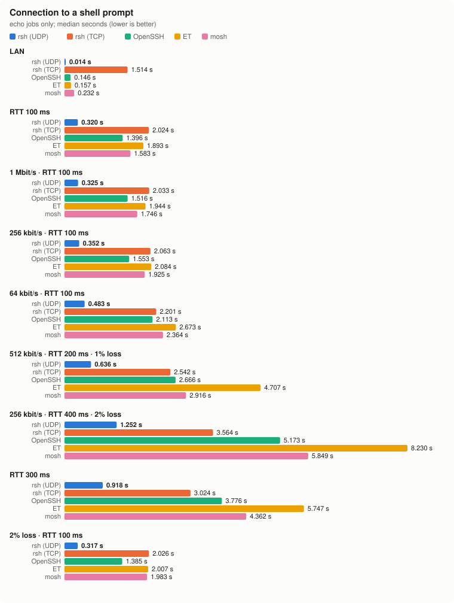
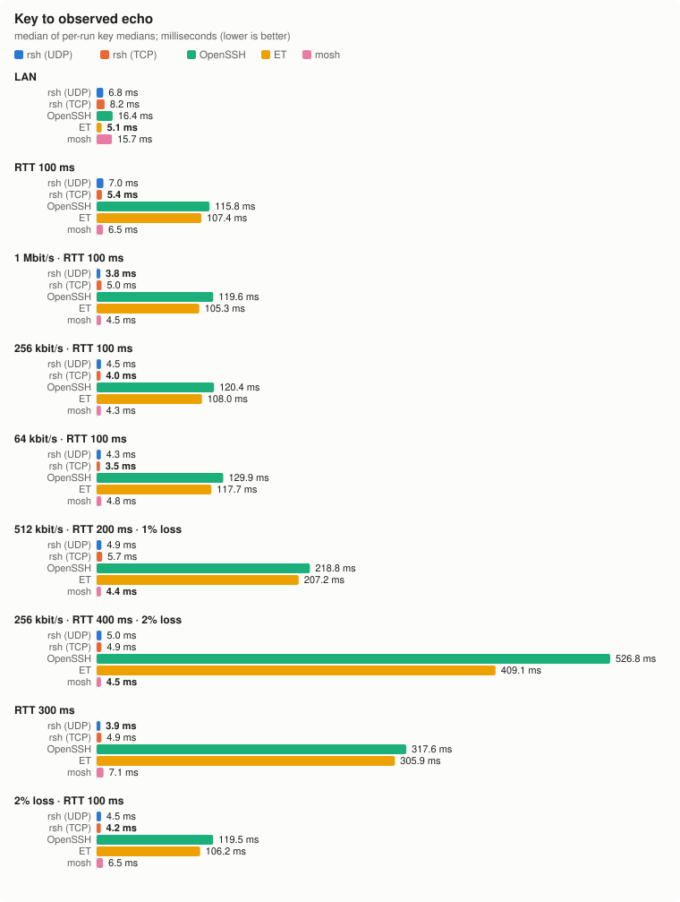
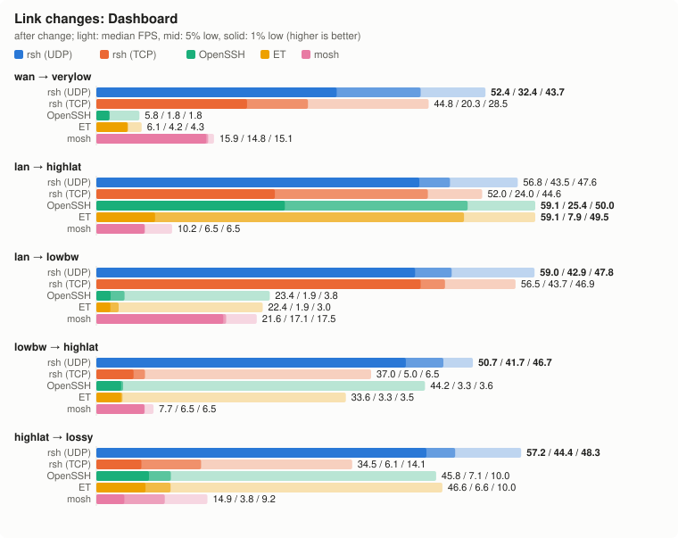
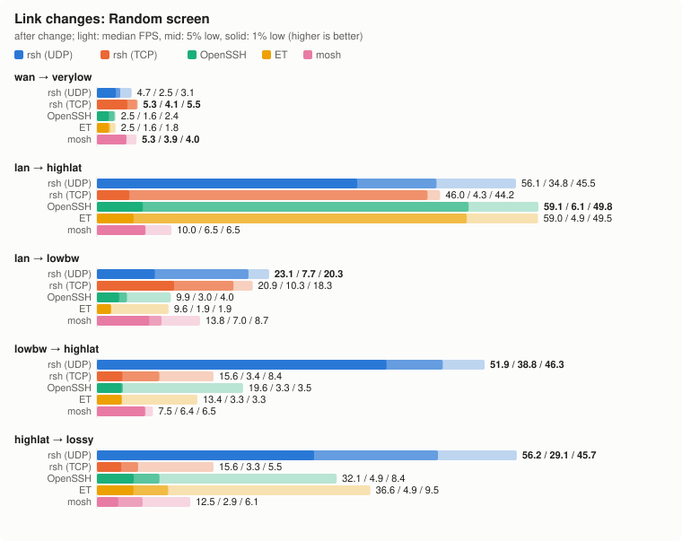
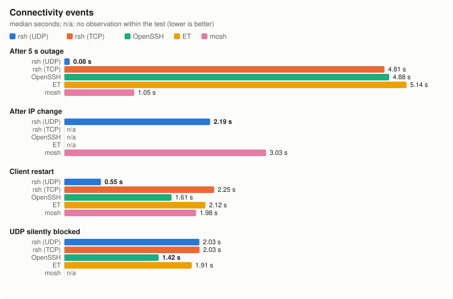
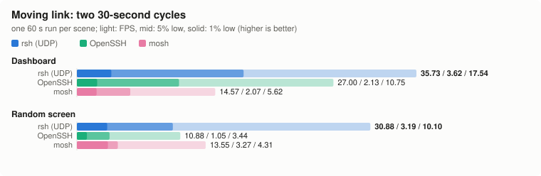

# Benchmark report

Recorded comparisons of rsh (UDP), rsh with UDP blocked (TCP fallback),
OpenSSH, Eternal Terminal (ET), and mosh. All tables and charts below are
generated from the [committed measurement snapshots](docs/bench/data).

## Measurement scope

| Dataset | Conditions | Samples | Version provenance |
| --- | --- | --- | --- |
| Static links, 2026-10-29 | Five transports; 100×30 terminal; requested 60 FPS; 8 s render window | Six render/switch attempts per case; three attempts per other case; two ten-session runs | Published 0.2.0, build `6729d398d4f1`; binary hash and versions recorded for all containers. |
| Moving link, 2026-10-29 | SSH/mosh/rsh; 158×43 viewer; requested 60 FPS; 60 s per scene | One run, two 30 s cycles per scene | Published 0.2.0, build `6729d398d4f1`. |

Both datasets were freshly measured on **2026-10-29**, using the published
**rsh 0.2.0** Linux arm64 binary, build `6729d398d4f1`. Its SHA-256 and
source build hash were verified before testing. The moving measurement
is reported separately because its window, screen size and impairment
semantics differ from the static tests.

### Environment and workloads

Apple M5 (10 cores, 32 GiB), macOS 27.0.1 (26A434), OrbStack Docker
29.8.2 with ten vCPUs and approximately 16 GiB assigned to the VM;
Linux `7.2.9-orbstack-00391-g2b298d05fbd4`, Ubuntu 24.04 arm64.
Measured packages: OpenSSH client/server `1:9.6p1-3ubuntu13.20`,
mosh `1.4.0-1ubuntu3`, ET `7.0.0-noble1`. The
[Dockerfile](benchmark/harness/Dockerfile) supplies the test environment;
the base image's older rsh was explicitly replaced on both ends of every
slot with the checksum-verified 0.2.0 binary.

Each job has a server/client container pair and an isolated shaped link;
jobs share host CPUs. Static batches used **four parallel jobs**, reduced from the old
snapshot's ten to limit host contention. This changes the historical host
load, so old/new differences alone cannot establish a code regression.
Other local containers remained running; host timing can still vary. `compress` is a compressible full-screen dashboard;
`bandwidth` changes every cell with random content. Both request 60 FPS.
SSH/ET frame headers are observed in the raw-output reader thread;
mosh/rsh headers are observed after pyte reconstructs screen differences
on another thread. Header arrival can precede the remaining cells, and
emulator scheduling contributes to the latter tools' measurements. This
does not measure GPU presentation or prove that every cell was repainted.

### Metrics and aggregation

- **Avg FPS** is the arithmetic mean of each run's displayed frames divided
  by its observation duration. **Median FPS** is the median of those run
  averages. The opening table shows both; FPS charts use the median.
- **1% / 5% low** are `1000 / p99(gap_ms)` and `1000 / p95(gap_ms)` using
  nearest-rank percentiles over available runs' inter-frame gaps pooled
  together. They are percentile reciprocals, not averages of the slowest
  one/five percent. Startup/end boundary gaps are excluded from lows.
- **Age** is the median of each run's median generation-to-observation
  time; it includes processing and queueing and is not RTT. Static windows
  begin at the first observed frame; late backlog is not drained into FPS.
- **Network** is received interface traffic at the client, in decimal
  kbit/s, including protocol overhead. KiB/frame is computed per run and
  then medianed. Packet counts include inbound and outbound interface
  traffic. These are not payload-only byte counts.
- **RSS** is a halfway-through-render sample, in MiB (KiB / 1024), medianed
  across runs; not peak RSS or PSS. Client and server are separate. Server
  process selection includes sshd's listener, ET's shared daemon and
  terminal, mosh-server, or rsh's shared serve process; shells are excluded.
- Other scalar values are medians of available results. Successful/total
  counts, timeouts and collection failures are preserved below. A missing
  observation is never a zero or proof of successful recovery.
- CPU is percent of one core over a render window, not total machine load.
  The collector's `torn` counter can double-count observations;
  it is not used as a count of visible defects in this report.

Metric implementations: [agent.py](benchmark/lab/agent.py),
[pooled lows and summaries](benchmark/lab/lab.py),
[original charts](benchmark/lab/charts.py), and
[report generator](benchmark/lab/report.py).

### Static network profiles

`tc netem` applies delay and independent random loss in both directions;
rate limits below apply server → client. RTT is the nominal delay total,
before queueing. No bandwidth cap means no configured rate limit.


| Profile | Conditions |
| --- | --- |
| lan | LAN |
| wan | RTT 100 ms |
| lowbw | 1 Mbit/s · RTT 100 ms |
| verylow | 256 kbit/s · RTT 100 ms |
| slow64k | 64 kbit/s · RTT 100 ms |
| mobile | 512 kbit/s · RTT 200 ms · 1% loss |
| badmobile | 256 kbit/s · RTT 400 ms · 2% loss |
| highlat | RTT 300 ms |
| lossy | 2% loss · RTT 100 ms |

## 1. Dashboard rendering

Light bars show median FPS, medium bars 5% low and solid bars 1% low.
All five transports and all nine network profiles are included; six runs per case were attempted.


| Link | Tool | Runs | Avg FPS | Median FPS | 1% low | 5% low | Age ms | RX kbit/s | Client RSS MiB | Server RSS MiB |
| --- | --- | --- | --- | --- | --- | --- | --- | --- | --- | --- |
| LAN | rsh (UDP) | 6 | 60.0 | 60.0 | 46.1 | 49.8 | 4 | 217 | 2.44 | 5.82 |
| LAN | rsh (TCP) | 6 | 59.9 | 60.0 | 46.3 | 50.3 | 3 | 227 | 2.56 | 5.21 |
| LAN | OpenSSH | 6 | 60.0 | 60.0 | 50.8 | 52.9 | 1 | 2482 | 7.37 | 18.40 |
| LAN | ET | 6 | 60.0 | 60.0 | 50.5 | 53.2 | 1 | 2439 | 17.62 | 14.93 |
| LAN | mosh | 6 | 46.4 | 46.5 | 37.5 | 41.3 | 10 | 235 | 15.42 | 10.54 |
| RTT 100 ms | rsh (UDP) | 6 | 60.0 | 60.0 | 43.5 | 47.6 | 55 | 217 | 2.44 | 5.20 |
| RTT 100 ms | rsh (TCP) | 6 | 56.2 | 56.2 | 43.5 | 47.4 | 60 | 224 | 2.59 | 5.46 |
| RTT 100 ms | OpenSSH | 6 | 60.0 | 60.0 | 45.7 | 50.3 | 52 | 2508 | 7.39 | 18.39 |
| RTT 100 ms | ET | 6 | 60.0 | 60.0 | 46.1 | 50.5 | 52 | 2465 | 18.08 | 15.27 |
| RTT 100 ms | mosh | 6 | 18.9 | 18.9 | 17.5 | 17.8 | 60 | 103 | 14.40 | 10.54 |
| 1 Mbit/s · RTT 100 ms | rsh (UDP) | 6 | 60.0 | 60.0 | 41.8 | 46.7 | 60 | 218 | 2.45 | 5.21 |
| 1 Mbit/s · RTT 100 ms | rsh (TCP) | 6 | 56.0 | 56.1 | 31.5 | 46.1 | 64 | 223 | 2.59 | 5.38 |
| 1 Mbit/s · RTT 100 ms | OpenSSH | 6 | 23.7 | 23.7 | 6.8 | 7.1 | 2542 | 976 | 7.51 | 19.22 |
| 1 Mbit/s · RTT 100 ms | ET | 6 | 23.9 | 23.9 | 6.8 | 8.0 | 2514 | 975 | 16.43 | 15.17 |
| 1 Mbit/s · RTT 100 ms | mosh | 6 | 17.9 | 18.0 | 16.8 | 17.1 | 66 | 98 | 14.36 | 10.48 |
| 256 kbit/s · RTT 100 ms | rsh (UDP) | 6 | 57.8 | 59.9 | 39.4 | 45.0 | 70 | 218 | 2.45 | 5.30 |
| 256 kbit/s · RTT 100 ms | rsh (TCP) | 6 | 38.3 | 39.9 | 25.9 | 27.8 | 69 | 161 | 2.57 | 5.42 |
| 256 kbit/s · RTT 100 ms | OpenSSH | 6 | 6.0 | 6.0 | 2.6 | 4.9 | 3783 | 248 | 7.39 | 19.36 |
| 256 kbit/s · RTT 100 ms | ET | 6 | 6.1 | 6.1 | 3.5 | 4.2 | 3762 | 249 | 18.07 | 14.59 |
| 256 kbit/s · RTT 100 ms | mosh | 6 | 15.7 | 15.7 | 14.1 | 14.9 | 82 | 87 | 14.37 | 10.43 |
| 64 kbit/s · RTT 100 ms | rsh (UDP) | 6 | 15.5 | 15.6 | 9.0 | 11.9 | 115 | 57 | 2.45 | 6.28 |
| 64 kbit/s · RTT 100 ms | rsh (TCP) | 6 | 15.4 | 15.4 | 7.2 | 12.4 | 176 | 63 | 2.57 | 5.43 |
| 64 kbit/s · RTT 100 ms | OpenSSH | 6 | 1.5 | 1.5 | 1.0 | 1.0 | 4386 | 62 | 7.38 | 19.33 |
| 64 kbit/s · RTT 100 ms | ET | 6 | 1.5 | 1.5 | 0.9 | 1.1 | 4642 | 61 | 18.05 | 14.11 |
| 64 kbit/s · RTT 100 ms | mosh | 6 | 10.3 | 10.3 | 7.5 | 9.2 | 153 | 59 | 14.55 | 10.42 |
| 512 kbit/s · RTT 200 ms · 1% loss | rsh (UDP) | 6 | 47.7 | 47.9 | 3.3 | 44.6 | 114 | 222 | 2.81 | 5.46 |
| 512 kbit/s · RTT 200 ms · 1% loss | rsh (TCP) | 6 | 34.1 | 34.9 | 3.5 | 16.5 | 117 | 163 | 2.77 | 5.38 |
| 512 kbit/s · RTT 200 ms · 1% loss | OpenSSH | 6 | 11.0 | 11.8 | 0.9 | 3.5 | 3816 | 500 | 7.69 | 19.51 |
| 512 kbit/s · RTT 200 ms · 1% loss | ET | 6 | 11.2 | 11.6 | 1.7 | 3.9 | 3286 | 496 | 17.38 | 14.23 |
| 512 kbit/s · RTT 200 ms · 1% loss | mosh | 6 | 9.1 | 9.1 | 8.6 | 8.9 | 121 | 50 | 14.34 | 10.40 |
| 256 kbit/s · RTT 400 ms · 2% loss | rsh (UDP) | 6 | 32.1 | 30.8 | 1.8 | 36.8 | 226 | 174 | 2.93 | 5.49 |
| 256 kbit/s · RTT 400 ms · 2% loss | rsh (TCP) | 5 | 14.6 | 14.7 | 1.5 | 3.4 | 237 | 123 | 2.80 | 6.16 |
| 256 kbit/s · RTT 400 ms · 2% loss | OpenSSH | 6 | 5.2 | 5.5 | 1.7 | 1.8 | 3882 | 249 | 7.52 | 19.33 |
| 256 kbit/s · RTT 400 ms · 2% loss | ET | 6 | 5.4 | 5.5 | 0.6 | 1.7 | 4386 | 246 | 16.10 | 14.08 |
| 256 kbit/s · RTT 400 ms · 2% loss | mosh | 6 | 4.3 | 4.3 | 1.2 | 4.6 | 233 | 25 | 14.34 | 10.36 |
| RTT 300 ms | rsh (UDP) | 6 | 59.9 | 60.0 | 42.7 | 47.2 | 155 | 217 | 2.44 | 5.24 |
| RTT 300 ms | rsh (TCP) | 6 | 54.6 | 54.7 | 33.4 | 46.5 | 161 | 218 | 2.63 | 5.43 |
| RTT 300 ms | OpenSSH | 6 | 60.0 | 60.0 | 23.4 | 47.8 | 152 | 2502 | 7.44 | 18.49 |
| RTT 300 ms | ET | 6 | 59.9 | 60.0 | 10.8 | 49.5 | 152 | 2464 | 15.94 | 15.26 |
| RTT 300 ms | mosh | 6 | 6.6 | 6.6 | 6.3 | 6.4 | 159 | 37 | 14.48 | 10.28 |
| 2% loss · RTT 100 ms | rsh (UDP) | 6 | 59.6 | 60.0 | 42.4 | 47.2 | 55 | 420 | 2.45 | 5.21 |
| 2% loss · RTT 100 ms | rsh (TCP) | 6 | 29.1 | 29.6 | 5.9 | 12.2 | 59 | 128 | 2.68 | 5.65 |
| 2% loss · RTT 100 ms | OpenSSH | 6 | 32.0 | 31.6 | 4.9 | 7.3 | 1782 | 1297 | 7.51 | 19.39 |
| 2% loss · RTT 100 ms | ET | 6 | 33.9 | 36.2 | 4.9 | 9.6 | 709 | 1486 | 18.19 | 14.94 |
| 2% loss · RTT 100 ms | mosh | 6 | 17.2 | 17.6 | 3.7 | 17.6 | 60 | 102 | 14.53 | 10.66 |

## 2. Random full-screen rendering

Every cell changes each frame. This workload compresses less effectively
and exposes a different bandwidth and frame-gap tradeoff than the dashboard.


| Link | Tool | Runs | Avg FPS | Median FPS | 1% low | 5% low | Age ms | RX kbit/s | Client RSS MiB | Server RSS MiB |
| --- | --- | --- | --- | --- | --- | --- | --- | --- | --- | --- |
| LAN | rsh (UDP) | 6 | 59.5 | 59.5 | 40.2 | 47.6 | 5 | 2668 | 2.45 | 5.40 |
| LAN | rsh (TCP) | 6 | 59.5 | 59.5 | 39.1 | 47.2 | 5 | 2717 | 2.60 | 5.22 |
| LAN | OpenSSH | 6 | 60.0 | 60.0 | 50.8 | 53.5 | 2 | 5781 | 7.38 | 18.40 |
| LAN | ET | 6 | 60.0 | 60.0 | 51.3 | 53.8 | 2 | 5720 | 18.09 | 16.78 |
| LAN | mosh | 6 | 46.2 | 46.2 | 37.6 | 41.2 | 11 | 2007 | 15.50 | 10.45 |
| RTT 100 ms | rsh (UDP) | 6 | 57.8 | 58.0 | 24.6 | 44.6 | 56 | 2682 | 2.56 | 5.30 |
| RTT 100 ms | rsh (TCP) | 6 | 50.7 | 54.9 | 26.6 | 29.7 | 63 | 2138 | 2.62 | 5.46 |
| RTT 100 ms | OpenSSH | 6 | 60.0 | 60.0 | 35.0 | 49.0 | 52 | 5796 | 7.47 | 18.44 |
| RTT 100 ms | ET | 6 | 60.0 | 60.0 | 12.9 | 49.0 | 52 | 5750 | 18.19 | 16.91 |
| RTT 100 ms | mosh | 6 | 18.8 | 18.9 | 17.1 | 17.7 | 62 | 816 | 14.43 | 10.43 |
| 1 Mbit/s · RTT 100 ms | rsh (UDP) | 6 | 24.1 | 24.1 | 13.2 | 20.4 | 100 | 931 | 2.46 | 5.44 |
| 1 Mbit/s · RTT 100 ms | rsh (TCP) | 6 | 20.2 | 19.8 | 10.3 | 17.8 | 97 | 800 | 2.57 | 5.42 |
| 1 Mbit/s · RTT 100 ms | OpenSSH | 6 | 10.1 | 10.1 | 6.2 | 6.7 | 3460 | 978 | 7.40 | 19.58 |
| 1 Mbit/s · RTT 100 ms | ET | 6 | 10.1 | 10.1 | 4.4 | 5.9 | 3226 | 979 | 17.16 | 15.02 |
| 1 Mbit/s · RTT 100 ms | mosh | 6 | 16.2 | 16.2 | 15.1 | 15.4 | 106 | 701 | 14.59 | 10.47 |
| 256 kbit/s · RTT 100 ms | rsh (UDP) | 6 | 6.1 | 6.0 | 2.6 | 5.5 | 220 | 244 | 2.46 | 6.29 |
| 256 kbit/s · RTT 100 ms | rsh (TCP) | 6 | 5.9 | 5.9 | 5.3 | 5.5 | 382 | 256 | 2.57 | 5.60 |
| 256 kbit/s · RTT 100 ms | OpenSSH | 6 | 2.5 | 2.5 | 1.2 | 1.5 | 3814 | 249 | 7.40 | 19.45 |
| 256 kbit/s · RTT 100 ms | ET | 6 | 2.6 | 2.5 | 1.2 | 1.3 | 3970 | 251 | 18.09 | 14.29 |
| 256 kbit/s · RTT 100 ms | mosh | 6 | 5.6 | 5.6 | 3.9 | 4.0 | 454 | 240 | 15.06 | 10.91 |
| 64 kbit/s · RTT 100 ms | rsh (UDP) | 6 | 1.4 | 1.4 | 1.1 | 1.2 | 534 | 64 | 2.44 | 5.46 |
| 64 kbit/s · RTT 100 ms | rsh (TCP) | 6 | 1.5 | 1.5 | 0.9 | 1.1 | 1224 | 63 | 2.57 | 5.69 |
| 64 kbit/s · RTT 100 ms | OpenSSH | 6 | 0.6 | 0.6 | 0.5 | 0.5 | 3880 | 61 | 7.38 | 19.43 |
| 64 kbit/s · RTT 100 ms | ET | 6 | 0.6 | 0.6 | 0.4 | 0.4 | 4738 | 62 | 18.07 | 13.98 |
| 64 kbit/s · RTT 100 ms | mosh | 6 | 1.5 | 1.5 | 1.5 | 1.5 | 3972 | 64 | 14.93 | 13.02 |
| 512 kbit/s · RTT 200 ms · 1% loss | rsh (UDP) | 6 | 10.2 | 10.1 | 2.7 | 5.1 | 186 | 434 | 2.55 | 5.42 |
| 512 kbit/s · RTT 200 ms · 1% loss | rsh (TCP) | 6 | 9.8 | 9.9 | 2.6 | 3.6 | 223 | 448 | 2.69 | 5.46 |
| 512 kbit/s · RTT 200 ms · 1% loss | OpenSSH | 6 | 4.6 | 4.7 | 0.7 | 3.0 | 3830 | 501 | 7.63 | 19.47 |
| 512 kbit/s · RTT 200 ms · 1% loss | ET | 6 | 5.1 | 5.2 | 0.9 | 2.6 | 3806 | 500 | 17.62 | 14.28 |
| 512 kbit/s · RTT 200 ms · 1% loss | mosh | 6 | 7.2 | 7.1 | 1.9 | 7.5 | 198 | 340 | 14.63 | 10.70 |
| 256 kbit/s · RTT 400 ms · 2% loss | rsh (UDP) | 6 | 4.2 | 4.0 | 1.0 | 1.6 | 370 | 196 | 2.69 | 5.74 |
| 256 kbit/s · RTT 400 ms · 2% loss | rsh (TCP) | 4 | 4.1 | 4.3 | 1.1 | 1.8 | 474 | 216 | 2.63 | 5.82 |
| 256 kbit/s · RTT 400 ms · 2% loss | OpenSSH | 6 | 2.3 | 2.3 | 0.6 | 1.0 | 4146 | 250 | 7.47 | 19.51 |
| 256 kbit/s · RTT 400 ms · 2% loss | ET | 6 | 2.4 | 2.5 | 0.5 | 1.0 | 4422 | 248 | 17.29 | 14.24 |
| 256 kbit/s · RTT 400 ms · 2% loss | mosh | 6 | 4.1 | 4.0 | 1.6 | 2.3 | 385 | 188 | 14.42 | 10.42 |
| RTT 300 ms | rsh (UDP) | 6 | 56.1 | 56.2 | 26.5 | 42.9 | 156 | 2709 | 2.57 | 5.46 |
| RTT 300 ms | rsh (TCP) | 6 | 49.4 | 49.2 | 15.0 | 44.2 | 164 | 1965 | 2.68 | 5.62 |
| RTT 300 ms | OpenSSH | 6 | 60.0 | 60.0 | 14.3 | 46.9 | 153 | 5795 | 7.82 | 18.63 |
| RTT 300 ms | ET | 6 | 60.0 | 60.0 | 4.0 | 49.3 | 153 | 5742 | 16.52 | 17.10 |
| RTT 300 ms | mosh | 6 | 6.6 | 6.6 | 6.3 | 6.4 | 161 | 282 | 14.32 | 10.19 |
| 2% loss · RTT 100 ms | rsh (UDP) | 6 | 57.1 | 57.5 | 24.1 | 44.8 | 56 | 5240 | 2.69 | 5.56 |
| 2% loss · RTT 100 ms | rsh (TCP) | 5 | 13.5 | 12.4 | 3.0 | 4.3 | 73 | 749 | 2.77 | 6.00 |
| 2% loss · RTT 100 ms | OpenSSH | 6 | 13.6 | 11.2 | 3.3 | 4.9 | 3205 | 1095 | 7.50 | 19.82 |
| 2% loss · RTT 100 ms | ET | 6 | 16.9 | 16.5 | 3.2 | 4.9 | 1570 | 1587 | 17.79 | 16.01 |
| 2% loss · RTT 100 ms | mosh | 6 | 14.9 | 14.6 | 3.7 | 6.1 | 62 | 794 | 14.45 | 10.90 |

## 3. Frame age


The rendering tables above include age for both scenes. The chart uses a log scale.

## 4. Network traffic and CPU


The render tables give RX kbit/s. Below: median per-run bytes/frame, packets/frame and CPU for each scene.

### Dashboard

| Link | Tool | RX KiB/frame | Packets in/frame | Packets out/frame | Client CPU % | Server CPU % |
| --- | --- | --- | --- | --- | --- | --- |
| lan | rsh (UDP) | 0.44 | 1.00 | 1.00 | 0.87 | 1.27 |
| lan | rsh (TCP) | 0.46 | 1.00 | 1.00 | 0.68 | 0.93 |
| lan | OpenSSH | 5.05 | 2.18 | 1.29 | 0.22 | 0.28 |
| lan | ET | 4.96 | 1.47 | 1.03 | 0.46 | 0.59 |
| lan | mosh | 0.62 | 1.00 | 0.20 | 1.08 | 2.40 |
| wan | rsh (UDP) | 0.44 | 1.00 | 0.99 | 0.97 | 1.33 |
| wan | rsh (TCP) | 0.49 | 1.10 | 1.00 | 0.73 | 2.53 |
| wan | OpenSSH | 5.10 | 3.16 | 1.53 | 0.21 | 0.23 |
| wan | ET | 5.02 | 2.45 | 1.95 | 0.33 | 0.48 |
| wan | mosh | 0.67 | 0.99 | 0.49 | 0.60 | 2.19 |
| lowbw | rsh (UDP) | 0.44 | 1.01 | 0.99 | 1.15 | 1.50 |
| lowbw | rsh (TCP) | 0.49 | 1.09 | 1.00 | 0.88 | 3.36 |
| lowbw | OpenSSH | 5.03 | 1.91 | 1.97 | 0.15 | 0.42 |
| lowbw | ET | 4.98 | 1.83 | 1.63 | 0.28 | 0.57 |
| lowbw | mosh | 0.67 | 0.99 | 0.50 | 0.64 | 2.36 |
| verylow | rsh (UDP) | 0.44 | 1.01 | 1.00 | 1.29 | 1.80 |
| verylow | rsh (TCP) | 0.49 | 1.16 | 1.00 | 0.94 | 3.08 |
| verylow | OpenSSH | 5.06 | 2.39 | 2.48 | 0.11 | 0.55 |
| verylow | ET | 4.98 | 1.89 | 1.74 | 0.29 | 0.61 |
| verylow | mosh | 0.68 | 1.00 | 0.50 | 0.69 | 2.83 |
| slow64k | rsh (UDP) | 0.45 | 1.06 | 1.03 | 0.53 | 2.21 |
| slow64k | rsh (TCP) | 0.50 | 1.38 | 1.02 | 0.56 | 2.07 |
| slow64k | OpenSSH | 5.09 | 3.27 | 3.63 | 0.06 | 0.54 |
| slow64k | ET | 4.92 | 2.40 | 2.50 | 0.32 | 0.67 |
| slow64k | mosh | 0.69 | 1.00 | 0.55 | 0.58 | 3.31 |
| mobile | rsh (UDP) | 0.59 | 1.32 | 1.10 | 1.32 | 2.33 |
| mobile | rsh (TCP) | 0.57 | 1.34 | 1.13 | 0.80 | 3.31 |
| mobile | OpenSSH | 5.13 | 2.50 | 2.78 | 0.17 | 0.86 |
| mobile | ET | 5.12 | 2.06 | 1.92 | 0.32 | 0.66 |
| mobile | mosh | 0.66 | 1.00 | 0.97 | 0.46 | 2.63 |
| badmobile | rsh (UDP) | 0.69 | 1.50 | 1.07 | 1.17 | 3.88 |
| badmobile | rsh (TCP) | 1.02 | 1.59 | 1.48 | 0.52 | 2.81 |
| badmobile | OpenSSH | 5.30 | 2.72 | 2.45 | 0.11 | 0.64 |
| badmobile | ET | 5.07 | 2.18 | 2.05 | 0.29 | 0.66 |
| badmobile | mosh | 0.70 | 1.06 | 1.00 | 0.27 | 2.55 |
| highlat | rsh (UDP) | 0.44 | 1.00 | 0.98 | 1.19 | 1.60 |
| highlat | rsh (TCP) | 0.49 | 1.07 | 0.99 | 0.90 | 3.28 |
| highlat | OpenSSH | 5.09 | 2.99 | 1.68 | 0.30 | 0.36 |
| highlat | ET | 5.01 | 2.34 | 1.77 | 0.46 | 0.70 |
| highlat | mosh | 0.68 | 0.98 | 0.97 | 0.29 | 2.13 |
| lossy | rsh (UDP) | 0.85 | 1.94 | 0.97 | 1.08 | 1.52 |
| lossy | rsh (TCP) | 0.54 | 1.33 | 1.12 | 0.56 | 2.27 |
| lossy | OpenSSH | 5.04 | 2.21 | 1.36 | 0.11 | 0.72 |
| lossy | ET | 5.02 | 2.06 | 1.21 | 0.22 | 0.40 |
| lossy | mosh | 0.71 | 1.10 | 0.54 | 0.54 | 2.09 |

### Random screen

| Link | Tool | RX KiB/frame | Packets in/frame | Packets out/frame | Client CPU % | Server CPU % |
| --- | --- | --- | --- | --- | --- | --- |
| lan | rsh (UDP) | 5.47 | 4.91 | 1.01 | 1.18 | 1.67 |
| lan | rsh (TCP) | 5.57 | 4.91 | 2.41 | 1.29 | 1.75 |
| lan | OpenSSH | 11.76 | 3.18 | 1.83 | 0.22 | 0.29 |
| lan | ET | 11.64 | 1.88 | 1.84 | 0.43 | 0.48 |
| lan | mosh | 5.30 | 4.99 | 0.20 | 2.56 | 4.19 |
| wan | rsh (UDP) | 5.64 | 5.07 | 1.01 | 1.32 | 1.77 |
| wan | rsh (TCP) | 4.76 | 4.10 | 2.01 | 1.27 | 5.38 |
| wan | OpenSSH | 11.79 | 3.33 | 1.84 | 0.21 | 0.22 |
| wan | ET | 11.71 | 2.96 | 1.99 | 0.32 | 0.43 |
| wan | mosh | 5.27 | 4.96 | 0.50 | 1.18 | 3.27 |
| lowbw | rsh (UDP) | 4.69 | 4.03 | 4.01 | 1.00 | 3.20 |
| lowbw | rsh (TCP) | 4.90 | 5.95 | 4.04 | 0.94 | 3.09 |
| lowbw | OpenSSH | 11.83 | 4.49 | 4.76 | 0.15 | 0.34 |
| lowbw | ET | 11.83 | 4.37 | 3.82 | 0.22 | 0.47 |
| lowbw | mosh | 5.28 | 4.98 | 0.50 | 1.37 | 4.03 |
| verylow | rsh (UDP) | 4.88 | 5.16 | 5.08 | 0.55 | 2.09 |
| verylow | rsh (TCP) | 5.30 | 8.38 | 7.15 | 0.63 | 1.94 |
| verylow | OpenSSH | 12.16 | 5.44 | 5.68 | 0.11 | 0.34 |
| verylow | ET | 11.97 | 4.51 | 4.24 | 0.23 | 0.55 |
| verylow | mosh | 5.23 | 4.93 | 0.98 | 0.78 | 4.88 |
| slow64k | rsh (UDP) | 5.35 | 11.25 | 11.19 | 0.34 | 1.52 |
| slow64k | rsh (TCP) | 5.13 | 7.90 | 5.43 | 0.18 | 1.47 |
| slow64k | OpenSSH | 12.41 | 6.75 | 6.25 | 0.06 | 0.29 |
| slow64k | ET | 12.41 | 5.42 | 5.50 | 0.30 | 0.65 |
| slow64k | mosh | 5.21 | 4.87 | 1.00 | 0.25 | 5.51 |
| mobile | rsh (UDP) | 5.07 | 4.40 | 4.07 | 0.77 | 2.48 |
| mobile | rsh (TCP) | 5.58 | 6.15 | 4.52 | 0.90 | 2.96 |
| mobile | OpenSSH | 13.24 | 6.00 | 6.49 | 0.12 | 0.35 |
| mobile | ET | 11.73 | 4.81 | 4.65 | 0.26 | 0.53 |
| mobile | mosh | 5.85 | 5.56 | 0.97 | 1.02 | 5.14 |
| badmobile | rsh (UDP) | 5.86 | 5.11 | 4.52 | 0.47 | 2.06 |
| badmobile | rsh (TCP) | 6.29 | 6.19 | 5.09 | 0.51 | 2.34 |
| badmobile | OpenSSH | 13.25 | 6.30 | 5.94 | 0.08 | 0.36 |
| badmobile | ET | 11.89 | 4.74 | 4.40 | 0.29 | 0.60 |
| badmobile | mosh | 5.66 | 5.46 | 0.99 | 0.70 | 5.54 |
| highlat | rsh (UDP) | 5.86 | 5.25 | 1.05 | 1.43 | 1.64 |
| highlat | rsh (TCP) | 4.86 | 4.13 | 2.07 | 1.28 | 5.24 |
| highlat | OpenSSH | 11.79 | 3.34 | 2.34 | 0.28 | 0.31 |
| highlat | ET | 11.68 | 2.82 | 1.86 | 0.38 | 0.56 |
| highlat | mosh | 5.22 | 4.98 | 1.06 | 0.44 | 2.88 |
| lossy | rsh (UDP) | 11.13 | 10.00 | 1.01 | 1.43 | 1.88 |
| lossy | rsh (TCP) | 7.26 | 5.56 | 3.95 | 0.67 | 3.09 |
| lossy | OpenSSH | 11.84 | 4.93 | 3.04 | 0.14 | 0.53 |
| lossy | ET | 11.84 | 4.68 | 2.87 | 0.26 | 0.49 |
| lossy | mosh | 6.62 | 6.23 | 0.52 | 1.10 | 3.85 |

## 5. Resident memory


Per-link RSS for both scenes is in sections 1–2. The chart pools the render samples across links and scenes.

### Ten simultaneous sessions


| Tool | Runs | All clients MiB | Server MiB | Idle packets in/s | Idle packets out/s |
| --- | --- | --- | --- | --- | --- |
| rsh (UDP) | 2 | 24.46 | 8.76 | 2.10 | 2.10 |
| OpenSSH | 2 | 73.71 | 148.17 | 0.00 | 0.00 |
| ET | 2 | 172.23 | 38.01 | 7.30 | 7.70 |
| mosh | 2 | 144.39 | 98.16 | 3.00 | 3.50 |

Each shell prints 3,000 lines, then becomes quiet. Packet rates are totals for the container's ten sessions. No rsh-TCP ten-session result was recorded.

## 6. Connection and key echo





| Link | Tool | Echo runs | Connect s | Echo ms | Echo max ms | Packets in/key | Packets out/key |
| --- | --- | --- | --- | --- | --- | --- | --- |
| lan | rsh (UDP) | 3/3 | 0.013 | 7.5 | 11.8 | 1.1 | 2.2 |
| lan | rsh (TCP) | 3/3 | 1.513 | 7.0 | 13.8 | 3.3 | 2.2 |
| lan | OpenSSH | 3/3 | 0.149 | 14.6 | 26.3 | 16.5 | 16.4 |
| lan | ET | 3/3 | 0.156 | 7.2 | 10.5 | 2.1 | 2.9 |
| lan | mosh | 3/3 | 0.238 | 16.9 | 20.4 | 2.3 | 2.2 |
| wan | rsh (UDP) | 3/3 | 0.322 | 6.8 | 112.8 | 1.4 | 2.5 |
| wan | rsh (TCP) | 3/3 | 2.029 | 4.8 | 107.5 | 3.3 | 2.3 |
| wan | OpenSSH | 3/3 | 1.427 | 120.1 | 129.7 | 20.7 | 21.2 |
| wan | ET | 3/3 | 1.945 | 106.8 | 110.9 | 1.3 | 2.4 |
| wan | mosh | 3/3 | 1.745 | 7.3 | 121.2 | 2.3 | 2.9 |
| lowbw | rsh (UDP) | 3/3 | 0.324 | 7.2 | 111.3 | 1.3 | 2.3 |
| lowbw | rsh (TCP) | 3/3 | 2.039 | 7.1 | 108.1 | 3.3 | 2.3 |
| lowbw | OpenSSH | 3/3 | 1.464 | 116.8 | 127.3 | 20.8 | 21.5 |
| lowbw | ET | 3/3 | 1.966 | 107.4 | 113.2 | 1.3 | 2.4 |
| lowbw | mosh | 3/3 | 1.660 | 8.3 | 122.8 | 2.3 | 2.8 |
| verylow | rsh (UDP) | 3/3 | 0.357 | 7.2 | 114.0 | 1.4 | 2.4 |
| verylow | rsh (TCP) | 3/3 | 2.070 | 7.2 | 114.2 | 3.5 | 2.7 |
| verylow | OpenSSH | 3/3 | 1.573 | 119.7 | 127.3 | 21.7 | 24.3 |
| verylow | ET | 3/3 | 2.139 | 110.6 | 116.2 | 1.2 | 2.4 |
| verylow | mosh | 3/3 | 1.797 | 7.5 | 129.3 | 2.3 | 2.5 |
| slow64k | rsh (UDP) | 3/3 | 0.479 | 7.5 | 130.3 | 1.3 | 2.3 |
| slow64k | rsh (TCP) | 3/3 | 2.209 | 7.0 | 135.3 | 3.5 | 2.6 |
| slow64k | OpenSSH | 3/3 | 2.159 | 130.3 | 136.9 | 22.2 | 22.2 |
| slow64k | ET | 3/3 | 2.717 | 118.7 | 122.5 | 1.2 | 2.4 |
| slow64k | mosh | 3/3 | 2.410 | 7.8 | 142.7 | 2.3 | 2.1 |
| mobile | rsh (UDP) | 3/3 | 0.638 | 7.3 | 213.9 | 1.7 | 2.2 |
| mobile | rsh (TCP) | 3/3 | 2.544 | 7.2 | 215.2 | 3.4 | 2.6 |
| mobile | OpenSSH | 3/3 | 2.677 | 236.0 | 437.2 | 26.8 | 35.0 |
| mobile | ET | 3/3 | 3.751 | 208.6 | 413.2 | 1.4 | 2.3 |
| mobile | mosh | 3/3 | 3.171 | 7.4 | 309.6 | 2.2 | 2.7 |
| badmobile | rsh (UDP) | 3/3 | 1.259 | 7.2 | 420.2 | 1.5 | 2.3 |
| badmobile | rsh (TCP) | 3/3 | 3.572 | 5.5 | 418.8 | 3.7 | 2.8 |
| badmobile | OpenSSH | 3/3 | 5.189 | 512.5 | 860.0 | 27.9 | 31.3 |
| badmobile | ET | 3/3 | 7.253 | 410.3 | 417.0 | 1.0 | 2.2 |
| badmobile | mosh | 3/3 | 5.956 | 8.0 | 598.5 | 1.4 | 1.9 |
| highlat | rsh (UDP) | 3/3 | 0.928 | 7.2 | 313.4 | 1.5 | 2.4 |
| highlat | rsh (TCP) | 3/3 | 3.033 | 7.4 | 312.8 | 2.9 | 2.6 |
| highlat | OpenSSH | 3/3 | 3.792 | 317.6 | 329.5 | 31.0 | 31.7 |
| highlat | ET | 3/3 | 5.322 | 306.3 | 312.7 | 1.0 | 2.2 |
| highlat | mosh | 3/3 | 4.052 | 7.7 | 396.2 | 1.8 | 2.2 |
| lossy | rsh (UDP) | 3/3 | 0.329 | 5.3 | 108.2 | 1.4 | 2.3 |
| lossy | rsh (TCP) | 3/3 | 2.030 | 5.8 | 109.3 | 3.4 | 2.8 |
| lossy | OpenSSH | 3/3 | 1.377 | 120.4 | 160.3 | 21.1 | 23.3 |
| lossy | ET | 3/3 | 1.912 | 108.9 | 111.6 | 1.6 | 2.7 |
| lossy | mosh | 3/3 | 1.708 | 7.1 | 125.4 | 2.3 | 2.8 |

Ten keys per run. Echo includes predictive local output for mosh/rsh. Connection times come from these same echo jobs, including their startup path; they are not a new dedicated cold-install test.

## 7. Bulk output


| Link | Tool | Completed | Completion s | 30 s timeouts | Errors | Terminal bytes |
| --- | --- | --- | --- | --- | --- | --- |
| lan | rsh (UDP) | 3/3 | 0.06 | 0 | 0 | 690955 |
| lan | rsh (TCP) | 3/3 | 0.08 | 0 | 0 | 692227 |
| lan | OpenSSH | 3/3 | 0.05 | 0 | 0 | 688960 |
| lan | ET | 3/3 | 0.07 | 0 | 0 | 688960 |
| lan | mosh | 3/3 | 0.06 | 0 | 0 | 687 |
| wan | rsh (UDP) | 3/3 | 0.15 | 0 | 0 | 4058 |
| wan | rsh (TCP) | 3/3 | 0.15 | 0 | 0 | 4105 |
| wan | OpenSSH | 3/3 | 0.60 | 0 | 0 | 688960 |
| wan | ET | 3/3 | 1.13 | 0 | 0 | 688960 |
| wan | mosh | 3/3 | 0.21 | 0 | 0 | 469 |
| lowbw | rsh (UDP) | 3/3 | 0.16 | 0 | 0 | 4115 |
| lowbw | rsh (TCP) | 3/3 | 0.16 | 0 | 0 | 4110 |
| lowbw | OpenSSH | 3/3 | 6.02 | 0 | 0 | 688960 |
| lowbw | ET | 3/3 | 5.94 | 0 | 0 | 688960 |
| lowbw | mosh | 3/3 | 0.19 | 0 | 0 | 470 |
| verylow | rsh (UDP) | 3/3 | 0.16 | 0 | 0 | 4079 |
| verylow | rsh (TCP) | 3/3 | 0.16 | 0 | 0 | 2814 |
| verylow | OpenSSH | 3/3 | 23.11 | 0 | 0 | 688960 |
| verylow | ET | 3/3 | 22.74 | 0 | 0 | 688960 |
| verylow | mosh | 3/3 | 0.22 | 0 | 0 | 571 |
| slow64k | rsh (UDP) | 3/3 | 0.19 | 0 | 0 | 3141 |
| slow64k | rsh (TCP) | 3/3 | 0.24 | 0 | 0 | 2787 |
| slow64k | OpenSSH | 0/3 | — | 3 | 0 | 215813 |
| slow64k | ET | 0/3 | — | 3 | 0 | 212074 |
| slow64k | mosh | 3/3 | 0.25 | 0 | 0 | 468 |
| mobile | rsh (UDP) | 3/3 | 0.25 | 0 | 0 | 4058 |
| mobile | rsh (TCP) | 3/3 | 0.47 | 0 | 0 | 23257 |
| mobile | OpenSSH | 3/3 | 11.66 | 0 | 0 | 688960 |
| mobile | ET | 3/3 | 11.56 | 0 | 0 | 688960 |
| mobile | mosh | 3/3 | 0.33 | 0 | 0 | 549 |
| badmobile | rsh (UDP) | 3/3 | 0.46 | 0 | 0 | 2782 |
| badmobile | rsh (TCP) | 3/3 | 0.96 | 0 | 0 | 2731 |
| badmobile | OpenSSH | 3/3 | 23.46 | 0 | 0 | 688960 |
| badmobile | ET | 3/3 | 23.05 | 0 | 0 | 688960 |
| badmobile | mosh | 3/3 | 0.64 | 0 | 0 | 462 |
| highlat | rsh (UDP) | 3/3 | 0.35 | 0 | 0 | 2814 |
| highlat | rsh (TCP) | 3/3 | 0.36 | 0 | 0 | 2809 |
| highlat | OpenSSH | 3/3 | 1.51 | 0 | 0 | 688960 |
| highlat | ET | 3/3 | 2.12 | 0 | 0 | 688960 |
| highlat | mosh | 3/3 | 0.50 | 0 | 0 | 615 |
| lossy | rsh (UDP) | 3/3 | 0.15 | 0 | 0 | 4115 |
| lossy | rsh (TCP) | 3/3 | 0.13 | 0 | 0 | 3148 |
| lossy | OpenSSH | 3/3 | 1.12 | 0 | 0 | 688960 |
| lossy | ET | 3/3 | 4.39 | 0 | 0 | 688960 |
| lossy | mosh | 3/3 | 0.21 | 0 | 0 | 471 |

Completion is the marker after `seq 1 100000`, watched for 30 s. When a case is mixed, completion time covers only completed runs; the counts remain explicit. mosh and rsh may skip intermediate output, so prompt recovery does not imply delivery of the complete byte stream.

## 8. Link changes

Each scene runs two seconds on the first link and eight seconds after the change. FPS before/after is medianed; post-change lows pool only post-change inter-frame gaps. Adaptation is the first whole-second bucket reaching 90% of that tool's own settled FPS, not time to recover 60 FPS.

### Dashboard



| Change | Tool | Runs | FPS before | FPS after | 1% low after | 5% low after | Age after ms | Adapt s |
| --- | --- | --- | --- | --- | --- | --- | --- | --- |
| wan → verylow | rsh (UDP) | 6/6 | 58.5 | 52.7 | 33.8 | 42.9 | 76 | 1.0 |
| wan → verylow | rsh (TCP) | 6/6 | 54.6 | 35.0 | 25.4 | 27.7 | 70 | 0.0 |
| wan → verylow | OpenSSH | 6/6 | 58.8 | 5.9 | 1.8 | 2.1 | 3648 | 2.0 |
| wan → verylow | ET | 6/6 | 59.0 | 6.1 | 1.8 | 4.2 | 3715 | 2.0 |
| wan → verylow | mosh | 6/6 | 18.6 | 15.6 | 14.7 | 15.0 | 83 | 0.0 |
| lan → highlat | rsh (UDP) | 6/6 | 59.2 | 56.7 | 43.3 | 47.2 | 155 | 1.0 |
| lan → highlat | rsh (TCP) | 6/6 | 59.2 | 51.8 | 24.6 | 46.3 | 160 | 1.0 |
| lan → highlat | OpenSSH | 6/6 | 58.8 | 59.2 | 25.4 | 50.3 | 152 | 1.0 |
| lan → highlat | ET | 6/6 | 59.0 | 59.0 | 6.0 | 50.0 | 152 | 1.0 |
| lan → highlat | mosh | 6/6 | 45.8 | 9.9 | 6.4 | 6.5 | 161 | 0.0 |
| lan → lowbw | rsh (UDP) | 6/6 | 59.0 | 59.0 | 41.3 | 47.2 | 60 | 1.0 |
| lan → lowbw | rsh (TCP) | 6/6 | 59.3 | 56.0 | 44.4 | 47.6 | 64 | 0.0 |
| lan → lowbw | OpenSSH | 6/6 | 59.0 | 23.1 | 1.9 | 3.8 | 2586 | 0.5 |
| lan → lowbw | ET | 6/6 | 59.2 | 22.9 | 1.9 | 3.1 | 2568 | 1.0 |
| lan → lowbw | mosh | 6/6 | 45.8 | 21.4 | 17.0 | 17.4 | 66 | 0.0 |
| lowbw → highlat | rsh (UDP) | 6/6 | 58.9 | 53.2 | 42.0 | 46.7 | 156 | 1.0 |
| lowbw → highlat | rsh (TCP) | 6/6 | 49.2 | 38.5 | 5.3 | 6.9 | 162 | 2.5 |
| lowbw → highlat | OpenSSH | 6/6 | 23.3 | 45.7 | 3.5 | 3.7 | 3062 | 3.0 |
| lowbw → highlat | ET | 6/6 | 23.4 | 34.6 | 3.5 | 3.6 | 2138 | 3.0 |
| lowbw → highlat | mosh | 6/6 | 18.1 | 7.5 | 6.4 | 6.5 | 161 | 0.0 |
| highlat → lossy | rsh (UDP) | 6/6 | 58.8 | 56.4 | 40.3 | 46.7 | 55 | 1.0 |
| highlat → lossy | rsh (TCP) | 6/6 | 50.8 | 29.3 | 5.7 | 11.9 | 57 | 0.0 |
| highlat → lossy | OpenSSH | 6/6 | 58.8 | 43.0 | 6.5 | 9.9 | 168 | 0.0 |
| highlat → lossy | ET | 6/6 | 58.4 | 48.3 | 7.2 | 11.9 | 122 | 0.0 |
| highlat → lossy | mosh | 6/6 | 6.7 | 13.4 | 3.0 | 8.0 | 61 | 3.0 |

### Random screen



| Change | Tool | Runs | FPS before | FPS after | 1% low after | 5% low after | Age after ms | Adapt s |
| --- | --- | --- | --- | --- | --- | --- | --- | --- |
| wan → verylow | rsh (UDP) | 6/6 | 52.0 | 3.8 | 0.9 | 3.0 | 226 | 2.0 |
| wan → verylow | rsh (TCP) | 6/6 | 50.0 | 5.5 | 3.9 | 5.5 | 418 | 1.0 |
| wan → verylow | OpenSSH | 6/6 | 59.1 | 2.5 | 1.4 | 2.2 | 7086 | 5.0 |
| wan → verylow | ET | 6/6 | 59.1 | 0.4 | 1.5 | 1.9 | 7515 | 5.0 |
| wan → verylow | mosh | 6/6 | 18.5 | 5.3 | 3.9 | 4.0 | 948 | 1.0 |
| lan → highlat | rsh (UDP) | 6/6 | 59.0 | 56.2 | 32.9 | 46.3 | 156 | 1.0 |
| lan → highlat | rsh (TCP) | 6/6 | 59.0 | 45.5 | 4.1 | 44.8 | 163 | 2.0 |
| lan → highlat | OpenSSH | 6/6 | 59.1 | 59.2 | 3.8 | 49.3 | 153 | 1.0 |
| lan → highlat | ET | 6/6 | 59.0 | 59.1 | 12.6 | 49.0 | 153 | 1.0 |
| lan → highlat | mosh | 6/6 | 45.8 | 10.0 | 6.4 | 6.5 | 162 | 0.0 |
| lan → lowbw | rsh (UDP) | 6/6 | 59.1 | 23.1 | 7.5 | 19.6 | 101 | 1.0 |
| lan → lowbw | rsh (TCP) | 6/6 | 59.2 | 21.2 | 10.3 | 18.0 | 99 | 0.0 |
| lan → lowbw | OpenSSH | 6/6 | 59.1 | 9.6 | 2.3 | 3.9 | 3464 | 0.0 |
| lan → lowbw | ET | 6/6 | 59.2 | 10.0 | 1.9 | 1.9 | 3424 | 1.0 |
| lan → lowbw | mosh | 6/6 | 45.5 | 13.5 | 6.9 | 8.3 | 109 | 0.0 |
| lowbw → highlat | rsh (UDP) | 6/6 | 23.6 | 51.9 | 29.5 | 46.5 | 157 | 1.5 |
| lowbw → highlat | rsh (TCP) | 6/6 | 19.6 | 15.6 | 3.6 | 8.0 | 159 | 4.0 |
| lowbw → highlat | OpenSSH | 6/6 | 9.9 | 18.5 | 3.3 | 3.6 | 4068 | 3.0 |
| lowbw → highlat | ET | 6/6 | 9.9 | 14.8 | 3.3 | 3.5 | 2236 | 2.0 |
| lowbw → highlat | mosh | 6/6 | 16.5 | 7.5 | 6.4 | 6.5 | 164 | 0.0 |
| highlat → lossy | rsh (UDP) | 6/6 | 47.5 | 55.5 | 32.2 | 46.3 | 56 | 1.0 |
| highlat → lossy | rsh (TCP) | 6/6 | 32.8 | 18.1 | 3.6 | 5.6 | 64 | 0.5 |
| highlat → lossy | OpenSSH | 6/6 | 59.0 | 32.8 | 5.5 | 9.5 | 214 | 0.0 |
| highlat → lossy | ET | 6/6 | 31.6 | 41.0 | 5.0 | 9.7 | 1058 | 0.5 |
| highlat → lossy | mosh | 6/6 | 6.7 | 12.1 | 2.9 | 5.9 | 63 | 3.0 |

## 9. Outage, roaming, reattachment and UDP block

Three runs each on RTT 100 ms. Outage is five seconds; roaming is watched for eight seconds. Reattachment restarts the client. UDP-block connection is watched for 15 seconds.



| Event | Tool | Observed | Time s | Same shell | Errors |
| --- | --- | --- | --- | --- | --- |
| After 5 s outage | rsh (UDP) | 3/3 | 0.08 | — | 0 |
| After 5 s outage | rsh (TCP) | 3/3 | 4.81 | — | 0 |
| After 5 s outage | OpenSSH | 3/3 | 4.88 | — | 0 |
| After 5 s outage | ET | 3/3 | 5.14 | — | 0 |
| After 5 s outage | mosh | 3/3 | 1.05 | — | 0 |
| After IP change | rsh (UDP) | 3/3 | 2.19 | — | 0 |
| After IP change | rsh (TCP) | 0/3 | — | — | 0 |
| After IP change | OpenSSH | 0/3 | — | — | 0 |
| After IP change | ET | 0/3 | — | — | 0 |
| After IP change | mosh | 3/3 | 3.03 | — | 0 |
| Client restart | rsh (UDP) | 3/3 | 0.55 | 3/3 | 0 |
| Client restart | rsh (TCP) | 3/3 | 2.25 | 3/3 | 0 |
| Client restart | OpenSSH | 3/3 | 1.61 | 0/3 | 0 |
| Client restart | ET | 3/3 | 2.12 | 0/3 | 0 |
| Client restart | mosh | 3/3 | 1.98 | 0/3 | 0 |
| UDP silently blocked | rsh (UDP) | 3/3 | 2.03 | — | 0 |
| UDP silently blocked | rsh (TCP) | 3/3 | 2.03 | — | 0 |
| UDP silently blocked | OpenSSH | 3/3 | 1.42 | — | 0 |
| UDP silently blocked | ET | 3/3 | 1.91 | — | 0 |
| UDP silently blocked | mosh | 0/3 | — | — | 3 |

Restart time alone does not establish session continuity: see Same shell. A missing roaming response within eight seconds is a censored observation, not a measured infinite recovery time. All three UDP-block mosh jobs reported no prompt, consistent with its UDP-only transport.

## 10. Moving network

This is a fresh 0.2.0 measurement, not pooled into the static comparison. Three independent links replay a common delay/rate/outage schedule on the Docker VM clock. Each 60 s scene contains two 30 s cycles. Nominal loss fractions are shared intervals of complete outage, unlike static independent per-packet random loss. A controlled 158×43 PTY attaches to tmux and continuously drains its output to a file; there is no on-screen GPU presentation measurement.

| Moving tool | Workload columns | Workload rows |
| --- | --- | --- |
| OpenSSH | 52 | 41 |
| mosh | 52 | 41 |
| rsh (UDP) | 52 | 41 |

| Cycle seconds | Phase | One-way delay / jitter ms | Outage time % | Down kbit/s | Up kbit/s |
| --- | --- | --- | --- | --- | --- |
| 0–6 | clear signal | 35 ± 5 | 0.1 | 8000 | 2000 |
| 6–10 | congestion | 70 ± 20 | 0.8 | 2000 | 500 |
| 10–14 | weak signal | 160 ± 60 | 3 | 512 | 128 |
| 14–17 | deep fade | 300 ± 120 | 8 | 128 | 32 |
| 17–18 | handover: link down | 180 ± 60 | 100 | 128 | 32 |
| 18–23 | recovering | 90 ± 30 | 1 | 1000 | 250 |
| 23–30 | clear again | 40 ± 8 | 0.1 | 5000 | 1250 |

Delay jitter is sampled every 250 ms; the ± column gives the configured jitter parameter, not a hard bound. The committed trace includes exact scheduled values and actual application timestamps.



| Scene | Tool | Avg FPS | 1% low | 5% low | Age ms | Scene RX MiB | Reported KiB/frame | Client RSS MiB | Server RSS MiB |
| --- | --- | --- | --- | --- | --- | --- | --- | --- | --- |
| Dashboard | OpenSSH | 27.00 | 2.13 | 10.75 | 100 | 12.30 | 7.47 | 7.84 | 19.73 |
| Dashboard | mosh | 14.57 | 2.07 | 5.62 | 58 | 0.53 | 0.62 | 14.55 | 10.43 |
| Dashboard | rsh (UDP) | 35.73 | 3.62 | 17.54 | 55 | 1.34 | 0.64 | 2.87 | 4.88 |
| Random screen | OpenSSH | 10.88 | 1.05 | 3.44 | 54 | 8.90 | 13.75 | 8.10 | 19.70 |
| Random screen | mosh | 13.55 | 3.27 | 4.31 | 67 | 3.10 | 3.90 | 14.55 | 10.43 |
| Random screen | rsh (UDP) | 30.88 | 3.19 | 10.10 | 58 | 8.01 | 4.42 | 2.94 | 4.49 |

The demo's scene RX counters include warmup/drain outside the common FPS window; reported KiB/frame also uses the collector's broader frame count. They are preserved as recorded and must not be read as 60-second RX rates or compared directly with static KiB/frame. RSS uses the demo's recorded samples rather than a peak-memory trace.

Dashboard rsh averaged 58.4 / 58.6 FPS in the final five seconds of the two clear phases. Random screens averaged 54.4 / 56.4 FPS in those final windows. Maximum application skew between containers was 27.47 / 3.88 ms (dashboard/random). All figures in this paragraph are computed from the newly committed frame observations and replay timestamps.

## Collection failures and limitations

| Source | Test | Link | Scene | Tool | Iteration | Error |
| --- | --- | --- | --- | --- | --- | --- |
| run-20261029-161607 | udpblock | wan | — | mosh | 0 | no prompt |
| run-20261029-161607 | udpblock | wan | — | mosh | 1 | no prompt |
| run-20261029-161607 | udpblock | wan | — | mosh | 2 | no prompt |
| run-20261029-161607 | render | badmobile | bandwidth | rsh (TCP) | 2 | no prompt |
| run-20261029-161607 | render | lossy | bandwidth | rsh (TCP) | 0 | no prompt |
| run-20261029-163746 | render | badmobile | compress | rsh (TCP) | 0 | no prompt |
| run-20261029-163746 | render | badmobile | bandwidth | rsh (TCP) | 2 | no prompt |

Static render jobs: 536/540 measured; switch jobs: 300/300 measured. Other tests use the first main batch only, except the separate sessions batch. Collection failures: 7; expected mosh UDP-block no-prompt cases: 3. No failed job was silently converted to a numeric result.

Results cover synthetic isolated paths on one shared host, not fairness with cross traffic, real radio traces, independent hardware replications or statistical confidence intervals. Static nominal loss percentages do not guarantee equal realized drops across protocols. High average FPS can coexist with worse tails; compare the average and percentile columns separately. No universal win or non-regression claim is made.

## Data and reproduction

| Source run | Jobs | Used for | Original SHA-256 |
| --- | --- | --- | --- |
| run-20261029-161607.json | 750 | echo, flood, outage, reattach, render, roam, switch, udpblock | 28c70957b6e0e628149610aef179fb929356b6df3875dabedea7c248593df6d0 |
| run-20261029-163746.json | 420 | render, switch | e3bbec2fac8b5626049c1015f1465ce2d06959761bfd8538667383cdf8a11752 |
| run-20261029-163908.json | 8 | sessions | a9405a2dec1dfccf00053d3f2ebe0e9d04415f3cbbf7eda583766e51356713e7 |

| Provenance | Value |
| --- | --- |
| rsh release | 0.2.0 |
| Build ID | 6729d398d4f1 |
| Binary SHA-256 | b2d2a572223c79f094a27d6476cd3e0dd0c2a163eb65913dac7b30e50b5bee23 |
| Source commit | fd9031cb576e2156a5907a49f572b8c01f622dab |
| Docker image ID | sha256:1ecf08a7a9e16518256711157b329e5705e1e212ceff5ccc9730e4d2c7ee440b |

The [static snapshot](docs/bench/data/static-20261029.json) contains all three batches, original options, per-job results, frame gaps and errors. The [moving snapshot](docs/bench/data/moving-20261029-release.json) includes all six results, raw frame observations, window timestamps, RSS/byte counters and the complete replay trace. SHA-256 fields identify the original local files; JSON is repackaged without changing measurement values. The [environment manifest](docs/bench/data/environment-20261029.json) records host/VM resources, image and package versions, original/executed harness hashes and the binary checks on both ends of every slot. The former [static](docs/bench/data/static-20261028.json) and [development moving](docs/bench/data/moving-20261029.json) snapshots remain available as historical data; they are not pooled into today's results.

Regenerate this report, the README tables and all charts from committed data:

```sh
python3 benchmark/lab/report.py
```

To reproduce the recorded workload and its four-job concurrency:

```sh
scripts/dist.sh
python3 benchmark/harness/run.py build
python3 benchmark/lab/lab.py run --tools ssh,et,mosh,rsh,rsh-tcp \
  --tests render,switch,echo,flood,outage,roam,reattach,udpblock \
  --nets lan,wan,lowbw,verylow,slow64k,highlat,lossy,mobile,badmobile \
  --switches lan:highlat,lan:lowbw,lowbw:highlat,highlat:lossy,wan:verylow \
  --scenes compress,bandwidth --fps 60 --duration 8 --iterations 3 \
  --cols 100 --rows 30 --parallel 4
# Repeat render,switch only with the same options for six screen samples.
python3 benchmark/lab/lab.py run --tools ssh,et,mosh,rsh \
  --tests sessions --sessions 10 --session-iterations 2 --nets lan --parallel 4
```

### Next full measurement

New performance measurements use **four parallel jobs** and **two evaluations
per case**, including sessions, for both development and publication. These
defaults reflect the host's four performance cores, without claiming physical
core affinity. Historical datasets remain separate. The recorded tables above
retain their actual four-job, six-screen-repeat conditions.
For the next measurement, run the static command above once with
`--iterations 2 --parallel 4`; omit the extra screen-only repeat. Run the sessions command
with `--session-iterations 2 --parallel 4`. This retains all five static
transports, nine links, both scenes and the same observation durations:
500 static jobs plus eight memory jobs, rather than 1,178 jobs.

The [twelve-worker validation](docs/bench/parallel12-20261029.md) completed
the same 750-job, three-repeat static batch in **11.02 minutes**, versus
**33.17 minutes** with four workers. The whole run through moving postflight
took **15.63 minutes**, versus **59.60 minutes** for the earlier 1,178-job
suite; this also includes fewer screen/memory repeats and stage gaps.
The earlier 14–15 minute estimate excluded preparation and review.
Mean FPS was close in all twelve lossless rsh UDP pairs under the report's
descriptive rule, but lows, lossy-path results and RSS were not identical.
The comparison uses the first three-repeat baseline batch, and moving
remains a separate three-link test rather than a twelve-worker load test.

Use a freshly built image or pass `--rsh /path/to/verified/rsh-linux-aarch64`
to replace an older embedded binary. The committed snapshot records the
actual image ID, binary SHA-256, package versions, source commit and harness
checksums. Moving demos need a 158×43 viewer to reproduce the recorded
layout; the three workload panes are narrower than the viewer:

```sh
python3 benchmark/lab/lab.py demo --tools ssh,mosh,rsh --events '' \
  --nets moving --scenes compress,bandwidth --fps 60 --duration 60
```

## Development investigations

The [TCP low-tail investigation](docs/bench/lowtail-20261031.md), begun
2026-10-31 with November 1 follow-ups, reports separate four-worker,
two-evaluation core, static low-bandwidth and ThinLTO screens. Per-repetition
FPS/lows, received traffic, CPU, age and sampled client/server RSS remain
visible. All three candidates remain unselected: transit improved dashboards
but retained tail deficits, freshness-quarter had an adverse core repeat, and
ThinLTO did not establish a runtime improvement. November 1 uses CPU<30% at
admission with runtime load recorded as context. These experiments are separate
from the [TCP batch candidate](docs/bench/tcp-batch-20261030.md) and do not
replace the published full-suite measurements above.

## References

The [README references](README.md#references) identify the papers and
protocol specifications considered for rsh's sender/receiver design,
with links to the corresponding implementation. Those publications do
not supply the measurements in this report. The benchmark uses its own
Docker/netem/terminal collector described above.
