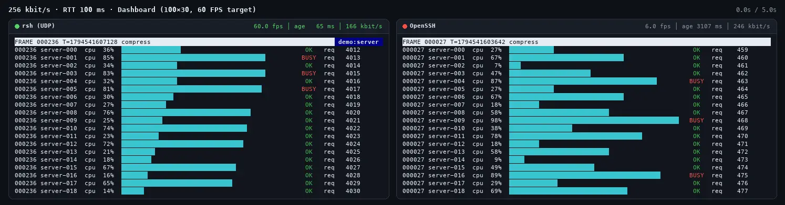
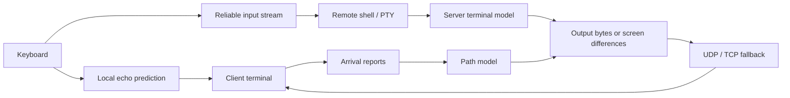
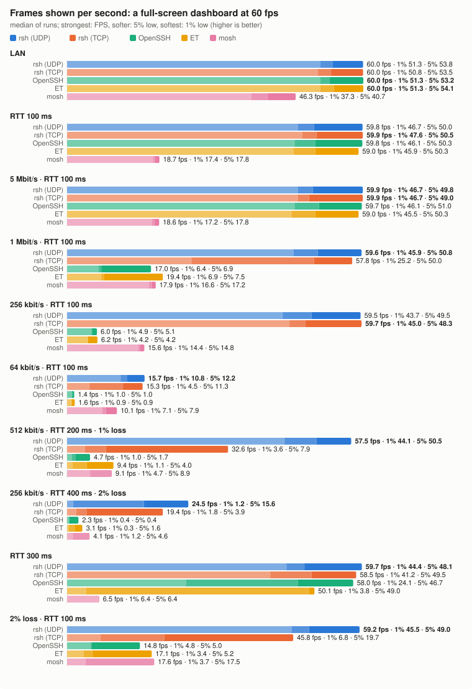
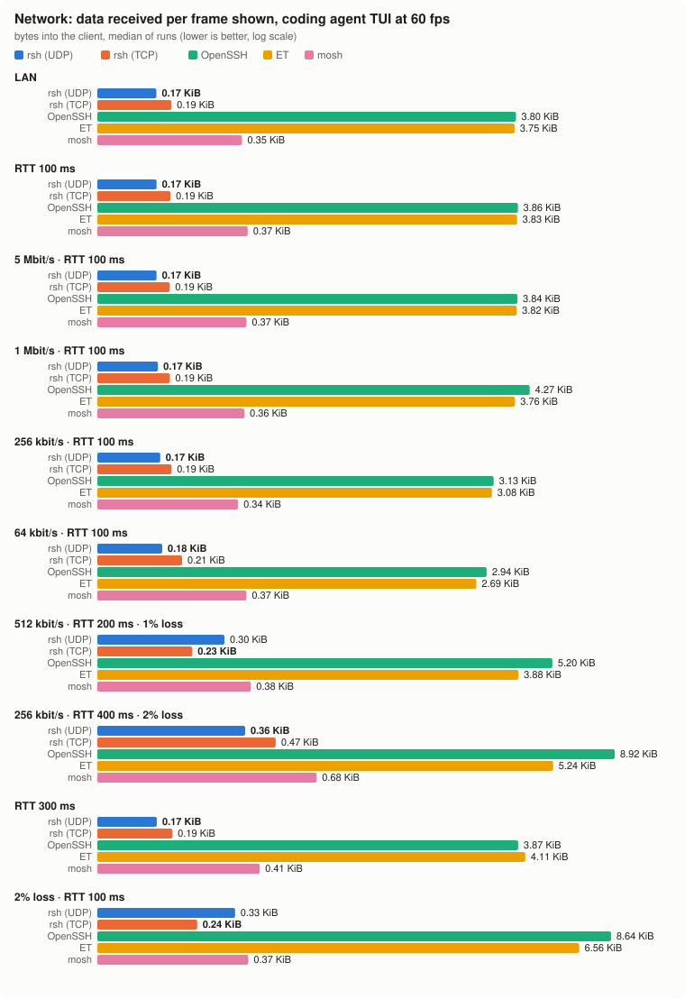
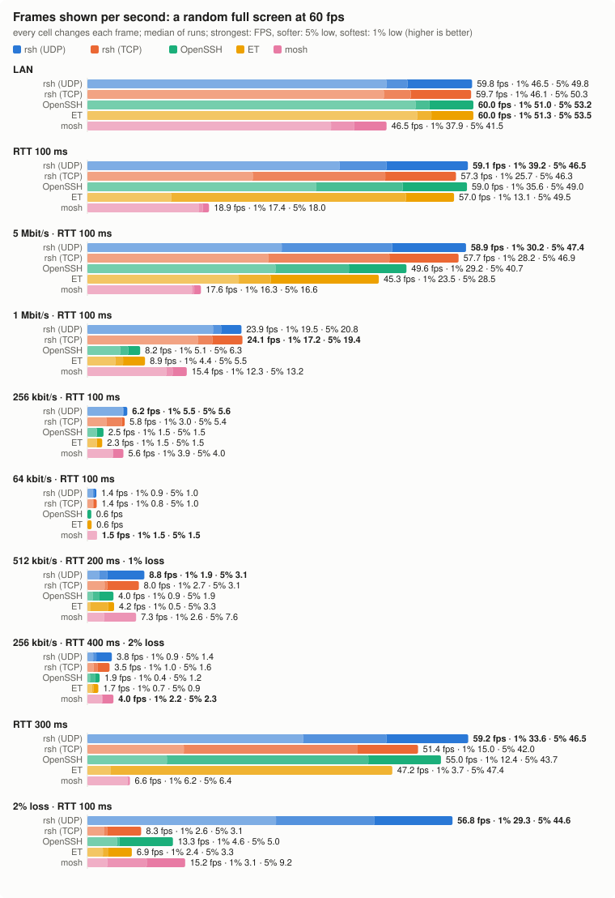
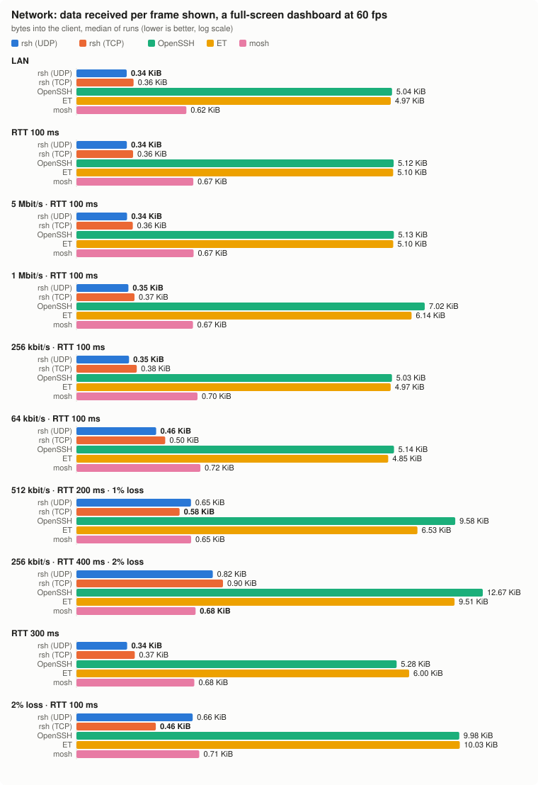
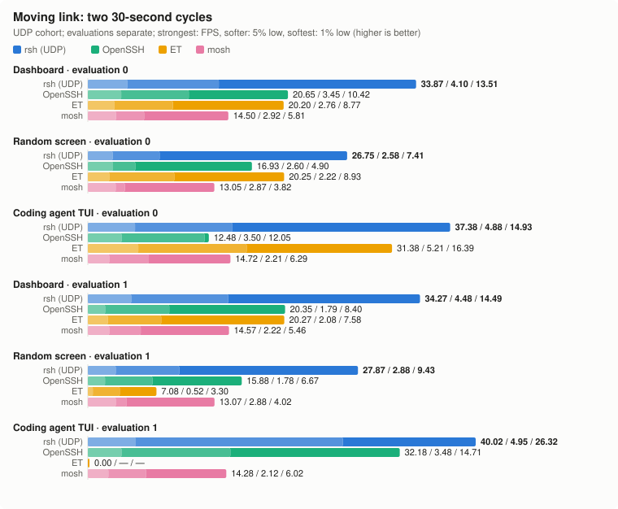

<p align="center">
  
</p>

<h1 align="center">rsh</h1>

<p align="center">
  <a href="https://github.com/enif-lee/rsh/releases/latest"></a>
  <a href="#installation"></a>
  <a href="#how-it-works"></a>
</p>

<p align="center"><strong>The most efficient and reliable remote shell.</strong></p>

rsh keeps your shell on the server so you can detach, reconnect, or change
networks and return to the same session. It predicts keystrokes locally,
adapts output to the available link, and sends the current screen when
sending every byte would leave you behind.

rsh supports Linux and macOS on x86_64 and arm64. It uses UDP with TCP
fallback on the same port.

<!-- benchmark-summary:start -->
### Performance at a glance

**A 256 kbit/s link at RTT 100 ms**, requesting 60 FPS in a 100×30 terminal
(coding agent KiB/frame row on LAN where every stream transport delivers full
rate; memory row with ten simultaneous idle LAN sessions). Four jobs run in
parallel; each case has two evaluations. Buffered catch-up bursts are excluded
and FPS is capped at the requested 60 FPS ceiling.



Five seconds of that dashboard, played back at 24 FPS. rsh keeps the requested
rate and a frame age near one round trip; OpenSSH falls to a few frames a
second and the picture is several seconds old. The counters above each pane
are that capture's own one-second window.

| Measurement | **rsh (UDP)** | **vs SSH** | mosh | OpenSSH | Eternal Terminal |
| --- | --- | --- | --- | --- | --- |
| Dashboard observed FPS (average) | **59.5** | **9.83×** | 15.6 | 6.0 | 6.2 |
| 1% / 5% low FPS | **43.7 / 49.5** | **8.97× / 9.74×** | 14.4 / 14.8 | 4.9 / 5.1 | 4.2 / 4.2 |
| Frame age, ms | **64** | **-98%** | 83 | 3808 | 3818 |
| Received network, kbit/s | **170** | **-32%** | 90 | 250 | 250 |
| Packets per frame (in + out) | **2.03** | **-55%** | 1.68 | 4.47 | 3.78 |
| Coding agent TUI RX, KiB/frame (LAN) | **0.17** | **-96%** | 0.35 | 3.80 | 3.75 |
| Key echo, ms | **7** | **-94%** | 8 | 120 | 109 |
| Bulk output to prompt, s | **0.15** | **-99%** | 0.23 | 23.25 | 23.14 |
| Ten idle LAN sessions, client + server MiB | **36.2** | **-84%** | 242.5 | 222.0 | 207.5 |

For FPS, **vs SSH** is the multiple rsh/SSH (higher favors rsh). For age, RX,
packets, echo, bulk time and RSS it is the percentage change `(rsh - SSH) / SSH`
(negative favors rsh). The 1%/5% factors are separate. Resource ratios describe
usage, not speed; ratios use unrounded statistics. Packets per frame is the
median of each run's client inbound plus outbound packet rate divided by observed
FPS. [Full results and methodology](BENCHMARK.md)
include both rsh transports, every profile, coding-agent efficiency, CPU/RSS and collection failures.
<!-- benchmark-summary:end -->

## Installation

```sh
curl -fsSL https://raw.githubusercontent.com/enif-lee/rsh/main/install.sh | sh
```

The installer verifies the release's SHA-256 checksum, installs
`~/.rsh/bin/rsh`, and creates `~/.local/bin/rsh`. Add `~/.local/bin` to
`PATH` if needed.

On the first connection, rsh uses your SSH access to install the matching
server binary and save an authentication token. Allow UDP port **2222**
for the normal transport, or TCP port **2222** for fallback. SSH is needed
for initial setup and server installation or upgrades.

Installed clients check for a new release once a day when connecting.
Servers are brought to the client's build on connection, with live session
handoff when supported. Set `RSH_NO_UPDATE=1` to disable client auto-update.

### Build from source

Requires Rust and Docker with support for the Linux architectures you build.

```sh
git clone https://github.com/enif-lee/rsh.git
cd rsh
scripts/dist.sh
./target/release/rsh user@host
```

`scripts/dist.sh` writes platform binaries and checksums to `~/.rsh/dist`.
Rebuild them after changing the source so the client can install a matching
build on remote hosts. Binaries stored outside `~/.rsh/bin` do not
auto-update themselves.

## Usage

```sh
rsh user@host                         # open a shell or choose a live session
rsh user@host work                    # open or resume the session named work
rsh user@host -- make test            # run a command and return its exit status
rsh user@host work --tmux             # join or create a remote tmux session
rsh user@host -L 8080:localhost:80     # forward a local port
rsh user@host -R 8080:localhost:80     # forward a remote port
rsh ls                               # list and switch sessions across hosts
```

Detach with `~.` and reconnect by session name. Sessions remain on the
server until their shell exits or the server is stopped; they are not
saved across host reboots. UDP sessions can follow a client to a new IP
address. TCP fallback provides connectivity on networks that block UDP,
but does not provide the same roaming behavior.

Type these keys at the start of a line:

| Key | Action |
| --- | --- |
| `~.` | Detach and leave the session running |
| `~l` | Open the session list; `m` renames the selected session |
| `~m` | Rename the current rsh or tmux session |
| `~,` | Open settings; arrows navigate and change values, Enter activates |
| `~i` | Toggle frame diff inspect (ordinary sessions) |
| `~r` | Request a repaint |
| `~h` | Show escape-key help |
| `~~` | Send a literal tilde |

Session rows show their type (`rsh` or `tmux`) followed by the session name.
Both types use `attached`/`detached` for the active **rsh connection**.
For tmux, native tmux clients are excluded: a session attached only through
native tmux still shows `detached` here. It does not change tmux's own
attachment count.
Both kinds of session can keep running while detached. On older servers,
the 60-session response limit may omit the rsh connection metadata for a
tmux row; such a row appears detached until the server is updated.
In `rsh ls`, use Up/Down and Enter to select, type to filter, and press
`m` to rename the selected rsh or tmux session. Up/Down wrap between the first
and last selectable rows, including when filtering. The `~l` session list
also wraps, skipping host headings and unreachable rows. Esc cancels the menu or
name editor; Ctrl+U clears the name field. Names are limited to 64 characters; tmux names also exclude
`.`, `:`, `#` and `;`. Renaming preserves the running session.

If a managed host runs a server that predates rename, the first rename
attempts an in-place update over SSH, then retries. If the server cannot
preserve its sessions, rename reports an error and leaves it running.
With `--peer` / `RSH_PEER`, update the user-managed server separately; the
menu displays a clear error instead of the old `bad hello` response.
After renaming, the list clears its text filter so the renamed row stays visible.
In `~l`, completing or cancelling rename returns to the session list; a
successful rename refreshes it and keeps the renamed row selected. `~m`
returns directly to the session after renaming.

Ordinary interactive sessions use the full terminal size. The header overlays
only the upper-right portion of the first row and hides when the cursor
reaches it. Its underlying text is restored before scrolling or repainting,
so the header never becomes part of the body or server history.
The server keeps the last 1000 body lines. Mouse-wheel scrolling and
Shift+PageUp / Shift+PageDown select a view of that server history; the
client retains only the visible screen and previous frame for rendering.
While viewing history, PageUp / PageDown also work; Esc or typing returns to the live screen. New output keeps the
history view anchored. Hold Shift while dragging to use the terminal app's
text selection. The client uses the alternate screen and restores the local
screen on detach or exit. tmux attachments keep their existing rendering and
tmux copy-mode scrolling.

Consecutive scroll requests are combined at an 8 ms frame interval; only
the latest requested position is rendered, with bounded output in flight.
Ordinary interactive sessions use the same server-side row and cell
comparison for live output: unchanged rows are skipped by hash, moved row
blocks scroll when that saves bytes, and modified rows choose the shortest
encoding among sparse cell jumps, merged spans, trailing line erase (`EL`)
and full-row rewrite, carrying pen attributes and OSC 8 hyperlinks inline.
Repeated draws of identical rows do not send screen data, including hidden cursor
movement and repeated window titles. Input modes, visible cursor changes,
bell, clipboard and terminal queries still work. Pipes retain the original
output bytes. The server keeps unfinished sequences and hidden drawing state
until they affect a later frame; synchronized frames have a bounded hold.
Scroll responses and TUI wheel output use the same fast cadence in either
direction and wait for whole frames. History scrolling requires a network
round trip and a server with scrolling support; update older servers before
attaching an ordinary interactive client.
The client compares consecutive visible frames to detect row movement in
either direction, including a TUI transcript between a fixed title and input
area. When it reduces output bytes, it scrolls only that body region and
updates the remaining changed rows with the same cell-versus-row cost check.
Detection uses frame contents rather than wheel events or history offsets;
resizing forces a fresh render.

Use `rsh --inspect <host> [name]` to enable both header statistics (`fps`,
`RTT`, `KB/s`) and the client's body frame diff overlay, or toggle frame diff
inspect via `~,` settings or `~i` at the start of a line during an ordinary
session: faint **green** rows moved and were reused, faint **amber** spans
were patched at the cell level, faint **red** rows were rewritten in full,
and faint **gray** cells stayed unchanged. `[inspect]` marks the mode in the
header.
The diagnostic backgrounds leave the application and server history intact;
toggling off restores original colors. Diagnostic colors follow reused rows
and repaint only when needed. They still add drawing work, so disable
inspect mode when measuring render time or throughput.
Frame diff inspect is unavailable for tmux attachments and noninteractive output.

The local viewport renders text cells, colors and hyperlinks. Inline bitmap
graphics protocols such as Kitty graphics and sixel are not supported by
its terminal model. New ordinary interactive shells receive
`TERM=xterm-256color` and `TERM_PROGRAM=rsh` to describe this terminal host.

Terminal output uses cyan for hosts/session names, magenta for session types,
green/yellow for attachment state, and red for failures. The in-session `~l`
list uses the same colors, with dim size/idle metadata and a background
highlight that preserves the selected row's colors. `rsh --help`
colors headings, options and escape shortcuts. These colors are always
enabled, including redirected output and terminals with `NO_COLOR` or `TERM=dumb`.

Lists keep host groups together and sort sessions by **idle time ascending**
(shortest first), regardless of type or attachment state. Host groups are
ordered by their shortest session idle time; empty and unreachable hosts
follow. When idle times are equal, the most recent local access wins.
Successful connections are remembered alongside the auth file
(`~/.rsh/known.recent` by default).

`~` followed by Cmd+, also opens settings when the terminal forwards the
Kitty Super-comma sequence (`CSI 44;9u`). A terminal app that reserves Cmd+,
for its own preferences needs a key mapping to send that sequence; `~,`
works with ordinary terminal input. Escape commands use `RSH_ESCAPE_KEY`
when overridden and are disabled when it is empty.

rsh schedules a 150 ms release for synchronized redraws left open by a
remote program, even if no more output arrives or another repaint is waiting.
Release occurs at a complete escape-sequence boundary; network and
application redraw time are separate. Each complete terminal update retains its synchronization marks because a
window resize may reset that state in the terminal.

Use `rsh --help` for connection, server and forwarding options.

## Configuration

`~/.rsh/config.yaml`:

```yaml
compress: always
clipboard_read: false
show_stats: false
inspect: false
```

`compress` accepts `always` (the default), `adaptive`, or `none`.
`--compress` overrides the file setting. `clipboard_read: false` blocks
remote OSC 52 clipboard reads; the default is `true`.

`show_stats: true` adds `[60fps, 30ms, 14KB/s] name:host` to the header;
the default is `false`. Values update once a second: FPS counts terminal
flushes containing remote output (an idle screen shows 0), latency is a
ping round trip (`--ms` until the first reply), and KB/s is combined RX + TX
encrypted packet bytes using decimal KB, excluding transport headers. While
enabled, one ping per second measures latency even without typing. The
overlaid header hides when the terminal is too narrow or when it would
cover the top-row cursor.

The `~,` settings window shows the version, host, session, peer and config
path. Its **Session** scope changes clipboard reads, local echo prediction,
header statistics and frame diff inspect immediately for the current
connection. Its **Global** scope saves clipboard, compression, header
statistics and frame diff inspect defaults for new attachments, preserving
other settings and comments; `--compress` and `--inspect` still take precedence. Switch
scope with Left/Right or Enter, move with Up/Down, and use Left/Right or
Enter to change a value. Select “Rename current session” and press Enter
to edit its name. Esc closes or cancels.

| Environment variable | Purpose |
| --- | --- |
| `RSH_NO_UPDATE=1` | Disable automatic client updates |
| `RSH_PREDICTION=never` or `always` | Override adaptive local echo prediction |
| `RSH_ESCAPE_KEY` | Change the escape character; an empty value disables it |
| `RSH_AUTH` | Use another client token file instead of `~/.rsh/known` |
| `RSH_PEER` | Connect directly to an existing server at `HOST:PORT` |

## How it works

One `rsh serve` process holds the host's sessions and PTYs. The server
maintains a terminal model, while the client maintains a mirror for local
echo prediction and rendering.



- **Output:** by default, while the link keeps up, the program's bytes
  travel as a deflate stream, preserving scrollback and terminal sequences. When the
  link falls behind, screen differences replace intermediate output.
- **Adaptation:** arrival reports measure capacity, delay, queueing and
  loss. The server uses them for its send window, output pacing and
  loss-protection copies. Sparse traffic can use short measurement copies
  when recent packet-pair measurements are unavailable.
- **Rendering:** the client combines output into synchronized terminal
  updates and provides adaptive local echo prediction. Ordinary interactive
  sessions render through a local terminal model with a header overlay and
  a body filling the terminal; tmux attachments and noninteractive output retain the
  byte-stream rendering path.
- **Resources:** UDP sessions share a server process and socket. Quiet
  terminal history and buffers are compacted, and idle keepalives slow
  down after inactivity.
- **Authentication:** SSH bootstraps per-client tokens. Each attachment
  uses X25519 key exchange and XChaCha20-Poly1305 encryption.

The implementation is in [`src/server.rs`](src/server.rs),
[`src/client.rs`](src/client.rs), [`src/path.rs`](src/path.rs),
[`src/proto.rs`](src/proto.rs), and [`src/terminal.rs`](src/terminal.rs).

<!-- benchmark-details:start -->
## Performance

Average FPS is the mean of the two per-run rates with buffered catch-up bursts
excluded (capped at 60 FPS); 1%/5% lows are reciprocals of pooled p99/p95 frame
gaps. Network is client RX including protocol overhead; RSS is a sample, not
peak memory. Frame observers differ across transports. See the
[measurement scope](BENCHMARK.md#measurement-scope).

### Dashboard on slow, distant and lossy links



| Link | Tool | Avg FPS | 1% low | 5% low | Age ms | RX kbit/s | Client RSS MiB | Server RSS MiB |
| --- | --- | --- | --- | --- | --- | --- | --- | --- |
| 1 Mbit/s · RTT 100 ms | rsh (UDP) | 59.6 | 45.9 | 50.8 | 56 | 169 | 3.06 | 5.89 |
| 1 Mbit/s · RTT 100 ms | OpenSSH | 17.0 | 6.4 | 6.9 | 1825 | 977 | 7.49 | 19.22 |
| 1 Mbit/s · RTT 100 ms | mosh | 17.9 | 16.6 | 17.2 | 66 | 98 | 14.45 | 10.48 |
| 256 kbit/s · RTT 100 ms | rsh (UDP) | 59.5 | 43.7 | 49.5 | 64 | 170 | 3.04 | 5.99 |
| 256 kbit/s · RTT 100 ms | OpenSSH | 6.0 | 4.9 | 5.1 | 3808 | 250 | 7.37 | 19.32 |
| 256 kbit/s · RTT 100 ms | mosh | 15.6 | 14.4 | 14.8 | 83 | 90 | 14.35 | 10.45 |
| RTT 300 ms | rsh (UDP) | 59.7 | 44.4 | 48.1 | 153 | 167 | 3.05 | 5.74 |
| RTT 300 ms | OpenSSH | 58.0 | 24.1 | 46.7 | 152 | 2507 | 7.45 | 18.48 |
| RTT 300 ms | mosh | 6.5 | 6.4 | 6.4 | 160 | 36 | 14.29 | 10.36 |
| 2% loss · RTT 100 ms | rsh (UDP) | 59.2 | 45.5 | 49.0 | 52 | 322 | 3.09 | 5.52 |
| 2% loss · RTT 100 ms | OpenSSH | 14.8 | 4.8 | 5.0 | 1640 | 1159 | 7.53 | 19.57 |
| 2% loss · RTT 100 ms | mosh | 17.6 | 3.7 | 17.5 | 61 | 102 | 14.51 | 10.74 |
| 256 kbit/s · RTT 400 ms · 2% loss | rsh (UDP) | 24.5 | 1.2 | 15.6 | 220 | 159 | 3.29 | 6.21 |
| 256 kbit/s · RTT 400 ms · 2% loss | OpenSSH | 2.3 | 0.4 | 0.4 | 4348 | 237 | 7.51 | 19.21 |
| 256 kbit/s · RTT 400 ms · 2% loss | mosh | 4.1 | 1.2 | 4.6 | 234 | 23 | 14.37 | 10.54 |

### Coding agent TUI (spinner, RGB token streaming & diff scroll)

Models an Ink-based coding assistant redrawing an active response block,
syntax-highlighted code, scrolling diffs and a bordered prompt/status footer.
Cell-level `CHA` jumps, in-place region scrolling and `zstream` deflate keep wire
traffic ~15–20× smaller than SSH and ET on unconstrained links while sustaining
60 FPS on constrained links where byte streams saturate and lag.




| Link | rsh RX kbit/s | SSH RX kbit/s | ET RX kbit/s | mosh RX kbit/s | RX vs SSH | RX vs ET | rsh KiB/frame | KiB/frame vs SSH / ET / mosh |
| --- | --- | --- | --- | --- | --- | --- | --- | --- |
| LAN | **83** | 1864 | 1842 | 133 | **22.46×** | **22.19×** | **0.17** | 22.48× / 22.21× / 2.10× |
| RTT 100 ms | **83** | 1886 | 1860 | 57 | **22.72×** | **22.40×** | **0.17** | 22.81× / 22.65× / 2.20× |
| 1 Mbit/s · RTT 100 ms | **84** | 978 | 978 | 54 | **11.65×** | **11.64×** | **0.17** | 24.97× / 21.97× / 2.11× |
| 256 kbit/s · RTT 100 ms | **84** | 248 | 250 | 48 | **2.94×** | **2.96×** | **0.17** | 17.90× / 17.65× / 1.96× |
| RTT 300 ms | **83** | 1885 | 1860 | 22 | **22.71×** | **22.41×** | **0.17** | 22.81× / 24.26× / 2.44× |
| 2% loss · RTT 100 ms | **161** | 1128 | 1289 | 56 | **7.01×** | **8.01×** | **0.33** | 25.89× / 19.65× / 1.12× |
| 512 kbit/s · RTT 200 ms · 1% loss | **146** | 500 | 498 | 29 | **3.43×** | **3.41×** | **0.30** | 17.10× / 12.74× / 1.26× |

| Link | Tool | Avg FPS | 1% low | 5% low | Age ms | RX kbit/s | Client RSS MiB | Server RSS MiB |
| --- | --- | --- | --- | --- | --- | --- | --- | --- |
| LAN | rsh (UDP) | 60.0 | 51.8 | 53.8 | 1 | 83 | 2.98 | 6.73 |
| LAN | OpenSSH | 60.0 | 50.8 | 53.5 | 1 | 1864 | 7.38 | 18.39 |
| LAN | ET | 60.0 | 50.3 | 52.6 | 1 | 1842 | 16.18 | 14.88 |
| LAN | mosh | 45.8 | 37.3 | 39.4 | 10 | 133 | 15.21 | 10.41 |
| 1 Mbit/s · RTT 100 ms | rsh (UDP) | 59.9 | 47.2 | 50.3 | 53 | 84 | 2.99 | 5.67 |
| 1 Mbit/s · RTT 100 ms | OpenSSH | 27.9 | 6.8 | 16.0 | 1098 | 978 | 7.39 | 18.67 |
| 1 Mbit/s · RTT 100 ms | ET | 31.8 | 16.3 | 20.0 | 1226 | 978 | 17.13 | 14.49 |
| 1 Mbit/s · RTT 100 ms | mosh | 18.4 | 16.9 | 17.3 | 64 | 54 | 14.76 | 10.47 |
| 256 kbit/s · RTT 100 ms | rsh (UDP) | 59.0 | 34.6 | 50.0 | 58 | 84 | 3.00 | 6.84 |
| 256 kbit/s · RTT 100 ms | OpenSSH | 9.7 | 5.2 | 5.3 | 3103 | 248 | 7.49 | 19.17 |
| 256 kbit/s · RTT 100 ms | ET | 9.9 | 5.3 | 6.9 | 3122 | 250 | 18.04 | 14.14 |
| 256 kbit/s · RTT 100 ms | mosh | 17.1 | 14.0 | 14.7 | 72 | 48 | 14.75 | 10.42 |
| RTT 300 ms | rsh (UDP) | 59.8 | 45.0 | 48.5 | 152 | 83 | 2.99 | 6.01 |
| RTT 300 ms | OpenSSH | 59.5 | 42.6 | 49.5 | 152 | 1885 | 7.36 | 18.38 |
| RTT 300 ms | ET | 55.2 | 32.2 | 48.8 | 152 | 1860 | 17.31 | 14.87 |
| RTT 300 ms | mosh | 6.5 | 6.4 | 6.4 | 161 | 22 | 14.77 | 10.33 |
| 2% loss · RTT 100 ms | rsh (UDP) | 58.9 | 42.7 | 48.5 | 52 | 161 | 2.98 | 6.66 |
| 2% loss · RTT 100 ms | OpenSSH | 16.2 | 3.5 | 5.0 | 750 | 1128 | 7.70 | 19.34 |
| 2% loss · RTT 100 ms | ET | 24.0 | 4.9 | 7.5 | 106 | 1289 | 18.14 | 14.62 |
| 2% loss · RTT 100 ms | mosh | 18.4 | 9.3 | 17.5 | 60 | 56 | 14.59 | 10.47 |

### Random full screen

Every cell changes each frame, exposing bandwidth and frame-gap limits.



| Link | Tool | Avg FPS | 1% low | 5% low | Age ms | RX kbit/s | Client RSS MiB | Server RSS MiB |
| --- | --- | --- | --- | --- | --- | --- | --- | --- |
| 1 Mbit/s · RTT 100 ms | rsh (UDP) | 23.9 | 19.5 | 20.8 | 101 | 932 | 3.14 | 5.59 |
| 1 Mbit/s · RTT 100 ms | OpenSSH | 8.2 | 5.1 | 6.3 | 3037 | 979 | 7.41 | 19.57 |
| 1 Mbit/s · RTT 100 ms | mosh | 15.4 | 12.3 | 13.2 | 108 | 667 | 14.54 | 10.46 |
| RTT 300 ms | rsh (UDP) | 59.2 | 33.6 | 46.5 | 154 | 2716 | 3.09 | 6.11 |
| RTT 300 ms | OpenSSH | 55.0 | 12.4 | 43.7 | 152 | 5792 | 7.83 | 18.65 |
| RTT 300 ms | mosh | 6.6 | 6.2 | 6.4 | 162 | 284 | 14.38 | 10.26 |
| 2% loss · RTT 100 ms | rsh (UDP) | 56.8 | 29.3 | 44.6 | 54 | 5232 | 3.27 | 6.69 |
| 2% loss · RTT 100 ms | OpenSSH | 13.3 | 4.6 | 5.0 | 1723 | 1824 | 7.60 | 19.53 |
| 2% loss · RTT 100 ms | mosh | 15.2 | 3.1 | 9.2 | 63 | 796 | 14.48 | 10.99 |
| 256 kbit/s · RTT 400 ms · 2% loss | rsh (UDP) | 3.8 | 0.9 | 1.4 | 391 | 204 | 3.27 | 7.10 |
| 256 kbit/s · RTT 400 ms · 2% loss | OpenSSH | 1.9 | 0.4 | 1.2 | 4546 | 244 | 7.53 | 19.49 |
| 256 kbit/s · RTT 400 ms · 2% loss | mosh | 4.0 | 2.2 | 2.3 | 386 | 187 | 14.45 | 10.33 |

### Network and memory




The [full benchmark report](BENCHMARK.md) includes CPU/RSS, packets, connection,
echo, bulk output, link changes and recovery, with all attempts retained.

### Moving network

Each evaluation contains two common 30-second impairment cycles over 60 seconds.
Four sessions use 100×30 workload PTYs. These observations are separate from
static tests and from the other rsh-transport cohort.



Dashboard rsh averages: **33.87 / 34.27 FPS** across the two evaluations.

Random screen rsh averages: **26.75 / 27.87 FPS** across the two evaluations.

Coding agent TUI rsh averages: **37.38 / 40.02 FPS** across the two evaluations.

Buffered catch-up bursts are excluded from FPS; frame age, gaps and replay
application timestamps remain in the [moving comparison](BENCHMARK.md#11-moving-network).
Moving RSS uses the larger of midpoint/end samples; scene traffic includes
warmup/drain. Synthetic links do not establish performance on every real radio
network or fairness with competing traffic.
<!-- benchmark-details:end -->

## Benchmark lab

The lab compares tools in separate Docker server/client pairs, each with
its own shaped link. Build the test image first:

```sh
scripts/dist.sh
python3 benchmark/harness/run.py build
```

Run render and link-switch tests:

```sh
python3 benchmark/lab/lab.py run --tools ssh,mosh,rsh \
  --tests render,switch --nets lan,wan,lowbw,highlat \
  --switches lan:lowbw,lowbw:highlat \
  --scenes compress,bandwidth,agent --fps 60 --duration 8 --iterations 2 --parallel 4
```

Performance measurements use four parallel jobs and two evaluations per case,
including session memory, in both development and published comparisons.
These defaults reflect the measurement host's four performance cores; they do
not pin processes to physical cores. Historical measurements retain their
recorded concurrency and repeat counts and are kept separate from new runs.
`--session-iterations` overrides the session-memory repeat count.

Run the moving-network demo:

```sh
python3 benchmark/lab/lab.py demo --tools ssh,mosh,rsh --events '' \
  --nets moving --scenes compress,bandwidth,agent --fps 60 --duration 60
```

To compare two Linux builds, pass `--rsh /path/to/baseline` and
`--rsh-b /path/to/candidate`. Select `rsh,rsh-b` for UDP or
`rsh-tcp,rsh-b-tcp` for TCP. Both `run` and `demo` install the requested
builds; the second uses port 2223. For example, a four-pane moving demo:

```sh
python3 benchmark/lab/lab.py demo \
  --rsh /path/to/baseline --rsh-b /path/to/candidate \
  --tools ssh,mosh,rsh-tcp,rsh-b-tcp --events '' \
  --nets moving --scenes compress,bandwidth --fps 60
```

The moving profile repeats a 30-second sequence of congestion, weak
signal, a one-second handover outage and recovery. All sessions use the
same intended delay/rate/outage schedule on the Docker VM clock. Each
session has an isolated link with the same configured capacity. Its loss percentages describe shared intervals
of link outage, not independent per-packet random-loss probabilities.

The top header shows the active profile. Each session header shows the
program, FPS, displayed-frame age and received network traffic. Frame age
is not a network RTT measurement. Actual application timestamps are saved
because OS scheduling can introduce differences between containers.

Results are saved under `benchmark/lab/out/`. Use `lab.py --help` for all
profiles and tests. Stop a demo with **Ctrl-b X**, or from another shell:

```sh
python3 benchmark/lab/lab.py stop
```

## Development

```sh
(ulimit -n 4096 && cargo test --locked --all-targets)
python3 -m unittest discover -s benchmark/lab -p 'test_*.py' -v
```

The Rust suite opens 300 idle TCP connections. The subshell sets its file
descriptor limit for this run.

Container integration tests are available in
[`tests/container`](tests/container); read each script's setup requirements
before running it. CPU profiling tools are in
[`benchmark/profile`](benchmark/profile).

## References

The sender/receiver design draws on work on interactive state delivery,
receiver arrival feedback and congestion estimation. The links below
record those influences and the corresponding mechanisms in this code.
rsh uses its own wire protocol and control rules; the mappings describe
ideas, not protocol compatibility or complete implementations of the
referenced algorithms.

| Reference | Connection to rsh |
| --- | --- |
| Winstein and Balakrishnan, [Mosh: An Interactive Remote Shell for Mobile Clients](https://www.usenix.org/conference/atc12/technical-sessions/presentation/winstein), USENIX ATC 2012 | Predictive local echo and sending current terminal state when intermediate output becomes obsolete. See [client prediction](src/client.rs) and [server screen delivery](src/server.rs). rsh also carries a byte stream while the link keeps up. |
| Smith et al., [SQP: Congestion Control for Low-Latency Interactive Video Streaming](https://research.google/pubs/sqp-congestion-control-for-low-latency-interactive-video-streaming/), 2022 | Measuring an application-limited link with the application's own bursts. [PathModel](src/path.rs) estimates rate from packet-train bytes and receiver arrival spacing, with extra handling for sparse terminal updates. |
| Fouladi et al., [Salsify: Low-Latency Network Video through Tighter Integration between a Video Codec and a Transport Protocol](https://www.usenix.org/conference/nsdi18/presentation/fouladi), NSDI 2018 | Jointly considering content production and transmission budget. The [server](src/server.rs) substitutes current-screen differences for obsolete queued output. rsh does not use Salsify's video codec or per-frame encoding search. |
| [WebRTC transport-wide congestion feedback](https://webrtc.googlesource.com/src/+/refs/heads/main/docs/native-code/rtp-hdrext/transport-wide-cc-02/README.md) and [Google Congestion Control draft](https://datatracker.ietf.org/doc/html/draft-ietf-rmcat-gcc-02) | Packet numbers and receiver-side timing inform sender estimates. See [Feedback](src/proto.rs), [client arrival reports](src/client.rs) and [path estimation](src/path.rs). rsh uses delay above a recent floor and packet trains, rather than implementing GCC's full trendline controller or RTCP format. |
| Cardwell et al., [BBR: Congestion-Based Congestion Control](https://research.google/pubs/bbr-congestion-based-congestion-control/), CACM 2017 | Separating bottleneck rate, propagation delay and standing queue, and accounting for bytes in flight. See [path rate/RTT estimates](src/path.rs) and [server drain_backlog](src/server.rs). The sparse terminal workload uses its own estimator; rsh does not implement BBR's complete state machine. |
| [RFC 6298: Computing TCP's Retransmission Timer](https://datatracker.ietf.org/doc/html/rfc6298), 2011 | [Sender](src/proto.rs) maintains smoothed RTT and RTT variation and avoids ambiguous retransmission samples (Karn's rule). The base RTO estimate is clamped to 50–1000 ms; the effective retransmission timeout can extend to 3 s for path RTT and drain time. These are application-specific bounds. |
| [RFC 5827: Early Retransmit for TCP and SCTP](https://www.rfc-editor.org/info/rfc5827/), 2010 | [Sender::on_ack](src/proto.rs) reduces the duplicate-ACK threshold for thin streams with few outstanding datagrams. |
| [RFC 9002: QUIC Loss Detection and Congestion Control](https://datatracker.ietf.org/doc/html/rfc9002), 2021 | A design reference for receiver hold-time/ACK-delay accounting and packet-based loss evidence. [PathModel::feedback](src/path.rs) subtracts reported receiver hold time. rsh's retransmission timer remains its own RFC-6298-derived timer; it does not implement QUIC recovery. |

Additional work considered during design includes
[Pudica (NSDI 2024)](https://www.usenix.org/conference/nsdi24/presentation/wang-shibo)
on low queueing for interactive frames,
[Copa (NSDI 2018)](https://web.mit.edu/copa/)
on delay-based control and competition, and
[Sprout (NSDI 2013)](https://www.usenix.org/system/files/conference/nsdi13/nsdi13-final113.pdf)
on stochastic cellular delivery forecasts. Their complete controllers are
not implemented here. The [benchmark report](BENCHMARK.md) describes the
independent experiments used to evaluate rsh.
