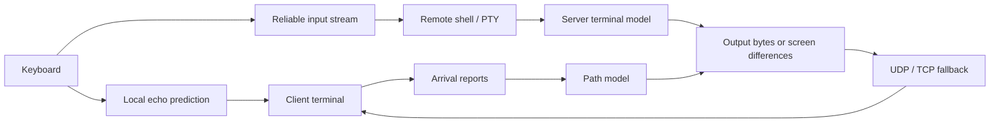

<p align="center">
  
</p>

<h1 align="center">rsh</h1>

<p align="center">
  <a href="https://github.com/enif-lee/rsh/releases/latest"></a>
  <a href="#installation"></a>
  <a href="#how-it-works"></a>
</p>

<p align="center"><strong>A remote shell for unreliable networks.</strong></p>

rsh keeps your shell on the server so you can detach, reconnect, or change
networks and return to the same session. It predicts keystrokes locally,
adapts output to the available link, and sends the current screen when
sending every byte would leave you behind.

Version **0.2.0** supports Linux and macOS on x86_64 and arm64. It uses UDP
with TCP fallback on the same port.

<!-- benchmark-summary:start -->
### Performance at a glance

Recorded five-tool lab snapshot, **2026-10-28, before 0.2.0**. The table
uses a 256 kbit/s link at RTT 100 ms, except the ten-session memory row.
Rendering requests 60 FPS in a 100×30 terminal. Exact historical rsh build
ID was not saved; these are observations, not release-wide guarantees.

| Measurement | rsh (UDP) | mosh | OpenSSH | Eternal Terminal |
| --- | --- | --- | --- | --- |
| Dashboard displayed FPS (median) | 54.3 | 15.9 | 6.0 | 6.1 |
| 1% / 5% low FPS | 36.1 / 41.8 | 14.7 / 15.0 | 1.9 / 4.9 | 4.2 / 4.3 |
| Frame age, ms | 76 | 82 | 3782 | 3754 |
| Received network, kbit/s | 220 | 88 | 250 | 249 |
| Key echo, ms | 4 | 4 | 120 | 108 |
| Bulk output to prompt, s | 0.16 | 0.24 | 23.18 | 22.89 |
| Ten idle LAN sessions, client + server MiB | 35.4 | 242.5 | 221.9 | 207.4 |

Six render runs; pooled frame-gap lows; three echo/bulk runs; two memory
runs. The [full report](BENCHMARK.md) includes rsh TCP fallback, all links,
raw measurements, aggregation rules and collection failures.
<!-- benchmark-summary:end -->

## Installation

```sh
curl -fsSL https://raw.githubusercontent.com/enif-lee/rsh/main/install.sh | sh
```

The installer verifies the release's SHA-256 checksum, installs
`~/.rsh/bin/rsh`, and creates `~/.local/bin/rsh`. Add `~/.local/bin` to
`PATH` if needed. To install a specific release:

```sh
curl -fsSL https://raw.githubusercontent.com/enif-lee/rsh/main/install.sh | RSH_VERSION=v0.2.0 sh
```

On the first connection, rsh uses your SSH access to install the matching
server binary and save an authentication token. Allow UDP port **2222**
for the normal transport, or TCP port **2222** for fallback. SSH is needed
for initial setup and server installation or upgrades.

Installed clients check for a new release once a day when connecting.
Servers are brought to the client's build on connection, with live session
handoff when supported. Set `RSH_NO_UPDATE=1` to disable client auto-update.

### Build from source

Requires Rust and Docker with support for the Linux architectures you build.

```sh
git clone https://github.com/enif-lee/rsh.git
cd rsh
scripts/dist.sh
./target/release/rsh user@host
```

`scripts/dist.sh` writes platform binaries and checksums to `~/.rsh/dist`.
Rebuild them after changing the source so the client can install a matching
build on remote hosts. Binaries stored outside `~/.rsh/bin` do not
auto-update themselves.

## Usage

```sh
rsh user@host                         # open a shell or choose a live session
rsh user@host work                    # open or resume the session named work
rsh user@host -- make test            # run a command and return its exit status
rsh user@host work --tmux             # join or create a remote tmux session
rsh user@host -L 8080:localhost:80     # forward a local port
rsh user@host -R 8080:localhost:80     # forward a remote port
rsh ls                               # list and switch sessions across hosts
```

Detach with `~.` and reconnect by session name. Sessions remain on the
server until their shell exits or the server is stopped; they are not
saved across host reboots. UDP sessions can follow a client to a new IP
address. TCP fallback provides connectivity on networks that block UDP,
but does not provide the same roaming behavior.

Type these keys at the start of a line:

| Key | Action |
| --- | --- |
| `~.` | Detach and leave the session running |
| `~l` | Open the session list |
| `~r` | Request a repaint |
| `~h` | Show escape-key help |
| `~~` | Send a literal tilde |

Use `rsh --help` for connection, server and forwarding options.

## Configuration

`~/.rsh/config.yaml`:

```yaml
compress: always
clipboard_read: false
```

`compress` accepts `always` (the default), `adaptive`, or `none`.
`--compress` overrides the file setting. `clipboard_read: false` blocks
remote OSC 52 clipboard reads; the default is `true`.

| Environment variable | Purpose |
| --- | --- |
| `RSH_NO_UPDATE=1` | Disable automatic client updates |
| `RSH_PREDICTION=never` or `always` | Override adaptive local echo prediction |
| `RSH_ESCAPE_KEY` | Change the escape character; an empty value disables it |
| `RSH_AUTH` | Use another client token file instead of `~/.rsh/known` |
| `RSH_PEER` | Connect directly to an existing server at `HOST:PORT` |

## How it works

One `rsh serve` process holds the host's sessions and PTYs. The server
maintains a terminal model, while the client maintains a mirror for local
echo prediction and rendering.



- **Output:** by default, while the link keeps up, the program's bytes
  travel as a deflate stream, preserving scrollback and terminal sequences. When the
  link falls behind, screen differences replace intermediate output.
- **Adaptation:** arrival reports measure capacity, delay, queueing and
  loss. The server uses them for its send window, output pacing and
  loss-protection copies. Sparse traffic can use short measurement copies
  when recent packet-pair measurements are unavailable.
- **Rendering:** the client combines output into synchronized terminal
  updates and provides adaptive local echo prediction.
- **Resources:** UDP sessions share a server process and socket. Quiet
  terminal history and buffers are compacted, and idle keepalives slow
  down after inactivity.
- **Authentication:** SSH bootstraps per-client tokens. Each attachment
  uses X25519 key exchange and XChaCha20-Poly1305 encryption.

The implementation is in [`src/server.rs`](src/server.rs),
[`src/client.rs`](src/client.rs), [`src/path.rs`](src/path.rs),
[`src/proto.rs`](src/proto.rs), and [`src/terminal.rs`](src/terminal.rs).

<!-- benchmark-details:start -->
## Performance

The following static-link comparisons restore the **2026-10-28 snapshot**.
Avg FPS is the mean of six per-run frame rates; 1%/5% lows are reciprocals
of pooled p99/p95 frame gaps. Network is client RX including protocol
overhead; RSS is a sampled resident size, not a peak. See
[methodology and version scope](BENCHMARK.md#measurement-scope).

### Dashboard on slow, distant and lossy links


| Link | Tool | Avg FPS | 1% low | 5% low | Age ms | RX kbit/s | Client RSS MiB | Server RSS MiB |
| --- | --- | --- | --- | --- | --- | --- | --- | --- |
| 1 Mbit/s · RTT 100 ms | rsh (UDP) | 60.0 | 43.9 | 47.8 | 59 | 217 | 2.44 | 5.55 |
| 1 Mbit/s · RTT 100 ms | OpenSSH | 23.7 | 6.9 | 7.0 | 2546 | 978 | 7.55 | 19.25 |
| 1 Mbit/s · RTT 100 ms | mosh | 18.1 | 16.9 | 17.3 | 66 | 100 | 14.53 | 10.54 |
| 256 kbit/s · RTT 100 ms | rsh (UDP) | 53.2 | 36.1 | 41.8 | 76 | 220 | 2.45 | 5.77 |
| 256 kbit/s · RTT 100 ms | OpenSSH | 6.0 | 1.9 | 4.9 | 3782 | 250 | 7.37 | 19.43 |
| 256 kbit/s · RTT 100 ms | mosh | 15.9 | 14.7 | 15.0 | 82 | 88 | 14.54 | 10.43 |
| RTT 300 ms | rsh (UDP) | 57.3 | 35.2 | 42.4 | 156 | 217 | 2.42 | 5.60 |
| RTT 300 ms | OpenSSH | 60.0 | 23.3 | 48.3 | 152 | 2507 | 7.45 | 18.40 |
| RTT 300 ms | mosh | 6.6 | 6.4 | 6.4 | 160 | 37 | 14.54 | 10.30 |
| 2% loss · RTT 100 ms | rsh (UDP) | 58.8 | 42.6 | 48.3 | 56 | 424 | 2.43 | 5.60 |
| 2% loss · RTT 100 ms | OpenSSH | 33.0 | 4.9 | 7.5 | 1111 | 1246 | 7.64 | 19.16 |
| 2% loss · RTT 100 ms | mosh | 17.1 | 3.7 | 17.6 | 60 | 100 | 14.54 | 10.87 |
| 256 kbit/s · RTT 400 ms · 2% loss | rsh (UDP) | 26.3 | 1.7 | 31.2 | 228 | 182 | 3.09 | 5.74 |
| 256 kbit/s · RTT 400 ms · 2% loss | OpenSSH | 5.1 | 0.9 | 1.4 | 4160 | 222 | 7.57 | 19.53 |
| 256 kbit/s · RTT 400 ms · 2% loss | mosh | 4.5 | 2.4 | 4.6 | 232 | 26 | 14.54 | 10.32 |

### Random full screen

All cells change each frame. These results expose frame-gap and bandwidth
limits that a compressible dashboard can hide.


| Link | Tool | Avg FPS | 1% low | 5% low | Age ms | RX kbit/s | Client RSS MiB | Server RSS MiB |
| --- | --- | --- | --- | --- | --- | --- | --- | --- |
| 1 Mbit/s · RTT 100 ms | rsh (UDP) | 23.9 | 13.0 | 20.6 | 101 | 928 | 2.46 | 5.99 |
| 1 Mbit/s · RTT 100 ms | OpenSSH | 10.0 | 6.2 | 6.7 | 3432 | 978 | 7.41 | 19.95 |
| 1 Mbit/s · RTT 100 ms | mosh | 16.4 | 15.1 | 15.5 | 106 | 707 | 14.76 | 10.44 |
| RTT 300 ms | rsh (UDP) | 56.7 | 27.6 | 44.4 | 160 | 2308 | 2.62 | 5.71 |
| RTT 300 ms | OpenSSH | 60.0 | 14.5 | 47.2 | 152 | 5798 | 7.82 | 18.66 |
| RTT 300 ms | mosh | 6.6 | 6.4 | 6.4 | 162 | 282 | 14.89 | 10.21 |
| 2% loss · RTT 100 ms | rsh (UDP) | 56.1 | 19.3 | 44.2 | 60 | 4370 | 2.62 | 5.89 |
| 2% loss · RTT 100 ms | OpenSSH | 15.3 | 4.3 | 5.0 | 2607 | 1413 | 7.57 | 19.99 |
| 2% loss · RTT 100 ms | mosh | 15.2 | 3.7 | 6.3 | 61 | 802 | 14.40 | 10.90 |
| 256 kbit/s · RTT 400 ms · 2% loss | rsh (UDP) | 3.6 | 0.5 | 1.4 | 373 | 196 | 2.54 | 5.76 |
| 256 kbit/s · RTT 400 ms · 2% loss | OpenSSH | 2.2 | 0.4 | 1.1 | 4310 | 216 | 7.41 | 19.60 |
| 256 kbit/s · RTT 400 ms · 2% loss | mosh | 4.2 | 1.1 | 2.3 | 383 | 192 | 14.45 | 10.38 |

### Network and memory


The [full benchmark report](BENCHMARK.md) includes client/server RSS and CPU
for both workloads on every link, packet counts, all five transports,
connection/echo, bulk output, link changes and session recovery, each with
comparison tables and charts. Raw job results are committed with the report.

### Moving network

The later `7a1d9454d5b1` development build, with the transport implementation
shipped in 0.2.0, was measured at 158×43 for 60 s per scene, two shared
30 s impairment cycles. These results are separate from the static snapshot.


rsh displayed **37.72 FPS** across the dashboard trace and **30.22 FPS**
across the random-screen trace. The dashboard reached **58.0 / 57.6 FPS**
in the final five seconds of the two clear phases. The
[moving comparison](BENCHMARK.md#10-moving-network) includes SSH/mosh,
lows, scene traffic and RSS. Shared scheduling still recorded up to
32.91 ms of application skew between containers.

Performance varies by workload and loss sequence. In the static snapshot,
mosh has better random-screen tails on some slow/lossy links, while SSH
has steadier near-link frame timing. No uniform FPS or 1%/5% low advantage
is claimed. These synthetic tests do not establish fairness with competing
flows or performance on every real radio network.
<!-- benchmark-details:end -->

## Benchmark lab

The lab compares tools in separate Docker server/client pairs, each with
its own shaped link. Build the test image first:

```sh
scripts/dist.sh
python3 benchmark/harness/run.py build
```

Run render and link-switch tests:

```sh
python3 benchmark/lab/lab.py run --tools ssh,mosh,rsh \
  --tests render,switch --nets lan,wan,lowbw,highlat \
  --switches lan:lowbw,lowbw:highlat \
  --scenes compress,bandwidth --fps 60 --duration 8 --iterations 3
```

Run the moving-network demo:

```sh
python3 benchmark/lab/lab.py demo --tools ssh,mosh,rsh --events '' \
  --nets moving --scenes compress,bandwidth --fps 60 --duration 60
```

The moving profile repeats a 30-second sequence of congestion, weak
signal, a one-second handover outage and recovery. All sessions use the
same intended delay/rate/outage schedule on the Docker VM clock. Each
session has an isolated link with the same configured capacity. Its loss percentages describe shared intervals
of link outage, not independent per-packet random-loss probabilities.

The top header shows the active profile. Each session header shows the
program, FPS, displayed-frame age and received network traffic. Frame age
is not a network RTT measurement. Actual application timestamps are saved
because OS scheduling can introduce differences between containers.

Results are saved under `benchmark/lab/out/`. Use `lab.py --help` for all
profiles and tests. Stop a demo with **Ctrl-b X**, or from another shell:

```sh
python3 benchmark/lab/lab.py stop
```

## Development

```sh
NO_COLOR= cargo test --release --locked
python3 -m unittest discover -s benchmark/lab -p 'test_*.py' -v
```

Container integration tests are available in
[`tests/container`](tests/container); read each script's setup requirements
before running it. CPU profiling tools are in
[`benchmark/profile`](benchmark/profile).

## References

The sender/receiver design draws on work on interactive state delivery,
receiver arrival feedback and congestion estimation. The links below
record those influences and the corresponding mechanisms in this code.
rsh uses its own wire protocol and control rules; the mappings describe
ideas, not protocol compatibility or complete implementations of the
referenced algorithms.

| Reference | Connection to rsh |
| --- | --- |
| Winstein and Balakrishnan, [Mosh: An Interactive Remote Shell for Mobile Clients](https://www.usenix.org/conference/atc12/technical-sessions/presentation/winstein), USENIX ATC 2012 | Predictive local echo and sending current terminal state when intermediate output becomes obsolete. See [client prediction](src/client.rs) and [server screen delivery](src/server.rs). rsh also carries a byte stream while the link keeps up. |
| Smith et al., [SQP: Congestion Control for Low-Latency Interactive Video Streaming](https://research.google/pubs/sqp-congestion-control-for-low-latency-interactive-video-streaming/), 2022 | Measuring an application-limited link with the application's own bursts. [PathModel](src/path.rs) estimates rate from packet-train bytes and receiver arrival spacing, with extra handling for sparse terminal updates. |
| Fouladi et al., [Salsify: Low-Latency Network Video through Tighter Integration between a Video Codec and a Transport Protocol](https://www.usenix.org/conference/nsdi18/presentation/fouladi), NSDI 2018 | Jointly considering content production and transmission budget. The [server](src/server.rs) substitutes current-screen differences for obsolete queued output. rsh does not use Salsify's video codec or per-frame encoding search. |
| [WebRTC transport-wide congestion feedback](https://webrtc.googlesource.com/src/+/refs/heads/main/docs/native-code/rtp-hdrext/transport-wide-cc-02/README.md) and [Google Congestion Control draft](https://datatracker.ietf.org/doc/html/draft-ietf-rmcat-gcc-02) | Packet numbers and receiver-side timing inform sender estimates. See [Feedback](src/proto.rs), [client arrival reports](src/client.rs) and [path estimation](src/path.rs). rsh uses delay above a recent floor and packet trains, rather than implementing GCC's full trendline controller or RTCP format. |
| Cardwell et al., [BBR: Congestion-Based Congestion Control](https://research.google/pubs/bbr-congestion-based-congestion-control/), CACM 2017 | Separating bottleneck rate, propagation delay and standing queue, and accounting for bytes in flight. See [path rate/RTT estimates](src/path.rs) and [server drain_backlog](src/server.rs). The sparse terminal workload uses its own estimator; rsh does not implement BBR's complete state machine. |
| [RFC 6298: Computing TCP's Retransmission Timer](https://datatracker.ietf.org/doc/html/rfc6298), 2011 | [Sender](src/proto.rs) maintains smoothed RTT and RTT variation and avoids ambiguous retransmission samples (Karn's rule). The base RTO estimate is clamped to 50–1000 ms; the effective retransmission timeout can extend to 3 s for path RTT and drain time. These are application-specific bounds. |
| [RFC 5827: Early Retransmit for TCP and SCTP](https://www.rfc-editor.org/info/rfc5827/), 2010 | [Sender::on_ack](src/proto.rs) reduces the duplicate-ACK threshold for thin streams with few outstanding datagrams. |
| [RFC 9002: QUIC Loss Detection and Congestion Control](https://datatracker.ietf.org/doc/html/rfc9002), 2021 | A design reference for receiver hold-time/ACK-delay accounting and packet-based loss evidence. [PathModel::feedback](src/path.rs) subtracts reported receiver hold time. rsh's retransmission timer remains its own RFC-6298-derived timer; it does not implement QUIC recovery. |

Additional work considered during design includes
[Pudica (NSDI 2024)](https://www.usenix.org/conference/nsdi24/presentation/wang-shibo)
on low queueing for interactive frames,
[Copa (NSDI 2018)](https://web.mit.edu/copa/)
on delay-based control and competition, and
[Sprout (NSDI 2013)](https://www.usenix.org/system/files/conference/nsdi13/nsdi13-final113.pdf)
on stochastic cellular delivery forecasts. Their complete controllers are
not implemented here. The [benchmark report](BENCHMARK.md) describes the
independent experiments used to evaluate rsh.
