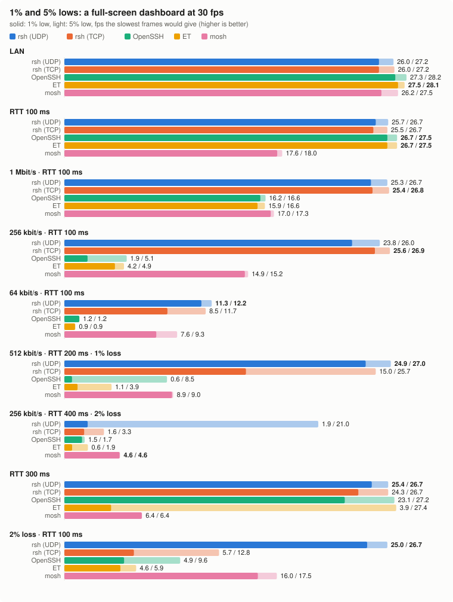
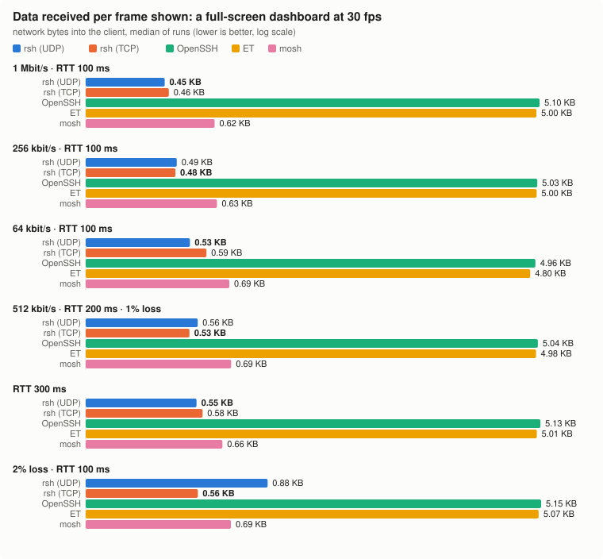
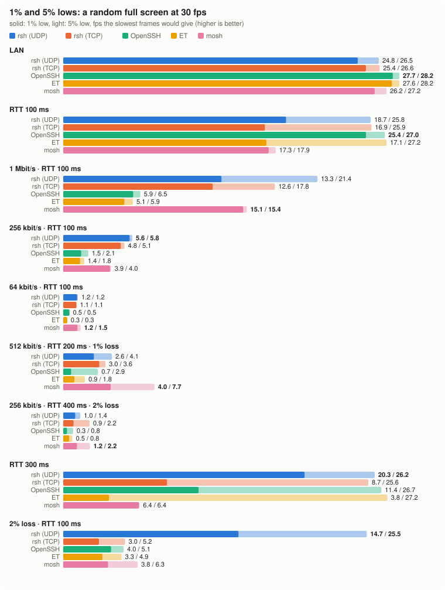
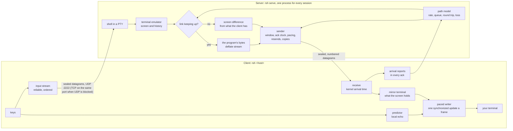
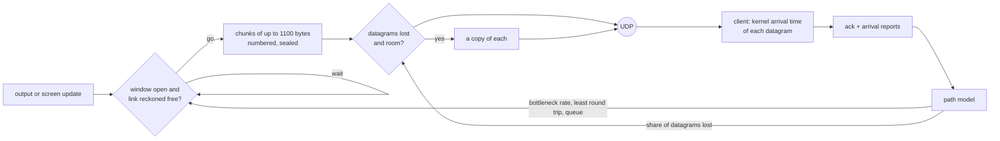

<p align="center">
  
</p>

<h1 align="center">rsh</h1>

<p align="center">
  <a href="Cargo.toml"></a>
  <a href="https://github.com/enif-lee/rsh/releases/latest"></a>
  <a href="#installation"></a>
  <a href="#architecture"></a>
</p>

<h3 align="center">The remote shell for bad networks.</h3>

<p align="center">
  <em>30 fps over 256 kbit/s, keys that echo in about 6 ms at any distance, and a session that outlives every dropped link.<br>
  Built for 3G, ADSL, trains, planes and hotel Wi-Fi, and just as quick on a LAN.</em>
</p>

rsh opens a shell on a host the way `ssh` does, but the session lives on the server: close the laptop, change networks, or kill the client, and `rsh <host>` brings you back to the same shell. Over UDP it echoes your keys at once, measures the link as it goes, and when the link cannot carry every byte it sends the latest screen instead of a backlog. Where only TCP gets through, it falls back to TCP on the same port.

| On a 256 kbit/s link (RTT 100 ms) | rsh | mosh | OpenSSH | Eternal Terminal |
| --- | --- | --- | --- | --- |
| A 30 fps dashboard, frames shown a second | **30.0** | 16.0 | 6.0 | 6.1 |
| Its 1% low (fps of the slowest 1% of frames) | **23.8** | 14.9 | 1.9 | 4.2 |
| How old the screen is | **69 ms** | 90 ms | 3.4 s | 3.4 s |
| A key to its echo | **6 ms** | 6 ms | 118 ms | 109 ms |
| `seq 1 100000` until the prompt is back | **0.16 s** | 0.24 s | 23 s | 23 s |
| Memory for 10 idle sessions on a LAN, clients + server | **35 MB** | 242 MB | 222 MB | 207 MB |

## Installation

```sh
curl -fsSL https://raw.githubusercontent.com/enif-lee/rsh/main/install.sh | bash
```

This puts the latest release for your machine (Linux or macOS, x86_64 or arm64), checked against the release's SHA-256 sums, at `~/.rsh/bin/rsh` and links it from `~/.local/bin/rsh`. `RSH_VERSION=v0.1.0` picks a release; running it again upgrades.

The first `rsh <host>` sets the host up over `ssh`: it copies the same build there (a binary for the host's platform comes from this version's GitHub release and is kept in `~/.rsh/dist`), starts `rsh serve` and saves a token. A host already running `rsh serve` can be used directly with `--peer <host>:2222`.

> [!NOTE]
> **Upgrades.** Once a day, when you connect, rsh looks for a newer release. If there is one it downloads the binary for your platform, checks it, replaces `~/.rsh/bin/rsh` and runs the new one with the same arguments; the next connection to each host then brings its server to the same build, in place, keeping its sessions. `RSH_NO_UPDATE=1` turns this off, and a build run from anywhere else than `~/.rsh/bin` never replaces itself.

### From source

Requires Rust (stable), and Docker for the static Linux builds that rsh copies to servers.

```sh
git clone https://github.com/enif-lee/rsh.git
cd rsh
scripts/dist.sh                         # ~/.rsh/dist/rsh-<platform> for Linux and macOS, and SHA256SUMS
install -m 755 target/release/rsh ~/.local/bin/rsh
```

A build of your own looks in `~/.rsh/dist` first for the hosts' binaries, so run `scripts/dist.sh` again after changing the source.

## Features

- **Sessions live on the server** and outlast the client: detach with `~.`, reattach by name, from another machine too. A killed client is back in the same shell in 0.5 s.
- **Roaming and outages are a notice, not a disconnect.** One UDP socket per host; a new IP address or a link that comes back is picked up within about 2 s.
- **Predictive local echo**, as in mosh, that steps aside on fast links.
- **Adapts to the link as it changes.** The server measures the bottleneck's rate, the queue in front of it, the round trip and loss from the client's arrival reports, keeps the queue short, and switches to sending screen differences when the link cannot keep up.
- **Light.** One `rsh serve` process carries every session of a host; ten sessions take 11 MB on the server and 24 MB of clients. Quiet sessions give memory back, and idle ones keep alive every 5 s.
- **Deflate-compressed output stream** by default (`--compress always|adaptive|none`).
- **TCP fallback on the same port** for networks that drop UDP.
- **Zero setup on the server**: the first connection installs the same build over `ssh`, starts `rsh serve`, saves a token. A server running another build is upgraded in place, keeping its sessions.
- `-L` and `-R` port forwarding, `--tmux` integration, a session list across hosts.

## Usage

```sh
rsh myhost                  # open a shell; with live sessions, a menu to pick one
rsh myhost work             # open or resume the session called "work"
rsh myhost -- make test     # run a command in a new session, exit with its status
rsh myhost work --tmux      # join (or create) the host's tmux session "work"
rsh myhost -L 8080:localhost:80
rsh ls                      # sessions on every known host
```

Keys, typed at the start of a line as in ssh:

| Key | Action |
| --- | --- |
| `~.` | detach; the session keeps running |
| `~l` | sessions of every known host; Enter switches |
| `~r` | repaint the screen from the server |
| `~h` | list these keys |
| `~~` | send `~` |

> [!TIP]
> `RSH_ESCAPE_KEY` sets another escape character (empty disables it), `RSH_PREDICTION=never|always` overrides local echo prediction, and `~/.rsh/config.yaml` takes `compress: always|adaptive|none` and `clipboard_read: false` (blocks OSC 52 clipboard reads by remote programs).

## Benchmarks

Same machine, same simulated links, five clients: rsh over UDP, rsh over TCP (UDP blocked), OpenSSH, Eternal Terminal (ET) and mosh. Each scene runs 8 s; values are the median of three runs, and the 1% and 5% lows are taken over all three runs' frame gaps together.

<p align="center">
  
</p>

<p align="center">
  
</p>

<p align="center">
  
</p>

- **The screen stays current, and smooth.** From 1 Mbit/s down to 64 kbit/s, and at 1% to 2% loss, rsh over UDP shows a 30 fps dashboard at 14.5 to 30 fps, what is on screen is 56 to 220 ms old, and the slowest 1% of frames still come at 11 to 25 fps on every link but the worst (256 kbit/s, RTT 400 ms, 2% loss: 1.9). OpenSSH and ET show 1.2 to 28 fps of frames that are 0.2 to 4.4 s old, because every byte waits its turn on the link; mosh 4.6 to 18 fps with 1% lows of 4.6 to 17.
- **Keys echo at once.** Local echo prediction answers a key in 5 to 8 ms on every link. OpenSSH and ET wait a round trip: 107 to 542 ms on the links with delay.
- **Big output does not block you.** `seq 1 100000` returns the prompt in 0.04 to 0.46 s on every link. OpenSSH and ET take 6 to 24 s on slow links, and more than 30 s at 64 kbit/s.
- **Sessions survive.** After a 5 s outage rsh is back 0.1 s after the link returns (mosh 1.0 s, OpenSSH and ET about 5 s). After the client moves to another IP address it carries on in 2.0 s (mosh 3.1 s; OpenSSH and ET not within the 8 s watched). A client killed and started again is back in the same shell in 0.5 s.

### Memory, traffic and packets

<p align="center">
  
</p>

<p align="center">
  
</p>

<p align="center">
  
</p>

<p align="center">
  
</p>

- **Ten sessions at once** (each shell having printed 3000 lines, then quiet): the ten rsh clients hold 24 MB and the server 11 MB, all ten sessions in one `rsh serve`. OpenSSH: 74 MB of clients and 148 MB of `sshd`; mosh 144 and 98 MB (a `mosh-server` per session); ET 171 and 36 MB. Idle, the ten rsh sessions cost 2 packets a second each way (mosh 3.4 to 3.6, ET 7.5 to 7.9; OpenSSH sends none).
- **One session.** While drawing at 30 fps the rsh client holds 2.4 MB (OpenSSH 7.4, mosh 14.5, ET 17.7 MB) and `rsh serve` 5.7 MB (`mosh-server` 10.4, ET 14.0, `sshd` 18.8 MB with its listener).
- **Traffic.** A dashboard frame on screen costs rsh 0.44 to 0.51 KB on the wire on clean links and 0.74 to 0.85 KB on lossy ones (datagrams go twice there while the link has room), mosh 0.60 to 0.69 KB, and OpenSSH and ET 4.9 to 6.2 KB, as they carry every byte the program writes.
- **Packets.** On clean links rsh takes one datagram a frame and answers each; OpenSSH takes 2.3 to 4.9 packets a frame and ET 1.7 to 2.6, as TCP segments a frame's bytes; mosh takes one and answers about every second one at RTT 100 ms (every fourth on a LAN, each at RTT 300 ms). On lossy links rsh takes 1.5 to 1.9, the copies. A typed key costs rsh 1.1 to 2.1 packets in and 2.2 to 2.5 out, about as many as ET and mosh; OpenSSH 16 to 37 in and 16 to 43 out, as it sends keystroke-timing chaff.

<details>
<summary>More charts: random full screen, bulk output</summary>

<p align="center">
  
</p>

<p align="center">
  
</p>

<p align="center">
  
</p>

</details>

> [!NOTE]
> These come from [`benchmark/lab`](benchmark/lab): two Docker containers per client on one machine, with `tc netem` for delay, loss and rate. Real radio links add jitter and reordering that netem only partly imitates. Where rsh is behind:
> - On a random full screen (every cell changes each frame), mosh's frames come at more even gaps on slow links: 1% lows of 15.1 at 1 Mbit/s and 4.0 at 512 kbit/s with 1% loss, against rsh's 13.3 and 2.6, at a lower frame rate (16.4 and 7.9 fps against 24.6 and 9.7). On a LAN and at RTT 100 ms, OpenSSH's random-screen 1% lows are higher (27.7 and 25.4 against 24.8 and 18.7), and on a LAN ET's and mosh's too (27.6 and 26.2); on a LAN OpenSSH's and ET's dashboard 1% lows as well (27.3 and 27.5 against 26.0).
> - At 256 kbit/s, RTT 400 ms and 2% loss, a lost datagram holds a dashboard frame for a resend now and then: rsh's 1% low there is 1.9 (mosh 4.6), though it shows 23.9 fps against mosh's 4.6. Under a random full screen there mosh's lows are a little higher (1.2 and 2.2 against 1.0 and 1.4) at the same frame rate.
> - When the link drops from RTT 100 ms to 256 kbit/s under a random full screen, rsh shows 4.9 fps afterwards (mosh 5.3) with a 1% low of 2.7 (mosh 3.9) and 41 stalls in three runs (mosh 1), though its screen is 0.2 s old against mosh's 1.0 s. From a LAN to 1 Mbit/s its random-screen 1% low is 8.2 (mosh 10.5).
> - On a LAN OpenSSH's and ET's screen is 1 ms old, rsh's 5 to 8 ms; at RTT 100 ms 52 ms against 56 to 59 ms. On a LAN ET echoes a key in 6 ms, rsh in 8 ms. On clean links the rsh client sends a packet for every frame it takes, mosh's one for every one to four.
> - rsh over TCP is back about 5 s after an outage, as OpenSSH is, and does not follow a move within the 8 s watched. Where UDP is blocked rsh connects in 2.0 s (it tries UDP first), OpenSSH in 1.4 s and ET in 1.9 s.
>
> Memory with 10 sessions comes from a separate run of the `sessions` test (two runs, median); the rest from one `lab.py run` of every test, three iterations each.

## Feature matrix

| | OpenSSH (sshd) | Eternal Terminal | mosh | rsh |
| --- | --- | --- | --- | --- |
| Transport | TCP | TCP | UDP | UDP, or TCP on the same port when UDP is blocked |
| Works where only TCP gets through | ✅ | ✅ | ❌ cannot connect | ✅ connects over TCP in 2.0 s |
| Client changes IP address | ❌ connection drops | ⚠️ reconnects over a new TCP connection (not within the 8 s watched) | ✅ ~3.1 s | ✅ ~2.0 s (UDP) |
| Link down for a few seconds | ⚠️ only while TCP survives its backoff (~5 s after the link) | ⚠️ reconnects (~5 s after the link) | ✅ back ~1.0 s after the link | ✅ back ~0.1 s after the link (UDP) |
| Client killed, started again | ❌ new shell | ❌ new shell | ❌ new shell | ✅ same shell in 0.5 s (`rsh <host> <name>`) |
| Local echo prediction | ❌ | ❌ | ✅ adaptive | ✅ adaptive |
| Slow link: shows the latest screen, not a backlog | ❌ | ❌ | ✅ | ✅ |
| Program's bytes reach your terminal (scrollback, OSC) | ✅ | ✅ | ❌ screen only, 5 of 18 OSC tested | ✅ 18 of 18 OSC tested; screen updates only while the link falls behind |
| Compression | ⚠️ `-C`, off by default | not checked | ✅ zlib | ✅ deflate stream, on by default |
| Port forwarding | ✅ `-L` `-R` `-D`, X11, agent | ✅ `-t` `-r`, agent | ❌ | ⚠️ `-L` `-R` |
| File transfer | ✅ scp, sftp | ❌ | ❌ | ❌ |
| List and switch sessions across hosts | ❌ | ❌ | ❌ | ✅ `rsh ls`, `~l` |
| tmux | run it yourself | run it yourself | run it yourself | ✅ `--tmux` joins or creates a tmux session |
| Server side | `sshd` | `sshd` + `etserver` daemon | `sshd` + a `mosh-server` per session (UDP 60000–61000) | one `rsh serve` for every session, port 2222, installed and upgraded over SSH by the client |
| Memory, 10 sessions (clients + server) | 222 MB | 207 MB | 242 MB | 35 MB |
| Upgrade the server without dropping sessions | n/a | not checked | n/a | ✅ hands sessions to the new binary |
| Authentication | SSH keys, passwords | via SSH | via SSH | per-client token issued over SSH; X25519 per attach, XChaCha20-Poly1305 |

Times and memory come from the lab runs above. The OSC counts come from an earlier run of [`benchmark/harness`](benchmark/harness); the other cells from each project's documentation and source.

## Architecture

rsh is one Rust binary that runs as the client (`rsh <host>`) and, on the host, as the server (`rsh serve`). Everything below is in [`src/`](src).



### Server

- **One process, one socket.** `rsh serve` holds every session in one process on one UDP port, polls the PTYs and the socket, and on upgrade hands all of it to the new binary (`src/upgrade.rs`) without dropping a session.
- **A terminal per session.** Each session's output goes through a terminal emulator (`alacritty_terminal`), so the server always knows the screen and the last 1000 lines: a client that attaches gets a repaint with its scrollback, and a slow link can be sent the screen instead of the backlog. Once output is quiet, history older than the last 100 lines moves out of the emulator's cells (24 bytes each) into the bytes that draw it, and an idle session gives back what its buffers grew to (`src/terminal.rs`, `src/server.rs`).
- **Two ways to send output.** While the link keeps up, the program's bytes go as they are (one deflate stream; with `--compress adaptive` only on far, slow or lagging links), so scrollback and OSC sequences reach your terminal. When they would take longer than 100 ms to drain, the server switches to *screen updates*: the difference between the screen now and the screen the client was last sent, at the program's own frame rate, until the link has kept up for a second.

### Transmission



- **Wire.** Every datagram is sealed with XChaCha20-Poly1305 under keys from an X25519 handshake on each attach, which a token issued over SSH authorizes. Without UDP the same packets go over a TCP connection to the same port, each with a 2-byte length.
- **A reliable stream with its own congestion control** (`src/proto.rs`): cumulative acks by byte offset; fast retransmit after duplicate acks, early retransmit when few datagrams are in flight, a retransmission timer with an Eifel-style undo of spurious timeouts, and a window that grows while round trips show no queue.
- **Path model** (`src/path.rs`): the client stamps each numbered datagram with the time its kernel received it (`SO_TIMESTAMP`) and reports those times in its acks. From them the server measures the bottleneck's rate from trains of datagrams sent back to back (packet-train dispersion), the queue in front of it as one-way delay over its least, the round trip less the client's hold, and loss. A path that turns longer, slower or faster (a LAN that became a 300 ms link, a slow link that went away) is learned within a few round trips.
- **Pacing to the link.** On a slow link the next screen update goes when the previous one is reckoned off the link, so updates never queue there and what you see stays young. On a fast path the window opens to the program's own pace.
- **Copies for loss.** On a path that loses datagrams, each goes twice while the link has room, so a frame rarely waits a round trip for a resend. A clean path sends none.

### Client and rendering

- **Prediction.** Typed characters show at once, underlined on far links (round trip over 80 ms) until the server confirms them, as in mosh; they step aside on links fast enough not to need them.
- **Mirror.** The client keeps its own terminal emulator of what your screen holds, which predictions and the session badge are drawn against.
- **Paced writer.** Output goes to your terminal as whole frames, each one synchronized update (mode 2026), at the program's frame rate, waiting a moment for the rest of a frame split over datagrams.
- **Keepalive.** Every second while in use, every 5 seconds once no key or output for 10 s; a key wakes it.

### References

rsh follows published work; it copies no code from it.

- K. Winstein, H. Balakrishnan. *Mosh: An Interactive Remote Shell for Mobile Clients.* USENIX ATC 2012: state synchronization over UDP, predictive local echo, roaming.
- N. Cardwell, Y. Cheng, C. S. Gunn, S. H. Yeganeh, V. Jacobson. *BBR: Congestion-Based Congestion Control.* ACM Queue, 2016: the bottleneck's rate and the least round trip as the model of a path.
- G. Carlucci, L. De Cicco, S. Holmer, S. Mascolo. *Analysis and Design of the Google Congestion Control for Web Real-time Communication (WebRTC).* MMSys 2016, and the transport-wide congestion control feedback: per-packet arrival times reported to the sender.
- D. Ray, C. Fraser, et al. *SQP: Congestion Control for Low-Latency Interactive Video Streaming.* 2022: bandwidth from the dispersion of a frame's packets.
- S. Fouladi, J. Emmons, E. Orbay, C. Wu, R. S. Wahby, K. Winstein. *Salsify: Low-Latency Network Video through Tighter Integration between a Video Codec and a Transport Protocol.* NSDI 2018: skipping frames the link cannot carry rather than queueing them.
- S. Keshav. *A Control-Theoretic Approach to Flow Control.* SIGCOMM 1991; C. Dovrolis, P. Ramanathan, D. Moore. *Packet-Dispersion Techniques and a Capacity-Estimation Methodology.* IEEE/ACM Transactions on Networking, 2004: packet pairs and trains.
- RFC 9002 (QUIC loss detection), RFC 6298 (retransmission timer), RFC 5681 and RFC 5827 (fast and early retransmit), RFC 3522 (Eifel detection).
- RFC 1951 (DEFLATE), RFC 7748 (X25519), XChaCha20-Poly1305, and synchronized output (mode 2026) as modern terminals implement it.

## Benchmark lab

[`benchmark/lab`](benchmark/lab) runs the comparison in parallel container pairs, each with its own link:

```sh
scripts/dist.sh && benchmark/harness/run.py build  # the image with sshd, ET, mosh and this rsh (from ~/.rsh/dist)
python3 benchmark/lab/lab.py run --iterations 3 --duration 8 \
    --tests render,switch,echo,flood,outage,roam,reattach,udpblock \
    --nets lan,wan,lowbw,verylow,slow64k,highlat,lossy,mobile,badmobile \
    --switches lan:highlat,lan:lowbw,lowbw:highlat,highlat:lossy,wan:verylow
                                                    # the README's run; results in benchmark/lab/out/run-<time>.json
python3 benchmark/lab/lab.py run --tools ssh,et,mosh,rsh --tests sessions --sessions 10 --iterations 2
                                                    # memory with 10 sessions at once
python3 benchmark/lab/lab.py demo                   # the tools side by side in tmux, then a summary
python3 benchmark/lab/lab.py stop                   # stop a run or demo from another shell
python3 benchmark/lab/charts.py benchmark/lab/out/run-<a>.json,benchmark/lab/out/run-<b>.json docs/bench
                                                    # every chart the runs have data for
python3 benchmark/lab/charts.py benchmark/lab/out/run-<a>.json docs/bench memory   # only these
```

Render runs record frames, their age, every frame gap (for the 1% and 5% lows), the client's bytes and packets a second, and the client's and the server's memory halfway through each scene. `--tests`, `--tools`, `--nets`, `--scenes`, `--switches`, `--fps` and `--duration` pick what runs (without `--tests`, render and switch only); `--rsh <linux binary>` tests another build without rebuilding the image, and `--rsh-b <linux binary>` installs a second build as the tool `rsh-b` (add it to `--tools`), to compare two builds in one run.

## Development

```sh
cargo test --release              # unit and session tests
tests/container/e2e.sh            # end to end against a container (see the script for its setup)
tests/container/onboard.sh        # first setup over SSH, upgrade in place
```
