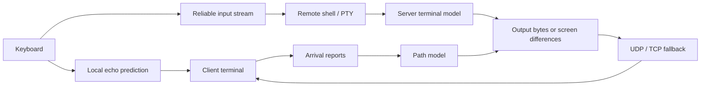

<p align="center">
  
</p>

<h1 align="center">rsh</h1>

<p align="center">
  <a href="https://github.com/enif-lee/rsh/releases/latest"></a>
  <a href="#installation"></a>
  <a href="#how-it-works"></a>
</p>

<p align="center"><strong>A remote shell for unreliable networks.</strong></p>

rsh keeps your shell on the server so you can detach, reconnect, or change
networks and return to the same session. It predicts keystrokes locally,
adapts output to the available link, and sends the current screen when
sending every byte would leave you behind.

Version **0.2.0** supports Linux and macOS on x86_64 and arm64. It uses UDP
with TCP fallback on the same port.

## Installation

```sh
curl -fsSL https://raw.githubusercontent.com/enif-lee/rsh/main/install.sh | sh
```

The installer verifies the release's SHA-256 checksum, installs
`~/.rsh/bin/rsh`, and creates `~/.local/bin/rsh`. Add `~/.local/bin` to
`PATH` if needed. To install a specific release:

```sh
curl -fsSL https://raw.githubusercontent.com/enif-lee/rsh/main/install.sh | RSH_VERSION=v0.2.0 sh
```

On the first connection, rsh uses your SSH access to install the matching
server binary and save an authentication token. Allow UDP port **2222**
for the normal transport, or TCP port **2222** for fallback. SSH is needed
for initial setup and server installation or upgrades.

Installed clients check for a new release once a day when connecting.
Servers are brought to the client's build on connection, with live session
handoff when supported. Set `RSH_NO_UPDATE=1` to disable client auto-update.

### Build from source

Requires Rust and Docker with support for the Linux architectures you build.

```sh
git clone https://github.com/enif-lee/rsh.git
cd rsh
scripts/dist.sh
./target/release/rsh user@host
```

`scripts/dist.sh` writes platform binaries and checksums to `~/.rsh/dist`.
Rebuild them after changing the source so the client can install a matching
build on remote hosts. Binaries stored outside `~/.rsh/bin` do not
auto-update themselves.

## Usage

```sh
rsh user@host                         # open a shell or choose a live session
rsh user@host work                    # open or resume the session named work
rsh user@host -- make test            # run a command and return its exit status
rsh user@host work --tmux             # join or create a remote tmux session
rsh user@host -L 8080:localhost:80     # forward a local port
rsh user@host -R 8080:localhost:80     # forward a remote port
rsh ls                               # list and switch sessions across hosts
```

Detach with `~.` and reconnect by session name. Sessions remain on the
server until their shell exits or the server is stopped; they are not
saved across host reboots. UDP sessions can follow a client to a new IP
address. TCP fallback provides connectivity on networks that block UDP,
but does not provide the same roaming behavior.

Type these keys at the start of a line:

| Key | Action |
| --- | --- |
| `~.` | Detach and leave the session running |
| `~l` | Open the session list |
| `~r` | Request a repaint |
| `~h` | Show escape-key help |
| `~~` | Send a literal tilde |

Use `rsh --help` for connection, server and forwarding options.

## Configuration

`~/.rsh/config.yaml`:

```yaml
compress: always
clipboard_read: false
```

`compress` accepts `always` (the default), `adaptive`, or `none`.
`--compress` overrides the file setting. `clipboard_read: false` blocks
remote OSC 52 clipboard reads; the default is `true`.

| Environment variable | Purpose |
| --- | --- |
| `RSH_NO_UPDATE=1` | Disable automatic client updates |
| `RSH_PREDICTION=never` or `always` | Override adaptive local echo prediction |
| `RSH_ESCAPE_KEY` | Change the escape character; an empty value disables it |
| `RSH_AUTH` | Use another client token file instead of `~/.rsh/known` |
| `RSH_PEER` | Connect directly to an existing server at `HOST:PORT` |

## How it works

One `rsh serve` process holds the host's sessions and PTYs. The server
maintains a terminal model, while the client maintains a mirror for local
echo prediction and rendering.



- **Output:** by default, while the link keeps up, the program's bytes
  travel as a deflate stream, preserving scrollback and terminal sequences. When the
  link falls behind, screen differences replace intermediate output.
- **Adaptation:** arrival reports measure capacity, delay, queueing and
  loss. The server uses them for its send window, output pacing and
  loss-protection copies. Sparse traffic can use short measurement copies
  when recent packet-pair measurements are unavailable.
- **Rendering:** the client combines output into synchronized terminal
  updates and provides adaptive local echo prediction.
- **Resources:** UDP sessions share a server process and socket. Quiet
  terminal history and buffers are compacted, and idle keepalives slow
  down after inactivity.
- **Authentication:** SSH bootstraps per-client tokens. Each attachment
  uses X25519 key exchange and XChaCha20-Poly1305 encryption.

The implementation is in [`src/server.rs`](src/server.rs),
[`src/client.rs`](src/client.rs), [`src/path.rs`](src/path.rs),
[`src/proto.rs`](src/proto.rs), and [`src/terminal.rs`](src/terminal.rs).

## Performance

These recorded Linux arm64 lab observations use the Rust implementation
shipped in 0.2.0. The workload requests 60 FPS in a 158×43 side-by-side
terminal. Each scene runs for 60 seconds, covering two cycles of the
`moving` network profile.

| Workload | Displayed FPS |
| --- | ---: |
| Dashboard, complete moving trace | 37.72 |
| Dashboard, last five seconds of each clear phase | 58.0 / 57.6 |
| Random full screen, complete moving trace | 30.22 |

This is a synthetic container lab on a shared host. It measures visible
frames, not a fixed throughput guarantee. Lossy links can still produce
long gaps while missing data is retransmitted, and random-loss performance
remains under evaluation. No uniform FPS or 1%/5% low advantage is claimed.
The [measurement record](docs/bench/moving-recovery.md#measurement)
contains the run conditions, frame counts and timing limits.

## Benchmark lab

The lab compares tools in separate Docker server/client pairs, each with
its own shaped link. Build the test image first:

```sh
scripts/dist.sh
python3 benchmark/harness/run.py build
```

Run render and link-switch tests:

```sh
python3 benchmark/lab/lab.py run --tools ssh,mosh,rsh \
  --tests render,switch --nets lan,wan,lowbw,highlat \
  --switches lan:lowbw,lowbw:highlat \
  --scenes compress,bandwidth --fps 60 --duration 8 --iterations 3
```

Run the moving-network demo:

```sh
python3 benchmark/lab/lab.py demo --tools ssh,mosh,rsh --events '' \
  --nets moving --scenes compress,bandwidth --fps 60 --duration 60
```

The moving profile repeats a 30-second sequence of congestion, weak
signal, a one-second handover outage and recovery. All sessions use the
same intended delay/rate/outage schedule on the Docker VM clock. Each
session has an isolated link with the same configured capacity. Its loss percentages describe shared intervals
of link outage, not independent per-packet random-loss probabilities.

The top header shows the active profile. Each session header shows the
program, FPS, displayed-frame age and received network traffic. Frame age
is not a network RTT measurement. Actual application timestamps are saved
because OS scheduling can introduce differences between containers.

Results are saved under `benchmark/lab/out/`. Use `lab.py --help` for all
profiles and tests. Stop a demo with **Ctrl-b X**, or from another shell:

```sh
python3 benchmark/lab/lab.py stop
```

## Development

```sh
NO_COLOR= cargo test --release --locked
python3 -m unittest discover -s benchmark/lab -p 'test_*.py' -v
```

Container integration tests are available in
[`tests/container`](tests/container); read each script's setup requirements
before running it. CPU profiling tools are in
[`benchmark/profile`](benchmark/profile).
