# Bounded TCP quiet65: full results and retained costs

Quiet65 is the review candidate for the complete TCP controller stack. Against
the **CAN+PTY correctness-fixed reference (24248+PR4/5, source4f98/c25)**,
the final matched screens record higher WAN/high-RTT and low-bandwidth dashboard
averages, with several tail gains and lower matched-body age. They also retain
LAN tail deficits, slower256 kbit/s random delivery,64 kbit/s tail/age costs,
120 Hz costs and occasional longer gaps. Moving observations show useful
throughput/recovery contrasts, with timing-fidelity and SSH tradeoffs still open.
This reference is **not literal current git main24248**.

**1% low, 5% low and average FPS are primary; CPU/RSS are secondary.** Individual
costs may be acceptable with overall improvement. No invented weights, noise
allowance, automatic single-metric veto, global SSH parity or policy-additivity
claim follows. Saved analyses retain `final_selection=None`; data validity and
product selection are separate decisions. Every role/evaluation and adverse
observation is retained below.

## Sources, builds and bounded mechanism

The implementation branch `perf/tcp-quarter-margin` is stacked on PR7 and adds quarter freshness plus bounded
quiet relative to that PR. The65-versus60 experiments isolate only the quiet
increment; the direct4f98 experiments compare the complete policy stack.
Those three scopes are kept distinct rather than treated as additive evidence.

Candidate65 is **781bbe465298 / 3d4c5bd1…795827**. Studies66–70 compare it to
the advanced quarter+margin parent60 **fa934e198646 / 4b5273bc…4c6c2d**; they
measure the bounded-quiet increment. Studies71–74 instead use the corrected
reference **4f98af080434 / c25f94dd…51a33**, measuring the complete controller
stack. They do not isolate quiet or add independent gains together. Identical
A/B artifacts provide simultaneous variation context, not an automatic noise
tolerance or physical P/E-core assignment proof. Both comparisons reuse prior
builds; neither is a newly compiled same-container pair.

The new quiet rule is confined to the animating TCP, no-slow-BDP/low-queue
branch30. It takes `max(original margin deadline, min(output_at+1ms,last+20ms))`
using existing constants. No new state, option, protocol field, global gap,
rate/window/RTO/credit change is introduced by65. Unknown BDP does not prove
unknown slow rate. The full stack also includes the earlier transit, probing,
quarter-freshness and TCP-local cadence changes, which the direct4f98 comparison
cannot attribute separately. [Exact incremental source proof](data/bounded-quiet65-core-20261101/65-tcp-margin-quiet-proof.json)
and [direct controller delta](data/bounded-quiet65-reference-core-20261101/controller.patch)
record those different scopes.

The logical cap is not a 20ms bound on service, body gaps or display latency.
Credit/TAIL/service can defer output. At the 8ms clamp, the extra logical wait
can be 12ms; continuous writes can tend toward 50 logical updates/s, and long-idle
first partial frames or producer-internal pauses can still expose partial
producer frames. Terminal parser ground is not producer-frame atomicity.
Untraced performance observations do not prove branch activation or causality.

Linux65 actually passes **149 tests: library119+CLI4+session25+concurrency1**,
with two library tests ignored. Mac65 passes **148:119+4+25+0**, with two ignored;
the Linux-only64-child stress fixture has zero Mac tests. Mac release is
`ed52c5c3…395ac9`, linked by later native source guards, separate from the Linux
artifact and the older baseline60 Mac145 result. Frozen preparation metadata
`Mac65_tested=False` predates that native proof and remains unchanged. Original
logs/guards/root Cargo fresh=false records are archived.

The unbuiltV1 snapshot is retained locally: its retained unknown-rate fixture
set `output_at=last+P`, conflicting with intended new quiet before any build.
V2 changes only that setup to `last` in both candidate/control, preserving its
assertion; the new fixture covers fresh output separately. The public archive
contains V1 hash/proof/fixture metadata, not its entire source tree. Unchanged60
control has two new quiet passes/one expected failure, plus retained margin3
and quarter3 passes. This correction does not erase the original fixture issue.

Old room+fresh+quiet recorded 18 FPS against 50.5/48.2 in a different parent and
broader path scope. It did not isolate quiet's cause and remains adverse
counterevidence. Earlier [quarter19/55](fresh-quarter55-20261101.md),
[cadence50/51/53](cadence-margin-20261101.md) and all older losses remain separate;
newer results neither average them away nor retroactively establish their cause.

## Method and cohort inventory

Each case uses four parallel roles and two evaluations, with exact slot order
`[SSH,A,B,candidate]` then `[candidate,B,A,SSH]`. This crosses parity and reverses
slots; it does not prove physical core pinning. Static windows request eight
seconds at100×30. Requested60 Hz and the separately predeclared120 Hz guards
are never pooled. Actual lo/hi timestamps are retained, including a residual
beyond eight complete one-second bins; bin sums need not equal full-window
body counts. For example72 has a valid125-body window with124 bodies in its
eight one-second bins. No frame is discarded or duration normalized away.

Core uses zero/50/150ms per direction without configured loss/rate caps. Slow
uses RTT100ms and server-egress1M/256k/64k caps, client direction uncapped.
All RSH roles share TCP alias/port2222/configuration. Source RAM ledgers,
pre-exec SET/GET geometry, nonce/PID/clock/FRAME N/T checks, strict deployment
and network proofs, all-four closure fences and the original five-second
pidfd/SIGUSR2 collection remain. No new timeout, cap or retry was added for
publication;120Hz guards retain32MiB raw/4096-record quota and original 5s.

Moving uses ticker warmup/prompt/drain, eight native workers and four sources
ready before a common future VM epoch, fixed 30s receive windows and 131-point
netem-change plans. Warmup/startup differs from static cohorts. All 56 outages
and 1048 point-skew values across the two moving cohorts are preserved, but
**moving performance_eligible=False and timing_fidelity_accepted=False**.
Short intended6/7ms edges can be compressed within measured ACK brackets;
identical intended schedules do not prove identical wire impairment.

Admission uses one host user+system<30% interval. Runtime CPU/process load is
context, not an abort threshold: no 60s streak or per-process gate. Source,
identity, timing and collection errors still reject. Process CPU100%=one core,
distinct from host admission percentage. Exact receive timestamps and earlier
environment creation dates remain in each compact; filename study dates do
not replace those timestamps.

Lows are adjacent complete-body gap quantiles, excluding window edges.
Maxgap includes boundaries; unmatched tail means no newly detected complete
body, not no bytes/communication. Body age is generation-to-read, conditional
on body matches, not RTT/input/GPU or every incomplete state. Sparse lows and
p95 age remain null. Resource checks are saved-job→summary→CSV consistency,
not new raw counter/RSS sampling. Client RX uses kbit/s; RSS is midpointKiB in
CSV and MiB below. Body/header counts are distinct; incomplete-state checks
are not physical screen damage or byte-loss measurements.

There are 272 records:240 eligible static and 32 descriptive moving. These are
inventory counts, never pooled FPS or a passing coverage matrix.

| Study / archive | Reference | Requested Hz | Jobs / blocks | Complete bodies / offline headers | Source records / pending | Eligibility | Missing low / p95-age cells |
|---|---|---:|---:|---:|---:|---|---:|
| 66 / [focused](data/bounded-quiet65-focused-20261101/README.md) | Advanced60 | 60 | 16 / 4 | 7254 / 7282 | 7680 / 0 | static eligible | 0 / 0 |
| 67 / [core](data/bounded-quiet65-core-20261101/README.md) | Advanced60 | 60 | 48 / 12 | 22561 / 22584 | 23040 / 0 | static eligible | 0 / 0 |
| 68 / [slow](data/bounded-quiet65-slow-20261101/README.md) | Advanced60 | 60 | 48 / 12 | 8718 / 8736 | 19761 / 8 | static eligible | 4 / 11 |
| 69 / [moving](data/bounded-quiet65-moving-20261101/README.md) | Advanced60 | 60 | 16 / 4 | 12980 / 12999 | 26052 / 2 | descriptive only | 0 / 0 |
| 70 / [fast120](data/bounded-quiet65-fast120-20261101/README.md) | Advanced60 | 120 | 16 / 4 | 14487 / 14509 | 15360 / 0 | static eligible | 0 / 0 |
| 71 / [reference-core](data/bounded-quiet65-reference-core-20261101/README.md) | CAN+PTY ref | 60 | 48 / 12 | 21911 / 21924 | 23040 / 0 | static eligible | 0 / 0 |
| 72 / [reference-slow](data/bounded-quiet65-reference-slow-20261101/README.md) | CAN+PTY ref | 60 | 48 / 12 | 7760 / 7776 | 19754 / 6 | static eligible | 8 / 11 |
| 73 / [reference-moving](data/bounded-quiet65-reference-moving-20261101/README.md) | CAN+PTY ref | 60 | 16 / 4 | 10834 / 10871 | 26366 / 1 | descriptive only | 0 / 0 |
| 74 / [reference-fast120](data/bounded-quiet65-reference-fast120-20261101/README.md) | CAN+PTY ref | 120 | 16 / 4 | 14401 / 14419 | 15360 / 0 | static eligible | 0 / 0 |

## 71: full stack versus corrected reference — core

Cells are **average /1% low /5% low FPS**; dashboard=`compress`, random=incompressible `bandwidth`.

| Network / scene / evaluation | SSH | CAN+PTY ref A | CAN+PTY ref B | Quiet65 |
|---|---:|---:|---:|---:|
| LAN / dashboard / 0 | 60.0 / 45.2 / 50.1 | 60.0 / 45.2 / 48.6 | 60.0 / 45.0 / 47.8 | 60.0 / 43.5 / 47.3 |
| LAN / dashboard / 1 | 60.0 / 45.2 / 49.6 | 60.0 / 45.2 / 47.3 | 60.0 / 43.5 / 48.1 | 60.0 / 43.7 / 48.1 |
| LAN / random / 0 | 59.9 / 46.5 / 48.8 | 60.0 / 40.5 / 45.0 | 60.0 / 42.4 / 46.9 | 60.0 / 42.4 / 46.3 |
| LAN / random / 1 | 60.0 / 46.0 / 49.1 | 60.0 / 41.7 / 46.6 | 60.0 / 41.9 / 45.4 | 59.9 / 43.3 / 46.1 |
| RTT100 ms / dashboard / 0 | 60.0 / 43.2 / 48.6 | 56.0 / 43.0 / 46.9 | 56.0 / 44.0 / 46.8 | 60.0 / 43.4 / 46.0 |
| RTT100 ms / dashboard / 1 | 60.0 / 43.8 / 48.8 | 55.6 / 42.1 / 46.4 | 55.8 / 42.2 / 46.3 | 60.0 / 43.8 / 47.9 |
| RTT100 ms / random / 0 | 60.0 / 38.2 / 46.8 | 54.2 / 30.6 / 46.0 | 54.4 / 35.6 / 45.9 | 58.4 / 35.5 / 46.5 |
| RTT100 ms / random / 1 | 60.0 / 31.5 / 47.4 | 53.6 / 29.0 / 43.9 | 54.4 / 31.2 / 45.6 | 58.5 / 42.5 / 47.5 |
| RTT300 ms / dashboard / 0 | 60.0 / 22.9 / 46.5 | 53.6 / 29.3 / 44.6 | 54.7 / 40.2 / 45.9 | 58.9 / 45.5 / 49.2 |
| RTT300 ms / dashboard / 1 | 60.0 / 22.9 / 45.3 | 54.4 / 38.0 / 43.7 | 39.7 / 18.9 / 28.0 | 56.1 / 31.4 / 42.8 |
| RTT300 ms / random / 0 | 60.0 / 12.1 / 44.2 | 48.2 / 13.6 / 43.5 | 49.4 / 14.4 / 44.9 | 53.5 / 27.6 / 47.3 |
| RTT300 ms / random / 1 | 60.0 / 14.9 / 45.0 | 49.7 / 15.1 / 45.4 | 50.1 / 13.5 / 45.3 | 53.4 / 14.5 / 47.4 |

WAN dashboard averages 60/60 exceed references 55.6–56.0, and random 58.4/58.5 exceed 53.6–54.4. RTT300 dashboard averages 58.9/56.1 exceed 39.7–54.7; random 53.5/53.4 exceed 48.2–50.1. These are group-level average gains, with mixed individual lows. WAN random evaluation1 improves all three FPS metrics against both references; RTT300 dashboard/random evaluation0 does too.

Costs remain: LAN dashboard evaluation0 lows 43.5/47.3 trail both references; all LAN candidate lows trail SSH. RTT300 random evaluation1 low1=14.5 is below referenceA 15.1 and SSH14.9, while its maxgap 516ms exceeds A282/B291/SSH118ms. Its body/header 427/428 and visible incomplete2.2282% remain; evaluation0 has428/429 and3.5423%. A better average or percentile does not remove longer gaps or unmatched states. WAN/high-RTT matched p95 ages are lower, but do not prove uniformly lower latency or source-frame atomicity. SSH averages remain60 at those remote cases.

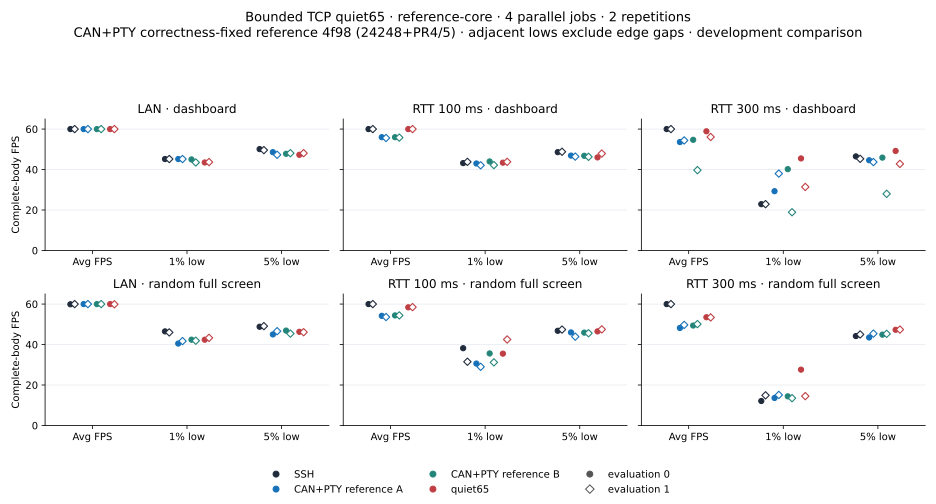

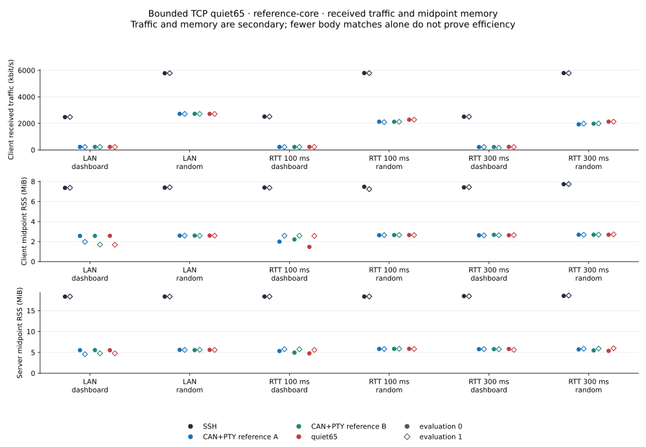

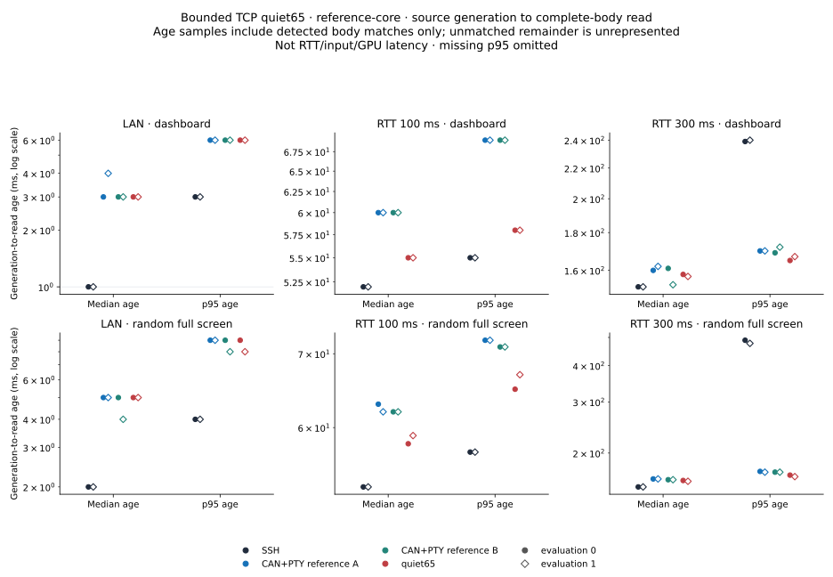

## 72: full stack versus corrected reference — slow

Cells are **average /1% low /5% low FPS**; dashboard=`compress`, random=incompressible `bandwidth`.

| Network / scene / evaluation | SSH | CAN+PTY ref A | CAN+PTY ref B | Quiet65 |
|---|---:|---:|---:|---:|
| 1 Mbit/s / dashboard / 0 | 23.5 / 5.9 / 7.2 | 56.0 / 43.3 / 46.4 | 55.6 / 39.8 / 46.9 | 60.0 / 42.1 / 46.5 |
| 1 Mbit/s / dashboard / 1 | 23.5 / 6.5 / 7.0 | 55.9 / 40.5 / 46.9 | 55.9 / 43.8 / 46.6 | 60.0 / 43.4 / 46.7 |
| 1 Mbit/s / random / 0 | 9.7 / 6.3 / 6.5 | 22.9 / 17.5 / 19.3 | 22.4 / 17.7 / 18.6 | 24.4 / 19.2 / 20.9 |
| 1 Mbit/s / random / 1 | 9.9 / 5.4 / 6.3 | 21.2 / 16.4 / 18.3 | 23.2 / 13.6 / 18.6 | 24.1 / 14.8 / 19.5 |
| 256 kbit/s / dashboard / 0 | 6.0 / 2.1 / 5.1 | 34.0 / 23.8 / 27.0 | 37.6 / 25.3 / 27.7 | 60.0 / 43.8 / 47.1 |
| 256 kbit/s / dashboard / 1 | 6.1 / 2.4 / 4.1 | 35.0 / 24.9 / 26.8 | 35.9 / 25.1 / 27.7 | 60.0 / 38.7 / 44.6 |
| 256 kbit/s / random / 0 | 2.4 / 1.3 / 1.3 | 5.9 / 5.4 / 5.6 | 6.0 / 5.4 / 5.5 | 5.9 / 5.3 / 5.5 |
| 256 kbit/s / random / 1 | 2.5 / 1.6 / 1.6 | 6.0 / 5.4 / 5.5 | 6.0 / 5.4 / 5.5 | 5.9 / 5.2 / 5.4 |
| 64 kbit/s / dashboard / 0 | 1.5 / 1.3 / 1.3 | 15.6 / 11.5 / 12.6 | 15.6 / 11.3 / 12.0 | 15.6 / 6.9 / 12.6 |
| 64 kbit/s / dashboard / 1 | 1.4 / 1.3 / 1.3 | 16.0 / 11.9 / 12.5 | 15.7 / 11.3 / 12.8 | 15.7 / 8.9 / 12.5 |
| 64 kbit/s / random / 0 | 0.6 / — / — | 1.2 / — / — | 1.4 / 0.8 / 0.8 | 1.2 / — / — |
| 64 kbit/s / random / 1 | 0.6 / — / — | 1.4 / 1.3 / 1.3 | 1.4 / 1.3 / 1.3 | 1.5 / 0.8 / 0.8 |

At 1Mbit/s random, candidate 24.4/19.2/20.9 and24.1/14.8/19.5 (average/1%/5%) improve averages and5% lows against both references. Evaluation1 low1 is below referenceA16.4. Its p95 age 160/146ms exceeds reference 120–128ms: retain the 18–40ms matched-freshness cost alongside FPS gains. At 256k dashboard all three FPS metrics improve against both references in both evaluations, with averages60 versus 34.0–37.6.

Conversely256k random evaluation1 declines in all three metrics against both references; evaluation0 also has tail costs.64k dashboard low1=6.9/8.9 is below both references11.3–11.9, with longer maxgaps171/158ms versus124–149ms. Sparse64k random includes candidate 10 bodies/lowNULL and12 bodies/0.8 lows; evaluation1 average 1.5 exceeds references 1.4 while lows trail 1.3 and maxgap1285ms exceeds753/776ms. No sparse null is zero-filled or interpreted as smooth delivery.

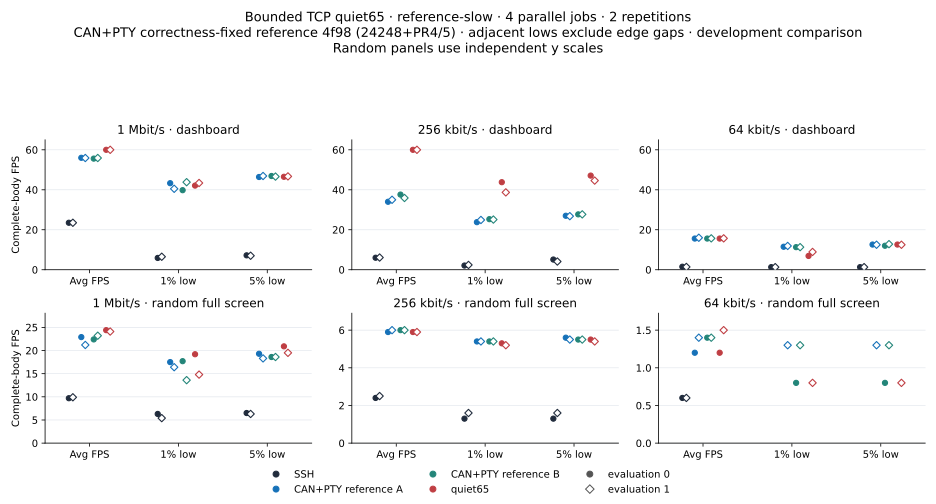

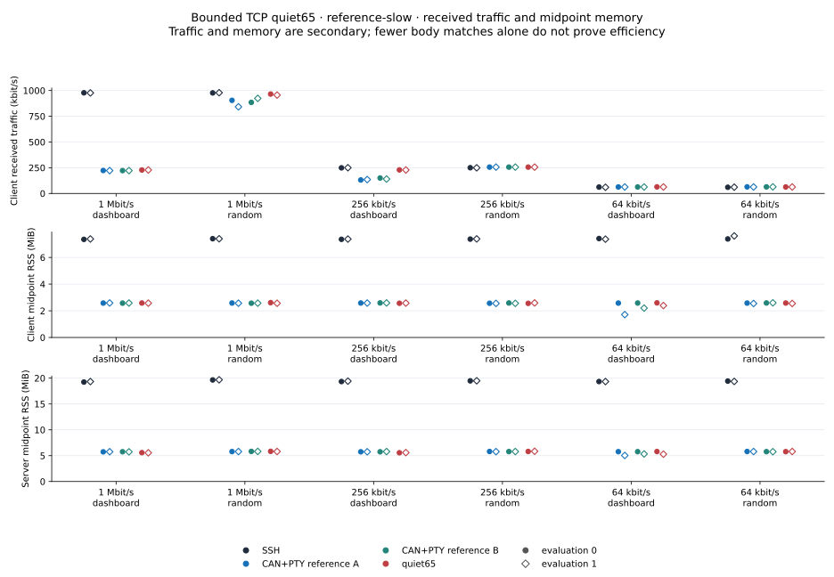

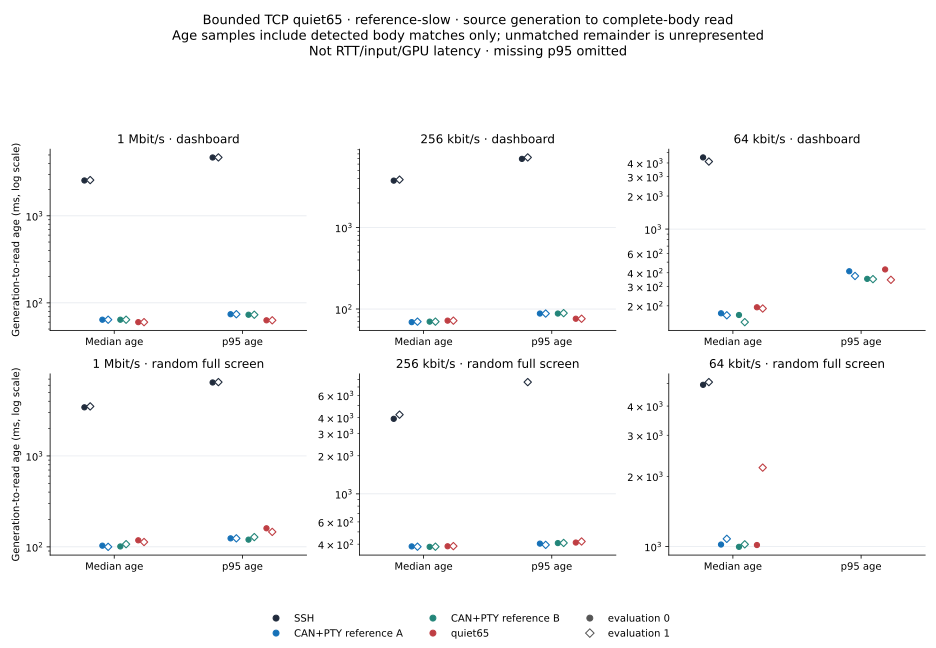

## 73: full stack versus corrected reference — descriptive moving

Cells are **average /1% low /5% low FPS**; dashboard=`compress`, random=incompressible `bandwidth`.

| Network / scene / evaluation | SSH | CAN+PTY ref A | CAN+PTY ref B | Quiet65 |
|---|---:|---:|---:|---:|
| Moving / dashboard / 0 | 47.9 / 3.6 / 32.5 | 15.2 / 2.5 / 5.4 | 18.5 / 2.3 / 7.4 | 26.9 / 3.2 / 8.4 |
| Moving / dashboard / 1 | 48.2 / 6.3 / 27.0 | 15.7 / 2.8 / 5.0 | 18.0 / 2.8 / 5.3 | 28.2 / 3.4 / 9.8 |
| Moving / random / 0 | 16.5 / 3.5 / 16.6 | 14.2 / 1.6 / 4.8 | 12.9 / 1.5 / 5.1 | 21.7 / 2.5 / 6.5 |
| Moving / random / 1 | 27.2 / 2.6 / 12.8 | 15.9 / 1.9 / 6.0 | 13.9 / 1.4 / 3.7 | 20.3 / 2.6 / 7.1 |

All four whole-window cases have higher candidate average/1%/5% FPS than both corrected references, with lower matched p95 age. Dashboard averages26.9/28.2 compare with15.2–18.5; random21.7/20.3 with12.9–15.9. These are descriptive cohort observations, not global timing-approved performance claims or isolated quiet effects.

SSH tradeoffs remain: dashboard averages47.9/48.2 and its lows exceed the candidate, while p95 age12033/11258ms is much larger. Random evaluation0 candidate average exceeds SSH16.5, but its lows2.5/6.5 trail3.5/16.6. Evaluation1 candidate average20.3 and5%low7.1 trailSSH27.2/12.8. In final23–30s, candidate averages improve against both references, but dashboard/random recovery-phase low1 costs remain. SSH dashboard112.3/107.4 FPS is stale catch-up, not a steady fresh rate above60. SSH random evaluation0 has zero bodies/NULL low/age in that final7s phase; its13129ms maxgap belongs to the entire30s window, not that phase. First newly made body delays are mixed against references and preserve source production phase.

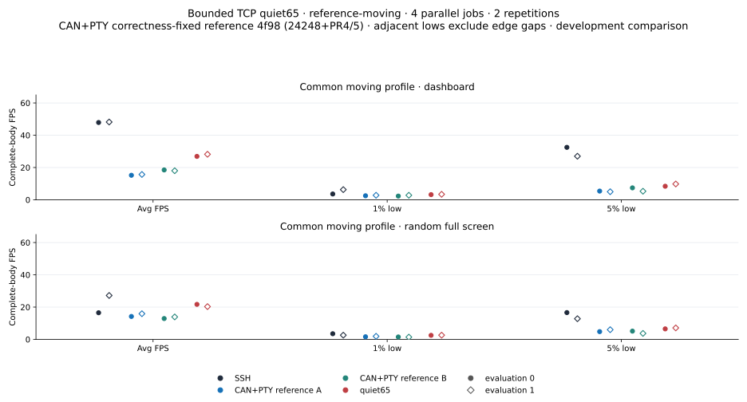

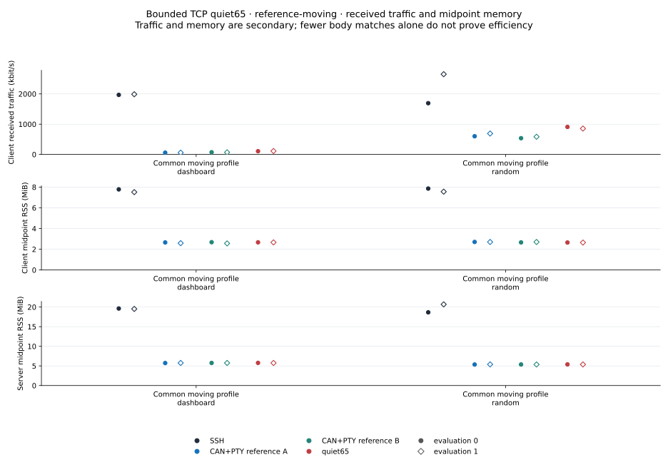

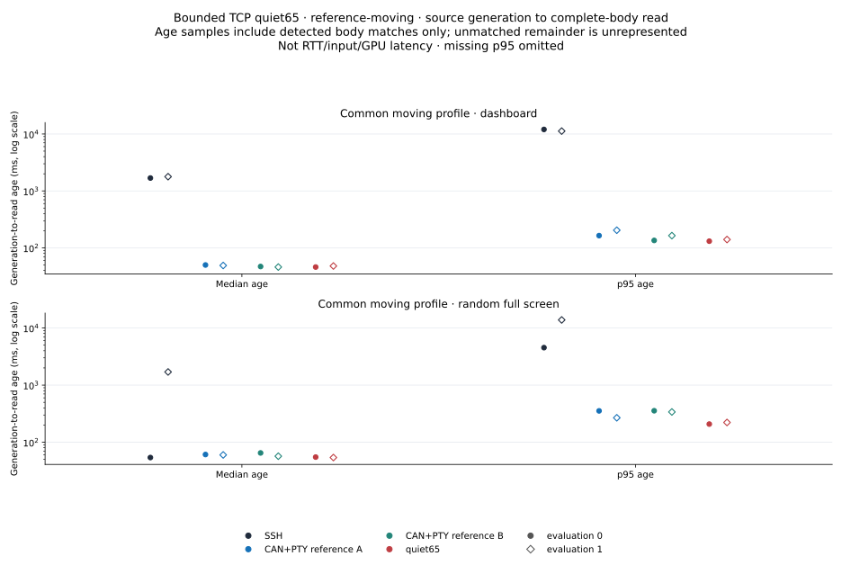

### All recovery phases

Each cell is average / 1% low / 5% low FPS. Phase boundaries are offsets from the fixed common T0; sparse/zero-body phase lows remain missing.

| Scene / evaluation / phase | SSH | CAN+PTY ref A | CAN+PTY ref B | Quiet65 |
|---|---:|---:|---:|---:|
| 00-moving-compress-i0 / clear signal | 59.3 / 34.2 / 47.6 | 28.8 / 15.3 / 20.8 | 44.2 / 19.1 / 27.5 | 58.2 / 36.5 / 43.6 |
| 00-moving-compress-i0 / congestion | 43.8 / 11.1 / 15.5 | 15.8 / 8.3 / 9.4 | 15.5 / 8.7 / 9.7 | 22.0 / 3.5 / 10.3 |
| 00-moving-compress-i0 / weak signal | 13.5 / 3.2 / 3.5 | 5.0 / 1.5 / 1.5 | 4.5 / 1.1 / 1.1 | 6.2 / 3.2 / 3.2 |
| 00-moving-compress-i0 / deep fade | 4.0 / 1.1 / 1.1 | 2.0 / — / — | 2.3 / — / — | 2.7 / — / — |
| 00-moving-compress-i0 / handover | 3.0 / — / — | 0.0 / — / — | 0.0 / — / — | 1.0 / — / — |
| 00-moving-compress-i0 / recovering | 10.0 / 0.9 / 1.1 | 6.4 / 2.8 / 4.1 | 7.2 / 3.2 / 3.8 | 7.6 / 2.5 / 2.7 |
| 00-moving-compress-i0 / clear again | 112.3 / 30.4 / 34.2 | 23.3 / 11.1 / 14.9 | 24.0 / 11.4 / 14.8 | 42.4 / 10.9 / 25.8 |
| 01-moving-compress-i1 / clear signal | 59.3 / 38.0 / 47.5 | 30.0 / 18.7 / 22.3 | 43.5 / 21.7 / 26.6 | 56.8 / 36.6 / 43.2 |
| 01-moving-compress-i1 / congestion | 47.0 / 11.5 / 33.6 | 14.2 / 4.0 / 9.0 | 15.5 / 8.7 / 9.7 | 23.8 / 3.4 / 12.4 |
| 01-moving-compress-i1 / weak signal | 11.2 / 2.7 / 3.6 | 5.0 / 2.8 / 2.8 | 5.0 / 2.9 / 2.9 | 5.8 / 2.3 / 2.6 |
| 01-moving-compress-i1 / deep fade | 7.7 / 1.0 / 1.3 | 3.7 / 2.0 / 2.0 | 3.7 / 1.9 / 1.9 | 4.7 / 1.6 / 1.6 |
| 01-moving-compress-i1 / handover | 4.0 / — / — | 1.0 / — / — | 1.0 / — / — | 1.0 / — / — |
| 01-moving-compress-i1 / recovering | 15.8 / 0.6 / 6.5 | 7.6 / 2.2 / 4.4 | 7.0 / 2.1 / 3.0 | 14.4 / 3.4 / 7.8 |
| 01-moving-compress-i1 / clear again | 107.4 / 22.2 / 30.4 | 23.3 / 11.8 / 14.6 | 21.3 / 7.9 / 13.7 | 42.7 / 15.0 / 22.7 |
| 02-moving-bandwidth-i0 / clear signal | 59.2 / 32.8 / 47.6 | 29.5 / 10.1 / 19.5 | 20.5 / 11.6 / 16.3 | 56.3 / 25.8 / 40.8 |
| 02-moving-bandwidth-i0 / congestion | 17.8 / 12.2 / 16.6 | 13.5 / 2.1 / 6.7 | 14.0 / 1.5 / 7.7 | 14.0 / 2.5 / 5.0 |
| 02-moving-bandwidth-i0 / weak signal | 13.2 / 2.6 / 3.6 | 4.5 / 1.6 / 1.6 | 5.2 / 0.8 / 3.1 | 4.2 / 1.9 / 1.9 |
| 02-moving-bandwidth-i0 / deep fade | 5.0 / 2.6 / 2.6 | 2.0 / — / — | 1.7 / — / — | 2.0 / — / — |
| 02-moving-bandwidth-i0 / handover | 0.0 / — / — | 1.0 / — / — | 1.0 / — / — | 1.0 / — / — |
| 02-moving-bandwidth-i0 / recovering | 0.0 / — / — | 6.0 / 1.0 / 4.5 | 6.4 / 2.1 / 4.2 | 7.8 / 3.7 / 3.9 |
| 02-moving-bandwidth-i0 / clear again | 0.0 / — / — | 20.0 / 7.6 / 10.6 | 21.3 / 9.2 / 14.9 | 27.7 / 4.9 / 12.1 |
| 03-moving-bandwidth-i1 / clear signal | 59.3 / 27.8 / 45.0 | 38.5 / 12.1 / 22.9 | 29.7 / 11.7 / 21.3 | 54.7 / 20.0 / 36.2 |
| 03-moving-bandwidth-i1 / congestion | 20.0 / 2.6 / 12.5 | 13.8 / 1.9 / 6.8 | 10.0 / 1.3 / 3.0 | 14.8 / 5.2 / 7.0 |
| 03-moving-bandwidth-i1 / weak signal | 6.0 / 3.4 / 3.5 | 4.5 / 1.1 / 1.1 | 4.2 / 1.4 / 1.4 | 3.8 / 0.8 / 0.8 |
| 03-moving-bandwidth-i1 / deep fade | 3.0 / — / — | 1.7 / — / — | 2.3 / — / — | 2.0 / — / — |
| 03-moving-bandwidth-i1 / handover | 2.0 / — / — | 0.0 / — / — | 1.0 / — / — | 1.0 / — / — |
| 03-moving-bandwidth-i1 / recovering | 5.0 / 0.9 / 1.0 | 5.4 / 2.0 / 2.4 | 3.2 / 1.0 / 1.0 | 6.0 / 1.1 / 4.3 |
| 03-moving-bandwidth-i1 / clear again | 45.7 / 12.5 / 25.2 | 20.3 / 8.6 / 10.3 | 22.4 / 9.7 / 12.7 | 24.4 / 8.6 / 10.0 |

### First newly produced bodies and all native bounds
Fresh-edge delay uses the first matched body whose actual source-made timestamp is at/after the edge. It includes producer phase and read delay; it is not exact impairment recovery, input/GPU latency or a steady source-rate claim.
| Batch / role | First body made after18s: delay ms | First body made after23s: delay ms | Final23–30s all / newly made body count |
|---|---:|---:|---:|
| 00-moving-compress-i0 / ssh | 6793.0 | 2233.7 | 786 / 574 |
| 00-moving-compress-i0 / main-A | 687.2 | 77.6 | 163 / 162 |
| 00-moving-compress-i0 / main-B | 871.9 | 81.4 | 168 / 167 |
| 00-moving-compress-i0 / candidate | 317.9 | 134.7 | 297 / 295 |
| 01-moving-compress-i1 / candidate | 339.2 | 111.6 | 299 / 298 |
| 01-moving-compress-i1 / main-B | 299.3 | 140.8 | 149 / 148 |
| 01-moving-compress-i1 / main-A | 341.1 | 110.8 | 163 / 162 |
| 01-moving-compress-i1 / ssh | 6549.5 | 2291.7 | 752 / 540 |
| 02-moving-bandwidth-i0 / ssh | — | — | 0 / 0 |
| 02-moving-bandwidth-i0 / main-A | 1128.6 | 85.2 | 140 / 139 |
| 02-moving-bandwidth-i0 / main-B | 1361.2 | 98.4 | 149 / 148 |
| 02-moving-bandwidth-i0 / candidate | 1356.9 | 90.7 | 194 / 193 |
| 03-moving-bandwidth-i1 / candidate | 1325.9 | 104.3 | 171 / 170 |
| 03-moving-bandwidth-i1 / main-B | 1420.4 | 118.2 | 157 / 156 |
| 03-moving-bandwidth-i1 / main-A | 1481.6 | 128.7 | 142 / 140 |
| 03-moving-bandwidth-i1 / ssh | 6731.9 | 2229.7 | 320 / 233 |

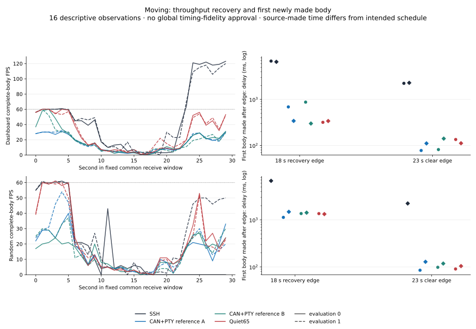
All28 common-overlap bounds below are netlink send/ACK brackets across eight directions, in ms. They do not measure exact kernel packet impairment or equal packet loss; coverage validity does not grant timing-fidelity approval.
| Block | Intended outage ms | Common lower / upper ms |
|---|---:|---:|
| 00-moving-compress-i0 | 6 | 5.791028 / 5.806028 |
| 00-moving-compress-i0 | 32 | 31.954655 / 31.985530 |
| 00-moving-compress-i0 | 120 | 119.732537 / 119.767454 |
| 00-moving-compress-i0 | 240 | 239.952785 / 239.986077 |
| 00-moving-compress-i0 | 1000 | 999.920917 / 1000.026001 |
| 00-moving-compress-i0 | 50 | 48.210192 / 48.249983 |
| 00-moving-compress-i0 | 7 | 6.974867 / 6.999909 |
| 01-moving-compress-i1 | 6 | 4.926940 / 4.936899 |
| 01-moving-compress-i1 | 32 | 31.953904 / 31.973030 |
| 01-moving-compress-i1 | 120 | 119.858538 / 119.886288 |
| 01-moving-compress-i1 | 240 | 239.730784 / 239.766660 |
| 01-moving-compress-i1 | 1000 | 999.884084 / 999.925375 |
| 01-moving-compress-i1 | 50 | 49.917158 / 49.954992 |
| 01-moving-compress-i1 | 7 | 6.366864 / 6.378364 |
| 02-moving-bandwidth-i0 | 6 | 5.653444 / 5.664777 |
| 02-moving-bandwidth-i0 | 32 | 31.967196 / 32.001488 |
| 02-moving-bandwidth-i0 | 120 | 119.942622 / 119.961997 |
| 02-moving-bandwidth-i0 | 240 | 239.928627 / 239.970669 |
| 02-moving-bandwidth-i0 | 1000 | 999.929164 / 999.989456 |
| 02-moving-bandwidth-i0 | 50 | 49.951087 / 49.964171 |
| 02-moving-bandwidth-i0 | 7 | 6.949749 / 6.988458 |
| 03-moving-bandwidth-i1 | 6 | 5.916452 / 5.930326 |
| 03-moving-bandwidth-i1 | 32 | 31.948939 / 32.004648 |
| 03-moving-bandwidth-i1 | 120 | 119.939501 / 120.005001 |
| 03-moving-bandwidth-i1 | 240 | 239.215665 / 240.004419 |
| 03-moving-bandwidth-i1 | 1000 | 999.183118 / 999.913955 |
| 03-moving-bandwidth-i1 | 50 | 49.955795 / 50.007671 |
| 03-moving-bandwidth-i1 | 7 | 6.975249 / 7.003500 |

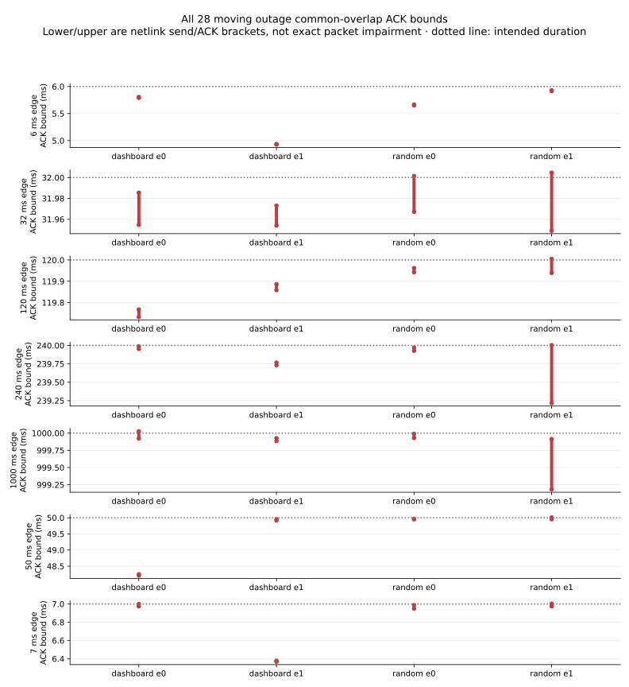

## 74: full stack versus corrected reference — separate120Hz guard

Cells are **average /1% low /5% low FPS**; dashboard=`compress`, random=incompressible `bandwidth`. Requested120Hz; do not compare absolute FPS as if this were a60Hz cohort.

| Network / scene / evaluation | SSH | CAN+PTY ref A | CAN+PTY ref B | Quiet65 |
|---|---:|---:|---:|---:|
| LAN / random / 0 | 120.0 / 75.7 / 86.4 | 119.5 / 66.2 / 77.7 | 120.0 / 64.0 / 77.0 | 119.2 / 62.1 / 76.3 |
| LAN / random / 1 | 120.0 / 74.4 / 84.4 | 119.9 / 67.3 / 76.7 | 119.5 / 63.5 / 75.6 | 119.3 / 65.1 / 75.6 |
| RTT100 ms / random / 0 | 120.0 / 50.9 / 75.1 | 100.4 / 54.7 / 68.9 | 100.7 / 55.0 / 68.9 | 99.9 / 51.9 / 69.6 |
| RTT100 ms / random / 1 | 120.0 / 48.9 / 77.4 | 99.7 / 42.5 / 69.2 | 100.9 / 45.9 / 69.8 | 101.0 / 55.9 / 67.8 |

Requested120Hz is independently checked in source/job metadata with unchanged quota/deadline. Actual sources each contain960 records here; that observed count is not imposed on other future producer/backpressure cases.

LAN evaluation0 candidate119.2/62.1/76.3 trails both references119.5–120.0/64.0–66.2/77.0–77.7 in all three metrics. Evaluation1 also trails referenceA in all three, with mixed B comparison. WAN evaluation0 has lower average99.9 and1%low51.9 but higher5%low69.6 than both references. Evaluation1 has higher average101.0/low1=55.9 but lower5%low67.8. SSH stays120 average and has higher5% lows75.1/77.4; candidate WAN1% lows exceed SSH. This guard is not evidence of universal high-rate parity or a reason to erase60Hz gains.

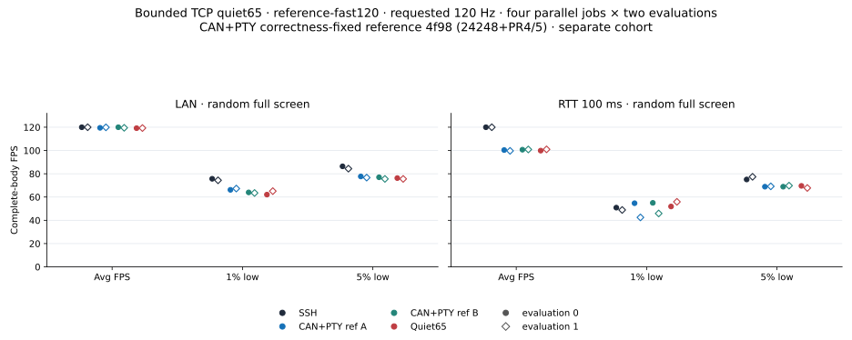

## 66: predeclared focused increment versus advanced60

Cells are **average /1% low /5% low FPS**; dashboard=`compress`, random=incompressible `bandwidth`.

| Network / scene / evaluation | SSH | Advanced60 A | Advanced60 B | Quiet65 |
|---|---:|---:|---:|---:|
| RTT100 ms / random / 0 | 60.0 / 29.6 / 48.0 | 58.0 / 29.1 / 45.2 | 57.4 / 29.4 / 44.9 | 58.6 / 43.4 / 48.6 |
| RTT100 ms / random / 1 | 60.0 / 36.3 / 46.6 | 57.7 / 28.1 / 46.1 | 58.0 / 30.9 / 46.4 | 58.4 / 41.5 / 46.8 |
| RTT300 ms / random / 0 | 60.0 / 12.4 / 43.5 | 52.1 / 24.3 / 45.2 | 53.2 / 16.1 / 47.0 | 53.2 / 37.5 / 47.4 |
| RTT300 ms / random / 1 | 60.0 / 13.6 / 42.8 | 53.2 / 17.1 / 45.5 | 53.1 / 30.0 / 47.0 | 53.6 / 20.7 / 47.3 |

The initial focused cohort records WAN candidate58.6/43.4/48.6 and58.4/41.5/46.8 above both advanced references in all three FPS metrics, with incomplete checks0% in both candidate windows. This association does not demonstrate quiet activation, atomic source-frame coalescing or GPU display behavior.

RTT300 evaluation1 low1=20.7 trails advancedB30.0. WAN evaluation1 maxgap115ms exceeds references87/111 andSSH44; RTT300 candidate first-body offsets291–293ms and incomplete3.66–3.79% remain. The focused cohort is not averaged into the later full matrix or a retry-until-winner selection.

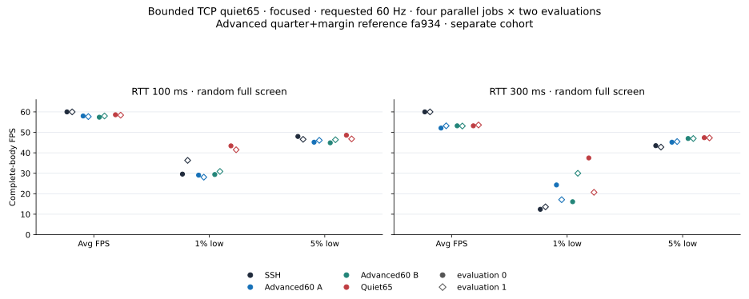

## 67: bounded-quiet increment versus advanced60 — full core

Cells are **average /1% low /5% low FPS**; dashboard=`compress`, random=incompressible `bandwidth`.

| Network / scene / evaluation | SSH | Advanced60 A | Advanced60 B | Quiet65 |
|---|---:|---:|---:|---:|
| LAN / dashboard / 0 | 60.0 / 46.5 / 49.6 | 60.0 / 45.3 / 48.4 | 60.0 / 43.2 / 47.9 | 60.0 / 45.1 / 48.2 |
| LAN / dashboard / 1 | 60.0 / 46.1 / 49.7 | 60.0 / 45.2 / 47.6 | 60.0 / 44.9 / 47.2 | 60.0 / 42.8 / 46.7 |
| LAN / random / 0 | 60.0 / 44.6 / 48.5 | 60.0 / 43.3 / 47.7 | 60.0 / 41.9 / 45.9 | 60.0 / 43.5 / 46.7 |
| LAN / random / 1 | 60.0 / 45.2 / 49.3 | 60.0 / 39.5 / 45.6 | 60.0 / 42.1 / 47.0 | 60.0 / 43.5 / 46.5 |
| RTT100 ms / dashboard / 0 | 60.0 / 43.4 / 48.0 | 60.0 / 41.7 / 46.9 | 60.0 / 41.5 / 45.3 | 60.0 / 42.7 / 46.7 |
| RTT100 ms / dashboard / 1 | 60.0 / 41.9 / 47.7 | 60.0 / 41.3 / 45.9 | 60.0 / 40.9 / 46.2 | 60.0 / 42.1 / 46.8 |
| RTT100 ms / random / 0 | 60.0 / 38.9 / 45.4 | 58.2 / 32.6 / 47.4 | 58.0 / 30.6 / 47.1 | 58.4 / 37.9 / 47.7 |
| RTT100 ms / random / 1 | 60.0 / 40.9 / 47.2 | 58.2 / 31.1 / 47.3 | 58.2 / 29.1 / 46.2 | 58.6 / 40.1 / 48.0 |
| RTT300 ms / dashboard / 0 | 60.0 / 24.0 / 46.3 | 59.0 / 44.8 / 48.2 | 59.0 / 43.6 / 48.5 | 59.0 / 43.5 / 49.0 |
| RTT300 ms / dashboard / 1 | 60.0 / 22.0 / 46.8 | 59.0 / 44.7 / 49.1 | 59.0 / 43.2 / 47.7 | 58.0 / 41.9 / 46.8 |
| RTT300 ms / random / 0 | 60.0 / 13.6 / 42.2 | 53.0 / 19.9 / 47.3 | 52.9 / 30.8 / 46.5 | 53.6 / 13.4 / 46.6 |
| RTT300 ms / random / 1 | 60.0 / 14.5 / 44.6 | 53.1 / 20.6 / 44.5 | 53.2 / 23.4 / 45.3 | 51.5 / 18.2 / 43.9 |

WAN random improves all three FPS metrics against both advanced references in both evaluations, with averages58.4/58.6 versus58.0–58.2. In contrast RTT300 random evaluation1 candidate51.5/18.2/43.9 trails both references53.1–53.2/20.6–23.4/44.5–45.3. RTT300 dashboard evaluation1 also declines in all three versus both references, and LAN dashboard evaluation1 tails decline. The narrower66 gains do not cancel these costs.

RTT300 random candidate body/header429/430 and412/414, incomplete3.68/3.66%, first-body offsets294/290ms and evaluation1 maxgap350ms versus293/302 remain. Slightly lower matched p95 age does not automatically compensate for those FPS or gap costs.

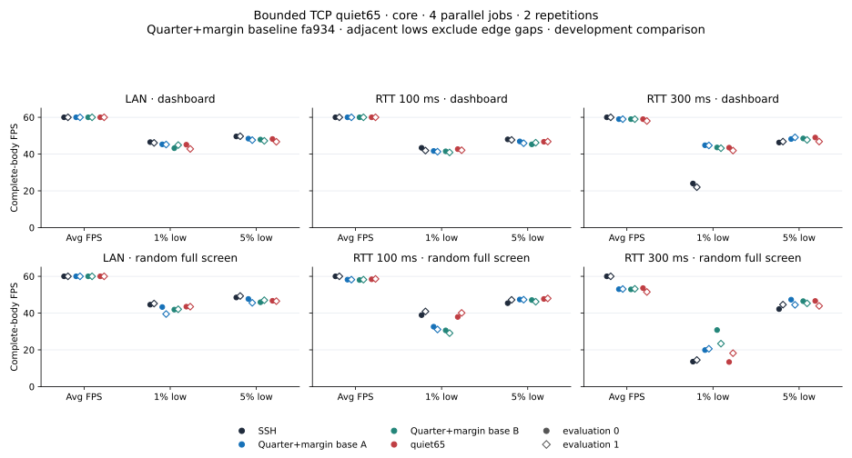

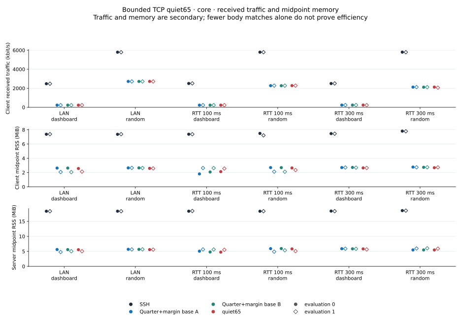

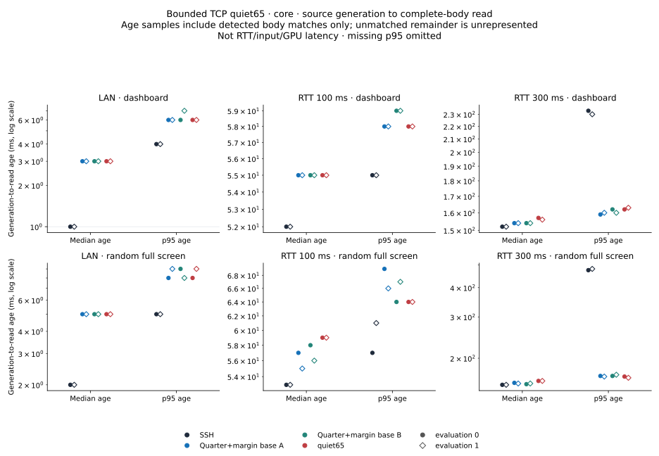

## 68: bounded-quiet increment versus advanced60 — slow

Cells are **average /1% low /5% low FPS**; dashboard=`compress`, random=incompressible `bandwidth`.

| Network / scene / evaluation | SSH | Advanced60 A | Advanced60 B | Quiet65 |
|---|---:|---:|---:|---:|
| 1 Mbit/s / dashboard / 0 | 23.5 / 6.2 / 7.2 | 60.0 / 41.2 / 45.3 | 60.0 / 41.4 / 45.4 | 60.0 / 41.4 / 47.0 |
| 1 Mbit/s / dashboard / 1 | 23.5 / 6.4 / 7.1 | 60.0 / 41.3 / 46.9 | 60.0 / 42.9 / 46.5 | 60.0 / 42.8 / 46.2 |
| 1 Mbit/s / random / 0 | 9.9 / 5.9 / 6.8 | 24.5 / 18.3 / 21.3 | 23.9 / 12.5 / 19.7 | 24.0 / 16.3 / 19.9 |
| 1 Mbit/s / random / 1 | 10.0 / 5.8 / 6.4 | 23.4 / 14.0 / 18.8 | 24.0 / 13.6 / 19.9 | 23.6 / 15.3 / 19.9 |
| 256 kbit/s / dashboard / 0 | 6.0 / 2.3 / 4.2 | 60.0 / 43.5 / 47.2 | 60.0 / 41.1 / 48.1 | 60.0 / 42.2 / 46.3 |
| 256 kbit/s / dashboard / 1 | 6.1 / 2.6 / 4.9 | 60.0 / 42.5 / 46.2 | 60.0 / 41.1 / 46.2 | 60.0 / 42.8 / 46.3 |
| 256 kbit/s / random / 0 | 2.4 / 1.2 / 1.2 | 6.0 / 5.3 / 5.5 | 5.9 / 5.5 / 5.6 | 5.9 / 4.4 / 5.4 |
| 256 kbit/s / random / 1 | 2.5 / 1.5 / 1.5 | 6.0 / 5.3 / 5.6 | 6.0 / 5.3 / 5.5 | 5.9 / 5.3 / 5.4 |
| 64 kbit/s / dashboard / 0 | 1.4 / 1.1 / 1.1 | 15.1 / 4.0 / 11.7 | 16.1 / 9.1 / 13.0 | 15.2 / 9.1 / 12.3 |
| 64 kbit/s / dashboard / 1 | 1.5 / 1.3 / 1.3 | 15.9 / 8.3 / 12.6 | 15.7 / 8.5 / 12.4 | 15.9 / 5.7 / 12.4 |
| 64 kbit/s / random / 0 | 0.6 / — / — | 1.6 / 1.4 / 1.4 | 1.5 / 1.4 / 1.4 | 1.5 / 1.3 / 1.3 |
| 64 kbit/s / random / 1 | 0.6 / — / — | 1.4 / 0.8 / 0.8 | 1.4 / 1.3 / 1.3 | 1.4 / 1.3 / 1.3 |

1Mbit/s random is mixed: evaluation0 candidate24.0/16.3/19.9 trails advancedA24.5/18.3/21.3 but exceedsB23.9/12.5/19.7. Evaluation1 low1 improves versus both; average23.6 trailsB24.0.256k random tails decline, with evaluation1 average5.9 versus both6.0.64k dashboard evaluation1 low1=5.7 trails8.3/8.5, despite lower matched p95 age341/355ms versus369–439ms. All null sparse lows/p95 values remain missing.

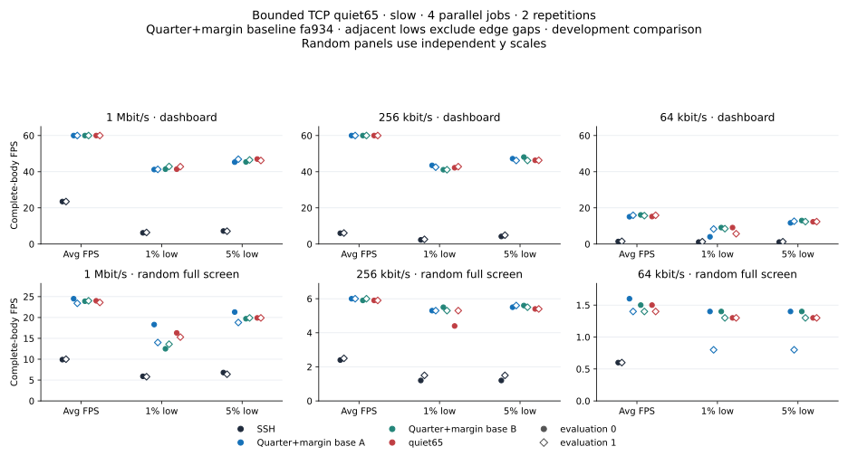

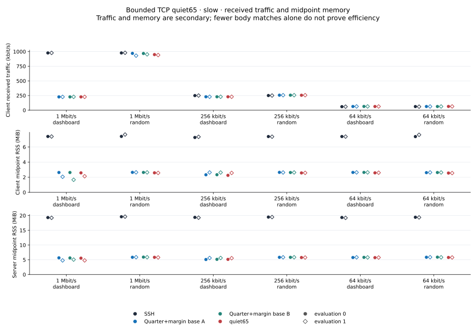

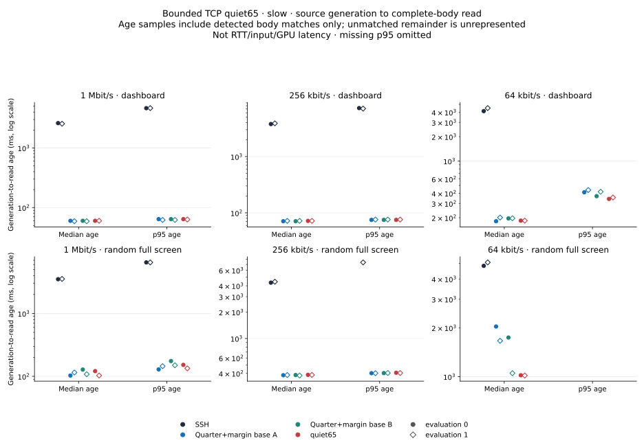

## 69: bounded-quiet increment versus advanced60 — descriptive moving

Cells are **average /1% low /5% low FPS**; dashboard=`compress`, random=incompressible `bandwidth`.

| Network / scene / evaluation | SSH | Advanced60 A | Advanced60 B | Quiet65 |
|---|---:|---:|---:|---:|
| Moving / dashboard / 0 | 47.9 / 3.8 / 29.9 | 28.5 / 2.6 / 12.4 | 26.7 / 3.7 / 7.4 | 26.4 / 3.2 / 7.0 |
| Moving / dashboard / 1 | 48.1 / 6.0 / 27.2 | 29.8 / 3.0 / 12.7 | 30.7 / 4.3 / 11.6 | 31.2 / 3.5 / 13.8 |
| Moving / random / 0 | 16.5 / 3.6 / 7.3 | 22.6 / 2.9 / 7.6 | 21.4 / 2.5 / 8.0 | 21.9 / 2.7 / 7.5 |
| Moving / random / 1 | 16.5 / 3.3 / 12.4 | 21.1 / 2.4 / 6.6 | 21.8 / 2.9 / 6.8 | 21.7 / 2.3 / 7.5 |

Whole-window outcomes are mixed. Dashboard evaluation0 candidate26.4/3.2/7.0 trails advancedB26.7/3.7/7.4 in all three, while evaluation1 average31.2 and5%low13.8 improve but low1=3.5 trailsB4.3. Random evaluation0 trails advancedA in all three; evaluation1 low1=2.3 trails both references.

SSH random average is16.5/16.5 in this cohort, with zero final23–30s bodies and NULL phase lows/age. Its13115/13203ms maxgaps are whole30s values. No earlier SSH27FPS cohort is pooled or causally used to explain that behavior. Candidate final recovery averages/tails remain mixed versus advanced references; lower whole-window matched p95 age does not erase FPS losses. The common6ms edge can measure5.437074–5.444324ms and7ms edge6.229829–6.235704ms; global fidelity remains unapproved.

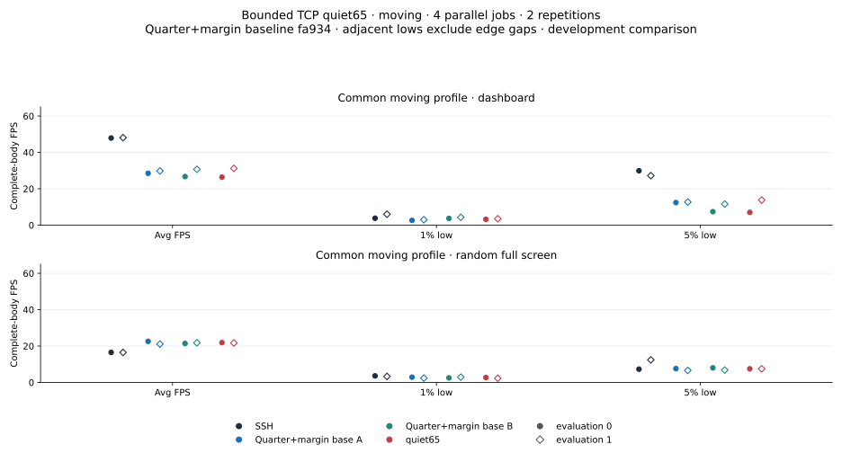

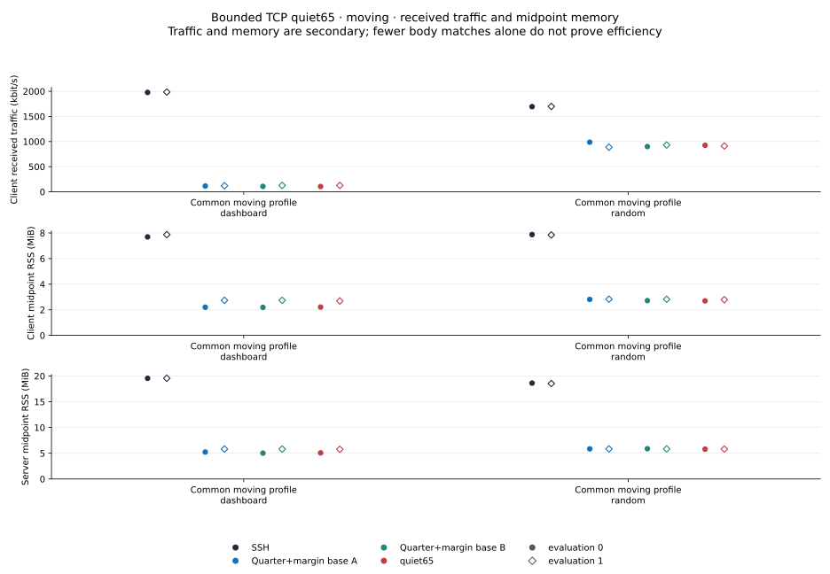

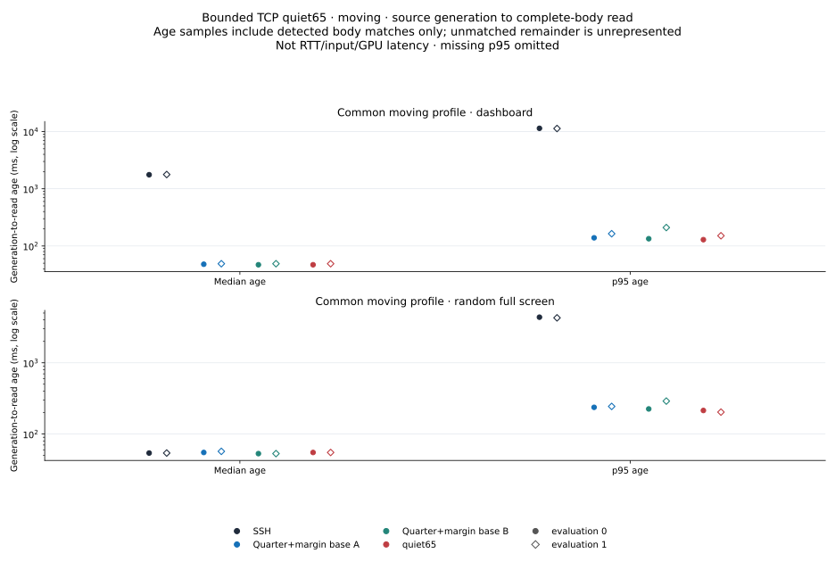

### All recovery phases

Each cell is average / 1% low / 5% low FPS. Phase boundaries are offsets from the fixed common T0; sparse/zero-body phase lows remain missing.

| Scene / evaluation / phase | SSH | Advanced60 A | Advanced60 B | Quiet65 |
|---|---:|---:|---:|---:|
| 00-moving-compress-i0 / clear signal | 59.3 / 32.7 / 48.5 | 57.3 / 34.8 / 45.1 | 56.8 / 32.2 / 43.6 | 57.3 / 36.4 / 43.6 |
| 00-moving-compress-i0 / congestion | 47.0 / 12.2 / 33.4 | 21.2 / 8.1 / 11.9 | 21.0 / 4.3 / 11.3 | 21.0 / 3.2 / 11.6 |
| 00-moving-compress-i0 / weak signal | 10.5 / 3.0 / 3.5 | 4.5 / 1.1 / 1.1 | 6.0 / 2.7 / 3.3 | 5.5 / 2.8 / 3.2 |
| 00-moving-compress-i0 / deep fade | 8.7 / 0.8 / 1.2 | 2.7 / — / — | 3.7 / 1.9 / 1.9 | 3.3 / — / — |
| 00-moving-compress-i0 / handover | 3.0 / — / — | 0.0 / — / — | 1.0 / — / — | 1.0 / — / — |
| 00-moving-compress-i0 / recovering | 14.6 / 0.9 / 6.6 | 17.6 / 4.2 / 8.4 | 7.4 / 2.1 / 4.4 | 7.0 / 3.2 / 3.5 |
| 00-moving-compress-i0 / clear again | 107.0 / 19.8 / 32.1 | 44.4 / 22.3 / 29.1 | 43.4 / 15.2 / 28.0 | 42.1 / 11.9 / 24.0 |
| 01-moving-compress-i1 / clear signal | 59.3 / 36.4 / 47.8 | 55.0 / 32.1 / 41.2 | 58.5 / 39.0 / 45.9 | 56.8 / 33.7 / 43.4 |
| 01-moving-compress-i1 / congestion | 47.0 / 11.6 / 32.2 | 27.8 / 7.8 / 12.7 | 26.5 / 7.0 / 10.6 | 24.0 / 1.6 / 9.5 |
| 01-moving-compress-i1 / weak signal | 11.0 / 2.8 / 3.6 | 12.0 / 2.3 / 3.0 | 18.0 / 2.4 / 4.6 | 12.2 / 2.4 / 3.5 |
| 01-moving-compress-i1 / deep fade | 7.7 / 0.9 / 2.2 | 4.3 / 1.7 / 1.7 | 4.0 / 0.9 / 0.9 | 2.3 / — / — |
| 01-moving-compress-i1 / handover | 4.0 / — / — | 1.0 / — / — | 0.0 / — / — | 1.0 / — / — |
| 01-moving-compress-i1 / recovering | 15.8 / 0.5 / 7.0 | 19.0 / 2.7 / 6.9 | 15.4 / 3.6 / 6.2 | 23.0 / 7.3 / 8.2 |
| 01-moving-compress-i1 / clear again | 107.0 / 21.7 / 31.4 | 42.4 / 10.4 / 24.7 | 43.4 / 18.7 / 26.5 | 46.6 / 16.5 / 26.7 |
| 02-moving-bandwidth-i0 / clear signal | 59.2 / 34.5 / 48.7 | 54.0 / 17.9 / 34.4 | 55.8 / 24.2 / 37.5 | 55.7 / 27.9 / 38.9 |
| 02-moving-bandwidth-i0 / congestion | 17.8 / 12.1 / 17.3 | 17.5 / 1.8 / 7.8 | 15.5 / 3.9 / 6.4 | 14.5 / 1.8 / 6.0 |
| 02-moving-bandwidth-i0 / weak signal | 13.0 / 2.5 / 4.3 | 6.8 / 1.0 / 3.3 | 5.5 / 1.3 / 2.4 | 5.0 / 2.1 / 2.1 |
| 02-moving-bandwidth-i0 / deep fade | 5.3 / 2.4 / 2.4 | 1.7 / — / — | 2.3 / — / — | 1.3 / — / — |
| 02-moving-bandwidth-i0 / handover | 0.0 / — / — | 2.0 / — / — | 0.0 / — / — | 0.0 / — / — |
| 02-moving-bandwidth-i0 / recovering | 0.0 / — / — | 9.2 / 3.1 / 3.9 | 6.4 / 1.7 / 3.5 | 11.0 / 2.0 / 5.3 |
| 02-moving-bandwidth-i0 / clear again | 0.0 / — / — | 29.1 / 5.5 / 9.8 | 26.1 / 7.5 / 11.2 | 26.6 / 7.2 / 11.1 |
| 03-moving-bandwidth-i1 / clear signal | 59.3 / 35.5 / 48.6 | 55.5 / 13.2 / 41.4 | 53.2 / 14.9 / 33.5 | 54.8 / 19.1 / 38.2 |
| 03-moving-bandwidth-i1 / congestion | 17.8 / 12.4 / 17.1 | 13.5 / 4.5 / 5.3 | 18.0 / 3.1 / 8.1 | 19.5 / 4.0 / 6.5 |
| 03-moving-bandwidth-i1 / weak signal | 13.0 / 2.3 / 3.5 | 4.5 / 1.4 / 1.4 | 7.8 / 2.4 / 3.4 | 4.5 / 1.3 / 1.3 |
| 03-moving-bandwidth-i1 / deep fade | 5.3 / 3.0 / 3.0 | 2.3 / — / — | 2.7 / — / — | 1.7 / — / — |
| 03-moving-bandwidth-i1 / handover | 0.0 / — / — | 2.0 / — / — | 2.0 / — / — | 0.0 / — / — |
| 03-moving-bandwidth-i1 / recovering | 0.0 / — / — | 8.0 / 2.4 / 4.6 | 7.4 / 1.4 / 4.6 | 8.4 / 1.5 / 5.6 |
| 03-moving-bandwidth-i1 / clear again | 0.0 / — / — | 25.4 / 5.7 / 11.6 | 26.4 / 5.5 / 10.3 | 25.4 / 5.5 / 10.1 |

### First newly produced bodies and all native bounds
Fresh-edge delay uses the first matched body whose actual source-made timestamp is at/after the edge. It includes producer phase and read delay; it is not exact impairment recovery, input/GPU latency or a steady source-rate claim.
| Batch / role | First body made after18s: delay ms | First body made after23s: delay ms | Final23–30s all / newly made body count |
|---|---:|---:|---:|
| 00-moving-compress-i0 / ssh | 6710.9 | 2233.3 | 749 / 548 |
| 00-moving-compress-i0 / main-A | 1172.5 | 84.5 | 311 / 309 |
| 00-moving-compress-i0 / main-B | 351.3 | 94.5 | 304 / 303 |
| 00-moving-compress-i0 / candidate | 151.6 | 76.7 | 295 / 295 |
| 01-moving-compress-i1 / candidate | 346.1 | 54.8 | 326 / 325 |
| 01-moving-compress-i1 / main-B | 792.1 | 68.9 | 304 / 302 |
| 01-moving-compress-i1 / main-A | 404.3 | 68.8 | 297 / 296 |
| 01-moving-compress-i1 / ssh | 6572.4 | 2286.4 | 749 / 541 |
| 02-moving-bandwidth-i0 / ssh | — | — | 0 / 0 |
| 02-moving-bandwidth-i0 / main-A | 1113.1 | 123.8 | 204 / 201 |
| 02-moving-bandwidth-i0 / main-B | 1480.2 | 95.3 | 183 / 181 |
| 02-moving-bandwidth-i0 / candidate | 570.0 | 144.5 | 186 / 184 |
| 03-moving-bandwidth-i1 / candidate | 527.8 | 95.2 | 178 / 177 |
| 03-moving-bandwidth-i1 / main-B | 1115.5 | 125.7 | 185 / 183 |
| 03-moving-bandwidth-i1 / main-A | 1093.3 | 66.7 | 178 / 177 |
| 03-moving-bandwidth-i1 / ssh | — | — | 0 / 0 |

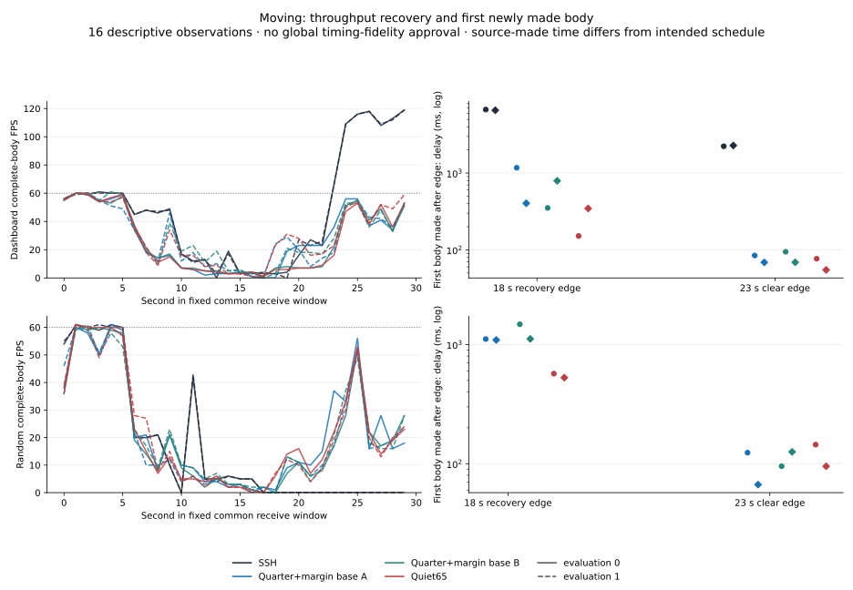
All28 common-overlap bounds below are netlink send/ACK brackets across eight directions, in ms. They do not measure exact kernel packet impairment or equal packet loss; coverage validity does not grant timing-fidelity approval.
| Block | Intended outage ms | Common lower / upper ms |
|---|---:|---:|
| 00-moving-compress-i0 | 6 | 5.970036 / 6.001162 |
| 00-moving-compress-i0 | 32 | 31.179190 / 31.197690 |
| 00-moving-compress-i0 | 120 | 119.935689 / 119.976148 |
| 00-moving-compress-i0 | 240 | 239.859378 / 239.927628 |
| 00-moving-compress-i0 | 1000 | 999.938798 / 999.981173 |
| 00-moving-compress-i0 | 50 | 49.907429 / 49.939679 |
| 00-moving-compress-i0 | 7 | 6.977834 / 7.000834 |
| 01-moving-compress-i1 | 6 | 5.965911 / 6.001245 |
| 01-moving-compress-i1 | 32 | 31.844569 / 31.867986 |
| 01-moving-compress-i1 | 120 | 119.893272 / 119.935480 |
| 01-moving-compress-i1 | 240 | 239.926461 / 239.956712 |
| 01-moving-compress-i1 | 1000 | 999.944465 / 1000.035216 |
| 01-moving-compress-i1 | 50 | 49.846179 / 49.884179 |
| 01-moving-compress-i1 | 7 | 6.229829 / 6.235704 |
| 02-moving-bandwidth-i0 | 6 | 5.437074 / 5.444324 |
| 02-moving-bandwidth-i0 | 32 | 31.870818 / 31.892360 |
| 02-moving-bandwidth-i0 | 120 | 119.942226 / 120.006435 |
| 02-moving-bandwidth-i0 | 240 | 239.953910 / 240.017869 |
| 02-moving-bandwidth-i0 | 1000 | 998.420540 / 1000.044467 |
| 02-moving-bandwidth-i0 | 50 | 49.958219 / 50.010427 |
| 02-moving-bandwidth-i0 | 7 | 6.587123 / 6.596290 |
| 03-moving-bandwidth-i1 | 6 | 5.976953 / 6.001036 |
| 03-moving-bandwidth-i1 | 32 | 31.962943 / 32.002485 |
| 03-moving-bandwidth-i1 | 120 | 119.961726 / 120.002351 |
| 03-moving-bandwidth-i1 | 240 | 239.933160 / 240.000869 |
| 03-moving-bandwidth-i1 | 1000 | 999.955174 / 1000.032008 |
| 03-moving-bandwidth-i1 | 50 | 49.954427 / 50.007136 |
| 03-moving-bandwidth-i1 | 7 | 6.975250 / 6.999626 |

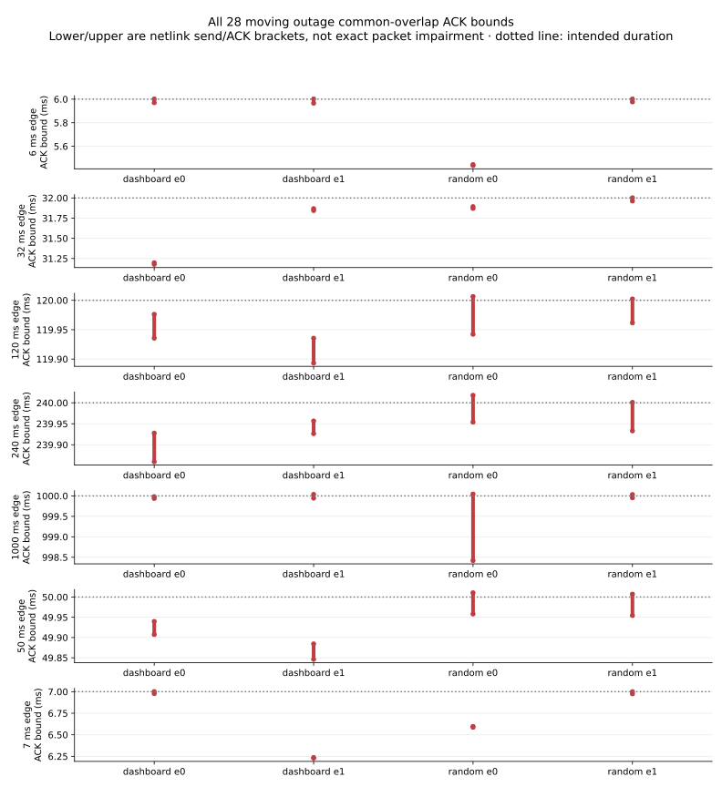

## 70: bounded-quiet increment versus advanced60 — separate120Hz guard

Cells are **average /1% low /5% low FPS**; dashboard=`compress`, random=incompressible `bandwidth`. Requested120Hz; do not compare absolute FPS as if this were a60Hz cohort.

| Network / scene / evaluation | SSH | Advanced60 A | Advanced60 B | Quiet65 |
|---|---:|---:|---:|---:|
| LAN / random / 0 | 120.0 / 73.2 / 83.0 | 119.7 / 61.2 / 75.5 | 119.9 / 63.1 / 75.9 | 119.5 / 65.7 / 78.8 |
| LAN / random / 1 | 120.0 / 79.8 / 85.8 | 119.9 / 63.5 / 78.5 | 119.8 / 67.9 / 77.2 | 119.8 / 67.1 / 75.3 |
| RTT100 ms / random / 0 | 120.0 / 57.7 / 76.9 | 103.5 / 44.6 / 70.4 | 104.7 / 60.5 / 74.2 | 100.6 / 56.0 / 67.8 |
| RTT100 ms / random / 1 | 120.0 / 49.9 / 76.8 | 103.3 / 48.6 / 71.8 | 101.9 / 46.1 / 68.2 | 98.0 / 44.9 / 67.4 |

This predeclared guard retains requested120Hz and the original quota/deadline, with960 source records per job observed. WAN candidate averages100.6/98.0 trail advanced references about102–105. Evaluation1 declines in all three FPS metrics against both advanced references. LAN is mixed and SSH tails remain stronger. These adverse observations stay separate from the60Hz matrices and the different-reference74 guard.

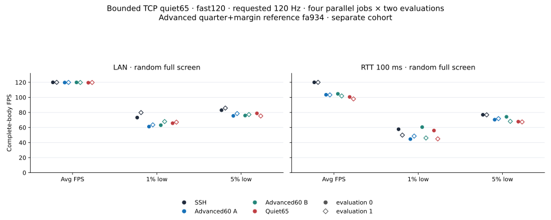

## RX, RSS, CPU, age, matched states and gaps — every observation

### 71 / reference-core

| Network / scene / evaluation / role | RX kbit/s | Client / server RSS MiB | Client / server CPU % | Median / p95 body age ms | Body / header count | Maxgap ms | Incomplete % / unmatched tail s |
|---|---:|---:|---:|---:|---:|---:|---:|
| LAN / dashboard / 0 / ssh | 2476 | 7.36 / 18.37 | 0.22 / 0.28 | 1.0 / 3.0 | 480 / 480 | 27 | 1.8126 / 0.0175 |
| LAN / dashboard / 0 / main-A | 227 | 2.56 / 5.52 | 0.78 / 1.09 | 3.0 / 6.0 | 480 / 480 | 25 | 0.0000 / 0.0145 |
| LAN / dashboard / 0 / main-B | 228 | 2.57 / 5.55 | 0.78 / 1.1 | 3.0 / 6.0 | 480 / 480 | 24 | 0.0000 / 0.0198 |
| LAN / dashboard / 0 / candidate | 228 | 2.57 / 5.52 | 0.83 / 1.13 | 3.0 / 6.0 | 480 / 480 | 24 | 0.0000 / 0.0198 |
| LAN / dashboard / 1 / candidate | 227 | 1.68 / 4.76 | 0.78 / 1.08 | 3.0 / 6.0 | 480 / 480 | 28 | 0.0000 / 0.0195 |
| LAN / dashboard / 1 / main-B | 227 | 1.70 / 4.77 | 0.77 / 1.03 | 3.0 / 6.0 | 480 / 480 | 24 | 0.0000 / 0.0150 |
| LAN / dashboard / 1 / main-A | 228 | 1.98 / 4.55 | 0.76 / 1.08 | 4.0 / 6.0 | 480 / 480 | 23 | 0.0000 / 0.0166 |
| LAN / dashboard / 1 / ssh | 2483 | 7.38 / 18.39 | 0.24 / 0.29 | 1.0 / 3.0 | 480 / 480 | 23 | 2.1100 / 0.0167 |
| LAN / random / 0 / ssh | 5781 | 7.38 / 18.38 | 0.19 / 0.25 | 2.0 / 4.0 | 480 / 480 | 26 | 4.2541 / 0.0261 |
| LAN / random / 0 / main-A | 2718 | 2.59 / 5.60 | 1.15 / 1.55 | 5.0 / 9.0 | 480 / 480 | 26 | 0.0000 / 0.0209 |
| LAN / random / 0 / main-B | 2723 | 2.59 / 5.56 | 1.19 / 1.55 | 5.0 / 9.0 | 480 / 480 | 25 | 0.0000 / 0.0190 |
| LAN / random / 0 / candidate | 2718 | 2.59 / 5.60 | 1.19 / 1.56 | 5.0 / 9.0 | 480 / 480 | 30 | 0.0000 / 0.0194 |
| LAN / random / 1 / candidate | 2715 | 2.59 / 5.58 | 1.11 / 1.44 | 5.0 / 8.0 | 480 / 480 | 29 | 0.0000 / 0.0292 |
| LAN / random / 1 / main-B | 2716 | 2.59 / 5.62 | 1.07 / 1.41 | 4.0 / 8.0 | 480 / 480 | 29 | 0.0000 / 0.0242 |
| LAN / random / 1 / main-A | 2717 | 2.59 / 5.58 | 1.11 / 1.44 | 5.0 / 9.0 | 480 / 480 | 26 | 0.0000 / 0.0219 |
| LAN / random / 1 / ssh | 5789 | 7.42 / 18.39 | 0.18 / 0.22 | 2.0 / 4.0 | 480 / 480 | 23 | 3.3203 / 0.0135 |
| RTT100 ms / dashboard / 0 / ssh | 2511 | 7.39 / 18.38 | 0.22 / 0.26 | 52.0 / 55.0 | 480 / 480 | 39 | 2.1328 / 0.0162 |
| RTT100 ms / dashboard / 0 / main-A | 224 | 1.99 / 5.34 | 0.82 / 3.13 | 60.0 / 69.0 | 448 / 448 | 28 | 0.0000 / 0.0171 |
| RTT100 ms / dashboard / 0 / main-B | 223 | 2.21 / 4.93 | 0.8 / 3.18 | 60.0 / 69.0 | 448 / 448 | 25 | 0.0000 / 0.0131 |
| RTT100 ms / dashboard / 0 / candidate | 228 | 1.46 / 4.76 | 0.8 / 1.08 | 55.0 / 58.0 | 480 / 480 | 29 | 0.0000 / 0.0148 |
| RTT100 ms / dashboard / 1 / candidate | 228 | 2.57 / 5.59 | 0.8 / 1.06 | 55.0 / 58.0 | 480 / 480 | 23 | 0.0000 / 0.0192 |
| RTT100 ms / dashboard / 1 / main-B | 223 | 2.58 / 5.75 | 0.81 / 3.17 | 60.0 / 69.0 | 447 / 447 | 25 | 0.0000 / 0.0203 |
| RTT100 ms / dashboard / 1 / main-A | 221 | 2.58 / 5.77 | 0.8 / 3.09 | 60.0 / 69.0 | 445 / 445 | 24 | 0.0000 / 0.0063 |
| RTT100 ms / dashboard / 1 / ssh | 2515 | 7.37 / 18.39 | 0.23 / 0.25 | 52.0 / 55.0 | 480 / 480 | 38 | 2.5687 / 0.0157 |
| RTT100 ms / random / 0 / ssh | 5798 | 7.47 / 18.39 | 0.23 / 0.23 | 53.0 / 57.0 | 480 / 480 | 81 | 8.4741 / 0.0157 |
| RTT100 ms / random / 0 / main-A | 2127 | 2.63 / 5.83 | 1.09 / 4.63 | 63.0 / 72.0 | 434 / 436 | 101 | 0.6549 / 0.0167 |
| RTT100 ms / random / 0 / main-B | 2124 | 2.65 / 5.84 | 1.08 / 4.62 | 62.0 / 71.0 | 435 / 435 | 91 | 0.1771 / 0.0137 |
| RTT100 ms / random / 0 / candidate | 2281 | 2.65 / 5.86 | 1.19 / 5.11 | 58.0 / 65.0 | 467 / 467 | 105 | 0.0000 / 0.0103 |
| RTT100 ms / random / 1 / candidate | 2279 | 2.64 / 5.82 | 1.14 / 4.7 | 59.0 / 67.0 | 468 / 468 | 93 | 0.0000 / 0.0217 |
| RTT100 ms / random / 1 / main-B | 2124 | 2.66 / 5.88 | 1.04 / 4.46 | 62.0 / 71.0 | 435 / 435 | 95 | 0.4037 / 0.0191 |
| RTT100 ms / random / 1 / main-A | 2092 | 2.64 / 5.82 | 1.04 / 4.34 | 62.0 / 72.0 | 429 / 430 | 93 | 0.4676 / 0.0103 |
| RTT100 ms / random / 1 / ssh | 5790 | 7.23 / 18.41 | 0.22 / 0.22 | 53.0 / 57.0 | 480 / 480 | 68 | 6.4777 / 0.0180 |
| RTT300 ms / dashboard / 0 / ssh | 2505 | 7.41 / 18.49 | 0.23 / 0.25 | 152.0 / 239.0 | 480 / 480 | 47 | 3.6623 / 0.0222 |
| RTT300 ms / dashboard / 0 / main-A | 214 | 2.62 / 5.77 | 0.75 / 2.94 | 160.0 / 170.0 | 429 / 429 | 72 | 0.0000 / 0.0224 |
| RTT300 ms / dashboard / 0 / main-B | 218 | 2.67 / 5.77 | 0.76 / 3.02 | 161.0 / 169.0 | 438 / 438 | 88 | 0.0000 / 0.0198 |
| RTT300 ms / dashboard / 0 / candidate | 235 | 2.63 / 5.82 | 0.85 / 3.27 | 158.0 / 165.0 | 471 / 471 | 80 | 0.0000 / 0.0185 |
| RTT300 ms / dashboard / 1 / candidate | 220 | 2.64 / 5.61 | 0.81 / 1.79 | 157.0 / 167.0 | 449 / 449 | 106 | 0.0000 / 0.0186 |
| RTT300 ms / dashboard / 1 / main-B | 160 | 2.63 / 5.77 | 0.64 / 2.42 | 153.0 / 172.0 | 318 / 318 | 82 | 0.0000 / 0.0251 |
| RTT300 ms / dashboard / 1 / main-A | 216 | 2.61 / 5.79 | 0.84 / 3.14 | 162.0 / 170.0 | 435 / 436 | 81 | 0.2406 / 0.0078 |
| RTT300 ms / dashboard / 1 / ssh | 2508 | 7.43 / 18.46 | 0.23 / 0.27 | 152.0 / 240.0 | 480 / 480 | 50 | 4.0741 / 0.0169 |
| RTT300 ms / random / 0 / ssh | 5796 | 7.73 / 18.55 | 0.2 / 0.21 | 153.0 / 489.0 | 480 / 480 | 99 | 15.3156 / 0.0103 |
| RTT300 ms / random / 0 / main-A | 1926 | 2.68 / 5.71 | 0.94 / 4.07 | 163.0 / 173.0 | 386 / 388 | 295 | 4.1344 / 0.0139 |
| RTT300 ms / random / 0 / main-B | 1978 | 2.68 / 5.47 | 0.97 / 4.12 | 162.0 / 172.0 | 395 / 398 | 293 | 4.1813 / 0.0093 |
| RTT300 ms / random / 0 / candidate | 2129 | 2.68 / 5.37 | 1.05 / 4.46 | 161.0 / 168.0 | 428 / 429 | 283 | 3.5423 / 0.0196 |
| RTT300 ms / random / 1 / candidate | 2130 | 2.72 / 5.98 | 1.05 / 4.43 | 160.0 / 166.0 | 427 / 428 | 516 | 2.2282 / 0.0244 |
| RTT300 ms / random / 1 / main-B | 1994 | 2.69 / 5.92 | 1.02 / 4.12 | 162.0 / 172.0 | 401 / 402 | 291 | 3.6406 / 0.0128 |
| RTT300 ms / random / 1 / main-A | 1981 | 2.68 / 5.89 | 0.96 / 4.08 | 163.0 / 172.0 | 398 / 399 | 282 | 3.4274 / 0.0186 |
| RTT300 ms / random / 1 / ssh | 5792 | 7.74 / 18.62 | 0.2 / 0.2 | 153.0 / 477.0 | 480 / 480 | 118 | 16.0829 / 0.0175 |

### 72 / reference-slow

| Network / scene / evaluation / role | RX kbit/s | Client / server RSS MiB | Client / server CPU % | Median / p95 body age ms | Body / header count | Maxgap ms | Incomplete % / unmatched tail s |
|---|---:|---:|---:|---:|---:|---:|---:|
| 1 Mbit/s / dashboard / 0 / ssh | 978 | 7.36 / 19.25 | 0.14 / 0.5 | 2547.0 / 4680.0 | 188 / 188 | 172 | 59.6363 / 0.1140 |
| 1 Mbit/s / dashboard / 0 / main-A | 223 | 2.58 / 5.74 | 0.84 / 3.37 | 64.0 / 74.0 | 448 / 448 | 29 | 0.0000 / 0.0202 |
| 1 Mbit/s / dashboard / 0 / main-B | 222 | 2.57 / 5.76 | 0.85 / 3.38 | 64.0 / 73.0 | 445 / 445 | 34 | 0.0000 / 0.0195 |
| 1 Mbit/s / dashboard / 0 / candidate | 228 | 2.58 / 5.58 | 0.84 / 1.15 | 60.0 / 63.0 | 480 / 480 | 26 | 0.0000 / 0.0172 |
| 1 Mbit/s / dashboard / 1 / candidate | 228 | 2.57 / 5.55 | 0.83 / 1.13 | 60.0 / 63.0 | 480 / 480 | 25 | 0.0000 / 0.0176 |
| 1 Mbit/s / dashboard / 1 / main-B | 222 | 2.58 / 5.74 | 0.83 / 3.38 | 64.0 / 73.0 | 447 / 447 | 25 | 0.0000 / 0.0091 |
| 1 Mbit/s / dashboard / 1 / main-A | 222 | 2.59 / 5.76 | 0.82 / 3.4 | 64.0 / 74.0 | 447 / 447 | 35 | 0.0000 / 0.0042 |
| 1 Mbit/s / dashboard / 1 / ssh | 977 | 7.39 / 19.34 | 0.16 / 0.56 | 2573.0 / 4689.0 | 188 / 189 | 158 | 58.9183 / 0.1026 |
| 1 Mbit/s / random / 0 / ssh | 977 | 7.41 / 19.66 | 0.12 / 0.29 | 3427.0 / 6431.0 | 78 / 79 | 158 | 86.2724 / 0.1559 |
| 1 Mbit/s / random / 0 / main-A | 905 | 2.58 / 5.79 | 0.79 / 2.79 | 103.0 / 124.0 | 183 / 183 | 67 | 0.0000 / 0.0465 |
| 1 Mbit/s / random / 0 / main-B | 885 | 2.57 / 5.82 | 0.77 / 2.77 | 101.0 / 120.0 | 179 / 179 | 78 | 0.0000 / 0.0626 |
| 1 Mbit/s / random / 0 / candidate | 966 | 2.61 / 5.84 | 0.87 / 2.99 | 118.0 / 160.0 | 195 / 195 | 76 | 0.0000 / 0.0248 |
| 1 Mbit/s / random / 1 / candidate | 956 | 2.57 / 5.81 | 0.84 / 2.95 | 113.0 / 146.0 | 193 / 193 | 71 | 0.0000 / 0.0223 |
| 1 Mbit/s / random / 1 / main-B | 924 | 2.57 / 5.82 | 0.83 / 2.86 | 107.0 / 128.0 | 186 / 187 | 80 | 0.4982 / 0.0568 |
| 1 Mbit/s / random / 1 / main-A | 842 | 2.57 / 5.80 | 0.74 / 2.69 | 100.0 / 124.0 | 170 / 170 | 81 | 0.0000 / 0.0553 |
| 1 Mbit/s / random / 1 / ssh | 979 | 7.40 / 19.68 | 0.13 / 0.32 | 3508.0 / 6491.0 | 79 / 80 | 184 | 88.8704 / 0.0766 |
| 256 kbit/s / dashboard / 0 / ssh | 249 | 7.36 / 19.34 | 0.09 / 0.58 | 3762.0 / 6954.0 | 48 / 49 | 470 | 21.7986 / 0.2013 |
| 256 kbit/s / dashboard / 0 / main-A | 131 | 2.58 / 5.75 | 0.8 / 2.85 | 69.0 / 88.0 | 272 / 272 | 44 | 0.0000 / 0.0271 |
| 256 kbit/s / dashboard / 0 / main-B | 150 | 2.59 / 5.75 | 0.86 / 3.14 | 70.0 / 88.0 | 301 / 301 | 41 | 0.0000 / 0.0199 |
| 256 kbit/s / dashboard / 0 / candidate | 229 | 2.57 / 5.56 | 1.22 / 1.73 | 72.0 / 76.0 | 480 / 480 | 25 | 0.0000 / 0.0222 |
| 256 kbit/s / dashboard / 1 / candidate | 228 | 2.58 / 5.59 | 1.17 / 1.67 | 72.0 / 76.0 | 480 / 480 | 31 | 0.0000 / 0.0206 |
| 256 kbit/s / dashboard / 1 / main-B | 140 | 2.59 / 5.79 | 0.85 / 3.0 | 70.0 / 89.0 | 287 / 287 | 42 | 0.0000 / 0.0216 |
| 256 kbit/s / dashboard / 1 / main-A | 135 | 2.58 / 5.75 | 0.8 / 2.76 | 70.0 / 88.0 | 280 / 280 | 44 | 0.0000 / 0.0213 |
| 256 kbit/s / dashboard / 1 / ssh | 250 | 7.38 / 19.42 | 0.08 / 0.53 | 3868.0 / 7249.0 | 49 / 49 | 425 | 25.0391 / 0.0276 |
| 256 kbit/s / random / 0 / ssh | 250 | 7.38 / 19.48 | 0.12 / 0.36 | 3919.0 / — | 19 / 20 | 756 | 77.3100 / 0.4411 |
| 256 kbit/s / random / 0 / main-A | 256 | 2.57 / 5.80 | 0.71 / 2.32 | 384.0 / 404.0 | 47 / 47 | 186 | 0.0000 / 0.1215 |
| 256 kbit/s / random / 0 / main-B | 256 | 2.59 / 5.79 | 0.66 / 2.39 | 381.0 / 408.0 | 48 / 48 | 184 | 0.0000 / 0.0282 |
| 256 kbit/s / random / 0 / candidate | 256 | 2.56 / 5.81 | 0.7 / 2.36 | 385.0 / 412.0 | 47 / 47 | 188 | 0.0000 / 0.1292 |
| 256 kbit/s / random / 1 / candidate | 256 | 2.59 / 5.85 | 0.84 / 2.62 | 386.0 / 420.0 | 47 / 47 | 191 | 0.0000 / 0.0422 |
| 256 kbit/s / random / 1 / main-B | 256 | 2.56 / 5.80 | 0.82 / 2.62 | 382.0 / 409.0 | 48 / 48 | 184 | 0.0000 / 0.0128 |
| 256 kbit/s / random / 1 / main-A | 256 | 2.55 / 5.78 | 0.82 / 2.65 | 382.0 / 395.0 | 48 / 48 | 185 | 0.0000 / 0.0256 |
| 256 kbit/s / random / 1 / ssh | 249 | 7.39 / 19.49 | 0.12 / 0.39 | 4227.0 / 7647.0 | 20 / 21 | 626 | 80.7848 / 0.2270 |
| 64 kbit/s / dashboard / 0 / ssh | 62 | 7.42 / 19.34 | 0.12 / 0.75 | 4496.0 / — | 12 / 12 | 798 | 13.4026 / 0.4606 |
| 64 kbit/s / dashboard / 0 / main-A | 63 | 2.58 / 5.77 | 0.68 / 2.61 | 171.0 / 413.0 | 125 / 125 | 149 | 0.0000 / 0.0025 |
| 64 kbit/s / dashboard / 0 / main-B | 63 | 2.58 / 5.77 | 0.68 / 2.63 | 165.0 / 352.0 | 125 / 125 | 130 | 0.0000 / 0.0387 |
| 64 kbit/s / dashboard / 0 / candidate | 64 | 2.59 / 5.80 | 0.67 / 2.7 | 194.0 / 429.0 | 125 / 125 | 171 | 0.0000 / 0.0078 |
| 64 kbit/s / dashboard / 1 / candidate | 63 | 2.39 / 5.29 | 0.62 / 2.43 | 189.0 / 345.0 | 126 / 126 | 158 | 0.0000 / 0.0188 |
| 64 kbit/s / dashboard / 1 / main-B | 63 | 2.20 / 5.34 | 0.69 / 2.36 | 142.0 / 350.0 | 126 / 126 | 124 | 0.0000 / 0.0231 |
| 64 kbit/s / dashboard / 1 / main-A | 63 | 1.71 / 5.04 | 0.64 / 2.36 | 164.0 / 374.0 | 128 / 128 | 129 | 0.0000 / 0.0586 |
| 64 kbit/s / dashboard / 1 / ssh | 60 | 7.37 / 19.34 | 0.09 / 0.65 | 4122.0 / — | 11 / 12 | 793 | 21.2085 / 0.6964 |
| 64 kbit/s / random / 0 / ssh | 60 | 7.39 / 19.43 | 0.09 / 0.33 | 4933.0 / — | 5 / 5 | 1738 | 52.3414 / 0.6928 |
| 64 kbit/s / random / 0 / main-A | 64 | 2.58 / 5.81 | 0.29 / 1.71 | 1020.0 / — | 10 / 12 | 1348 | 50.9602 / 0.6342 |
| 64 kbit/s / random / 0 / main-B | 64 | 2.59 / 5.78 | 0.29 / 1.69 | 997.0 / — | 11 / 12 | 1332 | 49.6386 / 0.0531 |
| 64 kbit/s / random / 0 / candidate | 63 | 2.58 / 5.78 | 0.35 / 1.73 | 1015.0 / — | 10 / 12 | 1342 | 49.1362 / 0.6383 |
| 64 kbit/s / random / 1 / candidate | 63 | 2.55 / 5.81 | 0.23 / 1.93 | 2179.0 / — | 12 / 13 | 1285 | 31.6761 / 0.2907 |
| 64 kbit/s / random / 1 / main-B | 64 | 2.60 / 5.77 | 0.29 / 1.72 | 1022.0 / — | 11 / 12 | 753 | 42.6342 / 0.6846 |
| 64 kbit/s / random / 1 / main-A | 63 | 2.55 / 5.80 | 0.29 / 1.75 | 1079.0 / — | 11 / 12 | 776 | 42.2296 / 0.4668 |
| 64 kbit/s / random / 1 / ssh | 61 | 7.61 / 19.36 | 0.09 / 0.33 | 5067.0 / — | 5 / 5 | 1738 | 67.4296 / 0.3056 |

### 73 / reference-moving

| Network / scene / evaluation / role | RX kbit/s | Client / server RSS MiB | Client / server CPU % | Median / p95 body age ms | Body / header count | Maxgap ms | Incomplete % / unmatched tail s |
|---|---:|---:|---:|---:|---:|---:|---:|
| Moving / dashboard / 0 / ssh | 1969 | 7.78 / 19.63 | 0.22 / 0.38 | 1685.0 / 12033.0 | 1436 / 1429 | 1224 | 74.3131 / 0.0093 |
| Moving / dashboard / 0 / main-A | 59 | 2.66 / 5.73 | 0.31 / 1.49 | 50.0 / 164.0 | 457 / 457 | 1660 | 0.0000 / 0.0310 |
| Moving / dashboard / 0 / main-B | 73 | 2.68 / 5.75 | 0.36 / 1.45 | 47.0 / 135.0 | 556 / 556 | 1784 | 0.0000 / 0.0005 |
| Moving / dashboard / 0 / candidate | 107 | 2.67 / 5.77 | 0.47 / 1.54 | 46.0 / 131.0 | 806 / 806 | 1270 | 0.0000 / 0.0027 |
| Moving / dashboard / 1 / candidate | 113 | 2.66 / 5.75 | 0.51 / 1.8 | 48.0 / 140.0 | 845 / 845 | 1267 | 0.0000 / 0.0014 |
| Moving / dashboard / 1 / main-B | 70 | 2.57 / 5.75 | 0.33 / 1.38 | 46.0 / 164.0 | 539 / 539 | 1204 | 0.0000 / 0.0158 |
| Moving / dashboard / 1 / main-A | 60 | 2.59 / 5.76 | 0.31 / 1.46 | 49.0 / 204.0 | 470 / 470 | 1214 | 0.0000 / 0.0006 |
| Moving / dashboard / 1 / ssh | 1989 | 7.52 / 19.52 | 0.24 / 0.37 | 1780.0 / 11258.0 | 1447 / 1444 | 1700 | 65.7564 / 0.0055 |
| Moving / random / 0 / ssh | 1694 | 7.86 / 18.65 | 0.14 / 0.09 | 54.0 / 4527.0 | 494 / 495 | 13129 | 83.6892 / 13.1286 |
| Moving / random / 0 / main-A | 602 | 2.71 / 5.36 | 0.57 / 2.44 | 61.0 / 354.0 | 426 / 433 | 1477 | 11.4968 / 0.0168 |
| Moving / random / 0 / main-B | 537 | 2.66 / 5.37 | 0.53 / 2.31 | 65.0 / 356.0 | 387 / 393 | 2029 | 7.3166 / 0.0246 |
| Moving / random / 0 / candidate | 910 | 2.65 / 5.39 | 0.81 / 3.12 | 55.0 / 208.0 | 651 / 653 | 2002 | 8.4892 / 0.0048 |
| Moving / random / 1 / candidate | 856 | 2.65 / 5.38 | 0.73 / 2.99 | 54.0 / 222.0 | 610 / 618 | 2164 | 11.9165 / 0.0016 |
| Moving / random / 1 / main-B | 585 | 2.70 / 5.37 | 0.51 / 2.33 | 57.0 / 339.0 | 416 / 426 | 2090 | 6.8509 / 0.0197 |
| Moving / random / 1 / main-A | 692 | 2.70 / 5.39 | 0.63 / 2.61 | 60.0 / 268.0 | 478 / 490 | 2828 | 16.0240 / 0.0209 |
| Moving / random / 1 / ssh | 2652 | 7.56 / 20.68 | 0.21 / 0.21 | 1700.0 / 13834.0 | 816 / 817 | 1448 | 87.3571 / 0.0136 |

### 74 / reference-fast120

| Network / scene / evaluation / role | RX kbit/s | Client / server RSS MiB | Client / server CPU % | Median / p95 body age ms | Body / header count | Maxgap ms | Incomplete % / unmatched tail s |
|---|---:|---:|---:|---:|---:|---:|---:|
| LAN / random / 0 / ssh | 11567 | 7.37 / 18.38 | 0.4 / 0.51 | 2.0 / 5.0 | 960 / 960 | 15 | 11.4565 / 0.0072 |
| LAN / random / 0 / main-A | 5438 | 2.60 / 5.61 | 2.62 / 3.39 | 5.0 / 9.0 | 956 / 956 | 29 | 0.0609 / 0.0130 |
| LAN / random / 0 / main-B | 5441 | 2.59 / 5.58 | 2.61 / 3.33 | 6.0 / 10.0 | 960 / 960 | 17 | 0.0000 / 0.0123 |
| LAN / random / 0 / candidate | 5435 | 2.62 / 5.64 | 2.71 / 3.35 | 5.0 / 9.0 | 954 / 954 | 27 | 0.0452 / 0.0149 |
| LAN / random / 1 / candidate | 5433 | 2.64 / 5.62 | 2.71 / 3.63 | 6.0 / 9.0 | 955 / 955 | 38 | 0.0004 / 0.0140 |
| LAN / random / 1 / main-B | 5439 | 2.62 / 5.59 | 2.66 / 3.56 | 5.0 / 10.0 | 956 / 957 | 24 | 0.1076 / 0.0182 |
| LAN / random / 1 / main-A | 5439 | 2.62 / 5.62 | 2.7 / 3.57 | 5.0 / 9.0 | 959 / 959 | 20 | 0.0000 / 0.0117 |
| LAN / random / 1 / ssh | 11577 | 7.41 / 18.38 | 0.45 / 0.58 | 2.0 / 5.0 | 960 / 960 | 18 | 12.6324 / 0.0083 |
| RTT100 ms / random / 0 / ssh | 11589 | 7.78 / 18.59 | 0.44 / 0.53 | 54.0 / 142.0 | 960 / 960 | 72 | 19.4112 / 0.0098 |
| RTT100 ms / random / 0 / main-A | 3956 | 2.66 / 5.84 | 2.17 / 9.54 | 58.0 / 64.0 | 803 / 808 | 105 | 0.7505 / 0.0000 |
| RTT100 ms / random / 0 / main-B | 3972 | 2.64 / 5.90 | 2.22 / 9.64 | 58.0 / 65.0 | 806 / 809 | 101 | 0.4647 / 0.0102 |
| RTT100 ms / random / 0 / candidate | 3917 | 2.63 / 5.86 | 2.22 / 9.71 | 60.0 / 66.0 | 799 / 799 | 105 | 0.0000 / 0.0106 |
| RTT100 ms / random / 1 / candidate | 3959 | 2.64 / 5.86 | 2.37 / 10.3 | 60.0 / 65.0 | 808 / 808 | 108 | 0.0000 / 0.0130 |
| RTT100 ms / random / 1 / main-B | 3967 | 2.61 / 5.88 | 2.33 / 10.14 | 59.0 / 65.0 | 807 / 811 | 97 | 0.6310 / 0.0089 |
| RTT100 ms / random / 1 / main-A | 3943 | 2.64 / 5.84 | 2.33 / 9.98 | 59.0 / 65.0 | 798 / 803 | 104 | 0.9555 / 0.0105 |
| RTT100 ms / random / 1 / ssh | 11584 | 7.94 / 18.59 | 0.47 / 0.57 | 54.0 / 117.0 | 960 / 960 | 76 | 20.6051 / 0.0100 |

### 66 / focused

| Network / scene / evaluation / role | RX kbit/s | Client / server RSS MiB | Client / server CPU % | Median / p95 body age ms | Body / header count | Maxgap ms | Incomplete % / unmatched tail s |
|---|---:|---:|---:|---:|---:|---:|---:|
| RTT100 ms / random / 0 / ssh | 5796 | 7.45 / 18.37 | 0.2 / 0.21 | 53.0 / 57.0 | 480 / 480 | 57 | 7.2078 / 0.0170 |
| RTT100 ms / random / 0 / main-A | 2268 | 2.66 / 5.87 | 1.07 / 4.62 | 55.0 / 65.0 | 464 / 467 | 89 | 0.8074 / 0.0090 |
| RTT100 ms / random / 0 / main-B | 2238 | 2.63 / 5.90 | 1.07 / 4.62 | 58.0 / 64.0 | 459 / 462 | 96 | 0.8809 / 0.0168 |
| RTT100 ms / random / 0 / candidate | 2280 | 2.64 / 5.83 | 1.09 / 4.76 | 59.0 / 63.0 | 469 / 469 | 88 | 0.0000 / 0.0195 |
| RTT100 ms / random / 1 / candidate | 2285 | 2.20 / 5.27 | 1.11 / 4.83 | 58.0 / 63.0 | 467 / 467 | 115 | 0.0000 / 0.0110 |
| RTT100 ms / random / 1 / main-B | 2277 | 1.59 / 4.97 | 1.09 / 4.68 | 55.0 / 65.0 | 464 / 467 | 111 | 0.8694 / 0.0214 |
| RTT100 ms / random / 1 / main-A | 2277 | 2.11 / 4.95 | 1.12 / 4.71 | 55.0 / 64.0 | 462 / 467 | 87 | 1.3492 / 0.0185 |
| RTT100 ms / random / 1 / ssh | 5800 | 7.22 / 18.13 | 0.21 / 0.22 | 53.0 / 58.0 | 480 / 480 | 44 | 6.5292 / 0.0138 |
| RTT300 ms / random / 0 / ssh | 5799 | 7.88 / 18.57 | 0.21 / 0.23 | 154.0 / 497.0 | 480 / 480 | 128 | 17.1189 / 0.0133 |
| RTT300 ms / random / 0 / main-A | 2080 | 2.76 / 5.98 | 1.05 / 4.37 | 156.0 / 167.0 | 417 / 420 | 352 | 5.0321 / 0.0159 |
| RTT300 ms / random / 0 / main-B | 2124 | 2.73 / 5.95 | 1.04 / 4.48 | 156.0 / 167.0 | 426 / 428 | 329 | 0.6386 / 0.0147 |
| RTT300 ms / random / 0 / candidate | 2123 | 2.71 / 5.89 | 1.07 / 4.55 | 160.0 / 168.0 | 426 / 428 | 343 | 3.7876 / 0.0193 |
| RTT300 ms / random / 1 / candidate | 2124 | 2.68 / 5.90 | 1.13 / 4.63 | 159.0 / 163.0 | 429 / 430 | 293 | 3.6632 / 0.0116 |
| RTT300 ms / random / 1 / main-B | 2114 | 2.72 / 6.00 | 1.09 / 4.51 | 154.0 / 169.0 | 425 / 427 | 296 | 0.9119 / 0.0186 |
| RTT300 ms / random / 1 / main-A | 2126 | 2.73 / 5.98 | 1.1 / 4.55 | 159.0 / 171.0 | 426 / 430 | 291 | 4.9836 / 0.0058 |
| RTT300 ms / random / 1 / ssh | 5795 | 7.82 / 18.68 | 0.22 / 0.24 | 153.0 / 502.0 | 480 / 480 | 134 | 17.7847 / 0.0089 |

### 67 / core

| Network / scene / evaluation / role | RX kbit/s | Client / server RSS MiB | Client / server CPU % | Median / p95 body age ms | Body / header count | Maxgap ms | Incomplete % / unmatched tail s |
|---|---:|---:|---:|---:|---:|---:|---:|
| LAN / dashboard / 0 / ssh | 2477 | 7.37 / 18.37 | 0.28 / 0.33 | 1.0 / 4.0 | 480 / 480 | 23 | 2.0969 / 0.0168 |
| LAN / dashboard / 0 / main-A | 228 | 2.63 / 5.62 | 0.75 / 1.04 | 3.0 / 6.0 | 480 / 480 | 24 | 0.0000 / 0.0152 |
| LAN / dashboard / 0 / main-B | 228 | 2.63 / 5.59 | 0.74 / 1.02 | 3.0 / 6.0 | 480 / 480 | 25 | 0.0000 / 0.0154 |
| LAN / dashboard / 0 / candidate | 227 | 2.57 / 5.55 | 0.77 / 1.07 | 3.0 / 6.0 | 480 / 480 | 24 | 0.0000 / 0.0177 |
| LAN / dashboard / 1 / candidate | 228 | 2.13 / 5.05 | 0.9 / 1.24 | 3.0 / 6.0 | 480 / 480 | 25 | 0.0000 / 0.0212 |
| LAN / dashboard / 1 / main-B | 227 | 2.07 / 5.04 | 0.86 / 1.18 | 3.0 / 7.0 | 480 / 480 | 25 | 0.0000 / 0.0169 |
| LAN / dashboard / 1 / main-A | 227 | 2.07 / 4.77 | 0.86 / 1.17 | 3.0 / 6.0 | 480 / 480 | 23 | 0.0000 / 0.0156 |
| LAN / dashboard / 1 / ssh | 2477 | 7.38 / 18.38 | 0.26 / 0.34 | 1.0 / 4.0 | 480 / 480 | 23 | 2.6864 / 0.0168 |
| LAN / random / 0 / ssh | 5792 | 7.36 / 18.38 | 0.2 / 0.25 | 2.0 / 5.0 | 480 / 480 | 26 | 4.2688 / 0.0142 |
| LAN / random / 0 / main-A | 2721 | 2.65 / 5.68 | 1.23 / 1.55 | 5.0 / 8.0 | 480 / 480 | 24 | 0.0000 / 0.0222 |
| LAN / random / 0 / main-B | 2717 | 2.65 / 5.66 | 1.23 / 1.57 | 5.0 / 9.0 | 480 / 480 | 25 | 0.0000 / 0.0193 |
| LAN / random / 0 / candidate | 2721 | 2.59 / 5.58 | 1.25 / 1.61 | 5.0 / 8.0 | 480 / 480 | 28 | 0.0000 / 0.0204 |
| LAN / random / 1 / candidate | 2717 | 2.58 / 5.59 | 1.24 / 1.66 | 5.0 / 9.0 | 480 / 480 | 25 | 0.0000 / 0.0194 |
| LAN / random / 1 / main-B | 2717 | 2.64 / 5.68 | 1.22 / 1.59 | 5.0 / 8.0 | 480 / 480 | 27 | 0.0000 / 0.0217 |
| LAN / random / 1 / main-A | 2717 | 2.66 / 5.64 | 1.3 / 1.73 | 5.0 / 9.0 | 480 / 480 | 27 | 0.0000 / 0.0175 |
| LAN / random / 1 / ssh | 5788 | 7.38 / 18.37 | 0.2 / 0.27 | 2.0 / 5.0 | 480 / 480 | 24 | 4.4492 / 0.0175 |
| RTT100 ms / dashboard / 0 / ssh | 2504 | 7.37 / 18.38 | 0.23 / 0.27 | 52.0 / 55.0 | 480 / 480 | 37 | 2.8587 / 0.0142 |
| RTT100 ms / dashboard / 0 / main-A | 228 | 1.81 / 5.06 | 0.81 / 1.12 | 55.0 / 58.0 | 480 / 480 | 28 | 0.0000 / 0.0251 |
| RTT100 ms / dashboard / 0 / main-B | 228 | 2.08 / 4.80 | 0.85 / 1.11 | 55.0 / 59.0 | 480 / 480 | 32 | 0.0000 / 0.0174 |
| RTT100 ms / dashboard / 0 / candidate | 228 | 2.13 / 4.74 | 0.83 / 1.14 | 55.0 / 58.0 | 480 / 480 | 26 | 0.0000 / 0.0240 |
| RTT100 ms / dashboard / 1 / candidate | 228 | 2.56 / 5.53 | 0.84 / 1.14 | 55.0 / 58.0 | 480 / 480 | 25 | 0.0000 / 0.0175 |
| RTT100 ms / dashboard / 1 / main-B | 228 | 2.63 / 5.62 | 0.8 / 1.11 | 55.0 / 59.0 | 480 / 480 | 26 | 0.0000 / 0.0117 |
| RTT100 ms / dashboard / 1 / main-A | 228 | 2.63 / 5.64 | 0.81 / 1.09 | 55.0 / 58.0 | 480 / 480 | 26 | 0.0000 / 0.0215 |
| RTT100 ms / dashboard / 1 / ssh | 2516 | 7.37 / 18.46 | 0.26 / 0.28 | 52.0 / 55.0 | 480 / 480 | 39 | 2.8229 / 0.0171 |
| RTT100 ms / random / 0 / ssh | 5794 | 7.48 / 18.37 | 0.24 / 0.25 | 53.0 / 57.0 | 480 / 480 | 59 | 7.4413 / 0.0200 |
| RTT100 ms / random / 0 / main-A | 2275 | 2.70 / 5.91 | 1.17 / 4.87 | 57.0 / 69.0 | 466 / 467 | 98 | 0.7911 / 0.0182 |
| RTT100 ms / random / 0 / main-B | 2269 | 2.69 / 5.94 | 1.15 / 4.78 | 58.0 / 64.0 | 464 / 466 | 97 | 0.7688 / 0.0192 |
| RTT100 ms / random / 0 / candidate | 2280 | 2.64 / 5.82 | 1.18 / 4.92 | 59.0 / 64.0 | 467 / 467 | 92 | 0.0000 / 0.0116 |
| RTT100 ms / random / 1 / candidate | 2280 | 2.35 / 5.09 | 1.12 / 4.8 | 59.0 / 64.0 | 469 / 469 | 93 | 0.0000 / 0.0163 |
| RTT100 ms / random / 1 / main-B | 2277 | 2.11 / 5.36 | 1.1 / 4.66 | 56.0 / 67.0 | 466 / 469 | 86 | 0.5930 / 0.0117 |
| RTT100 ms / random / 1 / main-A | 2280 | 2.13 / 4.89 | 1.11 / 4.7 | 55.0 / 66.0 | 466 / 467 | 89 | 0.5077 / 0.0114 |
| RTT100 ms / random / 1 / ssh | 5794 | 7.21 / 18.39 | 0.24 / 0.23 | 53.0 / 61.0 | 480 / 480 | 75 | 8.3804 / 0.0149 |
| RTT300 ms / dashboard / 0 / ssh | 2500 | 7.46 / 18.43 | 0.22 / 0.26 | 152.0 / 233.0 | 480 / 480 | 48 | 4.0827 / 0.0143 |
| RTT300 ms / dashboard / 0 / main-A | 234 | 2.70 / 5.88 | 0.87 / 3.38 | 154.0 / 159.0 | 472 / 472 | 105 | 0.0000 / 0.0187 |
| RTT300 ms / dashboard / 0 / main-B | 235 | 2.72 / 5.84 | 0.88 / 3.37 | 154.0 / 162.0 | 472 / 472 | 114 | 0.0000 / 0.0152 |
| RTT300 ms / dashboard / 0 / candidate | 235 | 2.65 / 5.82 | 0.91 / 3.44 | 157.0 / 162.0 | 472 / 472 | 127 | 0.0000 / 0.0173 |
| RTT300 ms / dashboard / 1 / candidate | 226 | 2.65 / 5.64 | 0.83 / 1.59 | 156.0 / 163.0 | 464 / 464 | 107 | 0.0000 / 0.0126 |
| RTT300 ms / dashboard / 1 / main-B | 235 | 2.69 / 5.84 | 0.89 / 3.31 | 154.0 / 160.0 | 472 / 472 | 106 | 0.0000 / 0.0211 |
| RTT300 ms / dashboard / 1 / main-A | 235 | 2.71 / 5.88 | 0.89 / 3.3 | 154.0 / 160.0 | 472 / 472 | 104 | 0.0000 / 0.0246 |
| RTT300 ms / dashboard / 1 / ssh | 2505 | 7.44 / 18.39 | 0.24 / 0.28 | 152.0 / 230.0 | 480 / 480 | 63 | 4.2756 / 0.0199 |
| RTT300 ms / random / 0 / ssh | 5800 | 7.80 / 18.59 | 0.24 / 0.25 | 154.0 / 475.0 | 480 / 480 | 105 | 16.8206 / 0.0112 |
| RTT300 ms / random / 0 / main-A | 2123 | 2.77 / 5.48 | 1.14 / 4.77 | 157.0 / 168.0 | 424 / 427 | 298 | 4.3437 / 0.0157 |
| RTT300 ms / random / 0 / main-B | 2113 | 2.74 / 5.48 | 1.13 / 4.82 | 155.0 / 168.0 | 423 / 426 | 311 | 4.6203 / 0.0207 |
| RTT300 ms / random / 0 / candidate | 2124 | 2.68 / 5.47 | 1.16 / 4.89 | 160.0 / 167.0 | 429 / 430 | 294 | 3.6778 / 0.0099 |
| RTT300 ms / random / 1 / candidate | 2065 | 2.73 / 5.89 | 1.13 / 4.8 | 160.0 / 165.0 | 412 / 414 | 350 | 3.6649 / 0.0168 |
| RTT300 ms / random / 1 / main-B | 2119 | 2.74 / 6.02 | 1.15 / 4.86 | 156.0 / 170.0 | 426 / 429 | 302 | 4.9924 / 0.0183 |
| RTT300 ms / random / 1 / main-A | 2127 | 2.73 / 5.96 | 1.15 / 4.82 | 156.0 / 167.0 | 425 / 429 | 293 | 4.7958 / 0.0143 |
| RTT300 ms / random / 1 / ssh | 5791 | 7.78 / 18.57 | 0.21 / 0.23 | 154.0 / 481.0 | 480 / 480 | 107 | 16.4949 / 0.0114 |

### 68 / slow

| Network / scene / evaluation / role | RX kbit/s | Client / server RSS MiB | Client / server CPU % | Median / p95 body age ms | Body / header count | Maxgap ms | Incomplete % / unmatched tail s |
|---|---:|---:|---:|---:|---:|---:|---:|
| 1 Mbit/s / dashboard / 0 / ssh | 977 | 7.39 / 19.33 | 0.16 / 0.57 | 2608.0 / 4646.0 | 188 / 189 | 168 | 61.5740 / 0.1121 |
| 1 Mbit/s / dashboard / 0 / main-A | 227 | 2.63 / 5.67 | 0.9 / 1.24 | 60.0 / 64.0 | 480 / 480 | 26 | 0.0000 / 0.0166 |
| 1 Mbit/s / dashboard / 0 / main-B | 227 | 2.63 / 5.62 | 0.9 / 1.2 | 60.0 / 64.0 | 480 / 480 | 25 | 0.0000 / 0.0181 |
| 1 Mbit/s / dashboard / 0 / candidate | 227 | 2.58 / 5.56 | 0.93 / 1.25 | 60.0 / 64.0 | 480 / 480 | 29 | 0.0000 / 0.0231 |
| 1 Mbit/s / dashboard / 1 / candidate | 227 | 2.13 / 4.79 | 0.79 / 1.09 | 60.0 / 63.0 | 480 / 480 | 25 | 0.0000 / 0.0195 |
| 1 Mbit/s / dashboard / 1 / main-B | 228 | 1.66 / 5.07 | 0.78 / 1.06 | 59.0 / 62.0 | 480 / 480 | 26 | 0.0000 / 0.0146 |
| 1 Mbit/s / dashboard / 1 / main-A | 227 | 2.06 / 4.79 | 0.78 / 1.05 | 59.0 / 62.0 | 480 / 480 | 25 | 0.0000 / 0.0161 |
| 1 Mbit/s / dashboard / 1 / ssh | 978 | 7.38 / 19.24 | 0.15 / 0.52 | 2547.0 / 4658.0 | 188 / 189 | 179 | 59.1941 / 0.0931 |
| 1 Mbit/s / random / 0 / ssh | 977 | 7.40 / 19.61 | 0.12 / 0.34 | 3501.0 / 6476.0 | 79 / 80 | 171 | 89.5932 / 0.0769 |
| 1 Mbit/s / random / 0 / main-A | 970 | 2.64 / 5.86 | 0.86 / 2.99 | 103.0 / 129.0 | 196 / 196 | 73 | 0.0000 / 0.0133 |
| 1 Mbit/s / random / 0 / main-B | 968 | 2.64 / 5.91 | 0.87 / 2.98 | 128.0 / 175.0 | 191 / 193 | 80 | 1.0400 / 0.0146 |
| 1 Mbit/s / random / 0 / candidate | 949 | 2.58 / 5.85 | 0.85 / 2.96 | 121.0 / 152.0 | 192 / 192 | 77 | 0.0000 / 0.0510 |
| 1 Mbit/s / random / 1 / candidate | 941 | 2.57 / 5.80 | 0.87 / 3.08 | 103.0 / 134.0 | 189 / 190 | 83 | 0.4869 / 0.0273 |
| 1 Mbit/s / random / 1 / main-B | 953 | 2.64 / 5.87 | 0.88 / 3.0 | 108.0 / 150.0 | 192 / 193 | 81 | 0.5315 / 0.0453 |
| 1 Mbit/s / random / 1 / main-A | 931 | 2.65 / 5.88 | 0.87 / 2.95 | 115.0 / 145.0 | 187 / 188 | 79 | 0.4962 / 0.0337 |
| 1 Mbit/s / random / 1 / ssh | 980 | 7.64 / 19.64 | 0.12 / 0.31 | 3537.0 / 6472.0 | 80 / 81 | 172 | 87.6034 / 0.0575 |
| 256 kbit/s / dashboard / 0 / ssh | 249 | 7.26 / 19.39 | 0.09 / 0.46 | 3787.0 / 7270.0 | 48 / 48 | 431 | 24.6748 / 0.1345 |
| 256 kbit/s / dashboard / 0 / main-A | 229 | 2.32 / 5.10 | 0.86 / 1.2 | 71.0 / 75.0 | 480 / 480 | 29 | 0.0000 / 0.0288 |
| 256 kbit/s / dashboard / 0 / main-B | 229 | 2.33 / 5.16 | 0.86 / 1.2 | 71.0 / 75.0 | 480 / 480 | 25 | 0.0000 / 0.0212 |
| 256 kbit/s / dashboard / 0 / candidate | 229 | 2.25 / 5.15 | 0.88 / 1.19 | 72.0 / 75.0 | 480 / 480 | 27 | 0.0000 / 0.0255 |
| 256 kbit/s / dashboard / 1 / candidate | 229 | 2.57 / 5.55 | 1.02 / 1.42 | 72.0 / 76.0 | 480 / 480 | 25 | 0.0000 / 0.0254 |
| 256 kbit/s / dashboard / 1 / main-B | 229 | 2.62 / 5.62 | 0.97 / 1.39 | 72.0 / 76.0 | 480 / 480 | 26 | 0.0000 / 0.0237 |
| 256 kbit/s / dashboard / 1 / main-A | 229 | 2.63 / 5.61 | 0.99 / 1.38 | 72.0 / 76.0 | 480 / 480 | 25 | 0.0000 / 0.0241 |
| 256 kbit/s / dashboard / 1 / ssh | 250 | 7.34 / 19.28 | 0.09 / 0.43 | 3893.0 / 7123.0 | 49 / 49 | 380 | 20.7617 / 0.0148 |
| 256 kbit/s / random / 0 / ssh | 250 | 7.38 / 19.49 | 0.13 / 0.38 | 4338.0 / — | 19 / 20 | 816 | 84.3519 / 0.4973 |
| 256 kbit/s / random / 0 / main-A | 256 | 2.64 / 5.85 | 0.77 / 2.36 | 381.0 / 402.0 | 48 / 48 | 190 | 0.0000 / 0.0066 |
| 256 kbit/s / random / 0 / main-B | 256 | 2.62 / 5.84 | 0.76 / 2.38 | 383.0 / 403.0 | 47 / 47 | 181 | 0.0000 / 0.1529 |
| 256 kbit/s / random / 0 / candidate | 255 | 2.57 / 5.77 | 0.8 / 2.42 | 385.0 / 407.0 | 47 / 47 | 228 | 0.0000 / 0.0463 |
| 256 kbit/s / random / 1 / candidate | 256 | 2.58 / 5.77 | 0.76 / 2.39 | 384.0 / 404.0 | 47 / 47 | 187 | 0.0000 / 0.1600 |
| 256 kbit/s / random / 1 / main-B | 256 | 2.63 / 5.86 | 0.73 / 2.52 | 378.0 / 404.0 | 48 / 48 | 188 | 0.0000 / 0.0322 |
| 256 kbit/s / random / 1 / main-A | 256 | 2.63 / 5.85 | 0.73 / 2.58 | 383.0 / 402.0 | 48 / 48 | 190 | 0.0000 / 0.0338 |
| 256 kbit/s / random / 1 / ssh | 250 | 7.36 / 19.49 | 0.12 / 0.45 | 4445.0 / 7382.0 | 20 / 21 | 672 | 84.5446 / 0.0084 |
| 64 kbit/s / dashboard / 0 / ssh | 60 | 7.38 / 19.35 | 0.05 / 0.7 | 4129.0 / — | 11 / 12 | 1127 | 21.8406 / 1.1268 |
| 64 kbit/s / dashboard / 0 / main-A | 63 | 2.64 / 5.77 | 0.55 / 2.17 | 181.0 / 412.0 | 121 / 122 | 262 | 1.5607 / 0.0201 |
| 64 kbit/s / dashboard / 0 / main-B | 64 | 2.64 / 5.83 | 0.58 / 2.24 | 196.0 / 369.0 | 129 / 129 | 189 | 0.0000 / 0.0130 |
| 64 kbit/s / dashboard / 0 / candidate | 63 | 2.58 / 5.74 | 0.55 / 2.26 | 184.0 / 341.0 | 122 / 122 | 161 | 0.0000 / 0.0510 |
| 64 kbit/s / dashboard / 1 / candidate | 63 | 2.60 / 5.77 | 0.62 / 2.48 | 184.0 / 355.0 | 127 / 127 | 211 | 0.0000 / 0.0059 |
| 64 kbit/s / dashboard / 1 / main-B | 64 | 2.64 / 5.81 | 0.6 / 2.34 | 197.0 / 418.0 | 126 / 126 | 173 | 0.0000 / 0.0143 |
| 64 kbit/s / dashboard / 1 / main-A | 64 | 2.64 / 5.84 | 0.62 / 2.33 | 201.0 / 439.0 | 127 / 127 | 163 | 0.0000 / 0.0598 |
| 64 kbit/s / dashboard / 1 / ssh | 60 | 7.37 / 19.22 | 0.05 / 0.58 | 4497.0 / — | 12 / 12 | 766 | 9.3774 / 0.3007 |
| 64 kbit/s / random / 0 / ssh | 62 | 7.37 / 19.43 | 0.09 / 0.28 | 4819.0 / — | 5 / 5 | 2029 | 66.9421 / 0.4238 |
| 64 kbit/s / random / 0 / main-A | 63 | 2.61 / 5.87 | 0.19 / 1.66 | 2037.0 / — | 13 / 13 | 733 | 26.0583 / 0.1981 |
| 64 kbit/s / random / 0 / main-B | 63 | 2.62 / 5.90 | 0.21 / 1.58 | 1742.0 / — | 12 / 13 | 740 | 31.8618 / 0.5904 |
| 64 kbit/s / random / 0 / candidate | 64 | 2.55 / 5.79 | 0.28 / 1.62 | 1020.0 / — | 12 / 12 | 745 | 46.8528 / 0.0258 |
| 64 kbit/s / random / 1 / candidate | 64 | 2.55 / 5.79 | 0.24 / 1.35 | 1016.0 / — | 11 / 12 | 762 | 44.4743 / 0.6936 |
| 64 kbit/s / random / 1 / main-B | 63 | 2.63 / 5.84 | 0.23 / 1.31 | 1050.0 / — | 11 / 12 | 752 | 43.4436 / 0.6823 |
| 64 kbit/s / random / 1 / main-A | 63 | 2.64 / 5.89 | 0.18 / 1.33 | 1663.0 / — | 11 / 13 | 1275 | 41.2237 / 0.0727 |
| 64 kbit/s / random / 1 / ssh | 60 | 7.61 / 19.38 | 0.05 / 0.22 | 5059.0 / — | 5 / 5 | 1728 | 67.4965 / 0.3230 |

### 69 / moving

| Network / scene / evaluation / role | RX kbit/s | Client / server RSS MiB | Client / server CPU % | Median / p95 body age ms | Body / header count | Maxgap ms | Incomplete % / unmatched tail s |
|---|---:|---:|---:|---:|---:|---:|---:|
| Moving / dashboard / 0 / ssh | 1977 | 7.69 / 19.54 | 0.24 / 0.49 | 1760.0 / 11397.0 | 1437 / 1432 | 1265 | 66.8936 / 0.0222 |
| Moving / dashboard / 0 / main-A | 115 | 2.20 / 5.23 | 0.55 / 2.02 | 48.0 / 139.0 | 854 / 855 | 3025 | 0.0985 / 0.0141 |
| Moving / dashboard / 0 / main-B | 107 | 2.19 / 5.02 | 0.49 / 1.78 | 47.0 / 134.0 | 802 / 802 | 1205 | 0.0000 / 0.0044 |
| Moving / dashboard / 0 / candidate | 105 | 2.21 / 5.07 | 0.49 / 1.79 | 47.0 / 129.0 | 791 / 791 | 1095 | 0.0000 / 0.0120 |
| Moving / dashboard / 1 / candidate | 127 | 2.69 / 5.77 | 0.56 / 1.97 | 49.0 / 151.0 | 935 / 935 | 1244 | 0.0000 / 0.0133 |
| Moving / dashboard / 1 / main-B | 127 | 2.74 / 5.82 | 0.54 / 1.88 | 49.0 / 210.0 | 922 / 922 | 1847 | 0.0000 / 0.0180 |
| Moving / dashboard / 1 / main-A | 120 | 2.74 / 5.82 | 0.56 / 1.94 | 49.0 / 164.0 | 895 / 895 | 1262 | 0.0000 / 0.0183 |
| Moving / dashboard / 1 / ssh | 1985 | 7.87 / 19.56 | 0.22 / 0.39 | 1776.0 / 11308.0 | 1443 / 1439 | 2074 | 67.8996 / 0.0251 |
| Moving / random / 0 / ssh | 1694 | 7.88 / 18.62 | 0.14 / 0.09 | 54.0 / 4377.0 | 494 / 495 | 13115 | 82.3864 / 13.1155 |
| Moving / random / 0 / main-A | 987 | 2.81 / 5.85 | 0.78 / 3.22 | 55.0 / 237.0 | 678 / 684 | 1433 | 6.6353 / 0.0127 |
| Moving / random / 0 / main-B | 900 | 2.71 / 5.88 | 0.69 / 2.91 | 53.0 / 225.0 | 641 / 646 | 3055 | 11.8293 / 0.0154 |
| Moving / random / 0 / candidate | 924 | 2.70 / 5.80 | 0.74 / 3.07 | 55.0 / 214.0 | 657 / 660 | 2801 | 12.3286 / 0.0062 |
| Moving / random / 1 / candidate | 911 | 2.79 / 5.82 | 0.8 / 3.17 | 55.0 / 203.0 | 650 / 654 | 2309 | 11.5812 / 0.0062 |
| Moving / random / 1 / main-B | 931 | 2.82 / 5.84 | 0.79 / 3.15 | 53.0 / 290.0 | 654 / 660 | 1761 | 6.5936 / 0.0079 |
| Moving / random / 1 / main-A | 888 | 2.83 / 5.84 | 0.74 / 3.05 | 57.0 / 244.0 | 632 / 633 | 1674 | 4.1363 / 0.0406 |
| Moving / random / 1 / ssh | 1699 | 7.84 / 18.54 | 0.15 / 0.1 | 54.0 / 4286.0 | 495 / 496 | 13203 | 83.0674 / 13.2032 |

### 70 / fast120

| Network / scene / evaluation / role | RX kbit/s | Client / server RSS MiB | Client / server CPU % | Median / p95 body age ms | Body / header count | Maxgap ms | Incomplete % / unmatched tail s |
|---|---:|---:|---:|---:|---:|---:|---:|
| LAN / random / 0 / ssh | 11577 | 7.39 / 18.36 | 0.46 / 0.59 | 3.0 / 5.0 | 960 / 960 | 25 | 13.6863 / 0.0087 |
| LAN / random / 0 / main-A | 5442 | 2.67 / 5.68 | 2.8 / 3.7 | 6.0 / 10.0 | 958 / 958 | 19 | 0.0000 / 0.0110 |
| LAN / random / 0 / main-B | 5440 | 2.69 / 5.67 | 2.78 / 3.7 | 6.0 / 10.0 | 959 / 959 | 26 | 0.0004 / 0.0103 |
| LAN / random / 0 / candidate | 5435 | 2.62 / 5.59 | 2.85 / 3.74 | 6.0 / 9.0 | 956 / 958 | 49 | 0.5002 / 0.0146 |
| LAN / random / 1 / candidate | 5433 | 2.61 / 5.59 | 2.74 / 3.53 | 5.0 / 9.0 | 959 / 959 | 17 | 0.0000 / 0.0157 |
| LAN / random / 1 / main-B | 5434 | 2.68 / 5.67 | 2.69 / 3.53 | 6.0 / 9.0 | 959 / 959 | 20 | 0.0000 / 0.0140 |
| LAN / random / 1 / main-A | 5440 | 2.71 / 5.67 | 2.74 / 3.56 | 5.0 / 9.0 | 959 / 959 | 21 | 0.1274 / 0.0159 |
| LAN / random / 1 / ssh | 11565 | 7.38 / 18.38 | 0.43 / 0.57 | 2.0 / 5.0 | 960 / 960 | 14 | 12.0853 / 0.0050 |
| RTT100 ms / random / 0 / ssh | 11588 | 7.85 / 18.59 | 0.51 / 0.61 | 54.0 / 113.0 | 960 / 960 | 71 | 20.3643 / 0.0043 |
| RTT100 ms / random / 0 / main-A | 4080 | 2.69 / 5.91 | 2.46 / 10.62 | 59.0 / 64.0 | 828 / 831 | 101 | 0.7416 / 0.0158 |
| RTT100 ms / random / 0 / main-B | 4126 | 2.71 / 5.95 | 2.5 / 10.79 | 59.0 / 65.0 | 838 / 842 | 112 | 0.4395 / 0.0104 |
| RTT100 ms / random / 0 / candidate | 3954 | 2.62 / 5.86 | 2.53 / 10.49 | 60.0 / 65.0 | 805 / 805 | 106 | 0.0000 / 0.0071 |
| RTT100 ms / random / 1 / candidate | 3852 | 2.64 / 6.04 | 2.43 / 10.64 | 60.0 / 66.0 | 784 / 785 | 93 | 0.0866 / 0.0108 |
| RTT100 ms / random / 1 / main-B | 4030 | 2.73 / 5.89 | 2.5 / 10.83 | 59.0 / 66.0 | 815 / 822 | 104 | 1.1734 / 0.0113 |
| RTT100 ms / random / 1 / main-A | 4095 | 2.73 / 5.92 | 2.53 / 11.12 | 59.0 / 65.0 | 827 / 832 | 101 | 0.6869 / 0.0082 |
| RTT100 ms / random / 1 / ssh | 11590 | 7.89 / 18.59 | 0.53 / 0.63 | 54.0 / 101.0 | 960 / 960 | 70 | 20.5876 / 0.0046 |

## Reproduction and archive boundaries

Each linked archive contains all saved per-role/evaluation metrics and complete-body
timelines, exact independent audits/CSV, source/build/control provenance,
gzip-preserved original logs and portable verification/plot code. Native moving
plans/stdout/brackets/restoration and all recovery phases/seconds are bundled.
Raw capture/source payloads and executables remain local. Imported hashes are
from independent audits, not a new publisher raw rehash. Resource counters are
not independently remeasured. Publication performed no benchmark, product
execution or terminal/body-oracle replay.

The first portable-verifier attempt completed every assertion and failed only
when its control-log loop reused the integer case-count name for bytes in the
final JSON output. Renaming that loop variable fixed serialization; original
failure evidence is preserved locally. No data or assertion was weakened.
Review also corrected Mac suite-count assumptions, preserved exact CSV slots/
role crossing and replaced an unsupported future960-record assumption with
actual audit per-job counts. These are publication validation corrections,
not performance-policy changes or reasons to discard an observation.

All nine cohorts remain separate. No loss/input/UDP coverage or global SSH
parity is invented from this TCP study. No weighted score, winner retry,
automatic single-cost veto, source-frame/GPU atomicity proof, physical queue
claim or policy-additivity conclusion is made. The research PR publishes
results; implementation/release decisions retain their own review status.
