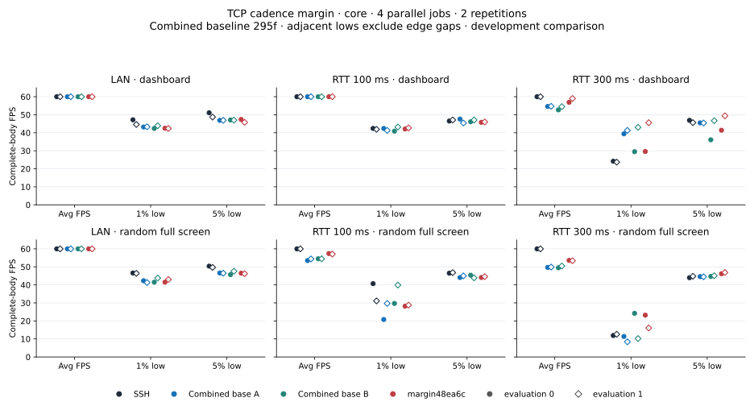
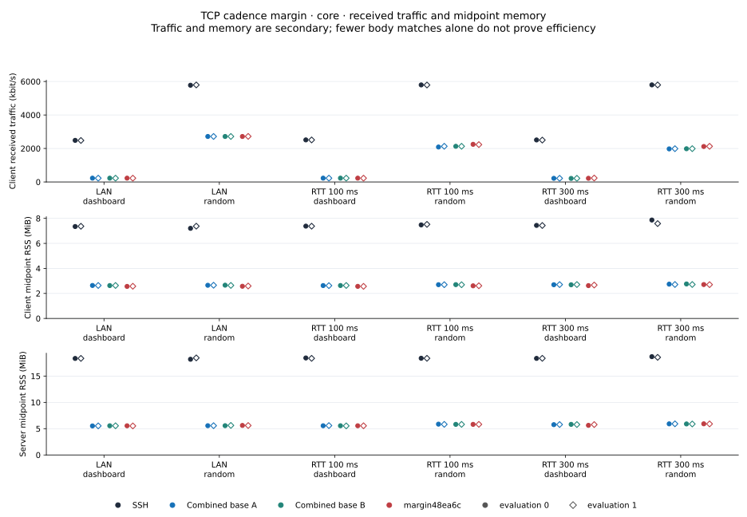
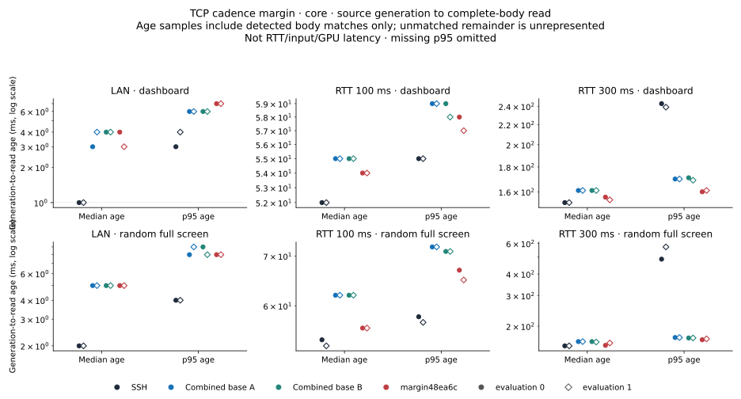
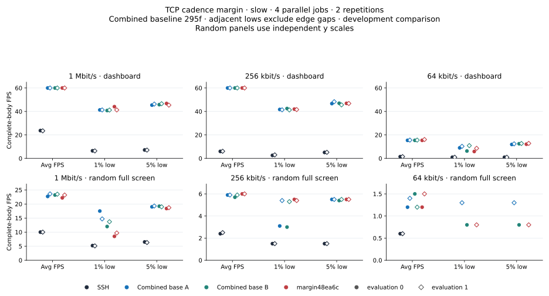
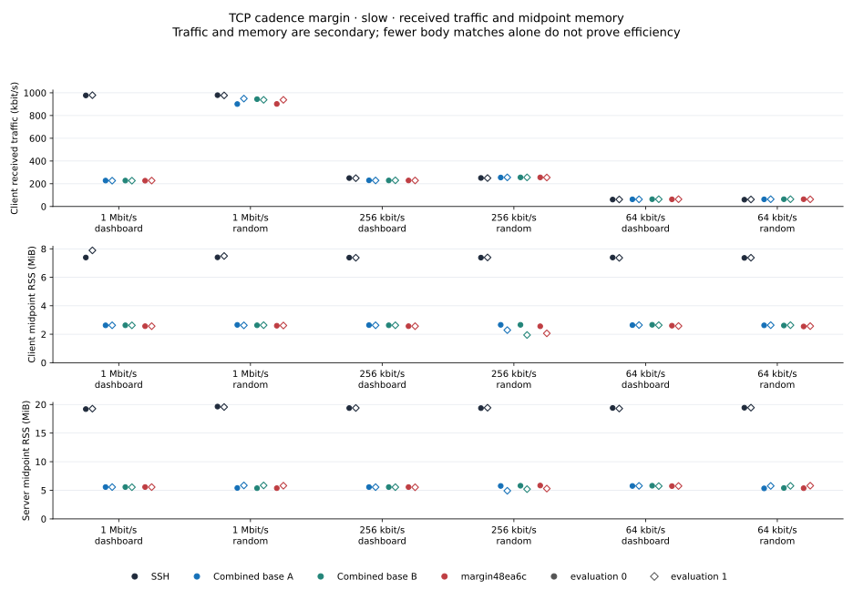
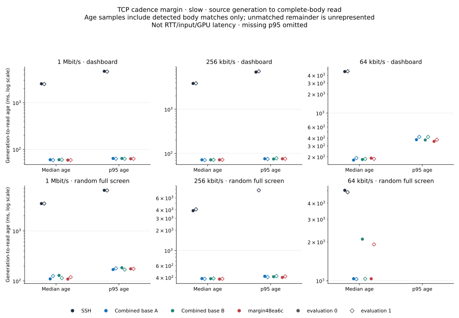
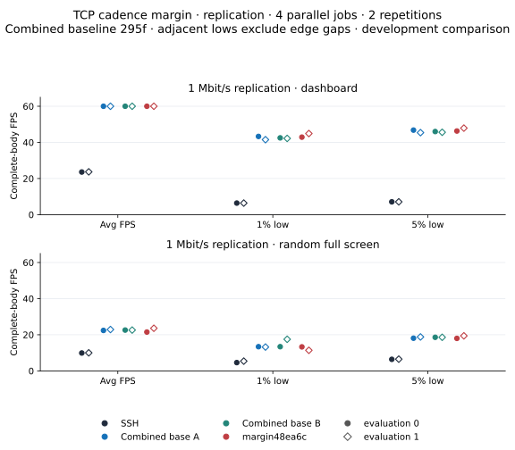
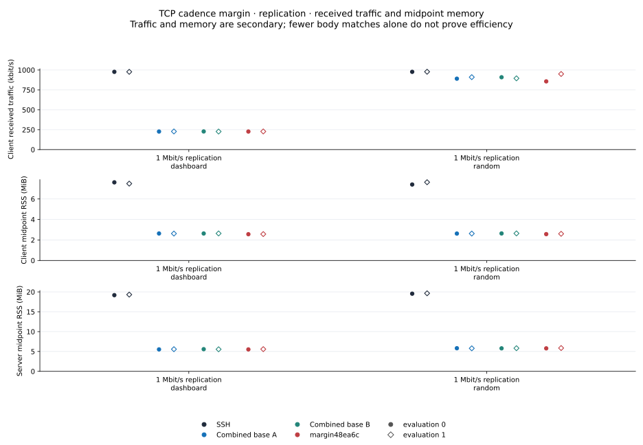
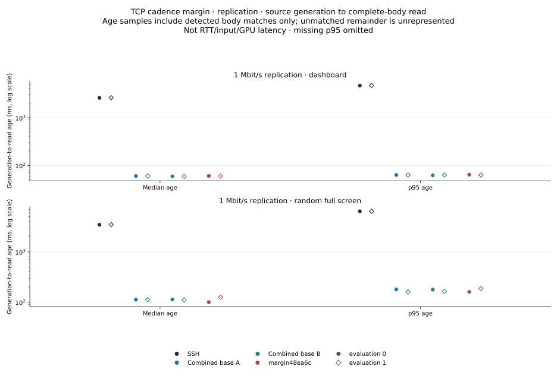

# TCP cadence margin: gains, regressions and a predeclared replication

The TCP-local 0.9 candidate records RTT 300 ms random average FPS of
**53.6/53.4** against simultaneous combined references **49.5–50.5**, with
mixed tail gains. It remains below SSH's 60 FPS. The original slow screen
also records lower 1%/5%/average FPS at 1 Mbit/s random in both evaluations.
A single predeclared replication has mixed results and does not erase that
adverse screen. The margin remains **unselected**, not a proven universal
improvement or final rejection based on one metric.

**1% low, 5% low and average FPS are primary; CPU/RSS are secondary.**
Individual costs may be acceptable with overall improvement. Age/traffic
remain visible; no numerical weights, automatic single-metric veto,
noise tolerance or retrospective exclusion is invented. Data validity is
separate from selection. All three cohorts and every evaluation stay separate.

## Exact change and build scope

Both A/B references are identical **combined295f / fb04386f…2eec4**, already
including CAN, PTY/account fixes and transit/probe changes. They are not the
CAN+PTY-only 4f98 references in the [earlier final TCP report](final-tcp-20261101.md).
The margin is **ea6c0df76a70 / e34a2fc4…a7aa45**. The
[artifact/build provenance](data/cadence-margin-core-20261101/paired-build-provenance.json)
explicitly reuses the existing baseline and builds the candidate separately
in a pinned compiler image with empty flags. **This is not a newly compiled
same-container pair.** Earlier artifacts/pipelines are not pooled here.

Only the server's no-known-slow-BDP, low-queue branch changes for TCP when
animation is recognized: `clamp(output_gap × 0.9, 8 ms, 20 ms)` replaces
`clamp(output_gap, 8 ms, 20 ms)`. The global cadence helper, rate/BDP/probe
logic, modeled/unmodeled UDP, client input, all credit/windows and 20 ms
partial-escape hold remain unchanged. There is no new option, protocol field,
rate floor or state. The [exact delta](data/cadence-margin-core-20261101/controller.patch),
[source proof](data/cadence-margin-core-20261101/48-tcp-cadence-margin-proof.json)
and [three fixtures](data/cadence-margin-core-20261101/48-tcp-cadence-margin-tests.rs)
retain the scope and gates. Shorter waits may affect partial-frame/network/age
behavior; fixture equivalence alone is not a no-regression proof.

The candidate passes **143 total tests**: library 113, CLI 4, session 25 and
one Linux concurrency fixture (64 children), with two library tests ignored.
The unchanged combined production with the same three fixtures passes two
and has the expected raw-step-margin failure. The baseline's existing140
passes remain separate. Logs/guards/source manifests are archived unchanged;
no new candidate macOS runtime claim is made.

## Method and evidence boundaries

Core 50 and slow 51 each have 48 jobs/12 blocks; predeclared replication 53 has
16 jobs/four blocks. Every case runs four parallel roles and two evaluations,
crossing `[SSH,A,B,margin]` to `[B,margin,SSH,A]`. The replication is exactly
one focused cohort after51, not a run-until-winner procedure. It neither
replaces nor averages away51. Original preparation-time relative-path
failure occurred before locks/Docker and zero jobs; it is not zero FPS.

Static windows are eight seconds at requested60 Hz,100×30. Core adds
zero/50/150 ms per direction without loss/rate caps; slow profiles add
RTT 100 ms and server-egress1M/256k/64k caps, client direction uncapped.
All three retain identical alias/port2222/configuration, RAM schema2 source,
child SET/GET-before-exec geometry, nonce/clock/PID proofs, all-four-window
closure fence and original five-second pidfd/SIGUSR2 collection. The new
replication also checks actual artifact routing before locks/Docker; it uses
the same binaries and source/collection implementation.

Admission uses one host user+system<30% interval. Runtime CPU/process load
is context, not an abort threshold; no 60-second streak or per-process gate
is used. Source/clock/identity/timing failures still reject. Process CPU100%
means one core, separate from the host admission percentage. All actual
receive windows are November1; environment creation predates them.

Lows use adjacent complete-body gaps, excluding window edges. Maxgap and
unmatched tail remain in compact/CSV. Sparse lows/p95 ages stay null, not
zero-filled. Age is source generation to complete-body read, conditional on
matched bodies, not RTT/input/GPU latency. RX is client kbit/s; RSS is midpoint
client/server MiB in tables. Resource checking is saved raw-job→summary→CSV
consistency, not independent raw-counter reconstruction.

## Core 50: LAN and RTT 100/300 ms

Cells are **average / 1% low / 5% low FPS**; dashboard=`compress`,
random=incompressible `bandwidth`. Every role/evaluation is retained.

| Network / scene / evaluation | SSH | Combined295f A | Combined295f B | Margin0.9 |
|---|---:|---:|---:|---:|
| LAN / dashboard / 0 | 60.0 / 47.2 / 51.1 | 60.0 / 43.2 / 46.9 | 60.0 / 42.4 / 47.1 | 60.0 / 42.5 / 47.4 |
| LAN / dashboard / 1 | 60.0 / 44.6 / 48.7 | 60.0 / 43.3 / 46.9 | 60.0 / 43.9 / 47.0 | 60.0 / 42.4 / 45.8 |
| LAN / random / 0 | 60.0 / 46.6 / 50.4 | 60.0 / 42.3 / 46.6 | 60.0 / 41.5 / 45.7 | 60.0 / 41.5 / 46.5 |
| LAN / random / 1 | 60.0 / 46.4 / 49.7 | 60.0 / 41.3 / 46.5 | 60.0 / 43.8 / 47.6 | 60.0 / 43.0 / 46.2 |
| RTT 100 ms / dashboard / 0 | 60.0 / 42.4 / 46.5 | 60.0 / 42.4 / 47.6 | 60.0 / 40.9 / 46.1 | 60.0 / 42.1 / 45.8 |
| RTT 100 ms / dashboard / 1 | 60.0 / 41.9 / 47.1 | 60.0 / 41.3 / 45.4 | 60.0 / 43.2 / 47.1 | 60.0 / 42.7 / 46.0 |
| RTT 100 ms / random / 0 | 60.0 / 40.7 / 46.5 | 53.5 / 20.8 / 44.1 | 54.5 / 29.7 / 45.4 | 57.4 / 28.2 / 44.1 |
| RTT 100 ms / random / 1 | 60.0 / 31.1 / 46.8 | 54.4 / 29.7 / 45.0 | 54.5 / 39.9 / 43.9 | 57.1 / 28.8 / 44.6 |
| RTT 300 ms / dashboard / 0 | 60.0 / 24.2 / 46.9 | 54.6 / 39.4 / 45.5 | 52.7 / 29.5 / 36.1 | 56.9 / 29.6 / 41.4 |
| RTT 300 ms / dashboard / 1 | 60.0 / 23.7 / 45.6 | 54.7 / 41.3 / 45.4 | 54.5 / 43.0 / 46.7 | 59.0 / 45.6 / 49.4 |
| RTT 300 ms / random / 0 | 60.0 / 11.9 / 44.0 | 49.7 / 11.4 / 44.6 | 49.5 / 24.2 / 44.7 | 53.6 / 23.2 / 46.2 |
| RTT 300 ms / random / 1 | 60.0 / 12.6 / 44.8 | 49.9 / 8.4 / 44.5 | 50.5 / 10.2 / 45.1 | 53.4 / 16.1 / 46.9 |

WAN random candidate averages are  57.4/57.1 against 53.5–54.5, but tails remain
mixed and SSH stays60. RTT 300 ms random 1% lows23.2/16.1 and5% lows46.2/46.9
exceed SSH11.9/12.6 and44.0/44.8, while averages remain lower. Against the
identical controls, some individual lows are still lower; no universal tail
advantage is claimed. RTT 300 ms dashboard evaluation0 has margin29.6/41.4
lows versus controlA39.4/45.5 despite its higher average56.9. LAN averages
are60 but lows remain below SSH, and several reference-relative tails decline.

The independent core audit retains 22,164 bodies/22,185 offline headers,
23,040 source records and zero pending writes. The study's192 endpoint-file,
96 live-server and96 strict-network checks match.

## Slow 51: original adverse screen

| Network / scene / evaluation | SSH | Combined295f A | Combined295f B | Margin0.9 |
|---|---:|---:|---:|---:|
| 1 Mbit/s / dashboard / 0 | 23.7 / 6.5 / 7.2 | 60.0 / 41.3 / 45.4 | 60.0 / 40.8 / 45.8 | 60.0 / 44.1 / 46.8 |
| 1 Mbit/s / dashboard / 1 | 23.5 / 6.4 / 7.1 | 60.0 / 41.3 / 46.3 | 60.0 / 41.2 / 46.6 | 60.0 / 41.3 / 45.4 |
| 1 Mbit/s / random / 0 | 10.0 / 5.2 / 6.5 | 22.7 / 17.5 / 19.0 | 23.2 / 12.0 / 19.2 | 22.2 / 8.5 / 18.4 |
| 1 Mbit/s / random / 1 | 10.0 / 5.1 / 6.3 | 23.6 / 14.7 / 19.3 | 23.5 / 13.7 / 19.0 | 23.2 / 9.7 / 18.7 |
| 256 kbit/s / dashboard / 0 | 6.0 / 2.6 / 5.1 | 60.0 / 41.7 / 46.7 | 60.0 / 42.5 / 47.0 | 60.0 / 42.0 / 46.9 |
| 256 kbit/s / dashboard / 1 | 6.1 / 3.0 / 5.2 | 60.0 / 41.4 / 48.3 | 60.0 / 41.3 / 45.6 | 60.0 / 41.6 / 46.8 |
| 256 kbit/s / random / 0 | 2.4 / 1.5 / 1.5 | 5.9 / 3.1 / 5.5 | 5.7 / 3.0 / 5.4 | 6.0 / 5.5 / 5.5 |
| 256 kbit/s / random / 1 | 2.5 / 1.5 / 1.5 | 5.9 / 5.4 / 5.5 | 5.9 / 5.3 / 5.5 | 6.0 / 5.4 / 5.5 |
| 64 kbit/s / dashboard / 0 | 1.5 / 1.0 / 1.0 | 15.4 / 9.0 / 11.9 | 15.4 / 6.3 / 12.5 | 15.4 / 5.9 / 12.1 |
| 64 kbit/s / dashboard / 1 | 1.5 / 1.0 / 1.0 | 15.6 / 10.3 / 12.4 | 15.6 / 10.9 / 12.7 | 16.1 / 8.6 / 12.8 |
| 64 kbit/s / random / 0 | 0.6 / — / — | 1.2 / — / — | 1.5 / 0.8 / 0.8 | 1.2 / — / — |
| 64 kbit/s / random / 1 | 0.6 / — / — | 1.4 / 1.3 / 1.3 | 1.2 / — / — | 1.5 / 0.8 / 0.8 |

At1 Mbit/s random, margin1% lows8.5/9.7,5% lows18.4/18.7 and averages22.2/23.2
are lower than both simultaneous references in both evaluations. Those
original results remain valid saved performance evidence. At 64k dashboard,
1% lows5.9/8.6 are also lower than both references, despite mixed average/5%
results. At 256k random, some gains appear; the table retains all of them.
None is converted into a numeric score that cancels another observation.

Slow retains 8,673 bodies/8,696 headers and19,775 source records. Six pending
write returns have null ends and zero pending-body joins. Five jobs lack both
low values (fewer than10 adjacent gaps), and11 lack p95 age; the21 missing
cells remain missing. The slow study's192/96/96 endpoint/live/network checks
match. Sparse64k observations are not evidence of smooth delivery.

## Replication 53: one predeclared1 Mbit/s cohort

| Network / scene / evaluation | SSH | Combined295f A | Combined295f B | Margin0.9 |
|---|---:|---:|---:|---:|
| 1 Mbit/s / dashboard / 0 | 23.6 / 6.4 / 7.1 | 60.0 / 43.3 / 46.8 | 60.0 / 42.5 / 46.0 | 60.0 / 42.9 / 46.3 |
| 1 Mbit/s / dashboard / 1 | 23.7 / 6.4 / 7.1 | 60.0 / 41.5 / 45.4 | 60.0 / 42.2 / 45.6 | 60.0 / 44.9 / 47.9 |
| 1 Mbit/s / random / 0 | 9.9 / 4.6 / 6.4 | 22.4 / 13.4 / 18.1 | 22.6 / 13.4 / 18.6 | 21.5 / 13.3 / 18.0 |
| 1 Mbit/s / random / 1 | 10.0 / 5.4 / 6.5 | 22.9 / 13.2 / 18.8 | 22.6 / 17.5 / 18.6 | 23.6 / 11.4 / 19.4 |

Random evaluation0 has margin21.5/13.3/18.0 versus references22.4–22.6
average,13.4 at 1% low and18.1–18.6 at 5% low. Evaluation1 has margin23.6/11.4/19.4:
average and5% low exceed both controls, while1% low is lower than13.2/17.5.
The larger1% losses from51 are not repeated in the same form in both
replication evaluations; this neither exonerates nor replaces51. Dashboard
all averages stay60, with mixed lows. No further replication is added here
to search for a preferred outcome.

This separate cohort retains 4,503 bodies/4,511 headers,6,890 source records,
zero pending writes and64 endpoint-file/32 live-server/32 network proofs.
The same source/body/clock/collection checks pass. It is not averaged into
51, and traced52 is not a performance control for it.

## Functional 52: changed deadline result not exercised

The [separate functional audit](data/cadence-margin-functional-20261101/lowbw52-mechanism-audit.md)
contains16 functional-valid observations and24 endpoint traces, with original
performance_eligible=False and one host-context rejection retained. There
are zero branch 30 records inside receive windows. All40 lifetime branch 30
snapshots precede the windows and have raw P58.662–75.473 ms: both P and 0.9P
clamp to 20 ms, so no recorded branch 30 result changes. Dashboard is raw;
random instead records known-slow/credit gates. This does not retroactively
identify51's cause or prove the policy harmless. A new RTT guard is not
justified by non-activation.

Body/header differences, incomplete-check counts, gen 1/no-full-reset records,
probe samples and catch-up-poll overlap stay in the exact audit/JSON/CSV.
Temporal overlap does not establish causal frame ownership. Incomplete-state
timestamps were not all retained, and scalar PTY chunks do not identify full
producer frames. No exact partial-state timeline, physical spare capacity or
continuous demand is invented. No new terminal replay or benchmark was
performed for publication.

## RX, RSS, CPU and age by observation

### Core

| Network / scene / evaluation / role | RX kbit/s | Client / server RSS MiB | Client / server CPU % | Median / p95 body age ms |
|---|---:|---:|---:|---:|
| LAN / dashboard / 0 / ssh | 2484 | 7.35 / 18.35 | 0.26 / 0.31 | 1.0 / 3.0 |
| LAN / dashboard / 0 / main-A | 228 | 2.64 / 5.52 | 0.82 / 1.13 | 3.0 / 6.0 |
| LAN / dashboard / 0 / main-B | 227 | 2.63 / 5.55 | 0.82 / 1.16 | 4.0 / 6.0 |
| LAN / dashboard / 0 / candidate | 228 | 2.56 / 5.55 | 0.84 / 1.17 | 4.0 / 7.0 |
| LAN / dashboard / 1 / main-B | 227 | 2.64 / 5.55 | 0.81 / 1.12 | 4.0 / 6.0 |
| LAN / dashboard / 1 / candidate | 227 | 2.57 / 5.52 | 0.87 / 1.17 | 3.0 / 7.0 |
| LAN / dashboard / 1 / ssh | 2478 | 7.37 / 18.36 | 0.25 / 0.32 | 1.0 / 4.0 |
| LAN / dashboard / 1 / main-A | 227 | 2.64 / 5.53 | 0.83 / 1.16 | 4.0 / 6.0 |
| LAN / random / 0 / ssh | 5776 | 7.20 / 18.20 | 0.2 / 0.26 | 2.0 / 4.0 |
| LAN / random / 0 / main-A | 2717 | 2.65 / 5.56 | 1.21 / 1.57 | 5.0 / 8.0 |
| LAN / random / 0 / main-B | 2717 | 2.66 / 5.57 | 1.22 / 1.56 | 5.0 / 9.0 |
| LAN / random / 0 / candidate | 2716 | 2.57 / 5.61 | 1.23 / 1.57 | 5.0 / 8.0 |
| LAN / random / 1 / main-B | 2717 | 2.64 / 5.62 | 1.19 / 1.48 | 5.0 / 8.0 |
| LAN / random / 1 / candidate | 2722 | 2.59 / 5.60 | 1.17 / 1.51 | 5.0 / 8.0 |
| LAN / random / 1 / ssh | 5794 | 7.38 / 18.46 | 0.21 / 0.24 | 2.0 / 4.0 |
| LAN / random / 1 / main-A | 2717 | 2.66 / 5.57 | 1.2 / 1.53 | 5.0 / 9.0 |
| RTT 100 ms / dashboard / 0 / ssh | 2512 | 7.38 / 18.45 | 0.25 / 0.3 | 52.0 / 55.0 |
| RTT 100 ms / dashboard / 0 / main-A | 228 | 2.63 / 5.55 | 0.87 / 1.17 | 55.0 / 59.0 |
| RTT 100 ms / dashboard / 0 / main-B | 228 | 2.63 / 5.55 | 0.87 / 1.17 | 55.0 / 59.0 |
| RTT 100 ms / dashboard / 0 / candidate | 228 | 2.57 / 5.55 | 0.87 / 1.2 | 54.0 / 58.0 |
| RTT 100 ms / dashboard / 1 / main-B | 228 | 2.64 / 5.53 | 0.77 / 1.04 | 55.0 / 58.0 |
| RTT 100 ms / dashboard / 1 / candidate | 228 | 2.57 / 5.55 | 0.78 / 1.06 | 54.0 / 57.0 |
| RTT 100 ms / dashboard / 1 / ssh | 2510 | 7.38 / 18.38 | 0.24 / 0.25 | 52.0 / 55.0 |
| RTT 100 ms / dashboard / 1 / main-A | 228 | 2.62 / 5.59 | 0.77 / 1.06 | 55.0 / 59.0 |
| RTT 100 ms / random / 0 / ssh | 5795 | 7.48 / 18.39 | 0.25 / 0.26 | 54.0 / 58.0 |
| RTT 100 ms / random / 0 / main-A | 2087 | 2.70 / 5.86 | 1.11 / 4.83 | 62.0 / 72.0 |
| RTT 100 ms / random / 0 / main-B | 2130 | 2.70 / 5.82 | 1.16 / 4.86 | 62.0 / 71.0 |
| RTT 100 ms / random / 0 / candidate | 2248 | 2.61 / 5.82 | 1.25 / 5.05 | 56.0 / 67.0 |
| RTT 100 ms / random / 1 / main-B | 2131 | 2.70 / 5.82 | 1.14 / 4.87 | 62.0 / 71.0 |
| RTT 100 ms / random / 1 / candidate | 2231 | 2.61 / 5.82 | 1.18 / 4.94 | 56.0 / 65.0 |
| RTT 100 ms / random / 1 / ssh | 5790 | 7.52 / 18.38 | 0.22 / 0.23 | 53.0 / 57.0 |
| RTT 100 ms / random / 1 / main-A | 2131 | 2.70 / 5.82 | 1.13 / 4.84 | 62.0 / 72.0 |
| RTT 300 ms / dashboard / 0 / ssh | 2509 | 7.44 / 18.36 | 0.25 / 0.28 | 152.0 / 243.0 |
| RTT 300 ms / dashboard / 0 / main-A | 218 | 2.70 / 5.76 | 0.84 / 2.97 | 161.0 / 170.0 |
| RTT 300 ms / dashboard / 0 / main-B | 212 | 2.69 / 5.82 | 0.82 / 3.0 | 161.0 / 171.0 |
| RTT 300 ms / dashboard / 0 / candidate | 220 | 2.62 / 5.63 | 0.8 / 1.29 | 156.0 / 160.0 |
| RTT 300 ms / dashboard / 1 / main-B | 218 | 2.71 / 5.79 | 0.84 / 3.08 | 161.0 / 169.0 |
| RTT 300 ms / dashboard / 1 / candidate | 235 | 2.67 / 5.78 | 0.88 / 3.36 | 154.0 / 161.0 |
| RTT 300 ms / dashboard / 1 / ssh | 2501 | 7.43 / 18.38 | 0.24 / 0.26 | 152.0 / 239.0 |
| RTT 300 ms / dashboard / 1 / main-A | 219 | 2.71 / 5.79 | 0.82 / 3.09 | 161.0 / 170.0 |
| RTT 300 ms / random / 0 / ssh | 5797 | 7.87 / 18.69 | 0.24 / 0.25 | 154.0 / 487.0 |
| RTT 300 ms / random / 0 / main-A | 1976 | 2.74 / 5.91 | 1.05 / 4.56 | 163.0 / 172.0 |
| RTT 300 ms / random / 0 / main-B | 1984 | 2.76 / 5.90 | 1.05 / 4.47 | 163.0 / 171.0 |
| RTT 300 ms / random / 0 / candidate | 2119 | 2.71 / 5.92 | 1.13 / 4.75 | 155.0 / 167.0 |
| RTT 300 ms / random / 1 / main-B | 1990 | 2.71 / 5.89 | 1.13 / 4.59 | 162.0 / 171.0 |
| RTT 300 ms / random / 1 / candidate | 2129 | 2.70 / 5.90 | 1.2 / 5.02 | 160.0 / 169.0 |
| RTT 300 ms / random / 1 / ssh | 5794 | 7.58 / 18.56 | 0.23 / 0.25 | 154.0 / 573.0 |
| RTT 300 ms / random / 1 / main-A | 1988 | 2.71 / 5.92 | 1.1 / 4.6 | 163.0 / 172.0 |

### Slow

| Network / scene / evaluation / role | RX kbit/s | Client / server RSS MiB | Client / server CPU % | Median / p95 body age ms |
|---|---:|---:|---:|---:|
| 1 Mbit/s / dashboard / 0 / ssh | 977 | 7.39 / 19.20 | 0.15 / 0.48 | 2546.0 / 4712.0 |
| 1 Mbit/s / dashboard / 0 / main-A | 228 | 2.62 / 5.57 | 0.81 / 1.1 | 60.0 / 64.0 |
| 1 Mbit/s / dashboard / 0 / main-B | 228 | 2.63 / 5.57 | 0.8 / 1.11 | 60.0 / 64.0 |
| 1 Mbit/s / dashboard / 0 / candidate | 227 | 2.57 / 5.57 | 0.81 / 1.12 | 59.0 / 63.0 |
| 1 Mbit/s / dashboard / 1 / main-B | 227 | 2.62 / 5.54 | 0.84 / 1.17 | 60.0 / 63.0 |
| 1 Mbit/s / dashboard / 1 / candidate | 228 | 2.57 / 5.56 | 0.85 / 1.17 | 59.0 / 63.0 |
| 1 Mbit/s / dashboard / 1 / ssh | 979 | 7.89 / 19.27 | 0.15 / 0.53 | 2507.0 / 4637.0 |
| 1 Mbit/s / dashboard / 1 / main-A | 227 | 2.63 / 5.56 | 0.84 / 1.14 | 59.0 / 63.0 |
| 1 Mbit/s / random / 0 / ssh | 979 | 7.40 / 19.64 | 0.11 / 0.3 | 3523.0 / 6485.0 |
| 1 Mbit/s / random / 0 / main-A | 901 | 2.66 / 5.41 | 0.8 / 2.83 | 110.0 / 169.0 |
| 1 Mbit/s / random / 0 / main-B | 944 | 2.63 / 5.38 | 0.82 / 2.93 | 129.0 / 184.0 |
| 1 Mbit/s / random / 0 / candidate | 902 | 2.60 / 5.38 | 0.81 / 2.86 | 109.0 / 175.0 |
| 1 Mbit/s / random / 1 / main-B | 938 | 2.64 / 5.85 | 0.86 / 2.9 | 114.0 / 169.0 |
| 1 Mbit/s / random / 1 / candidate | 938 | 2.61 / 5.80 | 0.88 / 2.93 | 119.0 / 175.0 |
| 1 Mbit/s / random / 1 / ssh | 977 | 7.50 / 19.56 | 0.12 / 0.28 | 3525.0 / 6449.0 |
| 1 Mbit/s / random / 1 / main-A | 949 | 2.62 / 5.85 | 0.87 / 2.97 | 126.0 / 179.0 |
| 256 kbit/s / dashboard / 0 / ssh | 250 | 7.38 / 19.38 | 0.09 / 0.46 | 3828.0 / 6927.0 |
| 256 kbit/s / dashboard / 0 / main-A | 230 | 2.64 / 5.56 | 1.01 / 1.43 | 72.0 / 76.0 |
| 256 kbit/s / dashboard / 0 / main-B | 229 | 2.63 / 5.56 | 1.0 / 1.43 | 72.0 / 75.0 |
| 256 kbit/s / dashboard / 0 / candidate | 229 | 2.57 / 5.56 | 1.03 / 1.46 | 72.0 / 76.0 |
| 256 kbit/s / dashboard / 1 / main-B | 230 | 2.63 / 5.55 | 0.89 / 1.23 | 72.0 / 78.0 |
| 256 kbit/s / dashboard / 1 / candidate | 229 | 2.57 / 5.53 | 0.89 / 1.26 | 72.0 / 76.0 |
| 256 kbit/s / dashboard / 1 / ssh | 249 | 7.38 / 19.39 | 0.06 / 0.39 | 3860.0 / 7213.0 |
| 256 kbit/s / dashboard / 1 / main-A | 229 | 2.63 / 5.55 | 0.88 / 1.23 | 71.0 / 75.0 |
| 256 kbit/s / random / 0 / ssh | 251 | 7.38 / 19.37 | 0.1 / 0.37 | 3878.0 / — |
| 256 kbit/s / random / 0 / main-A | 255 | 2.66 / 5.76 | 0.69 / 2.46 | 386.0 / 417.0 |
| 256 kbit/s / random / 0 / main-B | 256 | 2.66 / 5.80 | 0.72 / 2.34 | 384.0 / 411.0 |
| 256 kbit/s / random / 0 / candidate | 256 | 2.56 / 5.84 | 0.73 / 2.47 | 379.0 / 401.0 |
| 256 kbit/s / random / 1 / main-B | 256 | 1.95 / 5.21 | 0.8 / 2.59 | 387.0 / 420.0 |
| 256 kbit/s / random / 1 / candidate | 255 | 2.06 / 5.30 | 0.8 / 2.57 | 383.0 / 416.0 |
| 256 kbit/s / random / 1 / ssh | 250 | 7.39 / 19.43 | 0.13 / 0.37 | 4068.0 / 7762.0 |
| 256 kbit/s / random / 1 / main-A | 256 | 2.29 / 4.92 | 0.83 / 2.48 | 382.0 / 405.0 |
| 64 kbit/s / dashboard / 0 / ssh | 61 | 7.39 / 19.39 | 0.07 / 0.76 | 4575.0 / — |
| 64 kbit/s / dashboard / 0 / main-A | 63 | 2.64 / 5.76 | 0.63 / 2.56 | 178.0 / 376.0 |
| 64 kbit/s / dashboard / 0 / main-B | 64 | 2.66 / 5.80 | 0.63 / 2.54 | 182.0 / 372.0 |
| 64 kbit/s / dashboard / 0 / candidate | 63 | 2.60 / 5.73 | 0.61 / 2.58 | 191.0 / 353.0 |
| 64 kbit/s / dashboard / 1 / main-B | 64 | 2.64 / 5.73 | 0.72 / 2.51 | 186.0 / 416.0 |
| 64 kbit/s / dashboard / 1 / candidate | 64 | 2.58 / 5.75 | 0.65 / 2.66 | 186.0 / 376.0 |
| 64 kbit/s / dashboard / 1 / ssh | 62 | 7.37 / 19.29 | 0.07 / 0.7 | 4622.0 / — |
| 64 kbit/s / dashboard / 1 / main-A | 63 | 2.64 / 5.77 | 0.61 / 2.55 | 192.0 / 417.0 |
| 64 kbit/s / random / 0 / ssh | 60 | 7.36 / 19.44 | 0.06 / 0.33 | 5031.0 / — |
| 64 kbit/s / random / 0 / main-A | 63 | 2.62 / 5.34 | 0.28 / 1.52 | 1036.0 / — |
| 64 kbit/s / random / 0 / main-B | 64 | 2.61 / 5.40 | 0.19 / 1.64 | 2101.0 / — |
| 64 kbit/s / random / 0 / candidate | 64 | 2.55 / 5.37 | 0.27 / 1.52 | 1035.0 / — |
| 64 kbit/s / random / 1 / main-B | 64 | 2.64 / 5.77 | 0.28 / 1.63 | 1035.0 / — |
| 64 kbit/s / random / 1 / candidate | 63 | 2.57 / 5.80 | 0.2 / 1.7 | 1913.0 / — |
| 64 kbit/s / random / 1 / ssh | 62 | 7.38 / 19.45 | 0.1 / 0.33 | 4861.0 / — |
| 64 kbit/s / random / 1 / main-A | 64 | 2.64 / 5.77 | 0.3 / 1.68 | 1029.0 / — |

### Replication

| Network / scene / evaluation / role | RX kbit/s | Client / server RSS MiB | Client / server CPU % | Median / p95 body age ms |
|---|---:|---:|---:|---:|
| 1 Mbit/s / dashboard / 0 / ssh | 977 | 7.62 / 19.18 | 0.17 / 0.63 | 2590.0 / 4679.0 |
| 1 Mbit/s / dashboard / 0 / main-A | 227 | 2.63 / 5.53 | 0.92 / 1.22 | 60.0 / 63.0 |
| 1 Mbit/s / dashboard / 0 / main-B | 228 | 2.63 / 5.58 | 0.89 / 1.22 | 59.0 / 62.0 |
| 1 Mbit/s / dashboard / 0 / candidate | 227 | 2.56 / 5.52 | 0.91 / 1.24 | 60.0 / 64.0 |
| 1 Mbit/s / dashboard / 1 / main-B | 227 | 2.64 / 5.55 | 0.83 / 1.12 | 59.0 / 63.0 |
| 1 Mbit/s / dashboard / 1 / candidate | 228 | 2.57 / 5.59 | 0.85 / 1.17 | 60.0 / 63.0 |
| 1 Mbit/s / dashboard / 1 / ssh | 977 | 7.50 / 19.32 | 0.15 / 0.54 | 2613.0 / 4709.0 |
| 1 Mbit/s / dashboard / 1 / main-A | 228 | 2.62 / 5.58 | 0.83 / 1.14 | 60.0 / 63.0 |
| 1 Mbit/s / random / 0 / ssh | 977 | 7.41 / 19.55 | 0.11 / 0.27 | 3468.0 / 6431.0 |
| 1 Mbit/s / random / 0 / main-A | 891 | 2.62 / 5.82 | 0.75 / 2.77 | 112.0 / 179.0 |
| 1 Mbit/s / random / 0 / main-B | 909 | 2.64 / 5.79 | 0.78 / 2.81 | 113.0 / 178.0 |
| 1 Mbit/s / random / 0 / candidate | 857 | 2.57 / 5.79 | 0.74 / 2.67 | 100.0 / 160.0 |
| 1 Mbit/s / random / 1 / main-B | 895 | 2.64 / 5.82 | 0.75 / 2.65 | 111.0 / 164.0 |
| 1 Mbit/s / random / 1 / candidate | 950 | 2.60 / 5.87 | 0.79 / 2.81 | 125.0 / 187.0 |
| 1 Mbit/s / random / 1 / ssh | 978 | 7.63 / 19.64 | 0.11 / 0.27 | 3495.0 / 6429.0 |
| 1 Mbit/s / random / 1 / main-A | 910 | 2.62 / 5.79 | 0.75 / 2.72 | 112.0 / 161.0 |

## Archive, selection and remaining scope

[Core](data/cadence-margin-core-20261101/README.md),
[slow](data/cadence-margin-slow-20261101/README.md) and
[replication](data/cadence-margin-replication-20261101/README.md) archives contain
all per-evaluation metrics, complete-body timelines, exact independent audits,
source/build/control evidence, gzip-preserved logs and portable verifiers/plots.
The [functional appendix](data/cadence-margin-functional-20261101/README.md)
is separate. Full capture/source payloads and executables remain local;
raw hashes are imported from independent audits rather than claimed as a new
publisher rehash. Resource counters are not independently remeasured.

The margin remains unselected because the overall FPS tradeoff is unresolved,
with core gains, original slow losses and mixed replication retained together.
This is not automatic rejection on one metric and not global SSH parity.
No new full-matrix run, moving/loss/input/UDP runtime promotion or release
adoption is claimed. These112 eligible static observations are separate from
the earlier 96 static plus16 descriptive moving observations and from 16
functional 52 records. The research PR publishes results, not product code.

## Display-only correction to the preceding moving charts

The earlier42c9bdfe moving FPS/age layouts clipped legend/caption text and
overlapped age-axis labels. The [display erratum](data/cadence-margin-functional-20261101/prior-moving-display-correction.json)
records original and corrected hashes. Wider/taller figures correct that
display only; all152 other archive entries, numerical observations and raw
inputs remain unchanged. No benchmark or reinterpretation of moving timing
fidelity accompanies this correction.
