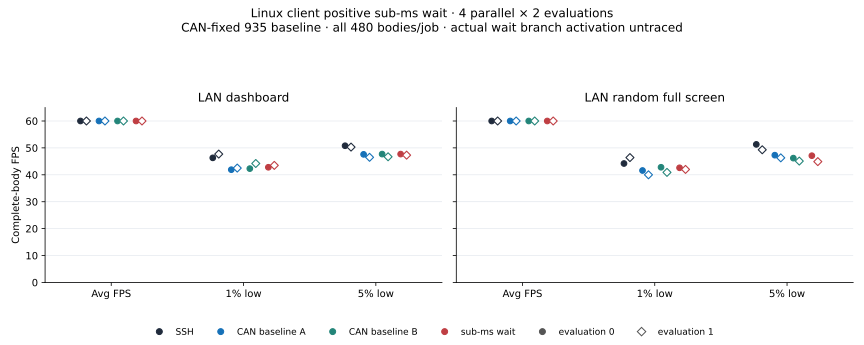

# Linux client sub-millisecond wait: LAN follow-up

All 16 jobs retain 480 complete bodies and average 60 FPS. **The candidate's
tails are mixed against the CAN-fixed baseline and below SSH in every
evaluation.** This focused sample does not establish a consistent improvement;
the wait candidate remains unselected. The primary assessment uses 1% low,
5% low and average FPS together. CPU/RSS are secondary, with age and network
costs retained separately. There is no numeric weighting or individual-metric veto.

## Change and comparison

On Linux, the [patch](data/client-subms-lan-20261101/client-subms-wait.patch)
uses FD-aware `ppoll` only for a positive remainder below 1 ms. Zero/overdue,
at least 1 ms, non-Linux and server waits retain their previous paths. It
changes no deadline eligibility, controller, configuration or dependency.
Actual branch activations and wake durations were not traced: these results
do not prove sub-millisecond wake precision or a timer cause for the tails.

The [paired build](data/client-subms-lan-20261101/client-subms-wait-release-pair.json)
uses **CAN-fixed baseline source `93533574fffa` / SHA `c68e0f…84a136`**,
not unfixed main `6729/9ab`. The wait candidate is source `ca0abbd5fc40` /
SHA `91e765…1d92cb`. Internal main-A/B labels are identical CAN baseline
replicas. The three inherited CAN fixtures and 99 library tests pass, with
two ignored; they do not specifically test wait behavior, native precision
or non-Linux execution. Original preparation-stage wording remains unchanged
in the archived hypothesis/build records.

Study 37 has four simultaneous roles, two evaluations for LAN dashboard
(`compress`) and random full screen (`bandwidth`): **16 jobs / four blocks**.
Slots cross `[SSH,A,B,candidate]` to `[B,candidate,SSH,A]`. All roles use the
RAM schema2 source, nonce/pidfd collection, original five-second deadline,
four-window closure fence and child SET/GET-before-exec method inherited
from study 36. This is source-flow geometry evidence, not a native GET sidecar
or a guarantee about later remote geometry. Different earlier pipelines and
unfixed-main results are not pooled into this comparison.

## Separate evaluation results

Cells are **average / 1% low / 5% low FPS**. Every cell has 480 source-matched
complete bodies. Lows use adjacent body gaps; edge gaps remain in the CSV.

| Scene / evaluation | SSH | CAN baseline A | CAN baseline B | Sub-ms wait |
|---|---:|---:|---:|---:|
| Dashboard / 0 | 60.0 / 46.3 / 50.8 | 60.0 / 41.9 / 47.6 | 60.0 / 42.3 / 47.7 | 60.0 / 42.8 / 47.7 |
| Dashboard / 1 | 60.0 / 47.7 / 50.3 | 60.0 / 42.5 / 46.5 | 60.0 / 44.2 / 46.7 | 60.0 / 43.5 / 47.3 |
| Random / 0 | 60.0 / 44.2 / 51.3 | 60.0 / 41.6 / 47.3 | 60.0 / 42.8 / 46.2 | 60.0 / 42.6 / 47.1 |
| Random / 1 | 60.0 / 46.4 / 49.3 | 60.0 / 40.0 / 46.3 | 60.0 / 40.9 / 45.1 | 60.0 / 42.0 / 44.9 |

Candidate dashboard evaluation 0 improves or ties both CAN replicas, while
evaluation 1 has a 1% low between them. Random evaluation 0 has both lows
between the replicas. Random evaluation 1 improves 1% low but lowers 5% low
against both. All candidate lows remain below SSH. Two evaluations do not
establish statistical significance, a universal regression or policy causality.

## Freshness, resources and evidence

The [16-row CSV](data/client-subms-lan-20261101/metrics.csv) retains every
role's RX, CPU, client/server midpoint RSS, body age and leading/trailing
gaps. RX is decimal kbit/s, RSS is KiB and CPU is a percentage of one core.
These are saved-derived values and units; the original counter endpoints
and midpoint samples were not retained for independent remeasurement.

| Candidate scene / evaluation | Age median / p95 ms | Edge max gap ms | Client / server CPU % | Client / server RSS KiB | RX kbit/s |
|---|---:|---:|---:|---:|---:|
| Dashboard / 0 | 4 / 7 | 26 | 0.89 / 1.22 | 2692 / 5784 | 227 |
| Dashboard / 1 | 4 / 7 | 25 | 0.79 / 1.11 | 2692 / 5824 | 228 |
| Random / 0 | 5 / 8 | 27 | 1.13 / 1.52 | 2708 / 5860 | 2722 |
| Random / 1 | 5 / 9 | 31 | 1.27 / 1.67 | 2732 / 5844 | 2717 |

Age covers source-generation to detected complete-body read, not RTT, input
or GPU presentation. Candidate age is similar to the CAN replicas and above
SSH's 1–2 ms median / 3–5 ms p95. Actual receive windows are
04:27:56.072–04:28:54.375 KST on November 1. CPU admission is one user+system
sample below 30%: startup 19%, phases 17/27/24/19%. Runtime maxima
38/38/35/30% are context, not rejection thresholds. No P-core affinity is proved.

The [independent audit](data/client-subms-lan-20261101/saved-data-audit.md)
checks all 7,680 source records and body/header joins, capture structure/hashes,
clocks, nonce/PID/fences, 64 endpoint-file and 32 live-server proofs. There
are no pending writes, zero-body jobs or missing lows. It does not rerun all
terminal emulation or establish a GPU result. Data is valid and eligible for
qualitative focused comparison; final selection is null and full-matrix
promotion is unproved.

The [compact archive](data/client-subms-lan-20261101/README.md) preserves
32 original raw hashes, source/pair/patch/build evidence and portable
`verify-metrics.py`; full captures/source payloads stay local. The verifier
recalculates saved metrics and checks imported bytes and the figure manifest
without starting a terminal or benchmark. Run-status preparation/analysis
strings retain their creation stage; saved analysis outputs provide completion
evidence. This wait experiment is separate from the CAN compatibility fix
[PR 4](https://github.com/enif-lee/rsh/pull/4).
