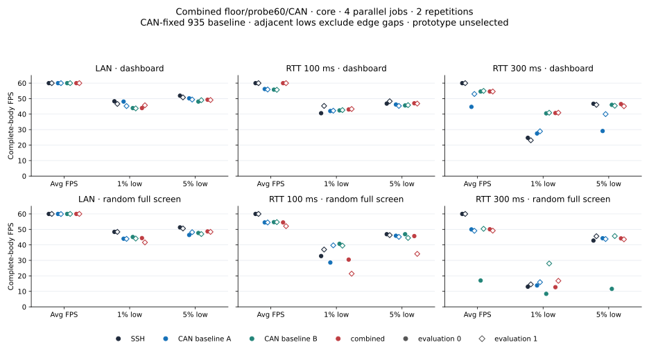
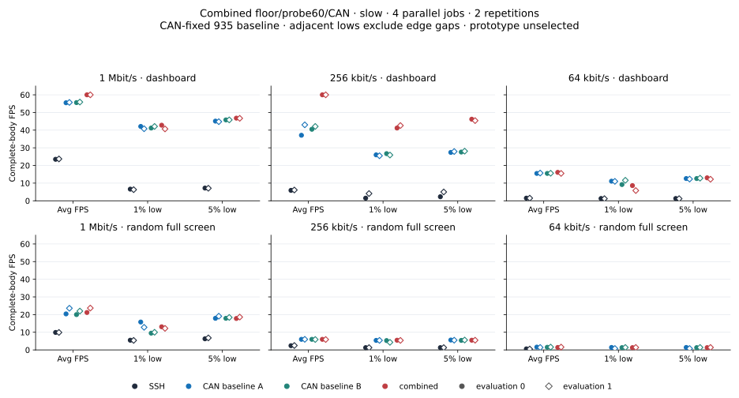
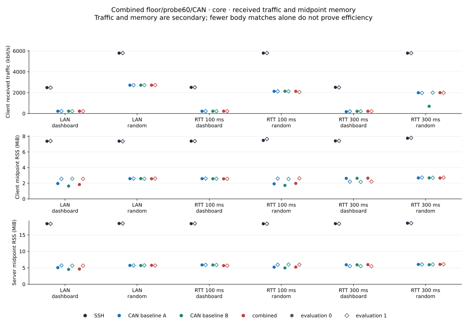
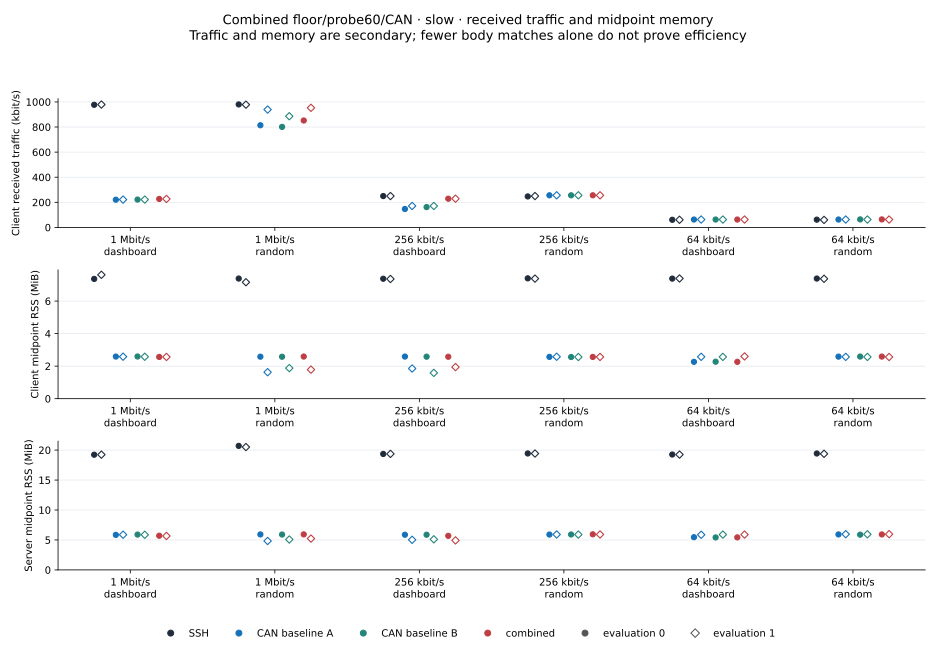
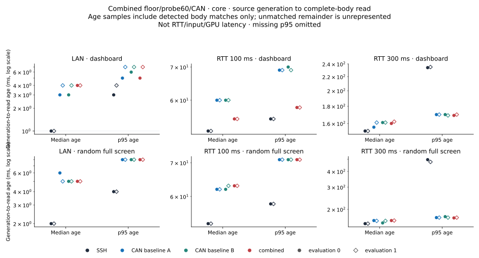
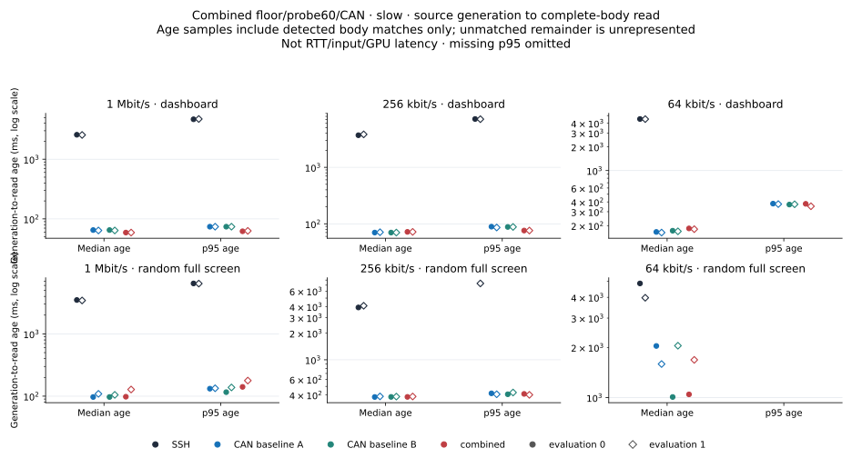

# Combined transit/probe policy: static comparison

The combination reaches 60 FPS in both 1 Mbit/s and 256 kbit/s dashboard
evaluations, with higher 1%/5% lows at 256 kbit/s against the simultaneous
CAN-fixed references. Other contexts retain FPS and freshness costs: WAN
random evaluation 1 is weaker, RTT 300 ms random remains near 50 FPS versus
SSH's 60, and 1 Mbit/s random p95 body age rises to 141/178 ms. These are mixed
per-evaluation outcomes, not a global SSH-parity claim or final promotion.

**1% low, 5% low and average FPS are primary; CPU/RSS are secondary.**
Age, received traffic and recovery costs remain separate. Individual costs
can be acceptable with overall improvement, without a numeric weighting,
automatic single-metric veto or invented noise tolerance. The candidate
is currently unselected for product integration.

## Candidate, baseline and method

The candidate combines a TCP transit allowance gated by a sampled floor of
at least 20 ms, broad 60% lossless/server-output capacity exploration and the
explicit CAN screen-delta prefix. It adds no sub-ms wait, near-floor
predicate, transport state, protocol field, user option or dependency. Client input and UDP retain
their original 80% probe condition. An application-sampled floor is not
physical propagation time, and logical transit accounting is not a proof
of an empty kernel queue or spare capacity.
The allowance discounts a slow-rate BDP estimate or half recent delivery
credit from logical output backlog, using the existing restart minimum.
It adds no send credit. Exploration relaxes one growth condition from 80%
to 60%; other feedback guards remain in use.

Both references are **CAN-fixed baseline source `93533574fffa` / SHA
`c68e0f…84a136`**, not unfixed main `6729/9ab`. Candidate source is
`94f28a7b3b13` / SHA `7198d2…fb7263`. The [paired build](data/combined-core-20261101/fps-combined-release-pair.json)
verifies source/binary identity. The full library passes 110 tests with two
ignored, including 14 target fixtures; there was no separate 14-test rerun.
The oldfar+CAN control with the same four probe fixtures passes three and
has the expected 70%-utilization growth failure. This distinguishes the
probe condition, not performance benefit or combined-policy safety.

The archived historical patch chain is [transit](data/combined-core-20261101/tcp-transit.patch)
→ [sampled floor](data/combined-core-20261101/tcp-transit-floor.patch)
→ [broad probe60](data/combined-core-20261101/tcp-transit-floor-probe60.patch)
→ [CAN](data/combined-core-20261101/tcp-transit-floor-probe60-cancel.patch).
CAN is already shared by both measured artifacts. Source proofs/manifests
and build/guard/control logs retain their original bytes and creation-stage
wording. Component gains are not assumed additive. Actual controller branch
choices, rate samples and queue causes are untraced in these performance runs.

Core study 38 and slow study 39 each have **48 jobs / 12 blocks, four parallel
roles and two evaluations** per network/scene/role. Identical baseline A/B
and candidate share alias/path/port 2222/configuration. Slots cross
`[SSH,A,B,candidate]` to `[B,candidate,SSH,A]`. Both screens use the same
RAM schema2/nonce/pidfd/original-five-second collection, four-window fence,
body/header/clock oracle and child SET/GET-before-exec method inherited from
study 37. Geometry is source-flow evidence, not a native GET sidecar or a
later remote-size guarantee. Earlier unfixed-main or different-pipeline
measurements are not pooled into these comparisons.

All 96 saved observations pass input checks and allow qualitative profile
comparison; final selection remains null. Core retains **21,530 bodies /
21,550 offline uniform headers / 23,040 source records**. Slow retains
**7,867 / 7,888 / 19,765**, including seven pending writes with null ends
and zero pending-body joins. Core has no pending writes. No job has zero
complete bodies. Independent audits check source headers/clocks/joins,
capture structure/hashes and each screen's 192 endpoint-file, 96 live-server
and 96 network-endpoint proofs, without a new full terminal replay.

## Core: LAN and RTT 100/300 ms

Cells are **average / 1% low / 5% low FPS**, using actual-source body
completion. Dashboard is `compress`; random is incompressible `bandwidth`.
Every role and evaluation stays separate.

| Network / scene / evaluation | SSH | CAN baseline A | CAN baseline B | Combined |
|---|---:|---:|---:|---:|
| LAN / dashboard / 0 | 60.0 / 48.3 / 51.9 | 60.0 / 48.1 / 50.2 | 60.0 / 43.9 / 48.1 | 60.0 / 43.9 / 49.3 |
| LAN / dashboard / 1 | 60.0 / 46.6 / 50.8 | 60.0 / 45.2 / 49.4 | 60.0 / 43.7 / 49.0 | 60.0 / 45.7 / 49.1 |
| LAN / random / 0 | 60.0 / 48.4 / 51.3 | 60.0 / 44.0 / 46.4 | 60.0 / 45.1 / 47.7 | 60.0 / 44.4 / 48.7 |
| LAN / random / 1 | 60.0 / 48.4 / 50.6 | 59.9 / 43.9 / 48.2 | 60.0 / 44.1 / 47.0 | 60.0 / 41.6 / 48.4 |
| RTT 100 ms / dashboard / 0 | 60.0 / 40.6 / 46.8 | 56.2 / 42.0 / 46.2 | 55.8 / 42.4 / 45.6 | 60.0 / 43.0 / 47.0 |
| RTT 100 ms / dashboard / 1 | 60.0 / 45.3 / 48.3 | 55.9 / 42.2 / 45.3 | 55.7 / 42.6 / 45.8 | 60.0 / 43.3 / 46.8 |
| RTT 100 ms / random / 0 | 60.0 / 32.8 / 46.9 | 54.5 / 28.6 / 45.9 | 54.7 / 40.7 / 46.9 | 54.5 / 30.5 / 45.7 |
| RTT 100 ms / random / 1 | 60.0 / 37.0 / 46.3 | 54.5 / 39.7 / 45.2 | 54.7 / 39.5 / 44.5 | 52.1 / 21.4 / 34.2 |
| RTT 300 ms / dashboard / 0 | 60.0 / 24.7 / 46.7 | 44.7 / 27.5 / 29.1 | 54.6 / 40.5 / 46.0 | 54.6 / 40.7 / 46.5 |
| RTT 300 ms / dashboard / 1 | 60.0 / 23.1 / 46.0 | 53.0 / 28.9 / 40.0 | 55.0 / 40.9 / 45.4 | 54.6 / 40.9 / 45.1 |
| RTT 300 ms / random / 0 | 60.0 / 13.0 / 42.8 | 50.0 / 13.8 / 44.3 | 17.0 / 8.4 / 11.6 | 50.1 / 12.7 / 44.2 |
| RTT 300 ms / random / 1 | 60.0 / 14.5 / 45.6 | 49.1 / 15.9 / 43.8 | 50.4 / 28.0 / 45.7 | 49.2 / 16.8 / 43.6 |

WAN dashboard reaches 60/60 average FPS against the references' 55.7–56.2,
with higher lows against both references. WAN random evaluation 1 instead
retains candidate 52.1 / 21.4 / 34.2 versus reference A's
54.5 / 39.7 / 45.2 and B's 54.7 / 39.5 / 44.5. LAN averages are near 60
but SSH lows remain higher; candidate/reference comparisons are mixed.

RTT 300 ms random evaluation 0 has identical reference binaries at **50.0 and
17.0 body FPS**, versus candidate 50.1. The slower reference's offline
header rate is 17.4 (139 headers versus 136 bodies), a distinct criterion.
This A/A divergence is preserved; it does not identify a policy/compiler
cause or supply an automatic tolerance. Candidate RTT 300 ms random averages
50.1/49.2 against SSH's 60, with mixed lows.

The WAN random evaluation 1 candidate retains **417 complete bodies versus
421 offline uniform headers**: 52.1 body FPS versus 52.6 header FPS and
0.820928% time-weighted incomplete state. RTT 300 ms random evaluation 1
retains 394/397 and 4.175293% incomplete state. Raw body/header differences
remain in the compact records; no partial state is masked, relabeled or
silently replaced by a live placeholder. They do not alone establish a
parser defect, physical presentation failure or particular controller cause.

## Slow: 1 Mbit/s, 256 kbit/s and 64 kbit/s

| Network / scene / evaluation | SSH | CAN baseline A | CAN baseline B | Combined |
|---|---:|---:|---:|---:|
| 1 Mbit/s / dashboard / 0 | 23.5 / 6.6 / 7.2 | 55.5 / 42.1 / 45.1 | 55.6 / 41.2 / 45.8 | 60.0 / 42.8 / 46.8 |
| 1 Mbit/s / dashboard / 1 | 23.7 / 6.3 / 7.1 | 55.7 / 40.8 / 44.8 | 55.9 / 42.1 / 45.8 | 60.0 / 40.7 / 46.7 |
| 1 Mbit/s / random / 0 | 9.9 / 5.5 / 6.3 | 20.4 / 15.8 / 17.9 | 20.0 / 9.5 / 17.9 | 21.2 / 13.1 / 17.8 |
| 1 Mbit/s / random / 1 | 9.9 / 5.4 / 6.8 | 23.6 / 12.8 / 19.1 | 22.0 / 10.0 / 18.4 | 23.7 / 12.2 / 18.6 |
| 256 kbit/s / dashboard / 0 | 5.9 / 1.5 / 2.3 | 37.1 / 26.0 / 27.4 | 40.5 / 26.7 / 27.6 | 60.0 / 41.2 / 46.2 |
| 256 kbit/s / dashboard / 1 | 6.1 / 4.1 / 5.0 | 43.0 / 25.5 / 27.9 | 42.1 / 25.9 / 28.1 | 60.0 / 42.6 / 45.4 |
| 256 kbit/s / random / 0 | 2.4 / 1.3 / 1.3 | 6.0 / 5.4 / 5.6 | 6.0 / 5.3 / 5.4 | 6.0 / 5.5 / 5.5 |
| 256 kbit/s / random / 1 | 2.5 / 1.3 / 1.3 | 6.0 / 5.4 / 5.5 | 5.9 / 4.3 / 5.6 | 5.9 / 5.4 / 5.5 |
| 64 kbit/s / dashboard / 0 | 1.5 / 1.3 / 1.3 | 15.5 / 11.1 / 12.6 | 15.5 / 9.2 / 12.6 | 16.1 / 8.6 / 13.0 |
| 64 kbit/s / dashboard / 1 | 1.5 / 1.2 / 1.2 | 15.7 / 11.0 / 12.3 | 15.6 / 11.6 / 12.8 | 15.5 / 5.8 / 12.2 |
| 64 kbit/s / random / 0 | 0.6 / — / — | 1.6 / 1.4 / 1.4 | 1.5 / 1.3 / 1.3 | 1.4 / 1.3 / 1.3 |
| 64 kbit/s / random / 1 | 0.5 / — / — | 1.4 / 0.8 / 0.8 | 1.6 / 1.4 / 1.4 | 1.6 / 1.4 / 1.4 |

At 256 kbit/s dashboard, both candidate evaluations reach 60 FPS with
1% lows 41.2/42.6 and 5% lows 46.2/45.4; references average 37.1–43.0
with lower lows. At 1 Mbit/s dashboard, 60/60 averages and higher 5% lows come
with evaluation 1's 1% low 40.7, below reference 40.8/42.1. At 64 kbit/s
dashboard, candidate 1% lows 8.6/5.8 are below both references; average and
5% outcomes are mixed. Those costs remain visible under joint FPS assessment.

At 1 Mbit/s random, candidate averages 21.2/23.7 against references 20.0–23.6,
with mixed lows and a freshness cost. Candidate p95 body age is **141/178 ms**,
versus A/B 132/116 and 134/138 ms. Received traffic is 852/953 kbit/s,
versus A/B 814/801 and 939/886. At 256 kbit/s dashboard, candidate p95 age is
76/76 ms versus references 86–89, while received traffic rises to 229/229
from 147–171 kbit/s. These are separate dimensions, not a synthetic score
or proof of physical queue length or bandwidth-estimator causality.

## Resources, age and limitations

The [core CSV](data/combined-core-20261101/core-metrics.csv) and
[slow CSV](data/combined-slow-20261101/core-metrics.csv) retain all 96 roles'
RX, CPU, client/server midpoint RSS, age, edge gaps, internal-gap sample
counts, trailing no-new-body intervals and offline header counts. RX uses
decimal kbit/s; CSV RSS is KiB and plots use MiB. CPU is the transport
process/thread share of one core, excluding source/observer Python.
Resource checks establish saved batch→summary→CSV consistency and units,
not reconstruction of unretained raw counter endpoints or midpoint samples.

Age is source-generation to detected complete-body read, not RTT, input
or GPU latency. Missing slow SSH 64 kbit/s random lows (five/four bodies) remain
null, and 11 slow p95-age values remain missing; no point is invented.
Adjacent-gap lows exclude leading/trailing intervals, which remain explicit
in edge-inclusive maximum gap and trailing-time fields.

Core receive windows are 04:43:59.899–04:47:06.641 KST and slow
04:50:43.614–04:54:08.265 KST on November 1. CPU admission is one sampled
user+system interval below 30%: startup 11%/20%, phase ranges 10–29%/7–29%.
Runtime maxima 52%/66% are context, not rejection thresholds or proof of
no load effect. Timing/metadata guards remain separate; P-core affinity
and statistical significance are not established.

The [core archive](data/combined-core-20261101/README.md) and
[slow archive](data/combined-slow-20261101/README.md) include independent
audits, source/pair/patch/build evidence, all 48 frame sequences per screen
and 96 original capture/source hashes each. Compact verifiers recalculate
saved statistics and check imported bytes/figure manifests without starting
a terminal or benchmark. Full raw payload/capture replay remains local.
Immutable run-status strings may still say analysis pending; saved analysis
manifests/results establish completion. Loss, moving recovery, input, UDP
and broader compatibility remain outside these static TCP comparisons.
