# Final TCP controller: static FPS and descriptive moving recovery

The CAN+PTY-fixed combined controller reaches **60 FPS in both WAN, 1 Mbit/s and
256 kbit/s dashboard evaluations**. It does not establish universal SSH parity:
LAN tails remain lower, RTT 300 ms random averages are 47.7/49.7 versus SSH's
60, and 1 Mbit/s random has mixed reference-relative costs. The moving study
shows faster arrival of newly made frames alongside substantially lower FPS
than SSH. It is **descriptive, with timing fidelity unapproved**.

**1% low, 5% low and average FPS are primary; CPU/RSS are secondary.**
Age, traffic and fresh recovery remain separate costs. Overall improvement may
justify individual losses; no invented weighting, automatic metric veto or
noise allowance is used. Final product selection remains pending. This report
contains **96 eligible static observations plus 16 descriptive moving records**,
not 112 promoted performance observations.

## Artifacts and reproducibility

Both references use CAN plus caller-owned PTY/account lookup fixes: source
`4f98af080434`, binary `c25f94dd…51a33`. Combined source is `295f81d54ea4`,
binary `fb04386f…2eec4`. These are tested development artifacts, not a claim
that the release or remote main contains the controller. The exact
[paired build](data/final-tcp-core-20261101/pty-account-release-pair.json),
[controller-only delta](data/final-tcp-core-20261101/controller.patch),
[shared account-lookup patch](data/final-tcp-core-20261101/fps-combined-pty-account.patch)
and [source identities](data/final-tcp-core-20261101/controller-source.json)
are archived. Older CAN-only, unfixed-main and different observer studies
remain separate; their measurements are not pooled here.

The TCP controller discounts a sampled slow BDP or half recent delivery credit
from logical backlog only when its sampled floor is at least 20 ms. It adds
no send credit. TCP server-output exploration uses the existing gain/feedback
with a 60% utilization condition; UDP and client input retain 80%. This does
not prove spare physical capacity, a kernel-empty path or whole-interval demand.
The shared CAN/PTY fixes are not attributed to the controller comparison.

The same-container Linux pair passes **129 / 140 tests** including library
99 / 110, CLI 4 each, session 25 each and the Linux concurrency fixture
(64 child spawns) each; library suites ignore two. macOS baseline passes
128 with two ignored; its Linux-only concurrency fixture is skipped. The
macOS command unsets `NO_COLOR` and raises the subprocess FD limit to 4096.
Original environment failures and the earlier unexplained session-suite
failure remain historical evidence, not established causes or erased results.
Build/guard logs are gzip-preserved byte-for-byte, with original SHA-256s.

Each static screen is **48 jobs / 12 blocks**, four simultaneous roles
`[SSH,A,B,combined]`, two evaluations and crossed slots
`[B,combined,SSH,A]` in evaluation 1. RSH aliases, TCP port 2222 and configuration
are identical. The RAM schema2 source ledger, child SET/GET geometry before
exec, source identity/clock proofs, four-window closure fence and original
five-second post-window collection are shared. Complete-body metrics come
from offline body/source joins, not online placeholders or header-only rates.
One user+system CPU interval below 30% admits a phase; runtime CPU and external
process load are recorded as context, not abort thresholds. There is no
60-second streak or per-process admission limit. Non-CPU evidence failures
remain fatal. Actual windows are November 1; environment creation predates them.

Static receive windows are eight seconds at requested 60 Hz in a 100×30
terminal. LAN adds no delay, RTT 100/300 ms add 50/150 ms per direction,
and all static profiles here use zero configured loss. The 1 Mbit/s,
256 kbit/s and 64 kbit/s profiles add RTT 100 ms, with the rate cap on server
egress in the endpoint-egress topology; the client direction is uncapped.

Lows use adjacent complete-body gaps inside each receive window, excluding
edge gaps. Max gap and unmatched tail remain in CSV/compact JSON. Sparse lows
and p95 ages remain null, never zero-filled. Age is source-generation to
complete-body read, conditional on matched bodies; it is not RTT, input,
GPU or an unconditional presentation guarantee. Received traffic is client
RX kbit/s; RSS is midpoint client/server MiB in the tables. CPU is process
percent, with 100% representing one core; host admission user+system percent
is a separate host-wide quantity. Resources are checked for saved raw-job→summary→CSV consistency,
not independently reconstructed from raw endpoint counters.

## Core: LAN and RTT 100/300 ms

Cells are **average / 1% low / 5% low FPS**. Dashboard means `compress`;
random means incompressible `bandwidth`. No repetitions are pooled.

| Network / scene / evaluation | SSH | CAN+PTY reference A | CAN+PTY reference B | Combined295f |
|---|---:|---:|---:|---:|
| LAN / dashboard / 0 | 60.0 / 44.5 / 49.5 | 60.0 / 43.2 / 47.0 | 60.0 / 44.6 / 48.0 | 60.0 / 44.7 / 47.6 |
| LAN / dashboard / 1 | 60.0 / 46.1 / 51.0 | 60.0 / 43.1 / 47.0 | 60.0 / 44.1 / 47.1 | 60.0 / 43.4 / 47.0 |
| LAN / random / 0 | 60.0 / 45.0 / 49.7 | 60.0 / 39.2 / 44.4 | 60.0 / 40.0 / 45.5 | 60.0 / 40.7 / 46.5 |
| LAN / random / 1 | 60.0 / 43.1 / 48.3 | 60.0 / 40.5 / 46.0 | 60.0 / 41.0 / 45.7 | 60.0 / 40.9 / 46.2 |
| RTT 100 ms / dashboard / 0 | 60.0 / 42.3 / 47.4 | 56.1 / 43.5 / 46.3 | 55.7 / 42.0 / 45.8 | 60.0 / 42.9 / 46.6 |
| RTT 100 ms / dashboard / 1 | 60.0 / 42.4 / 47.8 | 56.3 / 43.6 / 47.1 | 56.0 / 43.2 / 45.5 | 60.0 / 43.0 / 47.1 |
| RTT 100 ms / random / 0 | 60.0 / 31.7 / 46.2 | 29.2 / 14.1 / 25.9 | 54.6 / 41.0 / 44.2 | 54.4 / 34.8 / 45.4 |
| RTT 100 ms / random / 1 | 60.0 / 26.5 / 46.2 | 54.5 / 40.2 / 45.4 | 29.2 / 14.2 / 25.4 | 54.6 / 37.3 / 45.5 |
| RTT 300 ms / dashboard / 0 | 60.0 / 25.5 / 46.2 | 40.4 / 25.8 / 27.5 | 54.7 / 42.2 / 45.2 | 54.6 / 42.0 / 45.7 |
| RTT 300 ms / dashboard / 1 | 60.0 / 22.5 / 43.5 | 40.4 / 24.8 / 28.2 | 54.7 / 40.2 / 45.7 | 54.4 / 43.4 / 46.4 |
| RTT 300 ms / random / 0 | 60.0 / 12.1 / 42.6 | 50.4 / 11.7 / 45.2 | 49.9 / 10.7 / 44.6 | 47.7 / 12.4 / 29.9 |
| RTT 300 ms / random / 1 | 60.0 / 12.1 / 43.1 | 48.9 / 9.0 / 42.6 | 49.4 / 9.7 / 44.7 | 49.7 / 12.5 / 44.2 |

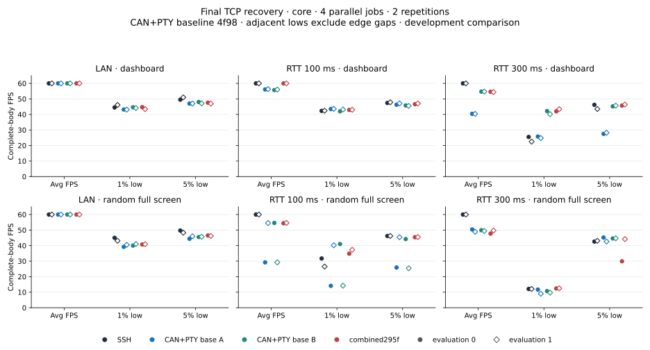

WAN dashboard improves to 60/60 average against safe references 55.7–56.3.
LAN random still has lower lows than SSH. RTT 300 ms random evaluation 0
has combined 47.7 / 12.4 / 29.9 versus references 49.9–50.4 average and
44.6–45.2 at 5% low, and SSH 60 / 12.1 / 42.6. Evaluation 1 differs;
all observations remain visible. Identical references diverge at WAN random
(29.2 versus about 54.5) and RTT 300 ms dashboard (40.4 versus 54.7), in both
evaluations. These are not discarded, converted into a noise allowance or
attributed to P/E cores or policy without causal evidence.

Core retains 21,249 bodies, 21,273 offline uniform headers and 23,040 source
records, with zero pending writes. The core screen's 192 endpoint file, 96 live
server and 96 network proofs pass the independent saved-data audit.

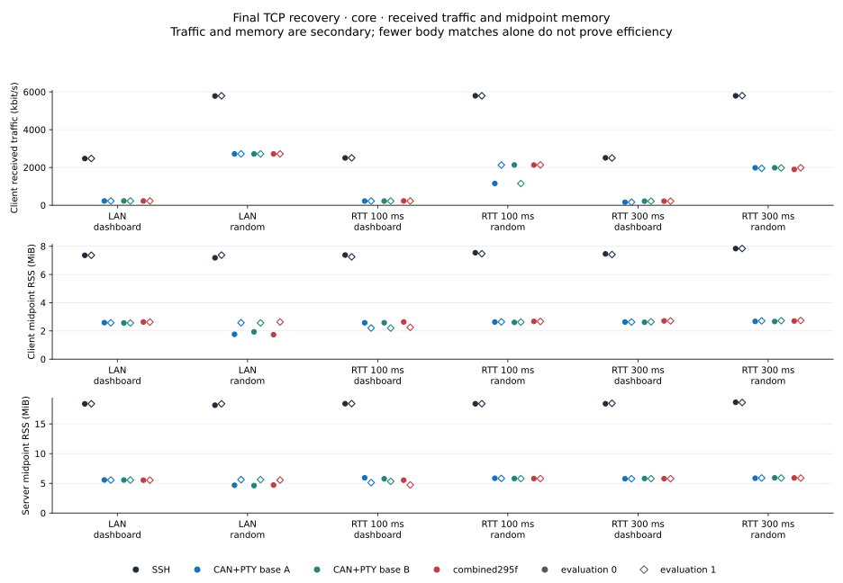
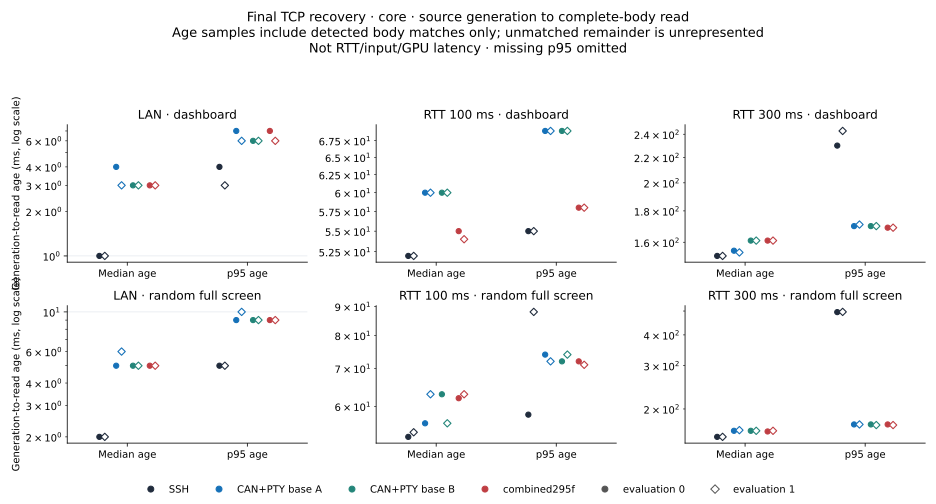

## Slow: 1 Mbit/s, 256 kbit/s and 64 kbit/s

| Network / scene / evaluation | SSH | CAN+PTY reference A | CAN+PTY reference B | Combined295f |
|---|---:|---:|---:|---:|
| 1 Mbit/s / dashboard / 0 | 23.4 / 6.5 / 7.1 | 55.9 / 42.3 / 45.6 | 55.1 / 28.2 / 31.1 | 60.0 / 40.2 / 46.8 |
| 1 Mbit/s / dashboard / 1 | 23.5 / 6.9 / 7.2 | 55.9 / 41.1 / 45.9 | 57.2 / 29.5 / 41.7 | 60.0 / 43.2 / 46.9 |
| 1 Mbit/s / random / 0 | 10.0 / 5.8 / 6.5 | 21.5 / 16.2 / 18.4 | 22.6 / 12.0 / 18.7 | 20.2 / 13.7 / 17.8 |
| 1 Mbit/s / random / 1 | 9.9 / 5.4 / 6.4 | 20.7 / 13.6 / 17.8 | 22.9 / 11.5 / 19.3 | 21.1 / 14.3 / 18.1 |
| 256 kbit/s / dashboard / 0 | 6.0 / 2.6 / 5.1 | 33.6 / 25.2 / 26.4 | 34.6 / 25.9 / 27.4 | 60.0 / 40.3 / 46.3 |
| 256 kbit/s / dashboard / 1 | 6.1 / 1.5 / 5.2 | 33.9 / 25.9 / 26.8 | 34.4 / 25.5 / 27.2 | 60.0 / 40.1 / 45.5 |
| 256 kbit/s / random / 0 | 2.5 / 1.3 / 1.3 | 6.0 / 5.3 / 5.5 | 5.7 / 2.9 / 5.4 | 5.9 / 5.5 / 5.5 |
| 256 kbit/s / random / 1 | 2.4 / 1.8 / 1.8 | 5.9 / 5.4 / 5.5 | 5.9 / 5.5 / 5.6 | 6.0 / 5.5 / 5.5 |
| 64 kbit/s / dashboard / 0 | 1.4 / 1.1 / 1.1 | 15.6 / 8.9 / 12.7 | 16.0 / 11.6 / 12.3 | 15.4 / 5.9 / 12.3 |
| 64 kbit/s / dashboard / 1 | 1.5 / 1.0 / 1.0 | 16.0 / 11.1 / 12.9 | 15.9 / 11.6 / 12.9 | 15.7 / 8.8 / 12.7 |
| 64 kbit/s / random / 0 | 0.5 / — / — | 1.4 / 1.3 / 1.3 | 1.4 / 1.3 / 1.3 | 1.6 / 1.4 / 1.4 |
| 64 kbit/s / random / 1 | 0.6 / — / — | 1.6 / 1.4 / 1.4 | 1.4 / 1.3 / 1.3 | 1.6 / 1.3 / 1.3 |

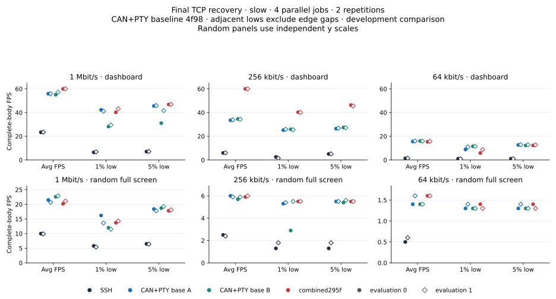

The 256 kbit/s dashboard increases from reference 33.6–34.6 FPS to 60/60,
with higher 1%/5% lows. At 1 Mbit/s random the combined 20.2/21.1 average
has mixed reference-relative FPS/lows and p95 age 117/151 ms. At 64 kbit/s
dashboard, combined 1% low 5.9/8.8 is below both references' 8.9–11.6 despite
large advantages over SSH. At 64 kbit/s random, 1.6 FPS average does not imply
fresh frames: combined median age is 2047/1981 ms and p95 is missing.

Slow retains 7,652 bodies, 7,672 offline headers and 19,765 source records.
Six pending write returns retain null end times; zero body matches join a
pending record. No zero-body jobs are hidden. Source fidelity and low-sample
limitations remain explicit.

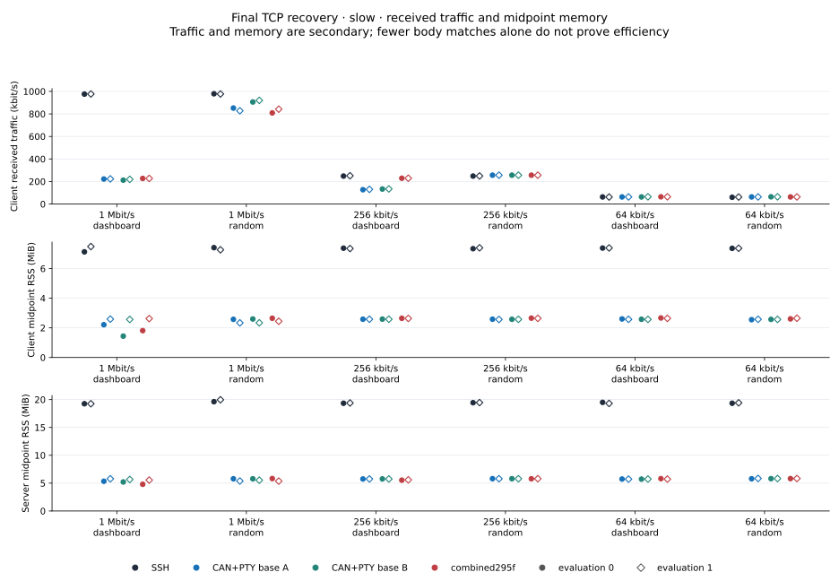
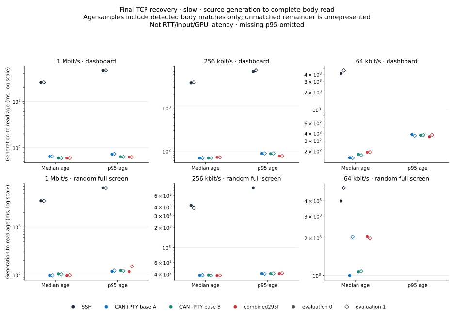

## Moving: descriptive common-timeline comparison

This is a separate warm-start experiment, **not pooled with static screens**.
A ticker warmup reaches prompt and is drained before four-agent readiness.
Eight persistent native netlink workers preserve the existing netem queue,
share a future VM epoch, and replay the same 131-point delay/rate/loss/outage
plan. All measured sources arm before the fixed common 30-second window;
there is no per-tool first-header re-anchoring or startup exclusion. Sources
retain their original 60 Hz schedule, which can itself fall behind actual
draw/write time. This differs from the static startup method.

All 16 records pass data checks, with 11,239 complete bodies / 11,282 headers /
26,696 source records, zero pending writes, 64 endpoint file, 32 live-server
and 32 network proofs. **The original performance_eligible=False remains.**
All 28 outages have positive common-overlap ACK lower bounds, but a nominal
6 ms common interval in random evaluation 1 is only 2.981765–2.994056 ms.
Kernel ACK brackets are not exact packet-loss/impairment timestamps. Common
intended schedules and valid source/body joins do not establish realized
wire equality or global timing fidelity. No tolerance is invented to approve it.

| Network / scene / evaluation | SSH | CAN+PTY reference A | CAN+PTY reference B | Combined295f |
|---|---:|---:|---:|---:|
| Moving / dashboard / 0 | 48.2 / 6.8 / 26.3 | 17.8 / 2.4 / 6.4 | 17.9 / 2.5 / 6.5 | 23.8 / 3.0 / 7.6 |
| Moving / dashboard / 1 | 47.9 / 7.3 / 24.5 | 20.7 / 2.2 / 7.0 | 18.3 / 2.4 / 6.0 | 21.9 / 2.6 / 8.3 |
| Moving / random / 0 | 27.3 / 2.6 / 13.6 | 14.3 / 1.5 / 6.5 | 20.2 / 2.4 / 7.1 | 20.4 / 2.3 / 6.0 |
| Moving / random / 1 | 27.2 / 3.2 / 12.9 | 14.1 / 1.9 / 4.9 | 15.3 / 1.8 / 5.9 | 19.3 / 2.1 / 6.7 |

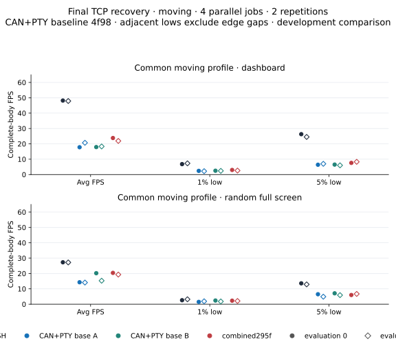

Dashboard combined average 23.8/21.9 and lows exceed the references in most
comparisons, but SSH remains at 48.2/47.9 with higher lows. Random is also
below SSH in average/lows. In contrast, dashboard combined p95 body age is
146/239 ms versus SSH 11,274/11,430 ms; random is 291/260 versus SSH
13,779/13,729 ms. Lower FPS can accompany newer frames; neither observation
is substituted for the other.

In the final 23–30 s dashboard phase, SSH receives 107.6/107.4 complete-body
FPS while combined receives 27.1/28.1. The >60 rate is retained as catch-up,
not called fresh steady-state recovery. The first body actually made after
the 23 s edge arrives after combined 143/34 ms versus SSH 2289/2298 ms.
Source-made freshness differs from intended-schedule freshness and does not
identify a particular probe/pacing/queue cause. Both edges, all phases and
every second are archived.

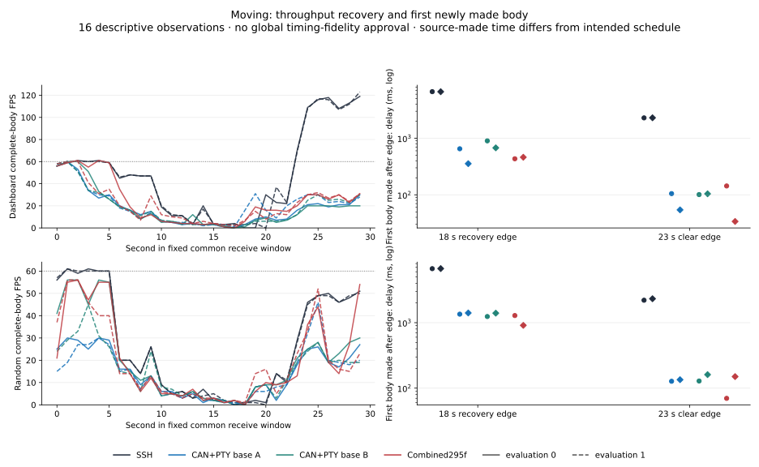
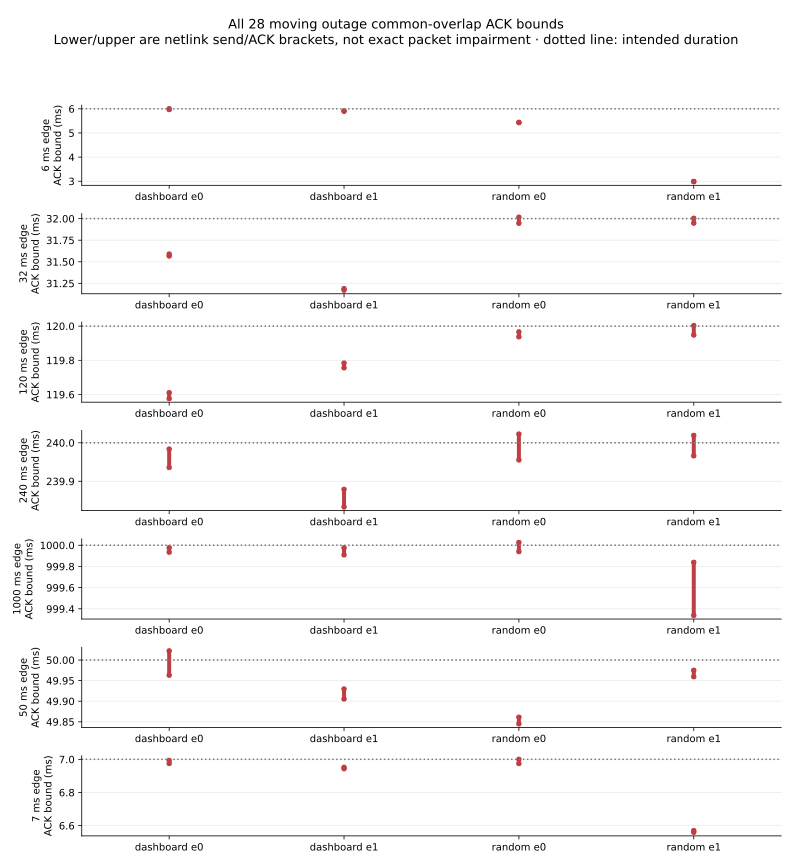
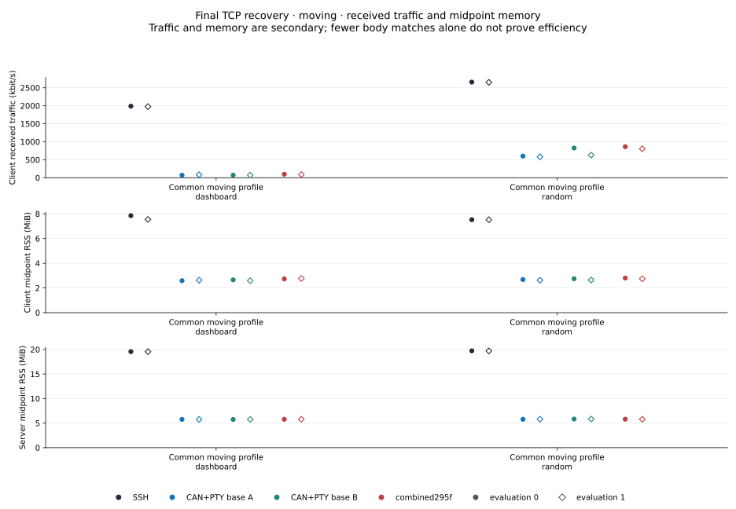
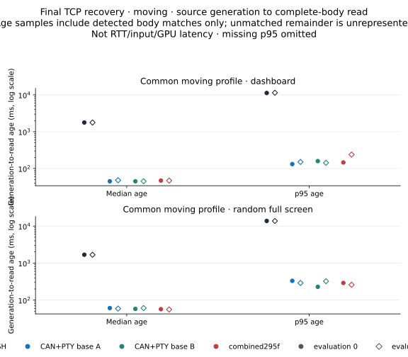

### All native outage bounds

Each cell is **common lower–upper ACK bracket, ms** across eight workers.
These bounds are not an exact blackout measurement.

| Intended ms | Dashboard e0 | Dashboard e1 | Random e0 | Random e1 |
|---:|---:|---:|---:|---:|
| 6.0 | 5.970697–6.001030 | 5.901321–5.913279 | 5.429194–5.438777 | 2.981765–2.994056 |
| 32.0 | 31.566992–31.589367 | 31.171698–31.187740 | 31.947244–32.016535 | 31.948160–32.004160 |
| 120.0 | 119.576391–119.610433 | 119.756225–119.783891 | 119.937476–119.966101 | 119.947809–120.002768 |
| 240.0 | 239.936036–239.983661 | 239.833284–239.878910 | 239.955452–240.022618 | 239.966118–240.019036 |
| 1000.0 | 999.935050–999.976550 | 999.909342–999.975467 | 999.940092–1000.026093 | 999.338047–999.838466 |
| 50.0 | 49.963334–50.022209 | 49.905334–49.929625 | 49.845083–49.861125 | 49.959583–49.975042 |
| 7.0 | 6.975494–6.993202 | 6.943701–6.951576 | 6.974910–7.000035 | 6.560158–6.569491 |

## Network, RSS, CPU and age by observation

Every saved evaluation and role follows. Traffic/RSS/CPU are secondary;
matching fewer complete bodies is not alone proof of greater efficiency.

### Core

| Network / scene / evaluation / role | RX kbit/s | Client / server RSS MiB | Client / server CPU % | Median / p95 body age ms |
|---|---:|---:|---:|---:|
| LAN / dashboard / 0 / ssh | 2472 | 7.36 / 18.38 | 0.26 / 0.34 | 1.0 / 4.0 |
| LAN / dashboard / 0 / main-A | 227 | 2.59 / 5.56 | 0.86 / 1.17 | 4.0 / 7.0 |
| LAN / dashboard / 0 / main-B | 228 | 2.57 / 5.55 | 0.84 / 1.16 | 3.0 / 6.0 |
| LAN / dashboard / 0 / candidate | 227 | 2.63 / 5.53 | 0.86 / 1.19 | 3.0 / 7.0 |
| LAN / dashboard / 1 / main-B | 228 | 2.56 / 5.55 | 0.79 / 1.1 | 3.0 / 6.0 |
| LAN / dashboard / 1 / candidate | 227 | 2.63 / 5.52 | 0.82 / 1.15 | 3.0 / 6.0 |
| LAN / dashboard / 1 / ssh | 2476 | 7.36 / 18.38 | 0.28 / 0.34 | 1.0 / 3.0 |
| LAN / dashboard / 1 / main-A | 227 | 2.57 / 5.55 | 0.8 / 1.11 | 3.0 / 6.0 |
| LAN / random / 0 / ssh | 5781 | 7.18 / 18.14 | 0.28 / 0.32 | 2.0 / 5.0 |
| LAN / random / 0 / main-A | 2718 | 1.76 / 4.67 | 1.29 / 1.62 | 5.0 / 9.0 |
| LAN / random / 0 / main-B | 2716 | 1.93 / 4.62 | 1.31 / 1.65 | 5.0 / 9.0 |
| LAN / random / 0 / candidate | 2717 | 1.73 / 4.71 | 1.31 / 1.77 | 5.0 / 9.0 |
| LAN / random / 1 / main-B | 2717 | 2.57 / 5.62 | 1.48 / 1.9 | 5.0 / 9.0 |
| LAN / random / 1 / candidate | 2716 | 2.64 / 5.55 | 1.47 / 1.91 | 5.0 / 9.0 |
| LAN / random / 1 / ssh | 5791 | 7.38 / 18.38 | 0.28 / 0.35 | 2.0 / 5.0 |
| LAN / random / 1 / main-A | 2718 | 2.58 / 5.61 | 1.45 / 1.89 | 6.0 / 10.0 |
| RTT 100 ms / dashboard / 0 / ssh | 2504 | 7.38 / 18.40 | 0.24 / 0.27 | 52.0 / 55.0 |
| RTT 100 ms / dashboard / 0 / main-A | 224 | 2.58 / 5.93 | 0.84 / 3.29 | 60.0 / 69.0 |
| RTT 100 ms / dashboard / 0 / main-B | 222 | 2.58 / 5.75 | 0.84 / 3.29 | 60.0 / 69.0 |
| RTT 100 ms / dashboard / 0 / candidate | 228 | 2.64 / 5.53 | 0.82 / 1.11 | 55.0 / 58.0 |
| RTT 100 ms / dashboard / 1 / main-B | 224 | 2.20 / 5.34 | 0.83 / 3.17 | 60.0 / 69.0 |
| RTT 100 ms / dashboard / 1 / candidate | 228 | 2.25 / 4.73 | 0.8 / 1.1 | 54.0 / 58.0 |
| RTT 100 ms / dashboard / 1 / ssh | 2509 | 7.25 / 18.40 | 0.23 / 0.27 | 52.0 / 55.0 |
| RTT 100 ms / dashboard / 1 / main-A | 224 | 2.21 / 5.12 | 0.86 / 3.22 | 60.0 / 69.0 |
| RTT 100 ms / random / 0 / ssh | 5793 | 7.54 / 18.38 | 0.25 / 0.27 | 53.0 / 58.0 |
| RTT 100 ms / random / 0 / main-A | 1155 | 2.63 / 5.85 | 0.66 / 2.94 | 56.0 / 74.0 |
| RTT 100 ms / random / 0 / main-B | 2132 | 2.61 / 5.80 | 1.18 / 5.09 | 63.0 / 72.0 |
| RTT 100 ms / random / 0 / candidate | 2130 | 2.68 / 5.80 | 1.19 / 4.95 | 62.0 / 72.0 |
| RTT 100 ms / random / 1 / main-B | 1150 | 2.63 / 5.80 | 0.71 / 3.04 | 56.0 / 74.0 |
| RTT 100 ms / random / 1 / candidate | 2135 | 2.67 / 5.80 | 1.27 / 5.28 | 63.0 / 71.0 |
| RTT 100 ms / random / 1 / ssh | 5791 | 7.47 / 18.39 | 0.28 / 0.3 | 54.0 / 88.0 |
| RTT 100 ms / random / 1 / main-A | 2131 | 2.64 / 5.82 | 1.24 / 5.23 | 63.0 / 72.0 |
| RTT 300 ms / dashboard / 0 / ssh | 2510 | 7.46 / 18.39 | 0.26 / 0.29 | 152.0 / 230.0 |
| RTT 300 ms / dashboard / 0 / main-A | 160 | 2.63 / 5.77 | 0.66 / 2.54 | 155.0 / 170.0 |
| RTT 300 ms / dashboard / 0 / main-B | 218 | 2.61 / 5.82 | 0.88 / 3.09 | 161.0 / 170.0 |
| RTT 300 ms / dashboard / 0 / candidate | 218 | 2.71 / 5.79 | 0.9 / 3.25 | 161.0 / 169.0 |
| RTT 300 ms / dashboard / 1 / main-B | 218 | 2.65 / 5.79 | 0.86 / 3.26 | 161.0 / 170.0 |
| RTT 300 ms / dashboard / 1 / candidate | 217 | 2.71 / 5.78 | 0.85 / 3.28 | 161.0 / 169.0 |
| RTT 300 ms / dashboard / 1 / ssh | 2502 | 7.41 / 18.46 | 0.26 / 0.29 | 152.0 / 243.0 |
| RTT 300 ms / dashboard / 1 / main-A | 163 | 2.63 / 5.77 | 0.64 / 2.52 | 154.0 / 171.0 |
| RTT 300 ms / random / 0 / ssh | 5791 | 7.84 / 18.63 | 0.24 / 0.27 | 154.0 / 495.0 |
| RTT 300 ms / random / 0 / main-A | 1983 | 2.68 / 5.86 | 1.19 / 4.97 | 163.0 / 173.0 |
| RTT 300 ms / random / 0 / main-B | 1984 | 2.67 / 5.92 | 1.24 / 4.85 | 163.0 / 173.0 |
| RTT 300 ms / random / 0 / candidate | 1896 | 2.70 / 5.91 | 1.15 / 4.86 | 162.0 / 173.0 |
| RTT 300 ms / random / 1 / main-B | 1974 | 2.73 / 5.90 | 1.19 / 4.88 | 163.0 / 172.0 |
| RTT 300 ms / random / 1 / candidate | 1983 | 2.74 / 5.88 | 1.2 / 4.94 | 163.0 / 172.0 |
| RTT 300 ms / random / 1 / ssh | 5799 | 7.84 / 18.60 | 0.26 / 0.28 | 154.0 / 496.0 |
| RTT 300 ms / random / 1 / main-A | 1954 | 2.71 / 5.89 | 1.17 / 4.86 | 164.0 / 173.0 |

### Slow

| Network / scene / evaluation / role | RX kbit/s | Client / server RSS MiB | Client / server CPU % | Median / p95 body age ms |
|---|---:|---:|---:|---:|
| 1 Mbit/s / dashboard / 0 / ssh | 976 | 7.13 / 19.25 | 0.16 / 0.5 | 2552.0 / 4634.0 |
| 1 Mbit/s / dashboard / 0 / main-A | 222 | 2.21 / 5.34 | 0.85 / 3.32 | 65.0 / 73.0 |
| 1 Mbit/s / dashboard / 0 / main-B | 212 | 1.44 / 5.21 | 0.76 / 1.5 | 60.0 / 64.0 |
| 1 Mbit/s / dashboard / 0 / candidate | 227 | 1.81 / 4.79 | 0.82 / 1.15 | 60.0 / 63.0 |
| 1 Mbit/s / dashboard / 1 / main-B | 219 | 2.57 / 5.66 | 0.87 / 1.38 | 60.0 / 64.0 |
| 1 Mbit/s / dashboard / 1 / candidate | 227 | 2.62 / 5.54 | 0.89 / 1.22 | 60.0 / 63.0 |
| 1 Mbit/s / dashboard / 1 / ssh | 977 | 7.48 / 19.25 | 0.18 / 0.54 | 2567.0 / 4669.0 |
| 1 Mbit/s / dashboard / 1 / main-A | 223 | 2.59 / 5.78 | 0.91 / 3.43 | 65.0 / 74.0 |
| 1 Mbit/s / random / 0 / ssh | 979 | 7.41 / 19.62 | 0.14 / 0.31 | 3524.0 / 6509.0 |
| 1 Mbit/s / random / 0 / main-A | 852 | 2.57 / 5.78 | 0.84 / 2.84 | 98.0 / 118.0 |
| 1 Mbit/s / random / 0 / main-B | 906 | 2.60 / 5.78 | 0.9 / 3.02 | 105.0 / 123.0 |
| 1 Mbit/s / random / 0 / candidate | 809 | 2.65 / 5.82 | 0.82 / 2.74 | 97.0 / 117.0 |
| 1 Mbit/s / random / 1 / main-B | 920 | 2.34 / 5.52 | 0.95 / 3.12 | 103.0 / 121.0 |
| 1 Mbit/s / random / 1 / candidate | 842 | 2.45 / 5.37 | 0.87 / 2.85 | 99.0 / 151.0 |
| 1 Mbit/s / random / 1 / ssh | 977 | 7.27 / 19.96 | 0.12 / 0.34 | 3503.0 / 6463.0 |
| 1 Mbit/s / random / 1 / main-A | 828 | 2.34 / 5.38 | 0.83 / 2.82 | 98.0 / 122.0 |
| 256 kbit/s / dashboard / 0 / ssh | 248 | 7.38 / 19.34 | 0.09 / 0.46 | 3776.0 / 6921.0 |
| 256 kbit/s / dashboard / 0 / main-A | 127 | 2.58 / 5.75 | 0.71 / 2.62 | 69.0 / 88.0 |
| 256 kbit/s / dashboard / 0 / main-B | 133 | 2.59 / 5.76 | 0.72 / 2.51 | 69.0 / 87.0 |
| 256 kbit/s / dashboard / 0 / candidate | 229 | 2.64 / 5.53 | 1.09 / 1.57 | 72.0 / 77.0 |
| 256 kbit/s / dashboard / 1 / main-B | 134 | 2.58 / 5.75 | 0.79 / 2.79 | 69.0 / 88.0 |
| 256 kbit/s / dashboard / 1 / candidate | 229 | 2.64 / 5.59 | 1.17 / 1.7 | 72.0 / 77.0 |
| 256 kbit/s / dashboard / 1 / ssh | 251 | 7.35 / 19.39 | 0.1 / 0.52 | 3896.0 / 7401.0 |
| 256 kbit/s / dashboard / 1 / main-A | 130 | 2.58 / 5.75 | 0.78 / 2.75 | 69.0 / 88.0 |
| 256 kbit/s / random / 0 / ssh | 248 | 7.34 / 19.44 | 0.11 / 0.31 | 4193.0 / 7755.0 |
| 256 kbit/s / random / 0 / main-A | 256 | 2.58 / 5.80 | 0.62 / 2.24 | 384.0 / 407.0 |
| 256 kbit/s / random / 0 / main-B | 256 | 2.58 / 5.80 | 0.66 / 2.08 | 387.0 / 405.0 |
| 256 kbit/s / random / 0 / candidate | 256 | 2.66 / 5.79 | 0.64 / 2.26 | 381.0 / 405.0 |
| 256 kbit/s / random / 1 / main-B | 256 | 2.57 / 5.79 | 0.66 / 2.2 | 381.0 / 407.0 |
| 256 kbit/s / random / 1 / candidate | 256 | 2.64 / 5.80 | 0.7 / 2.23 | 383.0 / 412.0 |
| 256 kbit/s / random / 1 / ssh | 249 | 7.40 / 19.46 | 0.08 / 0.31 | 3877.0 / — |
| 256 kbit/s / random / 1 / main-A | 256 | 2.57 / 5.79 | 0.67 / 2.24 | 387.0 / 403.0 |
| 64 kbit/s / dashboard / 0 / ssh | 63 | 7.38 / 19.50 | 0.06 / 0.63 | 4125.0 / — |
| 64 kbit/s / dashboard / 0 / main-A | 63 | 2.60 / 5.73 | 0.52 / 2.28 | 154.0 / 382.0 |
| 64 kbit/s / dashboard / 0 / main-B | 63 | 2.58 / 5.72 | 0.55 / 2.28 | 176.0 / 370.0 |
| 64 kbit/s / dashboard / 0 / candidate | 64 | 2.67 / 5.81 | 0.54 / 2.29 | 191.0 / 349.0 |
| 64 kbit/s / dashboard / 1 / main-B | 64 | 2.57 / 5.73 | 0.61 / 2.27 | 170.0 / 372.0 |
| 64 kbit/s / dashboard / 1 / candidate | 64 | 2.64 / 5.72 | 0.57 / 2.33 | 191.0 / 375.0 |
| 64 kbit/s / dashboard / 1 / ssh | 62 | 7.39 / 19.30 | 0.13 / 0.63 | 4637.0 / — |
| 64 kbit/s / dashboard / 1 / main-A | 63 | 2.57 / 5.72 | 0.57 / 2.35 | 152.0 / 363.0 |
| 64 kbit/s / random / 0 / ssh | 60 | 7.36 / 19.34 | 0.04 / 0.24 | 3974.0 / — |
| 64 kbit/s / random / 0 / main-A | 63 | 2.55 / 5.79 | 0.24 / 1.68 | 998.0 / — |
| 64 kbit/s / random / 0 / main-B | 64 | 2.57 / 5.80 | 0.25 / 1.67 | 1068.0 / — |
| 64 kbit/s / random / 0 / candidate | 63 | 2.61 / 5.82 | 0.2 / 1.75 | 2047.0 / — |
| 64 kbit/s / random / 1 / main-B | 64 | 2.57 / 5.82 | 0.25 / 1.6 | 1079.0 / — |
| 64 kbit/s / random / 1 / candidate | 63 | 2.65 / 5.83 | 0.19 / 1.53 | 1981.0 / — |
| 64 kbit/s / random / 1 / ssh | 62 | 7.37 / 19.41 | 0.03 / 0.29 | 5051.0 / — |
| 64 kbit/s / random / 1 / main-A | 63 | 2.58 / 5.84 | 0.17 / 1.64 | 2038.0 / — |

### Moving

| Network / scene / evaluation / role | RX kbit/s | Client / server RSS MiB | Client / server CPU % | Median / p95 body age ms |
|---|---:|---:|---:|---:|
| Moving / dashboard / 0 / ssh | 1987 | 7.85 / 19.56 | 0.24 / 0.41 | 1778.0 / 11274.0 |
| Moving / dashboard / 0 / main-A | 69 | 2.59 / 5.76 | 0.35 / 1.47 | 45.0 / 132.0 |
| Moving / dashboard / 0 / main-B | 72 | 2.66 / 5.74 | 0.35 / 1.4 | 45.0 / 159.0 |
| Moving / dashboard / 0 / candidate | 97 | 2.73 / 5.78 | 0.46 / 1.56 | 47.0 / 146.0 |
| Moving / dashboard / 1 / main-B | 71 | 2.59 / 5.76 | 0.38 / 1.4 | 45.0 / 143.0 |
| Moving / dashboard / 1 / candidate | 89 | 2.76 / 5.78 | 0.45 / 1.69 | 47.0 / 239.0 |
| Moving / dashboard / 1 / ssh | 1976 | 7.54 / 19.55 | 0.25 / 0.39 | 1776.0 / 11430.0 |
| Moving / dashboard / 1 / main-A | 83 | 2.63 / 5.76 | 0.42 / 1.61 | 48.0 / 151.0 |
| Moving / random / 0 / ssh | 2658 | 7.52 / 19.72 | 0.21 / 0.21 | 1685.0 / 13779.0 |
| Moving / random / 0 / main-A | 601 | 2.68 / 5.78 | 0.54 / 2.41 | 61.0 / 332.0 |
| Moving / random / 0 / main-B | 826 | 2.75 / 5.82 | 0.71 / 2.82 | 58.0 / 229.0 |
| Moving / random / 0 / candidate | 862 | 2.80 / 5.80 | 0.75 / 2.98 | 57.0 / 291.0 |
| Moving / random / 1 / main-B | 628 | 2.64 / 5.83 | 0.57 / 2.38 | 61.0 / 324.0 |
| Moving / random / 1 / candidate | 804 | 2.74 / 5.79 | 0.7 / 2.86 | 56.0 / 260.0 |
| Moving / random / 1 / ssh | 2651 | 7.52 / 19.70 | 0.21 / 0.21 | 1682.0 / 13729.0 |
| Moving / random / 1 / main-A | 582 | 2.62 / 5.80 | 0.51 / 2.29 | 59.0 / 290.0 |

## Incomplete loss screens and connection checks

Loss study 44 completed 32/48 jobs before a barrier failure. Retry 46
completed 4/16. Its first failure was candidate `connect_s=null` with no
prompt within the unchanged 30-second limit. The other three receive windows
closed; their subsequent barrier errors are secondary. Whether handshake
or display prevented the prompt remains unknown. The separate exact [44 partial CSV](data/final-tcp-context-20261101/study44-acceptance-per-rep.csv)
(32 rows) and [46 partial CSV](data/final-tcp-context-20261101/study46-acceptance-per-rep.csv)
(4 rows) preserve observed strong and weak FPS/lows. Their original partial
analysis logs retain failed coverage; no new raw-data audit is claimed.
These 36 records are **not a passing loss matrix**, not zeros
and not part of the 96 eligible static observations. Eight later connection-only
checks succeed; they ran no render scenes and do not explain, repair or
exonerate the earlier failure. The [sanitized context](data/final-tcp-context-20261101/context.json)
retains job counts, outcomes and hashes of original local records without
publishing PTY payloads or full host command lines.

## Archive and remaining scope

[Core](data/final-tcp-core-20261101/README.md),
[slow](data/final-tcp-slow-20261101/README.md) and
[moving](data/final-tcp-moving-20261101/README.md) archives contain compact
body timelines, every per-evaluation metric, exact independent audits,
input/build identities, gzip-preserved logs and portable verifiers/plot scripts.
Moving includes worker plan/stdout/ACK records and rederived bounds. This is
a partial public archive: full capture payloads, executable binaries and
source-ledger payloads remain local; their independent audit hashes are
imported rather than described as a second current raw rehash.

No new terminal emulator replay or benchmark was performed for publication.
The research PR contains documentation/results, not the archived unselected
TCP-batch implementation. Focused CAN/PTY/controller PRs remain separately
reviewable; draft controller results are not release adoption. Newer cadence
margin experiments are outside this dataset. UDP/all-path behavior, a complete
loss/moving/input matrix and universal SSH parity are not established here.
