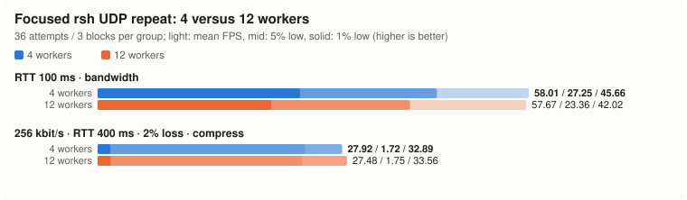

# Focused repeat of the two differing rsh UDP cases

Only RTT 100 ms random-screen rendering and the 256 kbit/s, RTT 400 ms,
nominal 2%-loss dashboard were repeated. Same official 0.2.0 binary,
collector, 100×30 terminal, requested 60 FPS and eight-second windows.

Each case/concurrency has three blocks of twelve attempts: **36 attempts
per group, 144 total**. WAN block order is 4/12/12/4/4/12; the lossy case
uses 12/4/4/12/12/4. Cases are interleaved. Each four-worker case rotates
through slots 0–3, 4–7 and 8–11; twelve-worker blocks use all slots.
This balances temporal and slot assignment effects without replaying the
earlier mixed-tool workload. All workers in a block run the same case.

The application's binary and its version/SHA/image are checked on all 24
containers before and after. This is a focused homogeneous-rsh diagnostic,
not an exact replication of the full suite's mix of protocols and profiles.

## Findings

WAN random-screen mean FPS was **58.01 → 57.67** (-0.6%), while its 1% low was **27.25 → 23.36** (-14.3%). Its 5% low was **45.66 → 42.02**. The twelve-worker tail remained lower in this focused repeat, although the deficit differs from the earlier 26.0 → 19.0 observation.

The lossy dashboard mean was **27.92 → 27.48 FPS** (-1.6%). The earlier approximately 20% drop was not reproduced in this repeat; the three block-mean ranges overlap. This does not prove identical behavior for every loss sequence.

The practical distinction remains: average FPS can be close while frame-gap
tails differ. This diagnostic does not identify the precise cause of the
tail difference or isolate it from host/collector scheduling and the extra
counter-reading overhead. The configured twelve-worker default is unchanged.

## Results

Mean FPS averages all available runs. 1%/5% lows pool inter-frame gaps
within each group. The block mean range shows the three block averages;
concurrent samples share host load and are not independent replications.
No statistical-equivalence claim is made.

| Link | Scene | Workers | Measured | Avg FPS | 1% low | 5% low | Block mean FPS range | Median RX kbit/s |
| --- | --- | --- | --- | --- | --- | --- | --- | --- |
| wan | bandwidth | 4 | 36/36 | 58.01 | 27.25 | 45.66 | 57.92–58.08 | 2681 |
| wan | bandwidth | 12 | 36/36 | 57.67 | 23.36 | 42.02 | 57.43–57.89 | 2681 |
| badmobile | compress | 4 | 36/36 | 27.92 | 1.72 | 32.89 | 25.87–29.25 | 173 |
| badmobile | compress | 12 | 36/36 | 27.48 | 1.75 | 33.56 | 27.12–27.75 | 169 |

## Each block

| Execution block | Workers | Active slots | Avg FPS | 1% low | 5% low |
| --- | --- | --- | --- | --- | --- |
| 00-wan-bandwidth-p4 | 4 | 0,1,2,3 | 57.92 | 25.51 | 45.66 |
| 01-badmobile-compress-p12 | 12 | 0,1,2,3,4,5,6,7,8,9,10,11 | 27.75 | 1.77 | 33.33 |
| 02-wan-bandwidth-p12 | 12 | 1,2,3,4,5,6,7,8,9,10,11,0 | 57.89 | 25.38 | 43.29 |
| 03-badmobile-compress-p4 | 4 | 0,1,2,3 | 25.87 | 1.65 | 31.95 |
| 04-wan-bandwidth-p12 | 12 | 2,3,4,5,6,7,8,9,10,11,0,1 | 57.69 | 23.92 | 41.84 |
| 05-badmobile-compress-p4 | 4 | 4,5,6,7 | 28.65 | 1.74 | 33.00 |
| 06-wan-bandwidth-p4 | 4 | 4,5,6,7 | 58.04 | 27.10 | 45.66 |
| 07-badmobile-compress-p12 | 12 | 3,4,5,6,7,8,9,10,11,0,1,2 | 27.56 | 1.72 | 33.44 |
| 08-wan-bandwidth-p4 | 4 | 8,9,10,11 | 58.08 | 28.01 | 45.45 |
| 09-badmobile-compress-p12 | 12 | 4,5,6,7,8,9,10,11,0,1,2,3 | 27.12 | 1.74 | 33.56 |
| 10-wan-bandwidth-p12 | 12 | 5,6,7,8,9,10,11,0,1,2,3,4 | 57.43 | 21.98 | 40.82 |
| 11-badmobile-compress-p4 | 4 | 8,9,10,11 | 29.25 | 1.74 | 33.11 |

## Actual qdisc drops

The counters below cover the whole job, including connection and teardown, not only its eight-second render window. Each job recreates its qdisc. Drop share is drops / (sent + dropped); still-queued packets are excluded. Drops may include queue-limit drops as well as configured random loss, so these are not exact measurements of the random-loss parameter.

| Link | Workers | Side | Counters | Sent packets | Drops | Aggregate drop % | Per-job drop % range | Max final qlen |
| --- | --- | --- | --- | --- | --- | --- | --- | --- |
| wan | 4 | srv | 36 | 85504 | 0 | 0.00 | 0.00–0.00 | 0 |
| wan | 4 | cli | 36 | 17660 | 0 | 0.00 | 0.00–0.00 | 0 |
| wan | 12 | srv | 36 | 85341 | 0 | 0.00 | 0.00–0.00 | 0 |
| wan | 12 | cli | 36 | 17567 | 0 | 0.00 | 0.00–0.00 | 0 |
| badmobile | 4 | srv | 36 | 14412 | 295 | 2.01 | 1.10–3.56 | 3 |
| badmobile | 4 | cli | 36 | 10494 | 221 | 2.06 | 0.38–3.64 | 7 |
| badmobile | 12 | srv | 36 | 13700 | 272 | 1.95 | 0.95–3.62 | 12 |
| badmobile | 12 | cli | 36 | 10244 | 200 | 1.91 | 0.00–3.76 | 8 |

`srv` is server egress and `cli` is client egress. Counter reads happen after the original collector returns and do not alter its saved FPS window or job_s. They can overlap other slots' observation windows and delay worker reuse, adding some host work; both focused concurrency settings include this instrumentation.

## Relation to the earlier comparison

The [earlier matched three-attempt comparison](parallel12-20261029.md) observed WAN random-screen 1% lows of 26.0 → 19.0 FPS and lossy dashboard mean FPS of 29.9 → 23.7. Compare the new group values and block ranges above rather than treating those earlier individual estimates as fixed performance. Different realized drops, order, workload mix and host scheduling prevent attributing every change to concurrency alone.

## Failures and source data

All 144 attempts produced render measurements; none were discarded.

[Complete blocks, per-run metrics/gaps, qdisc counters, environment and pre/postflight checks](data/focused-20261029.json). Original options/results and source-file hashes are retained. Rebuild with `python3 benchmark/lab/compare_parallel.py`.
