# TCP quarter freshness: static FPS and descriptive moving recovery

The TCP quarter freshness wait records higher average, 1% low and 5% low FPS
than both simultaneous combined references at **1 Mbit/s random in both
evaluations**. The static core still has SSH-relative average/tail deficits;
several dashboard lows and slow-link age samples worsen. In moving, dashboard
throughput improves, while random 1% lows decline against both references.
The candidate remains **unselected**, with overall selection pending rather
than an automatic rejection on one metric.

**1% low, 5% low and average FPS are primary; CPU/RSS are secondary.**
Age and fresh recovery distinguish throughput from stale catch-up. Individual
costs can be acceptable with overall improvement; no numerical weights, noise
allowance, automatic single-metric veto, global SSH parity or additive gain
claim is introduced. All evaluations and adverse observations remain visible.

## Exact source and builds

Both A/B references are identical **combined295f81d54ea4 / fb04386f…2eec4**.
Quarter55 is **515db0475a03 / 6d7fc6b1…68cba9**. This cohort does not contain
margin48 or the later quarter-plus-margin source60. The
[paired metadata](data/fresh-quarter55-core-20261101/paired-build-provenance.json)
reuses the existing combined baseline and separately builds the candidate in
a pinned compiler image; it does **not** claim a new same-container pair.

Only the server freshness wait changes: modeled paths already use
`min(20 ms, gap / 4)`; lossless TCP now also uses that bound. Unmodeled UDP
retains the 20 ms wait. Unknown-rate behavior, output credit/windows, capacity
estimation/probing, SLOW_ROOM=5 ms, partial-escape TAIL_WAIT and the global
cadence helper remain unchanged. The [exact patch](data/fresh-quarter55-core-20261101/controller.patch),
[source proof](data/fresh-quarter55-core-20261101/55-tcp-fresh-quarter-proof.json)
and [three fixtures](data/fresh-quarter55-core-20261101/55-tcp-fresh-quarter-tests.rs)
record scope. Earlier refresh may expose partial producer frames or increase
traffic/age; terminal parser completeness is not producer-frame completeness.

The candidate actually passes **143 total tests**: library 113, CLI 4, session 25
and one Linux concurrency fixture with 64 children; two library tests are
ignored. Unchanged combined production with the same three fixtures has two
passes and one expected known-slow deadline failure. Baseline 140 passes are
separate reused evidence. Original logs, source guards and root Cargo
fresh=false/optimized release records are bundled. No source60/macOS 145 test
result is attributed to this candidate. Creation-stage proof wording remains
historical; actual logs and artifact metadata supersede planned counts.

## Method and boundaries

Core56 and slow57 each have 48 observations/12 blocks. They run four parallel
roles, two evaluations, with direct slot crossing from `[SSH,A,B,candidate]`
to `[B,candidate,SSH,A]`. Static receive windows are eight seconds at requested
60 Hz and 100×30. Core adds zero/50/150 ms per direction, without configured
loss or rate caps; slow adds RTT 100 ms with server-egress1 Mbit/s, 256 kbit/s
or 64 kbit/s caps and uncapped client direction. All RSH roles share the
TCP alias, port 2222 and configuration.

Moving58 has 16 **descriptive** observations/four blocks. A ticker warmup,
prompt completion and drain precede a common future VM epoch. All four
measured sources and eight persistent native workers are ready before T0;
receive windows stay `[T0,T0+30 s]`, without per-tool anchor shifts. Scene
lifetimes, original 131-point schedule, netem change semantics and all seven
short outages remain. This startup differs from the static cohorts: they
are not pooled. The native worker's ACK brackets do not prove exact kernel
packet impairment, identical packet loss or global timing fidelity.

All retain RAM schema2 source ledgers, child SET/GET geometry before exec,
nonce/clock/source PID proofs, four-party receive-window closure and the
original five-second pidfd/SIGUSR2 collection. One host user+system<30%
interval admits a phase; runtime CPU/process load is context, not an abort
threshold. There is no continuous 60-second quiet requirement or per-process
limit. Source, identity, timing and sampling errors still reject. Process
CPU 100% means one core, distinct from host admission load. Actual windows
are November 1; environment creation predates them. Physical P/E placement
is unproven.

Lows use adjacent complete-body gaps and exclude window edges; maxgap and
unmatched tail remain in the compact/CSV. Missing sparse lows/p95 ages stay
null, not zero-filled. Body age is source generation to matched complete-body
read, conditional on matches, not RTT/input/GPU latency. Client RX is kbit/s;
RSS is midpoint KiB in CSV and MiB in tables. Resource checks establish
saved job→summary→CSV consistency, not independent raw-counter reconstruction.

## Core56: LAN and RTT 100/300 ms

Cells are **average / 1% low / 5% low FPS**. Dashboard=`compress`;
random=incompressible `bandwidth`. Every role/evaluation is retained.

| Network / scene / evaluation | SSH | Combined295f A | Combined295f B | Quarter55 |
|---|---:|---:|---:|---:|
| LAN / dashboard / 0 | 60.0 / 47.0 / 49.1 | 60.0 / 43.5 / 48.0 | 60.0 / 43.6 / 47.8 | 60.0 / 44.5 / 46.9 |
| LAN / dashboard / 1 | 60.0 / 46.4 / 50.8 | 60.0 / 41.9 / 46.7 | 60.0 / 45.6 / 48.6 | 60.0 / 44.7 / 48.1 |
| LAN / random / 0 | 60.0 / 45.3 / 49.8 | 60.0 / 43.4 / 46.7 | 60.0 / 41.9 / 45.6 | 60.0 / 43.1 / 46.3 |
| LAN / random / 1 | 60.0 / 43.4 / 49.2 | 60.0 / 41.5 / 46.1 | 60.0 / 42.3 / 46.6 | 60.0 / 43.1 / 46.5 |
| RTT 100 ms / dashboard / 0 | 60.0 / 41.7 / 47.5 | 60.0 / 42.1 / 46.3 | 60.0 / 41.4 / 47.2 | 60.0 / 41.6 / 47.1 |
| RTT 100 ms / dashboard / 1 | 60.0 / 42.5 / 46.6 | 60.0 / 41.2 / 46.3 | 60.0 / 41.2 / 46.8 | 60.0 / 42.6 / 44.8 |
| RTT 100 ms / random / 0 | 60.0 / 41.3 / 47.9 | 54.6 / 40.8 / 45.2 | 54.9 / 39.4 / 45.0 | 54.5 / 39.4 / 45.5 |
| RTT 100 ms / random / 1 | 59.9 / 33.5 / 45.3 | 54.4 / 39.8 / 44.8 | 54.2 / 28.6 / 43.4 | 54.6 / 31.9 / 43.9 |
| RTT 300 ms / dashboard / 0 | 60.0 / 24.8 / 45.0 | 54.6 / 42.7 / 45.7 | 54.5 / 41.7 / 46.2 | 54.6 / 43.6 / 46.7 |
| RTT 300 ms / dashboard / 1 | 60.0 / 21.8 / 47.0 | 54.6 / 41.7 / 46.1 | 54.6 / 42.0 / 45.2 | 54.6 / 42.4 / 46.4 |
| RTT 300 ms / random / 0 | 60.0 / 13.7 / 44.4 | 49.5 / 11.2 / 44.3 | 50.4 / 11.9 / 44.0 | 49.7 / 21.4 / 44.6 |
| RTT 300 ms / random / 1 | 60.0 / 11.4 / 44.4 | 49.7 / 12.8 / 44.3 | 50.2 / 11.6 / 45.1 | 50.6 / 12.8 / 43.1 |

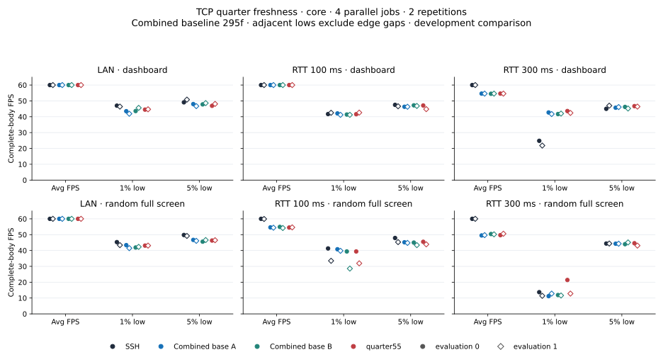

LAN averages are 60, with several tails below SSH. WAN random quarter averages
54.5/54.6 are near combined controls54.2–54.9 and below SSH 60/59.9. RTT 300 ms
random averages49.7/50.6 still trail SSH60; individual low advantages do not
establish global parity. WAN dashboard evaluation1 has lower quarter 5% low
44.8 than both controls 46.3/46.8, despite all averages staying 60.

The independent audit retains 22,041 complete bodies,22,053 offline headers,
23,040 source records and zero pending writes/body joins. Core has192
endpoint-file,96 live-server and 96 strict-network checks. Offline headers
and complete producer-body matches are separate counters.

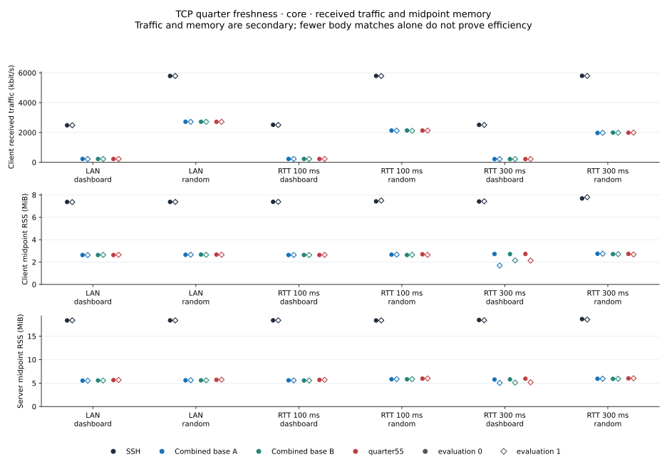
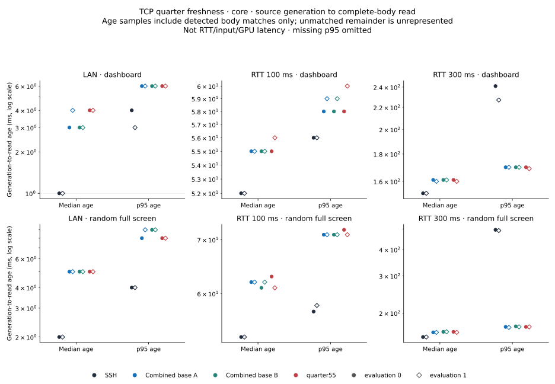

## Slow57: gains and costs

| Network / scene / evaluation | SSH | Combined295f A | Combined295f B | Quarter55 |
|---|---:|---:|---:|---:|
| 1 Mbit/s / dashboard / 0 | 23.7 / 6.6 / 7.6 | 60.0 / 40.0 / 45.7 | 60.0 / 41.6 / 46.4 | 60.0 / 38.6 / 45.1 |
| 1 Mbit/s / dashboard / 1 | 23.5 / 6.6 / 7.1 | 60.0 / 41.3 / 46.5 | 60.0 / 40.6 / 46.8 | 60.0 / 41.5 / 45.7 |
| 1 Mbit/s / random / 0 | 9.9 / 4.6 / 6.8 | 23.1 / 13.8 / 18.6 | 21.4 / 10.8 / 17.9 | 24.2 / 18.0 / 20.2 |
| 1 Mbit/s / random / 1 | 9.9 / 5.8 / 6.5 | 21.6 / 14.2 / 18.3 | 23.0 / 11.2 / 17.9 | 23.4 / 17.4 / 18.8 |
| 256 kbit/s / dashboard / 0 | 6.0 / 2.1 / 4.3 | 60.0 / 41.8 / 46.5 | 60.0 / 41.4 / 46.3 | 60.0 / 41.8 / 47.2 |
| 256 kbit/s / dashboard / 1 | 5.7 / 2.4 / 4.2 | 60.0 / 42.2 / 45.9 | 60.0 / 41.6 / 45.9 | 60.0 / 39.7 / 45.3 |
| 256 kbit/s / random / 0 | 2.4 / 1.2 / 1.2 | 6.0 / 5.3 / 5.5 | 5.7 / 2.8 / 5.5 | 5.9 / 5.3 / 5.5 |
| 256 kbit/s / random / 1 | 2.4 / 1.2 / 1.2 | 6.0 / 5.4 / 5.5 | 5.9 / 5.3 / 5.5 | 6.0 / 5.3 / 5.5 |
| 64 kbit/s / dashboard / 0 | 1.4 / 1.1 / 1.1 | 15.6 / 11.6 / 12.6 | 15.7 / 9.3 / 12.0 | 15.5 / 9.5 / 12.1 |
| 64 kbit/s / dashboard / 1 | 1.4 / 1.3 / 1.3 | 15.0 / 5.5 / 8.9 | 16.2 / 8.7 / 12.8 | 16.1 / 9.0 / 13.3 |
| 64 kbit/s / random / 0 | 0.6 / — / — | 1.6 / 1.4 / 1.4 | 1.4 / 1.3 / 1.3 | 1.5 / 1.3 / 1.3 |
| 64 kbit/s / random / 1 | 0.6 / — / — | 1.6 / 1.4 / 1.4 | 1.4 / 0.8 / 0.8 | 1.5 / 1.4 / 1.4 |

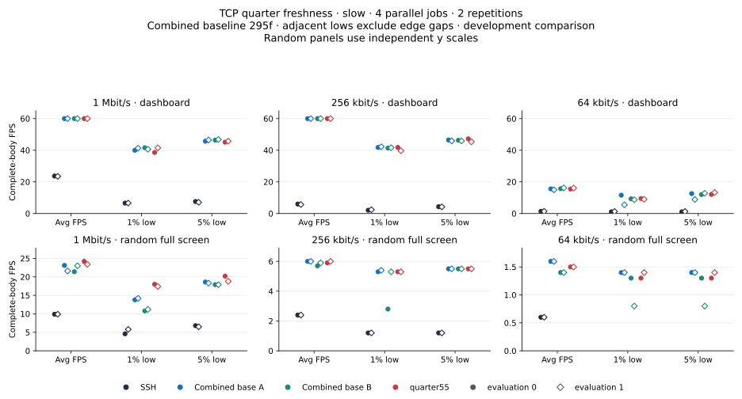

At 1 Mbit/s random, quarter records24.2/18.0/20.2 and23.4/17.4/18.8
(average/1%/5%), above both controls in each evaluation. Its p95 ages160/139 ms
sit among control values 120–178 ms; this is not uniformly lower age or RX.
At 1 Mbit/s dashboard evaluation0, lows 38.6/45.1 trail both controls 40.0/45.7
and 41.6/46.4. At 64 kbit/s dashboard evaluation0, quarter 1% low9.5 trails
control A11.6 and p95 age441 ms exceeds 360/367 ms, while other FPS comparisons
are mixed. These costs remain part of the overall assessment.

Slow retains 8,664 bodies/8,685 headers and19,769 source records. Eight pending
write returns have null ends; zero bodies join those pending writes. The two
64 kbit/s SSH random jobs each have five bodies, so four low cells are null;
12 p95-age cells are also null. Sparse results are not smooth-delivery proof.

Random panels use independent y scales so very low rates remain visible.

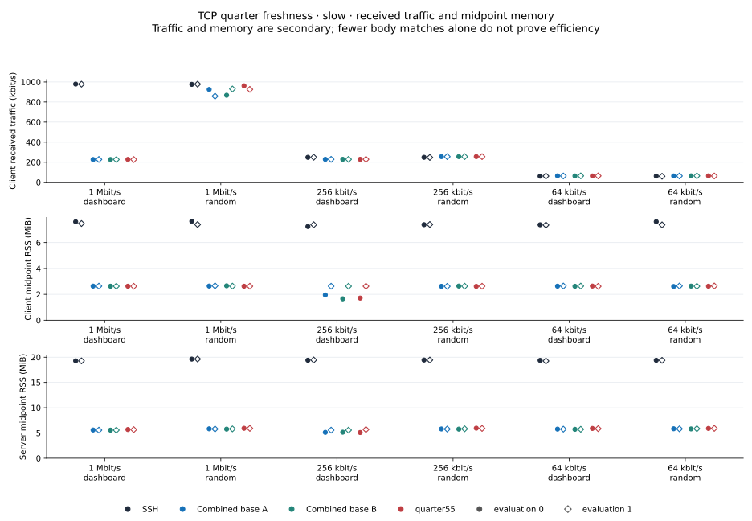
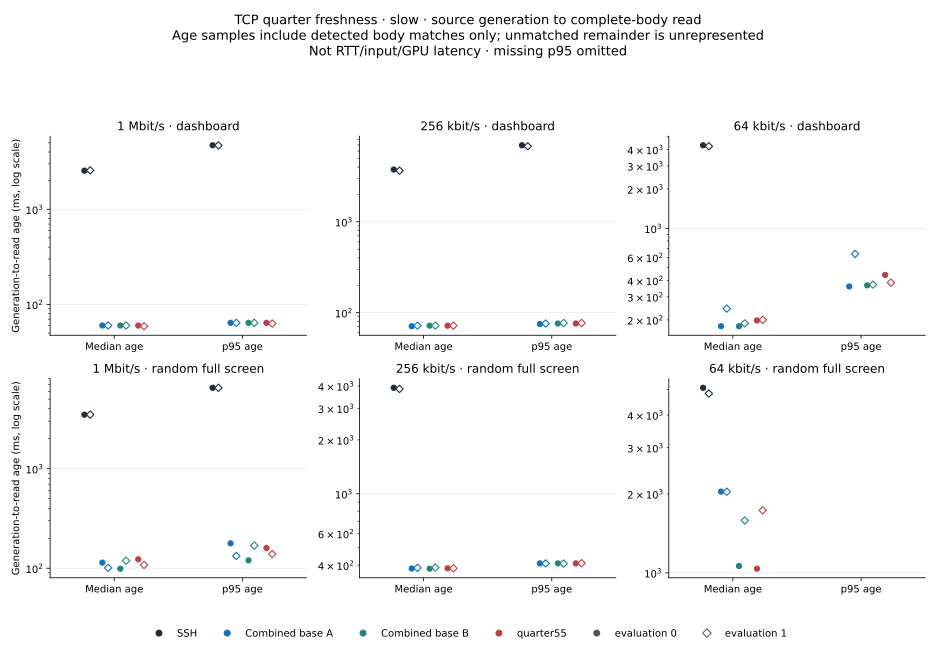

## Moving58: valid observations, descriptive comparisons

Moving data integrity passes, while **performance_eligible=False**, global
fidelity approval remains false and final selection stays null. This section
is not 16 additional eligible static performance observations.

| Network / scene / evaluation | SSH | Combined295f A | Combined295f B | Quarter55 |
|---|---:|---:|---:|---:|
| moving / dashboard / 0 | 48.0 / 3.7 / 31.5 | 21.4 / 2.5 / 7.8 | 23.7 / 2.9 / 9.4 | 27.9 / 3.6 / 8.6 |
| moving / dashboard / 1 | 49.4 / 6.9 / 32.0 | 21.2 / 2.8 / 6.9 | 22.0 / 2.4 / 9.3 | 25.2 / 3.4 / 7.3 |
| moving / random / 0 | 27.0 / 3.5 / 13.6 | 19.0 / 2.2 / 6.0 | 19.8 / 1.9 / 6.3 | 19.6 / 1.7 / 7.4 |
| moving / random / 1 | 27.6 / 3.5 / 13.4 | 18.9 / 2.4 / 6.5 | 19.1 / 2.2 / 7.0 | 21.3 / 1.9 / 7.1 |

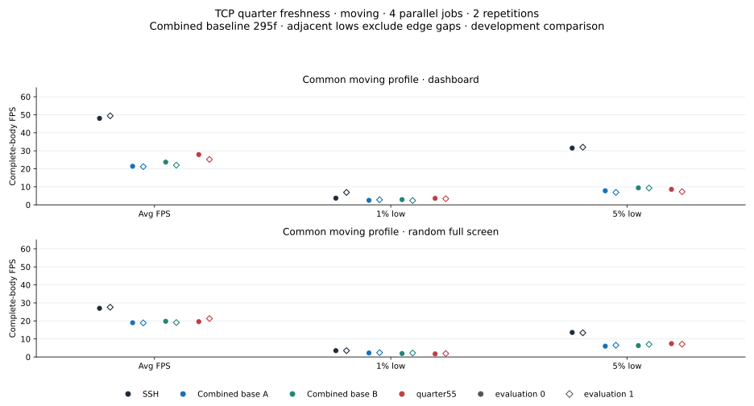

Dashboard averages 27.9/25.2 exceed reference 21.2–23.7, and1% lows exceed both
references, with mixed5% lows. Random1% lows 1.7/1.9 trail both references in
both evaluations, while5% lows 7.4/7.1 exceed them; average is mixed in the
first evaluation and higher in the second. Whole-window SSH throughput and
lows are higher here. These are descriptive observations under measured
schedule-fidelity limits, not a universal moving-policy gain.

Moving retains 12,331 bodies/12,378 headers,26,729 source records and one
pending write return with no pending-body join. All 16 have body matches and
whole-window low/age estimates.64 endpoint-file,32 live-server and32 strict
network proofs match.

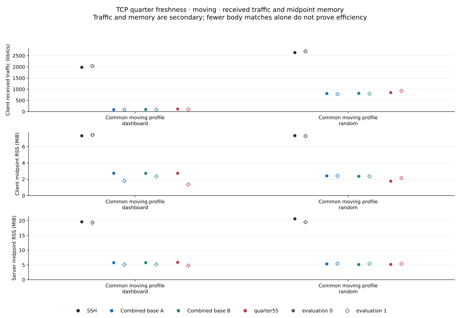
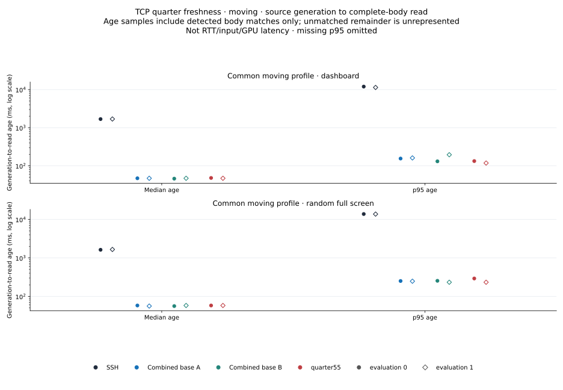

### Recovery and freshness

The complete 30 one-second bins and seven phase summaries for all 16 jobs are
saved in [moving-derived.json](data/fresh-quarter55-moving-20261101/moving-derived.json).
Final 23–30 s dashboard quarter averages 43.9/41.9 exceed references 26.1–29.4;
its5% lows 26.9/23.2 exceed 18.2–19.6. Evaluation1 quarter 1% low10.8 is below
both controls 11.1/11.6. SSH 112.7/114.1 FPS in that phase is catch-up, not a
new steady fresh source rate above 60 Hz.

The first complete body actually generated after 23 s arrives at quarter
104.8/102.0 ms, versus reference 101.0–101.5/86.3–132.2 ms: mixed relative
fresh-arrival latency. SSH is 2202.9/2114.8 ms. Throughput catch-up and fresh
arrival therefore answer different questions; intended schedule time is not
actual source-made time. No automatic age veto or causal attribution follows.

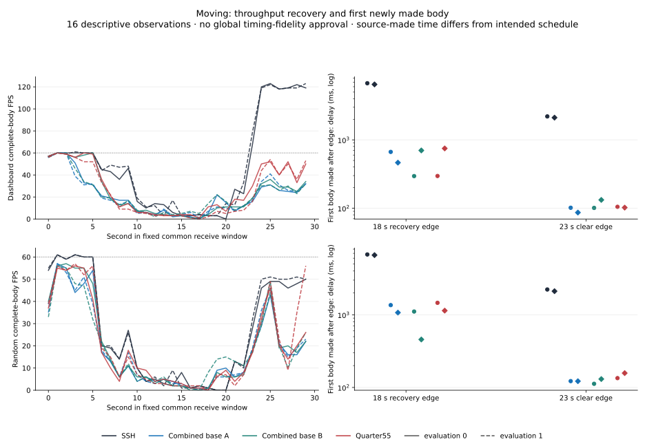

### All 28 native outage ACK bounds

Bounds are common-overlap lower/upper brackets derived from eight netlink
send/ACK records per edge, in milliseconds. They are not exact packet-level
blackout lengths. All 131-point traces and 524 inter-worker point-skew values
are retained and independently checked. All 28 lower bounds are positive,
but 6/7 ms transitions can be shortened: e.g. 4.361–4.373 ms for an intended
7 ms edge. Identical intended tables do not establish identical impairment.

| Block | Intended outage ms | Common lower / upper ms |
|---|---:|---:|
| 00-moving-compress-i0 | 6 | 5.974365 / 6.003699 |
| 00-moving-compress-i0 | 32 | 31.504586 / 31.539669 |
| 00-moving-compress-i0 | 120 | 119.925268 / 119.946227 |
| 00-moving-compress-i0 | 240 | 239.952369 / 240.105079 |
| 00-moving-compress-i0 | 1000 | 999.910236 / 1000.025944 |
| 00-moving-compress-i0 | 50 | 49.924059 / 49.961184 |
| 00-moving-compress-i0 | 7 | 6.974246 / 7.000871 |
| 01-moving-compress-i1 | 6 | 5.969532 / 6.002158 |
| 01-moving-compress-i1 | 32 | 31.958629 / 32.009089 |
| 01-moving-compress-i1 | 120 | 119.923851 / 119.959352 |
| 01-moving-compress-i1 | 240 | 239.813286 / 239.971536 |
| 01-moving-compress-i1 | 1000 | 999.922944 / 999.968653 |
| 01-moving-compress-i1 | 50 | 49.923143 / 50.046518 |
| 01-moving-compress-i1 | 7 | 4.361023 / 4.372940 |
| 02-moving-bandwidth-i0 | 6 | 5.052652 / 5.058986 |
| 02-moving-bandwidth-i0 | 32 | 31.951504 / 32.008255 |
| 02-moving-bandwidth-i0 | 120 | 119.957685 / 120.002518 |
| 02-moving-bandwidth-i0 | 240 | 239.935828 / 239.970328 |
| 02-moving-bandwidth-i0 | 1000 | 998.088808 / 998.131476 |
| 02-moving-bandwidth-i0 | 50 | 49.937184 / 50.013643 |
| 02-moving-bandwidth-i0 | 7 | 6.973663 / 7.001246 |
| 03-moving-bandwidth-i1 | 6 | 5.977657 / 6.001782 |
| 03-moving-bandwidth-i1 | 32 | 31.959463 / 31.989171 |
| 03-moving-bandwidth-i1 | 120 | 119.942852 / 119.984643 |
| 03-moving-bandwidth-i1 | 240 | 239.960953 / 240.033329 |
| 03-moving-bandwidth-i1 | 1000 | 999.902151 / 999.955027 |
| 03-moving-bandwidth-i1 | 50 | 49.948767 / 50.010518 |
| 03-moving-bandwidth-i1 | 7 | 6.802286 / 6.813037 |

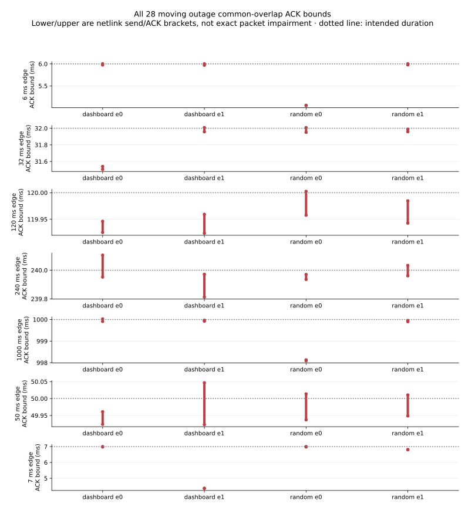

## Earlier19 counterevidence remains

This is the same product predicate as the previously unselected quarter-wait
experiment. Its RTT 300 ms random evaluation0 records 24.5/4.0/12.0 versus
mainA 49.7/14.0/45.2 andmainB 49.4/11.3/44.0. Evaluation1 is mixed. The exact
old rows are preserved in the [source proof](data/fresh-quarter55-core-20261101/55-tcp-fresh-quarter-proof.json).
They use older baseline 6729, schema1/post-exec geometry and 60-second admission,
whereas current references are295f with schema2/pre-exec geometry and CPU30.
Those changes do not resolve the old cause or make its adverse result false;
the cohorts are never pooled or used as causal controls for one another.

| Network / scene / evaluation | SSH | Old main6729 A | Old main6729 B | Old quarter19 |
|---|---:|---:|---:|---:|
| RTT 300 ms / random / 0 | 60.0 / 11.8 / 45.4 | 49.7 / 14.0 / 45.2 | 49.4 / 11.3 / 44.0 | 24.5 / 4.0 / 12.0 |
| RTT 300 ms / random / 1 | 60.0 / 11.8 / 44.4 | 49.7 / 9.9 / 44.3 | 48.4 / 13.0 / 35.7 | 50.0 / 11.1 / 44.5 |

## RX, RSS, CPU and age for every observation

### Core

| Network / scene / evaluation / role | RX kbit/s | Client / server RSS MiB | Client / server CPU % | Median / p95 body age ms |
|---|---:|---:|---:|---:|
| LAN / dashboard / 0 / ssh | 2483 | 7.37 / 18.36 | 0.27 / 0.34 | 1.0 / 4.0 |
| LAN / dashboard / 0 / main-A | 228 | 2.63 / 5.52 | 0.83 / 1.15 | 3.0 / 6.0 |
| LAN / dashboard / 0 / main-B | 228 | 2.63 / 5.57 | 0.85 / 1.16 | 3.0 / 6.0 |
| LAN / dashboard / 0 / candidate | 227 | 2.63 / 5.65 | 0.85 / 1.21 | 4.0 / 6.0 |
| LAN / dashboard / 1 / main-B | 227 | 2.64 / 5.55 | 0.76 / 1.05 | 3.0 / 6.0 |
| LAN / dashboard / 1 / candidate | 228 | 2.65 / 5.68 | 0.76 / 1.09 | 4.0 / 6.0 |
| LAN / dashboard / 1 / ssh | 2485 | 7.36 / 18.39 | 0.26 / 0.31 | 1.0 / 3.0 |
| LAN / dashboard / 1 / main-A | 227 | 2.63 / 5.53 | 0.74 / 1.05 | 4.0 / 6.0 |
| LAN / random / 0 / ssh | 5788 | 7.38 / 18.38 | 0.18 / 0.22 | 2.0 / 4.0 |
| LAN / random / 0 / main-A | 2721 | 2.65 / 5.59 | 1.07 / 1.42 | 5.0 / 8.0 |
| LAN / random / 0 / main-B | 2718 | 2.67 / 5.59 | 1.05 / 1.45 | 5.0 / 9.0 |
| LAN / random / 0 / candidate | 2716 | 2.67 / 5.70 | 1.05 / 1.47 | 5.0 / 8.0 |
| LAN / random / 1 / main-B | 2717 | 2.64 / 5.60 | 1.1 / 1.44 | 5.0 / 9.0 |
| LAN / random / 1 / candidate | 2718 | 2.66 / 5.74 | 1.1 / 1.47 | 5.0 / 8.0 |
| LAN / random / 1 / ssh | 5791 | 7.38 / 18.38 | 0.2 / 0.23 | 2.0 / 4.0 |
| LAN / random / 1 / main-A | 2716 | 2.66 / 5.62 | 1.13 / 1.46 | 5.0 / 9.0 |
| RTT 100 ms / dashboard / 0 / ssh | 2516 | 7.38 / 18.39 | 0.27 / 0.29 | 52.0 / 56.0 |
| RTT 100 ms / dashboard / 0 / main-A | 228 | 2.63 / 5.59 | 0.85 / 1.16 | 55.0 / 58.0 |
| RTT 100 ms / dashboard / 0 / main-B | 228 | 2.64 / 5.55 | 0.88 / 1.16 | 55.0 / 58.0 |
| RTT 100 ms / dashboard / 0 / candidate | 228 | 2.63 / 5.69 | 0.86 / 1.19 | 55.0 / 58.0 |
| RTT 100 ms / dashboard / 1 / main-B | 228 | 2.63 / 5.55 | 0.86 / 1.19 | 55.0 / 59.0 |
| RTT 100 ms / dashboard / 1 / candidate | 228 | 2.64 / 5.71 | 0.89 / 1.2 | 56.0 / 60.0 |
| RTT 100 ms / dashboard / 1 / ssh | 2506 | 7.38 / 18.39 | 0.24 / 0.3 | 52.0 / 56.0 |
| RTT 100 ms / dashboard / 1 / main-A | 228 | 2.63 / 5.57 | 0.87 / 1.15 | 55.0 / 59.0 |
| RTT 100 ms / random / 0 / ssh | 5793 | 7.42 / 18.36 | 0.23 / 0.23 | 53.0 / 57.0 |
| RTT 100 ms / random / 0 / main-A | 2133 | 2.66 / 5.83 | 1.09 / 4.77 | 62.0 / 71.0 |
| RTT 100 ms / random / 0 / main-B | 2138 | 2.63 / 5.82 | 1.09 / 4.72 | 61.0 / 71.0 |
| RTT 100 ms / random / 0 / candidate | 2132 | 2.70 / 5.96 | 1.1 / 4.82 | 63.0 / 72.0 |
| RTT 100 ms / random / 1 / main-B | 2113 | 2.65 / 5.86 | 1.09 / 4.82 | 62.0 / 71.0 |
| RTT 100 ms / random / 1 / candidate | 2131 | 2.64 / 5.99 | 1.08 / 4.84 | 61.0 / 71.0 |
| RTT 100 ms / random / 1 / ssh | 5785 | 7.50 / 18.38 | 0.21 / 0.22 | 53.0 / 58.0 |
| RTT 100 ms / random / 1 / main-A | 2125 | 2.67 / 5.86 | 1.08 / 4.8 | 62.0 / 71.0 |
| RTT 300 ms / dashboard / 0 / ssh | 2513 | 7.41 / 18.46 | 0.25 / 0.27 | 152.0 / 241.0 |
| RTT 300 ms / dashboard / 0 / main-A | 218 | 2.72 / 5.76 | 0.81 / 2.99 | 161.0 / 170.0 |
| RTT 300 ms / dashboard / 0 / main-B | 217 | 2.71 / 5.79 | 0.79 / 3.1 | 161.0 / 170.0 |
| RTT 300 ms / dashboard / 0 / candidate | 218 | 2.72 / 5.94 | 0.81 / 3.1 | 161.0 / 170.0 |
| RTT 300 ms / dashboard / 1 / main-B | 219 | 2.15 / 5.12 | 0.81 / 2.92 | 161.0 / 170.0 |
| RTT 300 ms / dashboard / 1 / candidate | 219 | 2.13 / 5.16 | 0.8 / 3.02 | 160.0 / 169.0 |
| RTT 300 ms / dashboard / 1 / ssh | 2507 | 7.43 / 18.40 | 0.25 / 0.27 | 152.0 / 227.0 |
| RTT 300 ms / dashboard / 1 / main-A | 219 | 1.69 / 5.04 | 0.8 / 3.07 | 160.0 / 170.0 |
| RTT 300 ms / random / 0 / ssh | 5798 | 7.68 / 18.66 | 0.21 / 0.24 | 154.0 / 496.0 |
| RTT 300 ms / random / 0 / main-A | 1970 | 2.74 / 5.93 | 1.08 / 4.6 | 162.0 / 172.0 |
| RTT 300 ms / random / 0 / main-B | 1994 | 2.71 / 5.91 | 1.07 / 4.59 | 163.0 / 173.0 |
| RTT 300 ms / random / 0 / candidate | 1985 | 2.73 / 6.02 | 1.07 / 4.61 | 163.0 / 172.0 |
| RTT 300 ms / random / 1 / main-B | 1980 | 2.71 / 5.93 | 1.03 / 4.4 | 163.0 / 172.0 |
| RTT 300 ms / random / 1 / candidate | 1993 | 2.68 / 6.04 | 1.04 / 4.47 | 162.0 / 172.0 |
| RTT 300 ms / random / 1 / ssh | 5794 | 7.80 / 18.55 | 0.21 / 0.22 | 154.0 / 492.0 |
| RTT 300 ms / random / 1 / main-A | 1979 | 2.75 / 5.94 | 1.02 / 4.44 | 162.0 / 171.0 |

### Slow

| Network / scene / evaluation / role | RX kbit/s | Client / server RSS MiB | Client / server CPU % | Median / p95 body age ms |
|---|---:|---:|---:|---:|
| 1 Mbit/s / dashboard / 0 / ssh | 979 | 7.61 / 19.28 | 0.2 / 0.68 | 2547.0 / 4711.0 |
| 1 Mbit/s / dashboard / 0 / main-A | 227 | 2.64 / 5.59 | 1.05 / 1.41 | 60.0 / 64.0 |
| 1 Mbit/s / dashboard / 0 / main-B | 227 | 2.63 / 5.56 | 1.05 / 1.45 | 60.0 / 64.0 |
| 1 Mbit/s / dashboard / 0 / candidate | 228 | 2.63 / 5.68 | 1.09 / 1.44 | 60.0 / 64.0 |
| 1 Mbit/s / dashboard / 1 / main-B | 227 | 2.63 / 5.57 | 0.96 / 1.32 | 60.0 / 64.0 |
| 1 Mbit/s / dashboard / 1 / candidate | 227 | 2.62 / 5.66 | 0.96 / 1.31 | 59.0 / 63.0 |
| 1 Mbit/s / dashboard / 1 / ssh | 978 | 7.47 / 19.27 | 0.19 / 0.54 | 2568.0 / 4695.0 |
| 1 Mbit/s / dashboard / 1 / main-A | 228 | 2.64 / 5.57 | 0.98 / 1.3 | 60.0 / 64.0 |
| 1 Mbit/s / random / 0 / ssh | 976 | 7.64 / 19.62 | 0.14 / 0.31 | 3489.0 / 6496.0 |
| 1 Mbit/s / random / 0 / main-A | 925 | 2.64 / 5.82 | 0.84 / 2.83 | 114.0 / 178.0 |
| 1 Mbit/s / random / 0 / main-B | 867 | 2.66 / 5.77 | 0.77 / 2.74 | 99.0 / 120.0 |
| 1 Mbit/s / random / 0 / candidate | 961 | 2.63 / 5.93 | 0.9 / 2.93 | 123.0 / 160.0 |
| 1 Mbit/s / random / 1 / main-B | 930 | 2.64 / 5.81 | 0.79 / 2.76 | 119.0 / 169.0 |
| 1 Mbit/s / random / 1 / candidate | 926 | 2.63 / 5.91 | 0.78 / 2.8 | 108.0 / 139.0 |
| 1 Mbit/s / random / 1 / ssh | 978 | 7.39 / 19.64 | 0.12 / 0.28 | 3492.0 / 6493.0 |
| 1 Mbit/s / random / 1 / main-A | 858 | 2.66 / 5.80 | 0.72 / 2.6 | 101.0 / 133.0 |
| 256 kbit/s / dashboard / 0 / ssh | 249 | 7.24 / 19.40 | 0.08 / 0.5 | 3757.0 / 6949.0 |
| 256 kbit/s / dashboard / 0 / main-A | 229 | 1.95 / 5.12 | 1.01 / 1.37 | 71.0 / 75.0 |
| 256 kbit/s / dashboard / 0 / main-B | 229 | 1.66 / 5.16 | 0.97 / 1.38 | 72.0 / 76.0 |
| 256 kbit/s / dashboard / 0 / candidate | 229 | 1.71 / 5.09 | 0.99 / 1.4 | 72.0 / 76.0 |
| 256 kbit/s / dashboard / 1 / main-B | 229 | 2.63 / 5.57 | 1.28 / 1.84 | 72.0 / 77.0 |
| 256 kbit/s / dashboard / 1 / candidate | 229 | 2.63 / 5.69 | 1.28 / 1.84 | 72.0 / 77.0 |
| 256 kbit/s / dashboard / 1 / ssh | 250 | 7.38 / 19.45 | 0.09 / 0.58 | 3650.0 / 6771.0 |
| 256 kbit/s / dashboard / 1 / main-A | 229 | 2.63 / 5.56 | 1.25 / 1.83 | 72.0 / 76.0 |
| 256 kbit/s / random / 0 / ssh | 249 | 7.38 / 19.44 | 0.1 / 0.37 | 3907.0 / — |
| 256 kbit/s / random / 0 / main-A | 256 | 2.62 / 5.80 | 0.68 / 2.34 | 383.0 / 409.0 |
| 256 kbit/s / random / 0 / main-B | 256 | 2.64 / 5.77 | 0.71 / 2.27 | 382.0 / 409.0 |
| 256 kbit/s / random / 0 / candidate | 256 | 2.62 / 5.95 | 0.7 / 2.35 | 384.0 / 409.0 |
| 256 kbit/s / random / 1 / main-B | 256 | 2.63 / 5.83 | 0.76 / 2.42 | 388.0 / 408.0 |
| 256 kbit/s / random / 1 / candidate | 256 | 2.63 / 5.91 | 0.77 / 2.4 | 384.0 / 410.0 |
| 256 kbit/s / random / 1 / ssh | 248 | 7.40 / 19.44 | 0.12 / 0.33 | 3849.0 / — |
| 256 kbit/s / random / 1 / main-A | 256 | 2.62 / 5.78 | 0.71 / 2.38 | 386.0 / 409.0 |
| 64 kbit/s / dashboard / 0 / ssh | 61 | 7.38 / 19.37 | 0.06 / 0.83 | 4312.0 / — |
| 64 kbit/s / dashboard / 0 / main-A | 64 | 2.63 / 5.77 | 0.62 / 2.55 | 179.0 / 360.0 |
| 64 kbit/s / dashboard / 0 / main-B | 63 | 2.62 / 5.73 | 0.64 / 2.66 | 179.0 / 367.0 |
| 64 kbit/s / dashboard / 0 / candidate | 63 | 2.64 / 5.90 | 0.62 / 2.72 | 198.0 / 441.0 |
| 64 kbit/s / dashboard / 1 / main-B | 64 | 2.64 / 5.73 | 0.5 / 1.98 | 188.0 / 372.0 |
| 64 kbit/s / dashboard / 1 / candidate | 64 | 2.62 / 5.86 | 0.49 / 2.03 | 200.0 / 385.0 |
| 64 kbit/s / dashboard / 1 / ssh | 62 | 7.36 / 19.25 | 0.08 / 0.6 | 4239.0 / — |
| 64 kbit/s / dashboard / 1 / main-A | 63 | 2.64 / 5.76 | 0.46 / 1.81 | 244.0 / 638.0 |
| 64 kbit/s / random / 0 / ssh | 62 | 7.61 / 19.39 | 0.05 / 0.23 | 5079.0 / — |
| 64 kbit/s / random / 0 / main-A | 63 | 2.61 / 5.84 | 0.19 / 1.62 | 2041.0 / — |
| 64 kbit/s / random / 0 / main-B | 64 | 2.64 / 5.80 | 0.29 / 1.67 | 1062.0 / — |
| 64 kbit/s / random / 0 / candidate | 64 | 2.63 / 5.90 | 0.28 / 1.61 | 1037.0 / — |
| 64 kbit/s / random / 1 / main-B | 64 | 2.62 / 5.85 | 0.25 / 1.68 | 1584.0 / — |
| 64 kbit/s / random / 1 / candidate | 63 | 2.65 / 5.92 | 0.21 / 1.63 | 1732.0 / — |
| 64 kbit/s / random / 1 / ssh | 60 | 7.37 / 19.38 | 0.04 / 0.25 | 4829.0 / — |
| 64 kbit/s / random / 1 / main-A | 63 | 2.65 / 5.82 | 0.2 / 1.71 | 2039.0 / — |

### Moving

| Network / scene / evaluation / role | RX kbit/s | Client / server RSS MiB | Client / server CPU % | Median / p95 body age ms |
|---|---:|---:|---:|---:|
| moving / dashboard / 0 / ssh | 1978 | 7.32 / 19.62 | 0.22 / 0.33 | 1683.0 / 11992.0 |
| moving / dashboard / 0 / main-A | 86 | 2.74 / 5.75 | 0.41 / 1.51 | 47.0 / 155.0 |
| moving / dashboard / 0 / main-B | 94 | 2.73 / 5.77 | 0.43 / 1.36 | 46.0 / 131.0 |
| moving / dashboard / 0 / candidate | 113 | 2.73 / 5.86 | 0.49 / 1.56 | 48.0 / 133.0 |
| moving / dashboard / 1 / main-B | 91 | 2.36 / 5.16 | 0.49 / 2.04 | 47.0 / 195.0 |
| moving / dashboard / 1 / candidate | 101 | 1.37 / 4.79 | 0.5 / 1.81 | 47.0 / 118.0 |
| moving / dashboard / 1 / ssh | 2033 | 7.43 / 19.34 | 0.25 / 0.46 | 1691.0 / 11381.0 |
| moving / dashboard / 1 / main-A | 85 | 1.81 / 5.12 | 0.46 / 1.82 | 47.0 / 161.0 |
| moving / random / 0 / ssh | 2636 | 7.34 / 20.65 | 0.2 / 0.2 | 1626.0 / 13826.0 |
| moving / random / 0 / main-A | 808 | 2.41 / 5.35 | 0.67 / 2.8 | 58.0 / 251.0 |
| moving / random / 0 / main-B | 816 | 2.36 / 5.13 | 0.65 / 2.81 | 56.0 / 254.0 |
| moving / random / 0 / candidate | 849 | 1.77 / 5.19 | 0.68 / 2.9 | 58.0 / 292.0 |
| moving / random / 1 / main-B | 796 | 2.38 / 5.37 | 0.67 / 2.72 | 58.0 / 233.0 |
| moving / random / 1 / candidate | 921 | 2.15 / 5.36 | 0.68 / 2.92 | 58.0 / 233.0 |
| moving / random / 1 / ssh | 2695 | 7.29 / 19.50 | 0.2 / 0.2 | 1658.0 / 13760.0 |
| moving / random / 1 / main-A | 784 | 2.41 / 5.39 | 0.62 / 2.61 | 56.0 / 248.0 |

## Reproduction, archive scope and selection

[Core archive](data/fresh-quarter55-core-20261101/README.md),
[slow archive](data/fresh-quarter55-slow-20261101/README.md) and
[moving descriptive archive](data/fresh-quarter55-moving-20261101/README.md)
contain 112 saved observations, exact independent audits, compact complete-body
timelines, source/build/control provenance, gzip-preserved logs and portable
verifiers/plots.96 static observations are eligible;16 moving observations
remain descriptive. Raw capture/source payloads and executable binaries stay
local. Raw hashes are imported from independent audits rather than claimed as
new publisher rehashes. Resource checking does not reconstruct raw counters.
No terminal replay, new benchmark or product dependency was added for publication.

Quarter55 remains unselected with FPS gains and costs preserved. No global SSH
parity, resolved old19 cause, input/UDP/loss coverage, new release adoption or
additivity with margin is claimed. The research PR publishes documentation;
focused implementation PRs have separate review and selection status.

The same publication corrects a display defect in four older age charts at
commit 82d0d251b8bd604e3a882d2b9863f610eb4e59ff: the 13×7 canvas let two long
ylabels overlap. Age-only 13×9 canvases remove that overlap. Only each plot
script's age figsize, its age SVG and manifest change; all historical raw,
metrics and other artifacts remain byte-identical. The
[before/after SHA record](data/fresh-quarter55-core-20261101/prior-age-layout-correction.json)
records the correction; values, selection and prior measurements are unchanged.
