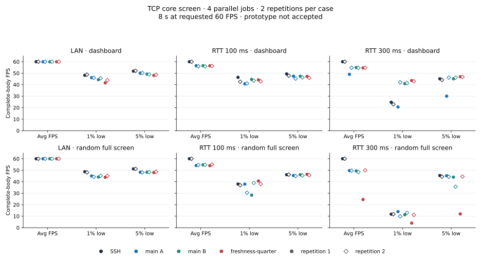
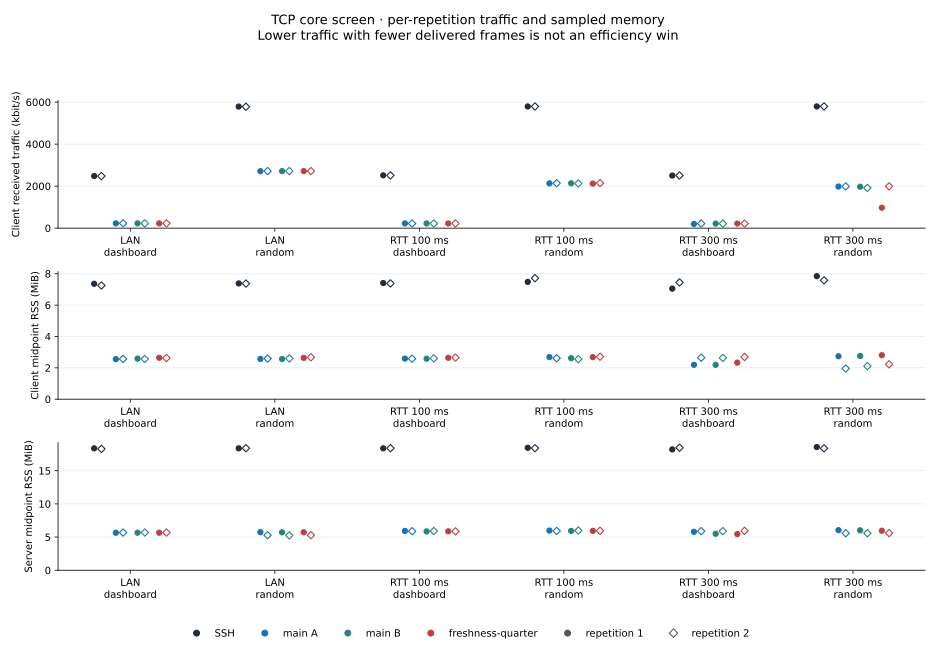
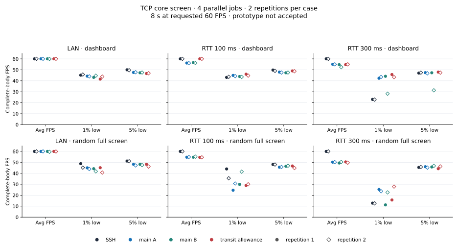
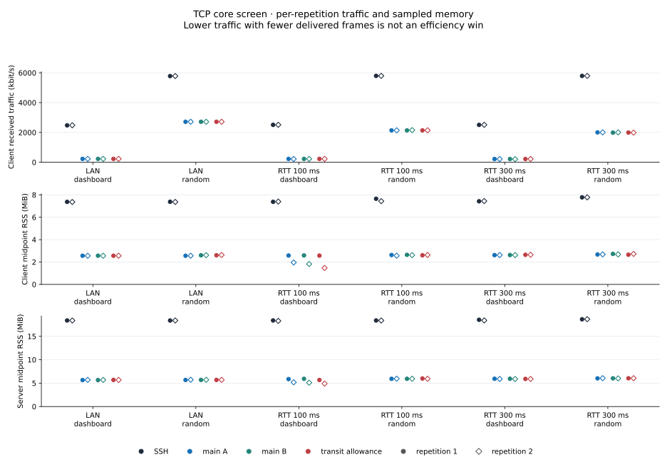
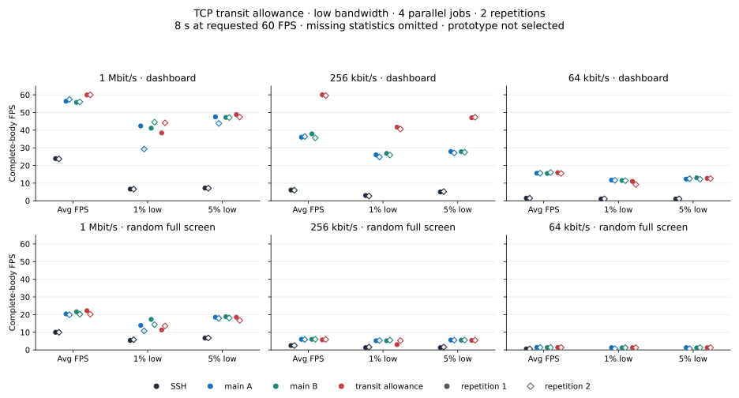
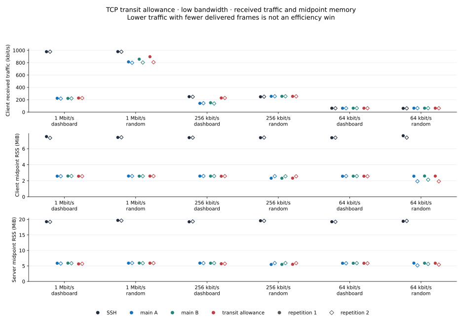
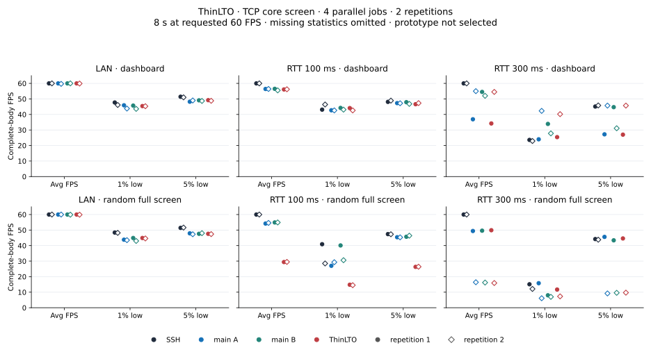
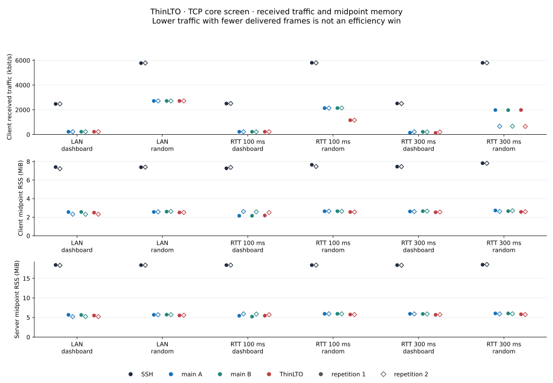

# TCP low-tail investigation (2026-10-31)

None of the three tested candidates meets the full acceptance requirements. The TCP transit
allowance reached 60 FPS in both 100 ms/dashboard repetitions, but retained
LAN tail deficits. The freshness-quarter prototype is also **not accepted**.
In one 300 ms
random-screen repetition it delivered 24.5 FPS with 1%/5% lows of 4.0/12.0,
versus 49.7 FPS and 14.0/45.2 for the simultaneous main-A control. The second
repetition recovered, but does not erase the failed observation. The cause of
that difference has not been established.

This is an ongoing development investigation. The product change in PR #3 is
TCP vectored batching; the experimental patches described here are separate
snapshots of main, **not product changes in that PR**. The November 1 follow-ups below also leave the compiler profile unselected.
The historical full-suite
tables in [BENCHMARK.md](../../BENCHMARK.md) remain unchanged. None of these
results establishes SSH parity or performance without regressions.

## Measurement policy and scope

All new performance measurements use **four simultaneous jobs and two
evaluations per item**, including session memory. This follows the user's
four-performance-core limit; it does not pin jobs to physical performance
cores. Older eight-worker/one-evaluation observations are kept separate.

The first accepted-data core screen ran 48 jobs: LAN, RTT 100 ms, RTT 300 ms; two
100×30 full-screen scenes; two repetitions; SSH, identical main-A/main-B
controls, and the prototype. Each observation lasted eight seconds at a
requested 60 FPS. Each job used its own server/client container pair. Main and
prototype used the same `rsh-tcp` alias, port 2222 and configuration; binaries
were replaced between phases with all agents absent. The second repetition
exchanged candidate/main-A slots. Main-B provides another same-code control,
not an automatic noise tolerance.

All 12 phase host guards passed. Installed-file hashes were checked before and
after every phase, with the live server executable/PID/listener checked on
both ends. Actual-source body replay accepted all 48 cases: 21,590 complete
frames, no source-ledger drops or missing oracle IDs. Observed headers also
matched their recorded source frame ID, timestamp and scene. These checks make
the data eligible for comparison; they do not make the candidate successful.
Exact runtime image IDs were not separately archived for this core run.

Main build: `6729d398d4f1`, SHA-256
`9ab79c22ebd289047ffa616a5e8aef3c7d9f2498756b5974ae5a74b2d0ecb463`.
Freshness-quarter build: `f200617535a4`, SHA-256
`86d95511114268945945bb8891574c2c60e50f459707eb493ae6d9117ec6a3b8`.
Both were freshly built sequentially in the same pinned Linux arm64 compiler
container, rustc/cargo 1.99.1, `/src`, `CARGO_HOME=/cargo`, release opt-level 3.
Source markers were checked outside Cargo's cache. The identical seven
candidate fixtures on unchanged main produced one expected failure and six
guard passes; the candidate passed seven targeted and 103 library tests, with
two ignored. See [build provenance](data/lowtail-20261031/fresh-quarter-release-pair.json),
[control result](data/lowtail-20261031/fresh-quarter-control-result.json), and
[experimental patch](data/lowtail-20261031/tcp-fresh-quarter.patch).

## Complete-body FPS, by repetition

The observer compares terminal body characters against the **actual source
payload**, excluding the header, badge and SGR attributes. FPS is completed
bodies divided by the eight-second window. Lows are reciprocals of nearest-rank
p99/p95 gaps between complete bodies, with boundary gaps excluded. They are not
means of the slowest frames. A body read timestamp is not GPU presentation.
Each number below preserves its own repetition; no pooled low hides a bad run.
The [per-run CSV](data/lowtail-20261031/core-metrics.csv) supplies these values.

| Link / scene / repetition | SSH avg / 1% / 5% | main-A avg / 1% / 5% | main-B avg / 1% / 5% | Prototype avg / 1% / 5% |
| --- | --- | --- | --- | --- |
| LAN / dashboard / 1 | 60.0 / 48.2 / 51.8 | 59.9 / 46.1 / 50.0 | 59.9 / 44.4 / 49.2 | 59.9 / 41.6 / 48.1 |
| LAN / dashboard / 2 | 60.0 / 48.8 / 52.1 | 60.0 / 46.0 / 50.2 | 60.0 / 45.6 / 48.9 | 60.0 / 43.9 / 48.7 |
| LAN / random / 1 | 60.0 / 48.7 / 51.2 | 60.0 / 45.0 / 48.3 | 60.0 / 44.1 / 48.3 | 60.0 / 43.9 / 48.0 |
| LAN / random / 2 | 60.0 / 48.1 / 51.2 | 60.0 / 44.2 / 48.1 | 60.0 / 45.2 / 48.3 | 60.0 / 45.1 / 48.7 |
| 100 ms / dashboard / 1 | 60.0 / 46.4 / 49.4 | 56.5 / 40.7 / 47.4 | 56.5 / 44.6 / 47.3 | 56.4 / 44.2 / 47.2 |
| 100 ms / dashboard / 2 | 60.0 / 42.6 / 47.8 | 56.0 / 41.1 / 45.3 | 55.9 / 43.5 / 46.3 | 56.2 / 42.9 / 45.9 |
| 100 ms / random / 1 | 60.0 / 38.0 / 46.1 | 54.1 / 37.9 / 45.4 | 54.7 / 28.3 / 46.1 | 54.0 / 40.6 / 46.4 |
| 100 ms / random / 2 | 60.0 / 37.0 / 46.2 | 54.6 / 30.4 / 45.0 | 54.7 / 38.9 / 45.4 | 55.0 / 38.1 / 45.7 |
| 300 ms / dashboard / 1 | 60.0 / 24.7 / 45.1 | 49.0 / 20.6 / 30.0 | 54.9 / 40.9 / 45.1 | 54.6 / 43.6 / 46.9 |
| 300 ms / dashboard / 2 | 60.0 / 22.9 / 44.1 | 54.7 / 42.1 / 46.2 | 54.6 / 41.4 / 46.2 | 54.7 / 42.9 / 46.7 |
| 300 ms / random / 1 | 60.0 / 11.8 / 45.4 | 49.7 / 14.0 / 45.2 | 49.4 / 11.3 / 44.0 | 24.5 / 4.0 / 12.0 |
| 300 ms / random / 2 | 60.0 / 11.8 / 44.4 | 49.7 / 9.9 / 44.3 | 48.4 / 13.0 / 35.7 | 50.0 / 11.1 / 44.5 |

Same-code variation remains visible: at 300 ms/compress in repetition 1,
main-A delivered 49.0 FPS with a 20.6 FPS 1% low, while main-B delivered
54.9/40.9. This prevents attributing every difference to code, but is not a
reason to accept the prototype's 24.5/4.0 random-screen observation. Two short
repetitions do not establish a confidence interval or explain the cause.

The bad candidate's source ledger recorded 480 generated frames and a 0.900 ms
p99 write time. Its complete-body counts per second were
`7, 13, 16, 21, 27, 31, 36, 45`, showing a gradual recovery during the window.
This observation motivates investigating startup rate/window estimation; the
uninstrumented run does not establish which estimator or scheduling decision
caused it. Source write statistics and per-second counts are retained in the
[compact results](data/lowtail-20261031/core-results.json).

## Network and memory

Traffic is whole-client-interface received decimal kbit/s, including protocol
overhead. RSS is a halfway-through-render sample, converted from KiB to MiB;
it is **not peak RSS or ten-session memory**. CPU in the
[per-run CSV](data/lowtail-20261031/core-metrics.csv) is percent of one core.
Frame age is generation-to-complete-body-read time, not network RTT. All these
measurements include this collector/runtime's effects.

In the bad 300 ms/random repetition, candidate RX was 973 kbit/s and server
CPU 2.32%, versus main-A's 1,982 kbit/s and 4.23%. Because delivered FPS also
halved, those lower resource figures do not demonstrate improved efficiency.
The [compact results](data/lowtail-20261031/core-results.json) retain all 48
repetitions' frame observations, FPS/lows, age, traffic, CPU and client/server
RSS. The archive permits metric recalculation. Raw captures and source bodies
remain local with committed hashes; this is not a public body-oracle replay
archive.

## Follow-up: TCP transit allowance

The second independent 48-job screen used build `37ca62d0e0b5`, SHA-256
`777aa6baa0f6cc8de42e664560b3fa76a62a733cd7f6607f32646381f90b2280`.
The [patch](data/lowtail-transit-20261031/tcp-transit.patch) counts up to a
bounded transit allowance when deciding whether TCP output is queued. With a
known slow rate it uses its BDP; otherwise it uses half the existing recent
delivery-credit window, including its 4.4 KB restart floor. Unsent/incoming
bytes remain counted. This changes screen-mode decisions, without adding
Sender send credit or changing the app window/RTO/UDP policy. It does not solve
incoming-only startup decisions. An idle floor or old fast-link history can
overestimate transit on a newly slow link.

The [matched build transcript](data/lowtail-transit-20261031/transit-v2env-release-pair.json)
records three targeted and 99 library passes, two ignored, unchanged source
manifests, and main identical to the first screen. Quarter freshness was not
included. The producer, complete-body observer, deployment, role exchange and
host guards were the same as the first screen. These are separate runs with
their own simultaneous controls; their observations are not pooled.

All 48 cases and 12 host guards passed data checks, with 21,925 complete bodies
and no source drops/missing IDs. The actual header audit checked all 21,925
observed bodies. All eight runtime containers used image
`sha256:1ecf08...`, Python 3.12.3, OpenSSH 9.6p1 and iproute2/tc 6.1.0.
The [full image/version record](data/lowtail-transit-20261031/runtime-platform.json)
finished 14.439 seconds before the first receive window. Source hashes,
per-repetition data and original raw-file hashes are in
[this separate archive](data/lowtail-transit-20261031).

| Link / scene / repetition | SSH avg / 1% / 5% | main-A avg / 1% / 5% | main-B avg / 1% / 5% | Transit avg / 1% / 5% |
| --- | --- | --- | --- | --- |
| LAN / dashboard / 1 | 60.0 / 45.1 / 50.0 | 60.0 / 44.2 / 47.6 | 60.0 / 43.1 / 47.3 | 60.0 / 41.5 / 46.6 |
| LAN / dashboard / 2 | 60.0 / 45.7 / 49.6 | 60.0 / 44.0 / 47.8 | 59.9 / 44.6 / 47.5 | 60.0 / 43.8 / 46.9 |
| LAN / random / 1 | 60.0 / 48.8 / 51.2 | 60.0 / 45.0 / 48.2 | 60.0 / 44.2 / 48.2 | 60.0 / 45.1 / 48.2 |
| LAN / random / 2 | 60.0 / 45.2 / 51.0 | 60.0 / 43.9 / 47.2 | 59.6 / 41.8 / 47.5 | 59.9 / 40.7 / 46.2 |
| 100 ms / dashboard / 1 | 60.0 / 43.1 / 49.8 | 56.2 / 44.9 / 47.9 | 56.5 / 43.9 / 47.3 | 60.0 / 46.0 / 49.0 |
| 100 ms / dashboard / 2 | 60.0 / 43.6 / 49.0 | 56.1 / 44.2 / 47.5 | 56.2 / 43.5 / 47.5 | 60.0 / 44.7 / 48.7 |
| 100 ms / random / 1 | 60.0 / 44.0 / 48.1 | 54.7 / 24.6 / 45.6 | 54.7 / 29.9 / 46.4 | 54.6 / 28.9 / 46.7 |
| 100 ms / random / 2 | 60.0 / 35.5 / 48.0 | 54.9 / 30.7 / 45.8 | 55.2 / 41.5 / 46.9 | 54.6 / 30.0 / 44.8 |
| 300 ms / dashboard / 1 | 60.0 / 23.0 / 47.0 | 55.0 / 42.3 / 47.4 | 54.7 / 44.1 / 47.3 | 54.7 / 45.7 / 47.9 |
| 300 ms / dashboard / 2 | 60.0 / 22.8 / 47.4 | 55.0 / 43.5 / 46.8 | 52.4 / 28.2 / 31.3 | 55.0 / 43.3 / 47.4 |
| 300 ms / random / 1 | 60.0 / 12.8 / 45.4 | 50.2 / 25.3 / 46.0 | 49.4 / 11.2 / 45.8 | 50.4 / 15.7 / 44.2 |
| 300 ms / random / 2 | 60.0 / 12.6 / 45.8 | 50.2 / 23.6 / 45.2 | 50.4 / 22.6 / 46.8 | 49.7 / 27.9 / 46.3 |

The clearest repeated improvement was 100 ms/dashboard: candidate **60.0 FPS**
twice, versus the two main controls' 56.1–56.5. Its 1%/5% lows were
46.0/49.0 and 44.7/48.7; p95 age was 57/58 ms versus main's 68–69 ms.
Candidate server CPU was 1.04/1.08% of one core versus main's 3.06–3.11%.
The simultaneous SSH 5% lows were still higher, at 49.8/49.0 FPS.

The deficits also repeated. LAN/dashboard candidate 1% lows were **41.5/43.8**,
and 5% lows **46.6/46.9**, below both main controls and SSH in each repetition.
LAN/random repetition 2 was 59.9/40.7/46.2, with tails below both main
controls. At 100 ms/random, 54.6 FPS twice was below main's 54.7–55.2.
The 300 ms/random results were mixed: 50.4/15.7/44.2 and 49.7/27.9/46.3.
These observations do not establish the code as their cause, but do not support
an all-path non-regression or SSH-equivalence claim. The candidate remains
unselected, pending low-bandwidth/loss/moving/input/resource checks.

## November 1 follow-up: CPU30 policy and separate source methods

These are two further 48-observation development screens, each with four
parallel jobs, two evaluations and its own simultaneous SSH/main-A/main-B
controls. The investigation began October 31; the receive windows below are
**November 1 KST**. Neither repeat nor source pipeline is pooled across runs.

The user changed admission to **one interval with total user+system CPU below
30%**. There is no continuous 60-second quiet requirement or individual-process
100% gate. Runtime CPU/process levels are recorded context, not threshold
rejections; timing, sampler, source, identity and data-integrity failures still
reject. Runtime maxima were **31–47%** in the slow screen and up to **45%** in
the ThinLTO screen. Those valid observations are retained under the requested
policy, without claiming low CPU throughout a window or physical P-core
isolation. Sanitized [slow-screen](data/lowtail-slow-cpu30-20261101/cpu30-summary.json)
and [ThinLTO](data/lowtail-lto-cpu30-20261101/cpu30-summary.json) admission/runtime
summaries include no host process names.

### Static low bandwidth: transit allowance

The [separate archive](data/lowtail-slow-cpu30-20261101) uses the same main
`6729d398d4f1` / SHA `9ab79c22...` and transit `37ca62d0e0b5` / SHA
`777aa6ba...` matched pair as the earlier transit screen. The three existing
profiles have nominal RTT 100 ms, no configured loss, and rates of 1 Mbit/s,
256 kbit/s and 64 kbit/s. They are not moving-network profiles.

All four roles use the new pre-write RAM/source-signal method: immutable
payload registration before stdout write, a nonce-bound pidfd/SIGUSR2 snapshot
after all four receive windows close, and the original five-second collection
wait. This differs from the legacy post-write producer in 19/20/25 and can
affect timing. Cross-run absolute comparisons are not made. Actual windows
were **00:03:14.183–00:06:30.909 KST**; the environment was created the previous
day at 23:59:52. The [source/header audit](data/lowtail-slow-cpu30-20261101/source-header-join-audit.json)
checked **19,764 records**, 19,759 completed
writes and **5 pending writes with null ends**. All **7,699** completed-body
headers matched source number/time/scene; none joined a pending write. This
checks source/header evidence, not every stream byte or a new terminal replay.

All 48 data checks passed. Avg/1%/5% complete-body FPS, per repetition:

| Link / scene / repetition | SSH avg / 1% / 5% | main-A avg / 1% / 5% | main-B avg / 1% / 5% | Candidate avg / 1% / 5% |
| --- | --- | --- | --- | --- |
| 1 Mbit/s / dashboard / 1 | 23.9 / 6.6 / 7.2 | 56.4 / 42.4 / 47.5 | 55.7 / 41.1 / 47.2 | 59.9 / 38.4 / 48.8 |
| 1 Mbit/s / dashboard / 2 | 23.7 / 6.6 / 7.1 | 57.4 / 29.3 / 43.8 | 56.0 / 44.5 / 47.1 | 60.0 / 44.1 / 47.4 |
| 1 Mbit/s / random / 1 | 10.0 / 5.4 / 6.7 | 20.4 / 13.9 / 18.5 | 21.6 / 17.3 / 18.8 | 22.2 / 11.3 / 18.5 |
| 1 Mbit/s / random / 2 | 10.0 / 5.8 / 6.8 | 19.9 / 10.8 / 17.9 | 20.2 / 14.3 / 18.1 | 20.2 / 13.6 / 16.7 |
| 256 kbit/s / dashboard / 1 | 6.1 / 3.0 / 5.0 | 36.0 / 26.0 / 27.9 | 37.9 / 26.8 / 27.8 | 60.0 / 41.7 / 47.0 |
| 256 kbit/s / dashboard / 2 | 6.0 / 2.7 / 5.2 | 36.4 / 24.8 / 27.1 | 35.6 / 25.9 / 27.5 | 59.6 / 40.6 / 47.3 |
| 256 kbit/s / random / 1 | 2.5 / 1.3 / 1.3 | 6.0 / 5.2 / 5.6 | 6.0 / 5.2 / 5.5 | 5.7 / 3.0 / 5.4 |
| 256 kbit/s / random / 2 | 2.5 / 1.6 / 1.6 | 5.9 / 5.3 / 5.5 | 6.0 / 5.5 / 5.6 | 5.9 / 5.3 / 5.5 |
| 64 kbit/s / dashboard / 1 | 1.5 / 1.0 / 1.0 | 15.6 / 11.7 / 12.3 | 15.5 / 11.5 / 13.0 | 15.9 / 11.0 / 12.7 |
| 64 kbit/s / dashboard / 2 | 1.5 / 1.1 / 1.1 | 15.6 / 11.6 / 12.5 | 16.0 / 11.4 / 12.2 | 15.5 / 9.2 / 12.6 |
| 64 kbit/s / random / 1 | 0.6 / — / — | 1.4 / 1.3 / 1.3 | 1.4 / 1.2 / 1.2 | 1.4 / 1.3 / 1.3 |
| 64 kbit/s / random / 2 | 0.6 / — / — | 1.4 / 0.7 / 0.7 | 1.4 / 1.3 / 1.3 | 1.4 / 1.3 / 1.3 |

The clearest repeated gain versus main was the 256 kbit/s dashboard: transit
**60.0/59.6 FPS**, 1% lows **41.7/40.6** and 5% lows **47.0/47.3**, versus
main averages 35.6–37.9 and much lower tails. The 1 Mbit/s dashboard also reached
59.9/60.0 FPS. Candidate avg FPS exceeded SSH in all 12 repetitions, and all
20 available candidate-versus-SSH low comparisons were higher. The other four
comparisons are unavailable: SSH at 64 kbit/s/random completed five bodies per
repeat, so its 1%/5% lows remain **null/—**, with no plotted point or inferred
win. Age statistics with too few samples also remain missing.

Identical-main comparisons retain deficits: 1 Mbit/s/random repetition 1 had a
candidate 1% low of **11.3** versus main 13.9/17.3; at 256 kbit/s/random it was
**3.0** versus 5.2/5.2; the second 64 kbit/s/dashboard 1% low was **9.2** versus
11.6/11.4. Source correctness, resource tradeoffs and these mixed tails do not
establish all-path non-regression. Transit remains **unselected**. Exact
network/RSS/CPU/age values for every role are in the
[CSV](data/lowtail-slow-cpu30-20261101/core-metrics.csv) and
[full per-repetition table](data/lowtail-slow-cpu30-20261101/acceptance-per-rep.md).

### Compiler profile: ThinLTO and one codegen unit

The [ThinLTO archive](data/lowtail-lto-cpu30-20261101) compares the unchanged
main implementation with only Cargo.toml's release profile changed to
`lto="thin"` and `codegen-units=1`. The
[patch](data/lowtail-lto-cpu30-20261101/thin-lto.patch),
[original build log (gzip)](data/lowtail-lto-cpu30-20261101/build-thin-lto.log.gz) and
[source-guarded paired build](data/lowtail-lto-cpu30-20261101/thin-lto-release-pair.json)
record the same sequential build environment, Cargo fresh=false and **96
release-library passes with two ignored**. Main source ID `6729d398d4f1` / SHA
`9ab79c22...` and candidate `459976ee4637` / SHA `3892767a...` were verified.
All other 24 common crate inputs match. The candidate binary is **15.7% smaller**
(3,114,232 versus 3,695,752 bytes); this is not a runtime-performance win.

The legacy post-write source method and body observer remain the same as the
original core screens; only the user-authorized CPU admission policy changed.
Actual windows were **00:15:08.565–00:18:16.376 KST**. All 48 data checks passed,
with **20,308** completed bodies and no source drops/missing IDs. Raw
[source/header checks](data/lowtail-lto-cpu30-20261101/source-header-join-audit.json)
cover all those bodies. Avg/1%/5% body FPS:

| Link / scene / repetition | SSH avg / 1% / 5% | main-A avg / 1% / 5% | main-B avg / 1% / 5% | Candidate avg / 1% / 5% |
| --- | --- | --- | --- | --- |
| LAN / dashboard / 1 | 60.0 / 47.7 / 51.4 | 60.0 / 45.9 / 48.2 | 60.0 / 45.7 / 49.1 | 60.0 / 45.4 / 49.2 |
| LAN / dashboard / 2 | 60.0 / 46.1 / 51.0 | 59.7 / 43.8 / 49.0 | 60.0 / 43.6 / 48.7 | 59.9 / 45.3 / 48.8 |
| LAN / random / 1 | 60.0 / 48.4 / 51.4 | 60.0 / 43.8 / 47.9 | 60.0 / 44.9 / 47.6 | 60.0 / 44.9 / 47.6 |
| LAN / random / 2 | 60.0 / 48.2 / 51.6 | 60.0 / 43.5 / 47.3 | 59.9 / 43.0 / 48.0 | 59.9 / 44.6 / 47.4 |
| 100 ms / dashboard / 1 | 60.0 / 43.1 / 48.1 | 56.4 / 42.7 / 47.3 | 56.5 / 44.2 / 47.9 | 56.1 / 44.1 / 46.6 |
| 100 ms / dashboard / 2 | 60.0 / 46.4 / 48.9 | 56.4 / 42.6 / 47.2 | 55.5 / 43.1 / 46.8 | 56.2 / 42.6 / 47.3 |
| 100 ms / random / 1 | 60.0 / 40.9 / 47.4 | 54.2 / 27.0 / 45.4 | 54.9 / 40.1 / 45.7 | 29.4 / 14.8 / 26.3 |
| 100 ms / random / 2 | 60.0 / 28.5 / 47.3 | 54.6 / 29.3 / 45.3 | 54.9 / 30.6 / 46.4 | 29.5 / 14.5 / 26.4 |
| 300 ms / dashboard / 1 | 60.0 / 23.6 / 45.1 | 36.9 / 24.0 / 27.2 | 54.5 / 33.9 / 44.7 | 34.2 / 25.4 / 27.0 |
| 300 ms / dashboard / 2 | 60.0 / 22.9 / 45.8 | 55.0 / 42.3 / 45.7 | 52.0 / 27.8 / 31.1 | 54.5 / 40.2 / 45.7 |
| 300 ms / random / 1 | 60.0 / 15.1 / 44.2 | 49.4 / 15.8 / 45.6 | 49.6 / 8.0 / 43.4 | 49.9 / 11.7 / 44.6 |
| 300 ms / random / 2 | 60.0 / 12.1 / 43.8 | 16.4 / 6.1 / 9.2 | 16.2 / 7.0 / 9.6 | 15.9 / 7.3 / 9.7 |

ThinLTO was not a repeated general improvement. The RTT 100 ms/random candidate
was **29.4/29.5 FPS** versus simultaneous mains **54.2–54.9**, with 1% lows
14.8/14.5 and 5% lows 26.3/26.4. This persists after the candidate/main-A slot
exchange. Its lower received traffic and CPU coincide with much less delivered
work, so are not an efficiency win. The profile remains **unselected**.

The final RTT 300 ms/random repeat shows a separate common slowdown: main-A
**16.4**, main-B **16.2** and ThinLTO **15.9 FPS**, versus SSH 60. All four
sources generated 480 frames at 60 per source second; the three rsh source
write p95 values were below 0.3 ms. The common decline therefore is not evidence
that only the candidate compiler caused it, or that sources generated only
about 130 frames. Controller/rate/observer causality remains unestablished.
Both SSH and rsh still ran live pyte; their online frame-detection paths differ
(raw FRAME scan for SSH, emulated-header detection for rsh). Offline body
recalculation does not remove live observer influence or prove that influence
caused this result. The
[per-run CSV](data/lowtail-lto-cpu30-20261101/core-metrics.csv) and
[full table](data/lowtail-lto-cpu30-20261101/acceptance-per-rep.md) retain all
positive and negative observations and resource values.

Both new archives preserve all 96 source/capture hashes per screen while raw
captures and payload bodies remain local. Portable metric checks recalculate
all 48 repetitions from archived complete frames; plot scripts keep repeats
separate and omit missing points. The raw-header audit is not a public
body-oracle replay. Pre-analysis run-status and pre-measurement build-status
fields are immutable stage records, not final verdicts. CPU is percent of one
core, RX is received interface decimal kbit/s, and RSS is a midpoint process
sample in KiB (charts show MiB), not peak/session memory. Frame age is
conditional on complete bodies, not network RTT, input or GPU presentation.

## Mechanisms investigated

The non-core rows summarize local research artifacts. Their raw traces and
captures are outside these committed archives. Independent data reviews
checked both 48-case core screens; they did not replay every diagnostic below.

| Experiment | Mechanism | Evidence and decision |
| --- | --- | --- |
| TCP known-BDP allowance | Remove estimated in-flight transit from screen-entry backlog when a slow rate is known | Functional trace showed the targeted rate was often unknown. No accepted performance win; not adopted. |
| TCP recent-transit allowance | When the slow rate is unknown, use half the existing recent delivery-credit window as a bounded transit estimate | Separate valid core and November 1 low-bandwidth screens: dashboard throughput improved, while identical-main tails retained deficits. Not selected; fast-to-slow stale-credit risk remains. |
| TCP busy-only rate estimate | Exclude idle periods from the drain-rate estimate | Diagnostic traces delayed screen entry but still showed large held backlog/reset. Functional evidence only; not adopted alone. |
| Strict one-packet staged tail | Finish a staged update only when full wire/window/loss/rate guards fit within one extra packet | Targeted 5/library 101 passed, 2 ignored. Across 64 completed instrumented diagnostic jobs the override fired zero times, including outside measurement windows. FPS differences cannot be attributed to this branch; not adopted or automatically widened. |
| TCP freshness-quarter | Apply the existing quarter-gap freshness wait to known-slow TCP as well as modeled paths | Valid 48-job core data above; materially bad 300 ms/random repetition. Not accepted. |
| Receiver ingress shaping | Validate receiver IFB shaping separately from endpoint egress shaping | Isolated native latency/rate/MTU and exact 2 MiB TCP content checks passed. The full topology comparison is prepared, not measured. |
| Source collection under backpressure | Diagnose missing source ledgers after the original five-second collection deadline | Separate slow-link diagnostic completed 16 jobs but retained 3 initial SSH collection failures. Eventually present files do not retroactively make the initial collection successful. |
| Signal-triggered source snapshot | Save actual payloads to a separate file even while PTY stdout is blocked; incomplete writes keep null completion time | Native unread-PTY smoke and a separate 16-job/four-session functional check passed independent reviews. The latter matched 746 bodies and preserved 4 pending writes with null end times; none of those 4 joined an observed completed body. All host phases were rejected, so this is not performance evidence. |
| ThinLTO/compiler profile | Release lto=thin and codegen-units=1, without a controller/protocol change | Valid November 1 48-job data above. Smaller binary, repeated WAN/random throughput deficits and a common rsh slowdown; no compiler-cause claim. Not selected. |
| TCP standalone-only size samples | Narrow size-rate inference to packets sent without earlier tracked flight | Rejected before implementation: it excludes standalone compressed chunks and valid in-flight slow-link bootstrap samples; metadata corrections also affect refloor. No performance result. |

Trace-on diagnostics and host-rejected runs are functional evidence only. They
are not pooled with the uninstrumented performance screen. A two-packet tail
counterfactual found conditional opportunities but was not implemented, and
does not predict FPS. Direct kernel delivery-rate reuse was deferred because
stored rate freshness and application-limited samples do not prove current
terminal drain capacity.

## Remaining acceptance checks

The initial core screens omitted low bandwidth; the November 1 static slow
screen adds that coverage with its separate source method. Loss, moving-link
recovery, input latency, bulk transfer, reconnect, peak/session memory and UDP
remain outside these results. A candidate must satisfy all required checks
before product adoption or a full-suite performance claim. Unit tests, mock schedules, code review and correct collection are
necessary evidence; none substitutes for those measurements.

Unsuccessful attempts and missing observations remain visible. November 1
intentionally uses the user-authorized CPU admission policy described above;
historical guard rejections remain historical. Collection timeouts, clock and
identity/data checks are preserved, and missing statistics are never zero or
success. No dataset creates an automatic A/A tolerance or candidate pass.

## Reproducing the figures

The committed [plot source](data/lowtail-20261031/plot.py) reads the compact
results and preserves both repetitions as separate points. Run it with
Matplotlib available; it writes the two SVGs beside this report. Source
manifests, the frozen harness manifest, collection checks and original raw-file
hashes are stored in [the data directory](data/lowtail-20261031).
The standalone [metric check](data/lowtail-20261031/verify-metrics.py) recalculates
FPS/lows/age and checks CSV resource values without the local raw files.
