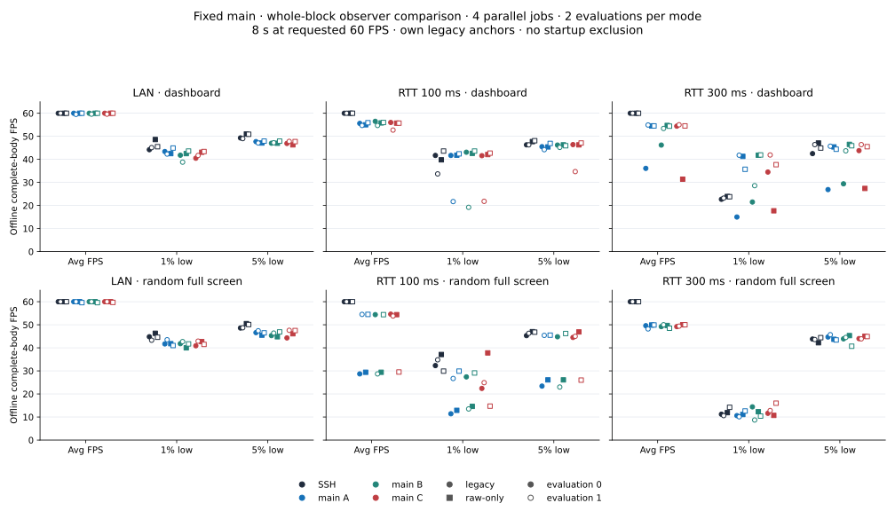
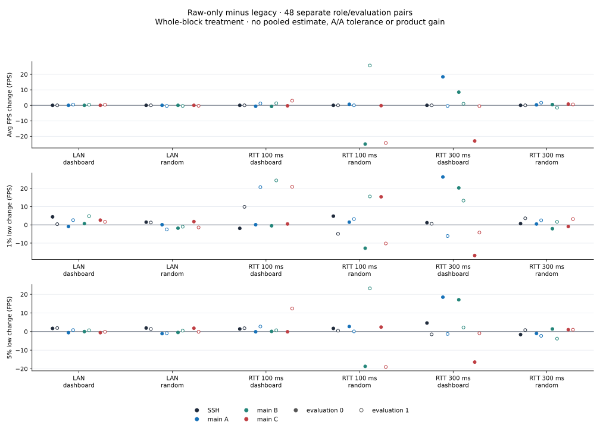
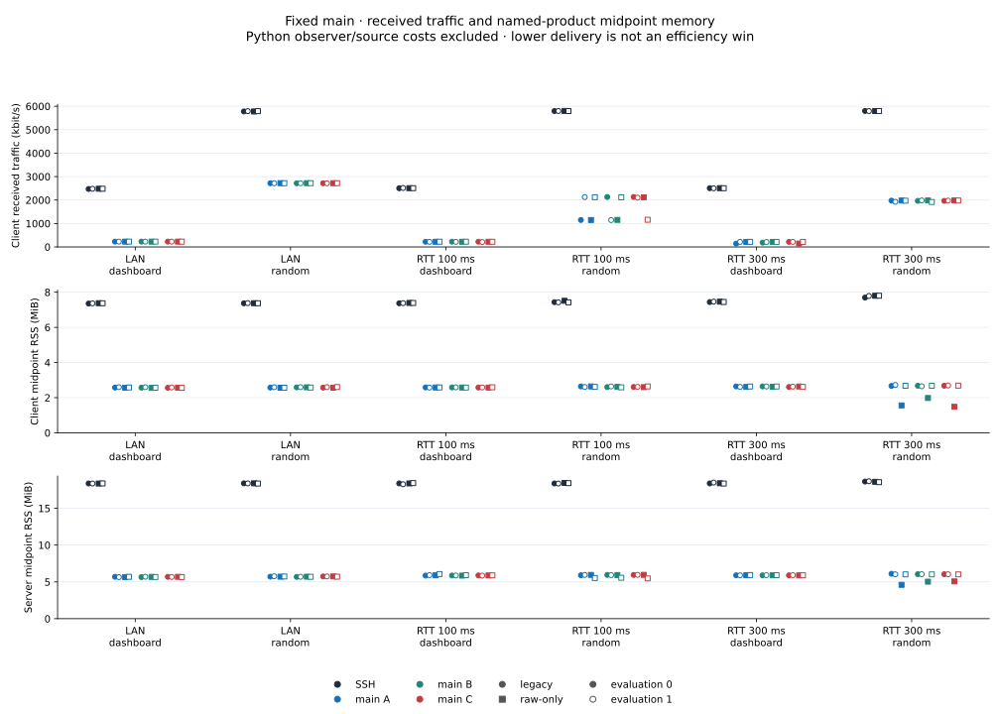

# Live observer comparison · November 1, 2026

Disabling live terminal emulation after the existing first-frame anchor did
not consistently recover SSH performance. Some cases improved, while identical
rsh replicas still entered slower regimes. This is an observer-method study
with unchanged product binaries; no product optimization is selected from it.

All numbers below are offline **complete-body** observations. Raw-mode live
headers/FPS are placeholders: 28 of 36 raw rsh live FPS values differ from the
body result, including a live 0.1 versus an actual-body 49.9 FPS. They are not
interchangeable. The [96 per-run observations](data/observer-cpu30-20261101/observer-per-rep.csv)
and [48 mode pairs](data/observer-cpu30-20261101/observer-per-rep.json) preserve
both evaluations and every role, without pooling.

## Method and evidence

Actual receive windows were **2026-11-01 00:53:00.862–00:59:43.112 KST**.
The study folder retains its October 31 start date. LAN, RTT 100 ms and
RTT 300 ms × dashboard/random × legacy/raw-only × two evaluations × four
roles produced **96 jobs in 24 blocks**, with four concurrent jobs.

Each block contains SSH and main-A/main-B/main-C. All three rsh roles use the
same TCP binary, SHA `9ab79c22…ecb463`, source `6729d398d4f1`; there is no
candidate product. Every block uses one observer mode. Per network/scene the
order is evaluation 0 legacy → evaluation 0 raw → evaluation 1 raw →
evaluation 1 legacy (ABBA). Slots change from `[SSH,A,B,C]` to `[B,C,SSH,A]`.
This is two evaluations per mode/context/role, not four pooled repeats.

Both modes retain their own existing first-header anchor: SSH uses the
read-thread event and rsh uses the emulated-header event. Raw-only switches
off live pyte/feed/look work after that anchor; capture, regex and queue work
remain. Recorded transitions were 11.9–29.7 ms after each own anchor, inside
the receive window. There is **no startup or early-estimator-seeding
exclusion**. The feed lock/recheck and later flag restoration are supported
by source/control flow, rather than separate pyte-call telemetry. The actual
image used pyte 0.8.0; exact image/version hashes are archived.

Admission used one sampled interval with total user+system CPU below 30%.
Startup was 26%; phase admissions were 19–28%. Runtime CPU is context, not
an invalidation threshold. The unweighted means of phase CPU means were
32.68% legacy and 31.60% raw, including setup/drain; they do not measure
collector CPU cost. Four jobs do not establish P-core affinity or isolation.

Saved-data checks accepted all 96 jobs: 42,132 complete bodies match recorded
source number/time/scene, all 46,080 retained source headers pass recorded
number/scene and positive-time checks, and source drops/missing frame IDs are
zero. The legacy source ledger records
completed writes; it cannot establish that no unrecorded write was pending.
The public archive is compact: it retains frame observations and the hashes
of all 192 original source/capture files, rather than the 523 MB of source
JSON. Metric recalculation is portable; independent terminal-character
replay still requires those original local files.

The [archive README](data/observer-cpu30-20261101/README.md),
[source/header audit](data/observer-cpu30-20261101/saved-data-audit.json),
[CPU policy summary](data/observer-cpu30-20261101/cpu30-summary.json) and
[manifest](data/observer-cpu30-20261101/manifest.json) state the exact scope.
Immutable preparation/run-stage status fields precede final analysis; final
validity is recorded in `observer-results.json`.

## Per-evaluation results

`compress` is the dashboard scene; `bandwidth` is incompressible random.
The table reports average FPS. The chart and CSV retain 1%/5% lows for every
role and evaluation; neither best-repeat selection nor averaging is used.

| Network / scene / evaluation | SSH legacy / raw | Main legacy A / B / C | Main raw A / B / C |
|---|---:|---:|---:|
| LAN / dashboard / 0 | 60.0 / 60.0 | 60.0 / 60.0 / 60.0 | 60.0 / 60.0 / 60.0 |
| LAN / dashboard / 1 | 60.0 / 60.0 | 59.5 / 59.6 / 59.6 | 60.0 / 60.0 / 60.0 |
| LAN / random / 0 | 60.0 / 60.0 | 60.0 / 60.0 / 60.0 | 60.0 / 60.0 / 60.0 |
| LAN / random / 1 | 60.0 / 60.0 | 60.0 / 60.0 / 60.0 | 59.6 / 59.6 / 59.7 |
| RTT 100 / dashboard / 0 | 60.0 / 60.0 | 55.6 / 56.5 / 56.0 | 55.0 / 55.8 / 55.7 |
| RTT 100 / dashboard / 1 | 60.0 / 60.0 | 54.7 / 54.7 / 52.7 | 55.9 / 56.0 / 55.7 |
| RTT 100 / random / 0 | 60.0 / 60.0 | 28.7 / 54.4 / 54.6 | 29.4 / 29.4 / 54.4 |
| RTT 100 / random / 1 | 60.0 / 60.0 | 54.5 / 28.7 / 53.8 | 54.5 / 54.4 / 29.5 |
| RTT 300 / dashboard / 0 | 60.0 / 60.0 | 36.1 / 46.2 / 54.4 | 54.5 / 54.7 / 31.4 |
| RTT 300 / dashboard / 1 | 60.0 / 60.0 | 54.9 / 53.4 / 55.0 | 54.5 / 54.4 / 54.5 |
| RTT 300 / random / 0 | 60.0 / 60.0 | 49.6 / 49.2 / 49.2 | 49.9 / 49.7 / 50.0 |
| RTT 300 / random / 1 | 60.0 / 60.0 | 48.2 / 50.0 / 49.4 | 49.9 / 48.5 / 50.0 |

For example, RTT 300/dashboard main-A evaluation 0 improves from
36.1 → 54.5 average FPS and 15.0 → 41.3 1% low. Its evaluation 1 instead
changes 54.9 → 54.5 average and 41.8 → 35.7 1% low. Main-C evaluation 0
falls 54.4 → 31.4 average FPS. WAN/random's slow replica changes roles:
evaluation 0 main-B falls 54.4 → 29.4, while evaluation 1 main-B improves
28.7 → 54.4 and main-C falls 53.8 → 29.5.

Across 36 rsh mode pairs, average FPS increases/decreases/ties in 16/13/7,
1% low in 23/13/0 and 5% low in 18/17/1. These are descriptive signs,
not an acceptance test or a noise allowance. SSH average stays 60 in all
24 jobs; its 1% and 5% lows each improve in 10 pairs and worsen in two.

## Traffic, memory and limits

The CSV also retains client/server CPU, generation-to-complete-read age and
its p95, maximum gap and observer transition time. Network is client RX in
decimal kbit/s; RSS is the named product process midpoint in KiB (charts use
MiB), not peak or total session memory. CPU is percent of one core for the
named product process. These product metrics exclude Python observer/source
cost. Age is neither RTT, input latency nor GPU presentation latency.

Identical rsh binaries still span up to 25.9 FPS within a legacy block and
25.0 FPS within a raw block. Raw RTT 300/random stays 48.5–50.0 FPS versus
SSH 60. Live pyte work after anchoring is therefore insufficient as the sole
explanation or a complete remedy. Observer/GIL/PTY/shared-host contributions
remain plausible; two evaluations and sign counts do not identify their
causal magnitude. Startup, estimator/socket/netem state and host scheduling
need direct evidence before changing controller policy.

All four observers change together, so early raw participants may alter
shared VM load while peers still start. A null result does not rule out
startup costs or remaining capture work. P/E-core placement and sender-egress
artifacts were not proved. No automatic A/A tolerance, universal observer
win, SSH parity or product promotion follows. Values are not pooled with the
separate pre-write/signal-source pipeline used by the November 1 slow-network
screen. Earlier benchmark tables remain unchanged.
