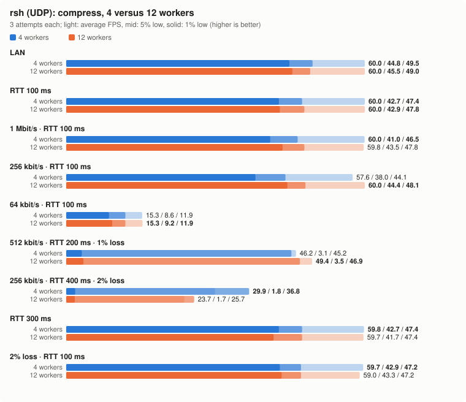
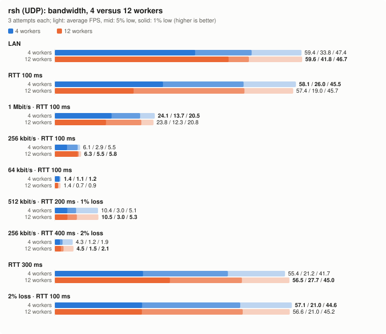
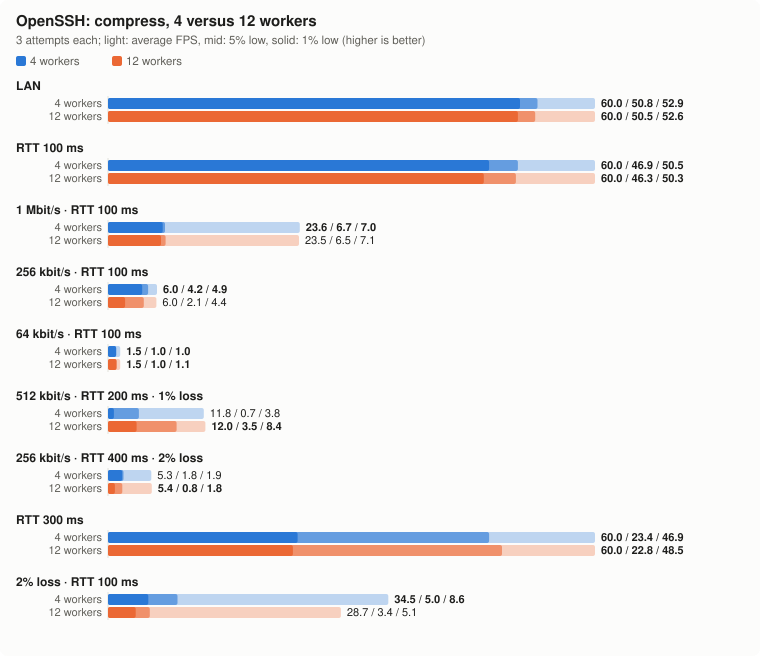
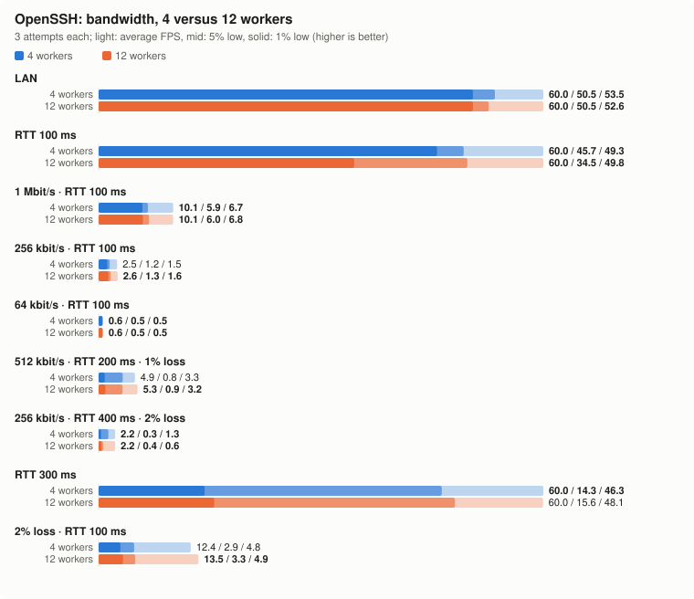

# Four versus twelve benchmark workers

Same published rsh 0.2.0 Linux arm64 binary (`6729d398d4f1`), image,
packages, scenes and collector; requested 60 FPS, 100×30, eight-second
render windows. The primary baseline is the earlier **first 750-job batch**:
three attempts per case. Its second screen batch is excluded from this
comparison so both sides have equal repeat counts.

Static tests compare 4 versus 12 active workers. Sessions compare the
first attempt per tool, with at most four active jobs on either side.
Moving is a separate three-link retest after all static jobs stop; it is
not a twelve-worker load test. All timings and measurements below were
recorded on 2026-10-29; no application source was changed.

## Actual elapsed time

| Scope | Earlier run | New run | Interpretation |
| --- | --- | --- | --- |
| Matched 750 static jobs | 33.17 min | 11.02 min | Same cases and three repeats; concurrency differs |
| Whole suite, start through moving postflight | 59.60 min | 15.63 min | 1,178 → 754 static/memory jobs; includes fewer screen/memory repeats and stage gaps |
| Memory batch | 8 jobs (two repeats) | 0.72 min / 4 jobs | One repeat per tool now |

The earlier whole-suite time includes its second screen batch and manual
stage gaps. Compare the matched 750-job row when assessing concurrency
speedup. The earlier 14–15 minute prediction assumed unchanged per-job
durations and excluded preparation/review; it was an estimate.

## Findings

The faster configuration did not produce identical measurements. rsh UDP
mean FPS is close in all 12 complete lossless scene/link pairs under the
descriptive rule below. Tail frame gaps vary in both directions, and the
lossy-path mean can differ substantially. Resource samples also differ;
these differences are observations, not demonstrated memory optimizations
or application regressions: the application binary was unchanged.

RTT 100 ms random-screen 1% low: **26.0 → 19.0 FPS**; LAN random-screen 1% low: **33.8 → 41.8 FPS**. At 256 kbit/s, RTT 400 ms and nominal 2% loss, dashboard mean FPS was **29.9 → 23.7**, a **-20.6%** change.

The runs differ in concurrency, time and realized random losses. This
experiment cannot isolate the cause of each difference or establish
statistical equivalence from three attempts. Twelve workers are faster for
routine mean-FPS checks; percentile and resource comparisons should retain
the same concurrency and enough independent repeats.

## How close are the results?

Exact equality is not expected across separate host runs and independent
random packet losses. The table below is a descriptive check of **mean FPS**:
difference no greater than the larger of 1 FPS or 5% of the baseline.
This rule was recorded before the new results were inspected. Only pairs
with all three observations are counted. It is not a statistical test of
equivalence; percentile lows and individual cases must also be inspected.

| Tool | Link class | Complete pairs | Mean within threshold | Median absolute mean change % |
| --- | --- | --- | --- | --- |
| rsh UDP | Lossless | 12 | 12 | 0.8 |
| rsh UDP | Random loss | 6 | 4 | 2.9 |
| SSH control | Lossless | 12 | 12 | 0.0 |
| SSH control | Random loss | 6 | 4 | 4.6 |
| All five transports | Lossless | 60 | 58 | 0.4 |
| All five transports | Random loss | 28 | 20 | 4.3 |

## Render results: 4 workers → 12 workers

Avg FPS is the mean of available per-run FPS. Lows pool inter-frame gaps separately on each side. Age is the median of per-run medians. Counts show missing attempts explicitly. Percent changes are relative to the four-worker baseline.

| Scene | Link | Tool | Measured runs | Avg FPS | Mean Δ % | 1% low | 5% low | Age ms |
| --- | --- | --- | --- | --- | --- | --- | --- | --- |
| compress | lan | rsh (UDP) | 3/3 → 3/3 | 60.0 → 60.0 | 0.0 | 44.8 → 45.5 | 49.5 → 49.0 | 4 → 3 |
| compress | lan | rsh (TCP) | 3/3 → 3/3 | 60.0 → 60.0 | 0.0 | 46.5 → 44.4 | 50.5 → 49.3 | 3 → 3 |
| compress | lan | OpenSSH | 3/3 → 3/3 | 60.0 → 60.0 | 0.0 | 50.8 → 50.5 | 52.9 → 52.6 | 1 → 1 |
| compress | lan | ET | 3/3 → 3/3 | 60.0 → 60.0 | 0.0 | 50.8 → 50.5 | 53.5 → 52.6 | 1 → 1 |
| compress | lan | mosh | 3/3 → 3/3 | 46.4 → 46.8 | 0.8 | 38.0 → 37.7 | 41.5 → 41.2 | 10 → 10 |
| compress | wan | rsh (UDP) | 3/3 → 3/3 | 60.0 → 60.0 | 0.0 | 42.7 → 42.9 | 47.4 → 47.8 | 55 → 54 |
| compress | wan | rsh (TCP) | 3/3 → 3/3 | 56.2 → 57.1 | 1.6 | 43.5 → 43.9 | 47.4 → 48.1 | 60 → 59 |
| compress | wan | OpenSSH | 3/3 → 3/3 | 60.0 → 60.0 | 0.0 | 46.9 → 46.3 | 50.5 → 50.3 | 52 → 52 |
| compress | wan | ET | 3/3 → 3/3 | 60.0 → 60.0 | 0.0 | 46.9 → 47.2 | 50.5 → 50.8 | 52 → 51 |
| compress | wan | mosh | 3/3 → 3/3 | 18.8 → 19.2 | 1.9 | 17.5 → 17.7 | 17.9 → 18.2 | 60 → 60 |
| compress | lowbw | rsh (UDP) | 3/3 → 3/3 | 60.0 → 59.8 | -0.3 | 41.0 → 43.5 | 46.5 → 47.8 | 60 → 59 |
| compress | lowbw | rsh (TCP) | 3/3 → 3/3 | 56.1 → 55.7 | -0.8 | 43.1 → 29.6 | 46.7 → 45.5 | 64 → 63 |
| compress | lowbw | OpenSSH | 3/3 → 3/3 | 23.6 → 23.5 | -0.4 | 6.7 → 6.5 | 7.0 → 7.1 | 2535 → 2515 |
| compress | lowbw | ET | 3/3 → 3/3 | 23.9 → 23.8 | -0.3 | 6.8 → 6.8 | 8.1 → 7.6 | 2512 → 2532 |
| compress | lowbw | mosh | 3/3 → 3/3 | 18.0 → 18.2 | 0.9 | 16.8 → 16.9 | 17.1 → 17.2 | 65 → 66 |
| compress | verylow | rsh (UDP) | 3/3 → 3/3 | 57.6 → 60.0 | 4.2 | 38.0 → 44.4 | 44.1 → 48.1 | 70 → 70 |
| compress | verylow | rsh (TCP) | 3/3 → 3/3 | 40.3 → 35.9 | -10.8 | 26.4 → 26.2 | 28.2 → 27.6 | 69 → 68 |
| compress | verylow | OpenSSH | 3/3 → 3/3 | 6.0 → 6.0 | -1.1 | 4.2 → 2.1 | 4.9 → 4.4 | 3805 → 3678 |
| compress | verylow | ET | 3/3 → 3/3 | 6.1 → 6.1 | 0.0 | 3.5 → 4.2 | 4.2 → 4.3 | 3793 → 3769 |
| compress | verylow | mosh | 3/3 → 3/3 | 15.7 → 16.0 | 1.9 | 14.0 → 14.7 | 14.9 → 15.0 | 82 → 82 |
| compress | slow64k | rsh (UDP) | 3/3 → 3/3 | 15.3 → 15.3 | 0.4 | 8.6 → 9.2 | 11.9 → 11.9 | 116 → 114 |
| compress | slow64k | rsh (TCP) | 3/3 → 3/3 | 15.4 → 15.9 | 3.0 | 7.3 → 9.1 | 12.3 → 12.5 | 175 → 160 |
| compress | slow64k | OpenSSH | 3/3 → 3/3 | 1.5 → 1.5 | 0.0 | 1.0 → 1.0 | 1.0 → 1.1 | 4389 → 4386 |
| compress | slow64k | ET | 3/3 → 3/3 | 1.5 → 1.6 | 2.2 | 0.9 → 0.9 | 1.1 → 1.1 | 4685 → 4495 |
| compress | slow64k | mosh | 3/3 → 3/3 | 10.3 → 10.1 | -1.3 | 8.6 → 6.8 | 9.3 → 7.3 | 153 → 156 |
| compress | mobile | rsh (UDP) | 3/3 → 3/3 | 46.2 → 49.4 | 7.0 | 3.1 → 3.5 | 45.2 → 46.9 | 114 → 113 |
| compress | mobile | rsh (TCP) | 3/3 → 3/3 | 32.6 → 30.8 | -5.5 | 3.3 → 3.5 | 15.2 → 11.4 | 117 → 115 |
| compress | mobile | OpenSSH | 3/3 → 3/3 | 11.8 → 12.0 | 1.7 | 0.7 → 3.5 | 3.8 → 8.4 | 4237 → 3340 |
| compress | mobile | ET | 3/3 → 3/3 | 11.7 → 12.1 | 3.1 | 1.4 → 3.3 | 4.2 → 4.2 | 3355 → 3358 |
| compress | mobile | mosh | 3/3 → 3/3 | 9.1 → 9.3 | 2.2 | 8.6 → 7.5 | 8.9 → 8.9 | 122 → 121 |
| compress | badmobile | rsh (UDP) | 3/3 → 3/3 | 29.9 → 23.7 | -20.6 | 1.8 → 1.7 | 36.8 → 25.7 | 225 → 227 |
| compress | badmobile | rsh (TCP) | 3/3 → 3/3 | 14.9 → 20.5 | 38.1 | 1.5 → 1.8 | 3.4 → 5.0 | 237 → 227 |
| compress | badmobile | OpenSSH | 3/3 → 3/3 | 5.3 → 5.4 | 1.2 | 1.8 → 0.8 | 1.9 → 1.8 | 3785 → 3820 |
| compress | badmobile | ET | 3/3 → 3/3 | 5.7 → 5.4 | -4.7 | 0.6 → 0.6 | 1.6 → 1.8 | 4711 → 4910 |
| compress | badmobile | mosh | 3/3 → 3/3 | 4.3 → 4.7 | 8.5 | 1.2 → 4.6 | 4.6 → 4.6 | 233 → 232 |
| compress | highlat | rsh (UDP) | 3/3 → 3/3 | 59.8 → 59.7 | -0.2 | 42.7 → 41.7 | 47.4 → 47.4 | 155 → 154 |
| compress | highlat | rsh (TCP) | 3/3 → 3/3 | 54.3 → 54.2 | -0.2 | 31.0 → 28.9 | 46.1 → 45.7 | 161 → 160 |
| compress | highlat | OpenSSH | 3/3 → 3/3 | 60.0 → 60.0 | 0.0 | 23.4 → 22.8 | 46.9 → 48.5 | 152 → 152 |
| compress | highlat | ET | 3/3 → 3/3 | 60.0 → 59.8 | -0.3 | 4.8 → 25.5 | 49.5 → 49.3 | 152 → 152 |
| compress | highlat | mosh | 3/3 → 3/3 | 6.6 → 6.6 | 0.5 | 6.2 → 6.0 | 6.4 → 6.4 | 159 → 160 |
| compress | lossy | rsh (UDP) | 3/3 → 3/3 | 59.7 → 59.0 | -1.2 | 42.9 → 43.3 | 47.2 → 47.2 | 55 → 54 |
| compress | lossy | rsh (TCP) | 3/3 → 3/3 | 30.0 → 32.1 | 6.8 | 6.4 → 5.8 | 13.9 → 21.9 | 59 → 54 |
| compress | lossy | OpenSSH | 3/3 → 3/3 | 34.5 → 28.7 | -16.9 | 5.0 → 3.4 | 8.6 → 5.1 | 1613 → 2731 |
| compress | lossy | ET | 3/3 → 3/3 | 35.7 → 37.4 | 4.9 | 4.9 → 5.1 | 9.7 → 9.9 | 985 → 647 |
| compress | lossy | mosh | 3/3 → 3/3 | 17.5 → 18.2 | 4.0 | 3.7 → 3.9 | 17.6 → 18.1 | 60 → 60 |
| bandwidth | lan | rsh (UDP) | 3/3 → 3/3 | 59.4 → 59.6 | 0.3 | 33.8 → 41.8 | 47.4 → 46.7 | 5 → 6 |
| bandwidth | lan | rsh (TCP) | 3/3 → 3/3 | 59.5 → 59.9 | 0.7 | 39.1 → 43.5 | 47.2 → 46.9 | 6 → 6 |
| bandwidth | lan | OpenSSH | 3/3 → 3/3 | 60.0 → 60.0 | 0.0 | 50.5 → 50.5 | 53.5 → 52.6 | 1 → 2 |
| bandwidth | lan | ET | 3/3 → 3/3 | 60.0 → 60.0 | 0.0 | 51.8 → 49.3 | 53.8 → 52.4 | 2 → 2 |
| bandwidth | lan | mosh | 3/3 → 3/3 | 46.2 → 46.7 | 1.1 | 37.6 → 37.5 | 41.2 → 40.8 | 11 → 11 |
| bandwidth | wan | rsh (UDP) | 3/3 → 3/3 | 58.1 → 57.4 | -1.1 | 26.0 → 19.0 | 45.5 → 45.7 | 56 → 56 |
| bandwidth | wan | rsh (TCP) | 3/3 → 3/3 | 46.4 → 54.9 | 18.2 | 26.2 → 29.5 | 28.3 → 45.9 | 63 → 62 |
| bandwidth | wan | OpenSSH | 3/3 → 3/3 | 60.0 → 60.0 | 0.0 | 45.7 → 34.5 | 49.3 → 49.8 | 52 → 52 |
| bandwidth | wan | ET | 3/3 → 3/3 | 60.0 → 60.0 | 0.1 | 11.8 → 27.0 | 49.5 → 49.8 | 52 → 52 |
| bandwidth | wan | mosh | 3/3 → 3/3 | 18.9 → 19.0 | 0.5 | 17.5 → 17.7 | 17.9 → 18.1 | 61 → 62 |
| bandwidth | lowbw | rsh (UDP) | 3/3 → 3/3 | 24.1 → 23.8 | -1.2 | 13.7 → 12.3 | 20.5 → 20.8 | 100 → 99 |
| bandwidth | lowbw | rsh (TCP) | 3/3 → 3/3 | 19.7 → 20.6 | 4.6 | 10.0 → 13.5 | 17.5 → 15.6 | 97 → 99 |
| bandwidth | lowbw | OpenSSH | 3/3 → 3/3 | 10.1 → 10.1 | 0.0 | 5.9 → 6.0 | 6.7 → 6.8 | 3418 → 3410 |
| bandwidth | lowbw | ET | 3/3 → 3/3 | 10.1 → 10.1 | 0.0 | 4.4 → 4.6 | 5.9 → 5.9 | 3223 → 3236 |
| bandwidth | lowbw | mosh | 3/3 → 3/3 | 16.2 → 16.4 | 1.2 | 14.9 → 14.2 | 15.4 → 15.4 | 106 → 105 |
| bandwidth | verylow | rsh (UDP) | 3/3 → 3/3 | 6.1 → 6.3 | 4.4 | 2.9 → 5.5 | 5.5 → 5.8 | 220 → 216 |
| bandwidth | verylow | rsh (TCP) | 3/3 → 3/3 | 6.0 → 5.9 | -0.6 | 5.3 → 5.3 | 5.5 → 5.5 | 381 → 384 |
| bandwidth | verylow | OpenSSH | 3/3 → 3/3 | 2.5 → 2.6 | 2.7 | 1.2 → 1.3 | 1.5 → 1.6 | 3809 → 4199 |
| bandwidth | verylow | ET | 3/3 → 3/3 | 2.5 → 2.6 | 2.6 | 1.2 → 1.5 | 1.3 → 1.5 | 3967 → 4329 |
| bandwidth | verylow | mosh | 3/3 → 3/3 | 5.6 → 5.6 | -0.6 | 4.0 → 4.0 | 4.0 → 4.0 | 451 → 494 |
| bandwidth | slow64k | rsh (UDP) | 3/3 → 3/3 | 1.4 → 1.4 | -4.7 | 1.1 → 0.7 | 1.2 → 0.9 | 538 → 541 |
| bandwidth | slow64k | rsh (TCP) | 3/3 → 3/3 | 1.5 → 1.5 | 0.0 | 0.9 → 1.0 | 1.0 → 1.2 | 1103 → 1030 |
| bandwidth | slow64k | OpenSSH | 3/3 → 3/3 | 0.6 → 0.6 | 0.0 | 0.5 → 0.5 | 0.5 → 0.5 | 3870 → 3864 |
| bandwidth | slow64k | ET | 3/3 → 3/3 | 0.6 → 0.6 | 0.0 | 0.4 → 0.4 | 0.4 → 0.4 | 4583 → 4933 |
| bandwidth | slow64k | mosh | 3/3 → 3/3 | 1.5 → 1.5 | 0.0 | 1.5 → 1.4 | 1.5 → 1.5 | 3956 → 3960 |
| bandwidth | mobile | rsh (UDP) | 3/3 → 3/3 | 10.4 → 10.5 | 1.0 | 3.0 → 3.0 | 5.1 → 5.3 | 185 → 182 |
| bandwidth | mobile | rsh (TCP) | 3/3 → 3/3 | 10.2 → 10.0 | -1.6 | 2.5 → 3.1 | 3.8 → 3.7 | 249 → 280 |
| bandwidth | mobile | OpenSSH | 3/3 → 3/3 | 4.9 → 5.3 | 7.5 | 0.8 → 0.9 | 3.3 → 3.2 | 4081 → 3929 |
| bandwidth | mobile | ET | 3/3 → 3/3 | 5.1 → 5.2 | 2.0 | 0.9 → 1.0 | 2.5 → 2.4 | 3850 → 3732 |
| bandwidth | mobile | mosh | 3/3 → 3/3 | 7.0 → 7.6 | 9.1 | 1.7 → 2.6 | 3.9 → 7.6 | 199 → 197 |
| bandwidth | badmobile | rsh (UDP) | 3/3 → 3/3 | 4.3 → 4.5 | 4.7 | 1.2 → 1.5 | 1.9 → 2.1 | 382 → 369 |
| bandwidth | badmobile | rsh (TCP) | 2/3 → 1/3 | 4.3 → 4.9 | 12.6 | 1.0 → 1.5 | 1.9 → 1.7 | 439 → 590 |
| bandwidth | badmobile | OpenSSH | 3/3 → 3/3 | 2.2 → 2.2 | 0.0 | 0.3 → 0.4 | 1.3 → 0.6 | 3855 → 5098 |
| bandwidth | badmobile | ET | 3/3 → 3/3 | 2.4 → 2.4 | 1.4 | 0.5 → 0.4 | 1.0 → 0.5 | 4229 → 4354 |
| bandwidth | badmobile | mosh | 3/3 → 3/3 | 3.8 → 3.8 | -1.7 | 1.1 → 0.8 | 2.2 → 2.3 | 384 → 383 |
| bandwidth | highlat | rsh (UDP) | 3/3 → 3/3 | 55.4 → 56.5 | 1.9 | 21.2 → 27.7 | 41.7 → 45.0 | 157 → 156 |
| bandwidth | highlat | rsh (TCP) | 3/3 → 3/3 | 49.2 → 50.5 | 2.7 | 15.0 → 11.8 | 43.7 → 45.0 | 163 → 163 |
| bandwidth | highlat | OpenSSH | 3/3 → 3/3 | 60.0 → 60.0 | -0.1 | 14.3 → 15.6 | 46.3 → 48.1 | 153 → 153 |
| bandwidth | highlat | ET | 3/3 → 3/3 | 60.0 → 60.0 | 0.0 | 4.0 → 3.8 | 49.8 → 49.8 | 153 → 153 |
| bandwidth | highlat | mosh | 3/3 → 3/3 | 6.6 → 6.6 | 0.0 | 6.3 → 6.4 | 6.4 → 6.4 | 161 → 161 |
| bandwidth | lossy | rsh (UDP) | 3/3 → 3/3 | 57.1 → 56.6 | -0.9 | 21.0 → 21.0 | 44.6 → 45.2 | 57 → 56 |
| bandwidth | lossy | rsh (TCP) | 2/3 → 3/3 | 13.6 → 16.3 | 20.0 | 3.3 → 3.7 | 4.5 → 5.4 | 70 → 68 |
| bandwidth | lossy | OpenSSH | 3/3 → 3/3 | 12.4 → 13.5 | 8.3 | 2.9 → 3.3 | 4.8 → 4.9 | 3622 → 1925 |
| bandwidth | lossy | ET | 3/3 → 3/3 | 14.4 → 18.5 | 28.5 | 3.2 → 4.8 | 4.1 → 5.0 | 1931 → 1157 |
| bandwidth | lossy | mosh | 3/3 → 3/3 | 14.9 → 14.8 | -0.2 | 3.7 → 3.7 | 6.1 → 4.7 | 62 → 60 |

## Render traffic and resources

All cells are baseline → new medians. RSS uses MiB; CPU is percent of one core. RSS is a sample, not a peak.

| Scene | Link | Tool | RX kbit/s | Client RSS MiB | Server RSS MiB | Client CPU % | Server CPU % |
| --- | --- | --- | --- | --- | --- | --- | --- |
| compress | lan | rsh (UDP) | 218.00 → 217.00 | 2.44 → 2.44 | 6.12 → 5.19 | 0.94 → 0.68 | 1.37 → 1.04 |
| compress | lan | rsh (TCP) | 227.00 → 229.00 | 2.57 → 2.57 | 5.17 → 5.87 | 0.71 → 0.74 | 0.96 → 1.10 |
| compress | lan | OpenSSH | 2480.00 → 2482.00 | 7.37 → 7.38 | 18.40 → 18.38 | 0.21 → 0.20 | 0.28 → 0.25 |
| compress | lan | ET | 2440.00 → 2446.00 | 17.14 → 18.12 | 14.57 → 14.36 | 0.42 → 0.38 | 0.53 → 0.48 |
| compress | lan | mosh | 235.00 → 237.00 | 15.42 → 15.43 | 10.54 → 10.41 | 1.09 → 0.77 | 2.38 → 1.74 |
| compress | wan | rsh (UDP) | 217.00 → 217.00 | 2.45 → 2.44 | 5.20 → 5.20 | 0.94 → 0.68 | 1.28 → 0.96 |
| compress | wan | rsh (TCP) | 224.00 → 227.00 | 2.59 → 2.59 | 5.65 → 5.47 | 0.66 → 0.69 | 2.51 → 2.61 |
| compress | wan | OpenSSH | 2517.00 → 2508.00 | 7.39 → 7.38 | 18.39 → 18.38 | 0.21 → 0.21 | 0.22 → 0.28 |
| compress | wan | ET | 2465.00 → 2469.00 | 15.85 → 17.30 | 14.60 → 14.48 | 0.36 → 0.29 | 0.51 → 0.44 |
| compress | wan | mosh | 103.00 → 105.00 | 14.37 → 14.42 | 10.56 → 10.55 | 0.60 → 0.40 | 2.11 → 1.45 |
| compress | lowbw | rsh (UDP) | 218.00 → 218.00 | 2.45 → 2.44 | 6.34 → 5.20 | 1.21 → 0.60 | 1.70 → 0.88 |
| compress | lowbw | rsh (TCP) | 223.00 → 224.00 | 2.59 → 2.58 | 5.37 → 5.39 | 1.08 → 0.63 | 3.74 → 2.23 |
| compress | lowbw | OpenSSH | 976.00 → 977.00 | 7.78 → 7.61 | 19.22 → 19.30 | 0.15 → 0.11 | 0.45 → 0.37 |
| compress | lowbw | ET | 975.00 → 975.00 | 15.84 → 18.09 | 14.64 → 14.09 | 0.31 → 0.18 | 0.57 → 0.39 |
| compress | lowbw | mosh | 99.00 → 100.00 | 14.37 → 14.43 | 10.46 → 10.45 | 0.66 → 0.35 | 2.41 → 1.42 |
| compress | verylow | rsh (UDP) | 218.00 → 219.00 | 2.45 → 2.44 | 6.17 → 5.86 | 1.29 → 0.69 | 1.80 → 0.96 |
| compress | verylow | rsh (TCP) | 163.00 → 143.00 | 2.57 → 2.58 | 6.32 → 6.19 | 0.94 → 0.45 | 3.18 → 1.75 |
| compress | verylow | OpenSSH | 250.00 → 250.00 | 7.39 → 7.38 | 19.37 → 19.36 | 0.10 → 0.06 | 0.55 → 0.26 |
| compress | verylow | ET | 249.00 → 249.00 | 18.07 → 18.08 | 14.13 → 13.63 | 0.30 → 0.14 | 0.62 → 0.33 |
| compress | verylow | mosh | 87.00 → 90.00 | 14.35 → 14.54 | 10.41 → 10.42 | 0.69 → 0.33 | 2.87 → 1.41 |
| compress | slow64k | rsh (UDP) | 57.00 → 57.00 | 2.45 → 2.45 | 6.54 → 5.39 | 0.55 → 0.28 | 2.36 → 1.39 |
| compress | slow64k | rsh (TCP) | 63.00 → 63.00 | 2.57 → 2.57 | 6.55 → 5.32 | 0.61 → 0.29 | 2.13 → 1.07 |
| compress | slow64k | OpenSSH | 61.00 → 61.00 | 7.38 → 7.37 | 19.30 → 19.33 | 0.06 → 0.03 | 0.59 → 0.33 |
| compress | slow64k | ET | 61.00 → 61.00 | 18.04 → 17.11 | 13.57 → 13.45 | 0.34 → 0.19 | 0.74 → 0.44 |
| compress | slow64k | mosh | 59.00 → 60.00 | 14.42 → 14.52 | 10.42 → 10.55 | 0.59 → 0.33 | 3.58 → 1.68 |
| compress | mobile | rsh (UDP) | 222.00 → 241.00 | 2.77 → 2.73 | 5.57 → 5.22 | 1.28 → 0.70 | 2.27 → 1.08 |
| compress | mobile | rsh (TCP) | 165.00 → 158.00 | 2.77 → 2.74 | 5.25 → 6.23 | 0.78 → 0.48 | 3.32 → 1.85 |
| compress | mobile | OpenSSH | 502.00 → 499.00 | 7.69 → 7.38 | 19.39 → 19.24 | 0.16 → 0.09 | 0.66 → 0.30 |
| compress | mobile | ET | 496.00 → 498.00 | 17.40 → 18.15 | 14.02 → 13.79 | 0.29 → 0.19 | 0.58 → 0.38 |
| compress | mobile | mosh | 49.00 → 50.00 | 14.32 → 14.46 | 10.37 → 10.40 | 0.45 → 0.24 | 2.65 → 1.38 |
| compress | badmobile | rsh (UDP) | 167.00 → 149.00 | 2.91 → 3.05 | 6.33 → 5.99 | 1.10 → 0.38 | 3.84 → 1.80 |
| compress | badmobile | rsh (TCP) | 123.00 → 128.00 | 2.79 → 2.91 | 5.72 → 5.35 | 0.52 → 0.41 | 2.81 → 1.67 |
| compress | badmobile | OpenSSH | 249.00 → 248.00 | 7.58 → 7.40 | 19.29 → 19.51 | 0.13 → 0.05 | 0.54 → 0.34 |
| compress | badmobile | ET | 248.00 → 249.00 | 17.28 → 17.30 | 13.69 → 13.59 | 0.30 → 0.15 | 0.65 → 0.35 |
| compress | badmobile | mosh | 25.00 → 26.00 | 14.35 → 14.84 | 10.29 → 10.28 | 0.27 → 0.15 | 2.56 → 1.42 |
| compress | highlat | rsh (UDP) | 217.00 → 217.00 | 2.45 → 2.44 | 5.49 → 5.21 | 1.28 → 0.57 | 1.73 → 0.77 |
| compress | highlat | rsh (TCP) | 217.00 → 220.00 | 2.62 → 2.64 | 5.68 → 5.40 | 0.87 → 0.64 | 3.40 → 2.23 |
| compress | highlat | OpenSSH | 2504.00 → 2507.00 | 7.43 → 7.45 | 18.52 → 18.40 | 0.37 → 0.17 | 0.40 → 0.21 |
| compress | highlat | ET | 2458.00 → 2464.00 | 15.94 → 15.96 | 14.70 → 14.44 | 0.51 → 0.24 | 0.79 → 0.36 |
| compress | highlat | mosh | 37.00 → 37.00 | 14.44 → 14.55 | 10.28 → 10.31 | 0.30 → 0.15 | 2.14 → 1.23 |
| compress | lossy | rsh (UDP) | 419.00 → 417.00 | 2.45 → 2.62 | 5.16 → 5.85 | 0.98 → 0.59 | 1.51 → 0.85 |
| compress | lossy | rsh (TCP) | 129.00 → 128.00 | 2.69 → 2.70 | 5.92 → 6.04 | 0.56 → 0.38 | 2.30 → 1.50 |
| compress | lossy | OpenSSH | 1406.00 → 1060.00 | 7.52 → 7.52 | 19.24 → 19.51 | 0.10 → 0.09 | 0.73 → 0.51 |
| compress | lossy | ET | 1558.00 → 1634.00 | 18.20 → 18.18 | 14.62 → 14.31 | 0.21 → 0.19 | 0.39 → 0.36 |
| compress | lossy | mosh | 103.00 → 104.00 | 14.53 → 14.53 | 10.52 → 10.56 | 0.53 → 0.35 | 2.10 → 1.38 |
| bandwidth | lan | rsh (UDP) | 2670.00 → 2666.00 | 2.45 → 2.44 | 5.57 → 5.25 | 1.17 → 1.48 | 1.76 → 2.10 |
| bandwidth | lan | rsh (TCP) | 2717.00 → 2717.00 | 2.60 → 2.57 | 5.73 → 5.76 | 1.29 → 1.42 | 1.75 → 2.01 |
| bandwidth | lan | OpenSSH | 5780.00 → 5790.00 | 7.39 → 7.38 | 18.40 → 18.39 | 0.24 → 0.30 | 0.31 → 0.38 |
| bandwidth | lan | ET | 5718.00 → 5724.00 | 18.09 → 18.09 | 16.46 → 16.11 | 0.43 → 0.62 | 0.49 → 0.78 |
| bandwidth | lan | mosh | 2007.00 → 2030.00 | 15.44 → 15.48 | 10.48 → 10.47 | 2.56 → 3.01 | 4.17 → 4.95 |
| bandwidth | wan | rsh (UDP) | 2685.00 → 2681.00 | 2.56 → 2.61 | 5.61 → 5.36 | 1.25 → 1.34 | 1.77 → 1.71 |
| bandwidth | wan | rsh (TCP) | 2132.00 → 2151.00 | 2.61 → 2.61 | 6.60 → 6.05 | 1.33 → 1.20 | 5.59 → 5.08 |
| bandwidth | wan | OpenSSH | 5796.00 → 5803.00 | 7.48 → 7.48 | 18.43 → 18.45 | 0.20 → 0.31 | 0.21 → 0.37 |
| bandwidth | wan | ET | 5748.00 → 5751.00 | 17.29 → 18.19 | 16.42 → 16.33 | 0.31 → 0.39 | 0.43 → 0.60 |
| bandwidth | wan | mosh | 816.00 → 823.00 | 14.46 → 14.47 | 10.41 → 10.42 | 1.17 → 1.22 | 3.22 → 3.59 |
| bandwidth | lowbw | rsh (UDP) | 933.00 → 928.00 | 2.46 → 2.45 | 5.43 → 5.39 | 1.04 → 0.80 | 3.19 → 2.54 |
| bandwidth | lowbw | rsh (TCP) | 803.00 → 801.00 | 2.57 → 2.59 | 5.68 → 6.05 | 0.93 → 0.73 | 3.10 → 2.29 |
| bandwidth | lowbw | OpenSSH | 979.00 → 978.00 | 7.40 → 7.41 | 19.52 → 19.72 | 0.17 → 0.10 | 0.34 → 0.28 |
| bandwidth | lowbw | ET | 979.00 → 977.00 | 17.15 → 17.14 | 14.84 → 14.33 | 0.27 → 0.17 | 0.53 → 0.45 |
| bandwidth | lowbw | mosh | 701.00 → 706.00 | 14.59 → 14.60 | 10.48 → 10.46 | 1.43 → 1.33 | 4.03 → 3.15 |
| bandwidth | verylow | rsh (UDP) | 242.00 → 246.00 | 2.46 → 2.44 | 6.57 → 6.29 | 0.53 → 0.31 | 2.08 → 1.15 |
| bandwidth | verylow | rsh (TCP) | 256.00 → 256.00 | 2.57 → 2.56 | 5.75 → 5.56 | 0.66 → 0.41 | 2.00 → 1.25 |
| bandwidth | verylow | OpenSSH | 249.00 → 250.00 | 7.39 → 7.40 | 19.45 → 19.48 | 0.11 → 0.05 | 0.33 → 0.20 |
| bandwidth | verylow | ET | 249.00 → 250.00 | 18.11 → 18.10 | 13.86 → 13.88 | 0.23 → 0.14 | 0.54 → 0.35 |
| bandwidth | verylow | mosh | 240.00 → 240.00 | 15.07 → 15.07 | 10.87 → 10.91 | 0.77 → 0.42 | 4.74 → 2.78 |
| bandwidth | slow64k | rsh (UDP) | 64.00 → 64.00 | 2.44 → 2.44 | 6.46 → 5.93 | 0.33 → 0.12 | 1.54 → 0.74 |
| bandwidth | slow64k | rsh (TCP) | 63.00 → 64.00 | 2.57 → 2.55 | 5.88 → 5.88 | 0.19 → 0.10 | 1.52 → 0.70 |
| bandwidth | slow64k | OpenSSH | 61.00 → 61.00 | 7.38 → 7.37 | 19.51 → 19.45 | 0.06 → 0.07 | 0.32 → 0.15 |
| bandwidth | slow64k | ET | 62.00 → 61.00 | 18.07 → 18.07 | 13.63 → 13.56 | 0.31 → 0.13 | 0.69 → 0.33 |
| bandwidth | slow64k | mosh | 64.00 → 63.00 | 14.87 → 14.96 | 13.03 → 12.98 | 0.22 → 0.12 | 5.45 → 2.80 |
| bandwidth | mobile | rsh (UDP) | 424.00 → 424.00 | 2.69 → 2.66 | 5.32 → 5.45 | 0.75 → 0.43 | 2.48 → 1.53 |
| bandwidth | mobile | rsh (TCP) | 451.00 → 452.00 | 2.68 → 2.66 | 5.74 → 6.28 | 0.92 → 0.43 | 3.12 → 1.53 |
| bandwidth | mobile | OpenSSH | 500.00 → 501.00 | 7.44 → 7.71 | 19.54 → 19.51 | 0.15 → 0.07 | 0.35 → 0.20 |
| bandwidth | mobile | ET | 500.00 → 501.00 | 17.84 → 18.09 | 14.05 → 13.74 | 0.26 → 0.15 | 0.54 → 0.35 |
| bandwidth | mobile | mosh | 339.00 → 342.00 | 14.82 → 14.91 | 10.70 → 10.33 | 0.99 → 0.56 | 5.16 → 2.80 |
| bandwidth | badmobile | rsh (UDP) | 192.00 → 223.00 | 2.66 → 2.67 | 5.84 → 5.43 | 0.47 → 0.29 | 2.18 → 1.22 |
| bandwidth | badmobile | rsh (TCP) | 223.50 → 237.00 | 2.70 → 2.63 | 6.62 → 5.47 | 0.56 → 0.25 | 2.50 → 1.19 |
| bandwidth | badmobile | OpenSSH | 247.00 → 240.00 | 7.47 → 7.39 | 19.54 → 19.52 | 0.09 → 0.03 | 0.40 → 0.16 |
| bandwidth | badmobile | ET | 247.00 → 249.00 | 15.83 → 17.33 | 13.77 → 13.76 | 0.31 → 0.14 | 0.65 → 0.33 |
| bandwidth | badmobile | mosh | 186.00 → 192.00 | 14.43 → 14.48 | 10.42 → 10.62 | 0.66 → 0.38 | 5.79 → 3.21 |
| bandwidth | highlat | rsh (UDP) | 2708.00 → 2710.00 | 2.61 → 2.65 | 5.72 → 5.50 | 1.69 → 1.35 | 1.89 → 1.72 |
| bandwidth | highlat | rsh (TCP) | 1950.00 → 2000.00 | 2.68 → 2.68 | 6.67 → 5.52 | 1.25 → 1.14 | 5.24 → 4.63 |
| bandwidth | highlat | OpenSSH | 5795.00 → 5799.00 | 7.82 → 7.89 | 18.62 → 18.59 | 0.27 → 0.26 | 0.31 → 0.30 |
| bandwidth | highlat | ET | 5744.00 → 5739.00 | 16.43 → 16.30 | 16.61 → 16.27 | 0.36 → 0.36 | 0.56 → 0.57 |
| bandwidth | highlat | mosh | 283.00 → 282.00 | 14.32 → 14.37 | 10.19 → 10.21 | 0.44 → 0.43 | 2.89 → 2.85 |
| bandwidth | lossy | rsh (UDP) | 5257.00 → 5225.00 | 2.61 → 2.69 | 5.84 → 5.87 | 1.53 → 1.31 | 1.97 → 1.90 |
| bandwidth | lossy | rsh (TCP) | 811.50 → 769.00 | 2.80 → 2.75 | 6.33 → 5.42 | 0.57 → 0.45 | 2.67 → 2.10 |
| bandwidth | lossy | OpenSSH | 1109.00 → 1171.00 | 7.43 → 7.43 | 19.78 → 19.93 | 0.13 → 0.07 | 0.52 → 0.37 |
| bandwidth | lossy | ET | 985.00 → 1866.00 | 18.16 → 18.05 | 14.61 → 14.91 | 0.21 → 0.18 | 0.44 → 0.38 |
| bandwidth | lossy | mosh | 793.00 → 800.00 | 14.49 → 14.58 | 11.04 → 10.80 | 1.11 → 0.95 | 3.98 → 3.31 |

## Link changes

All cells are baseline → new. Post-change lows pool post-change gaps only.

| Change | Scene | Tool | FPS after | 1% low after | 5% low after | Age after ms |
| --- | --- | --- | --- | --- | --- | --- |
| wan → verylow | compress | rsh (UDP) | 52.7 → 52.5 | 32.6 → 33.3 | 43.3 → 44.2 | 76 → 74 |
| wan → verylow | compress | rsh (TCP) | 32.5 → 32.2 | 25.7 → 18.3 | 27.7 → 19.6 | 68 → 68 |
| wan → verylow | compress | OpenSSH | 5.8 → 5.9 | 1.8 → 1.6 | 2.1 → 1.8 | 3625 → 3694 |
| wan → verylow | compress | ET | 6.1 → 5.8 | 1.9 → 1.8 | 4.2 → 1.9 | 3706 → 3640 |
| wan → verylow | compress | mosh | 15.6 → 15.9 | 14.6 → 14.7 | 14.9 → 15.0 | 84 → 82 |
| wan → verylow | bandwidth | rsh (UDP) | 3.8 → 4.7 | 0.9 → 2.7 | 2.9 → 3.1 | 226 → 216 |
| wan → verylow | bandwidth | rsh (TCP) | 5.6 → 5.4 | 4.2 → 3.3 | 5.5 → 5.5 | 473 → 420 |
| wan → verylow | bandwidth | OpenSSH | 2.5 → 2.5 | 1.4 → 1.2 | 1.9 → 1.9 | 7405 → 4046 |
| wan → verylow | bandwidth | ET | 0.4 → 0.3 | 1.5 → — | 1.6 → — | 7515 → 7499 |
| wan → verylow | bandwidth | mosh | 5.3 → 5.3 | 3.9 → 3.9 | 4.0 → 4.0 | 946 → 955 |
| lan → highlat | compress | rsh (UDP) | 56.7 → 57.0 | 44.1 → 44.1 | 47.2 → 47.4 | 155 → 154 |
| lan → highlat | compress | rsh (TCP) | 52.0 → 51.9 | 24.9 → 24.9 | 46.3 → 45.5 | 160 → 161 |
| lan → highlat | compress | OpenSSH | 59.2 → 59.1 | 37.3 → 37.2 | 50.5 → 50.5 | 152 → 152 |
| lan → highlat | compress | ET | 59.1 → 59.1 | 4.9 → 5.2 | 49.5 → 50.0 | 152 → 152 |
| lan → highlat | compress | mosh | 10.0 → 10.0 | 6.5 → 6.5 | 6.5 → 6.5 | 160 → 161 |
| lan → highlat | bandwidth | rsh (UDP) | 55.6 → 56.4 | 31.9 → 33.4 | 46.1 → 45.5 | 157 → 157 |
| lan → highlat | bandwidth | rsh (TCP) | 45.5 → 45.3 | 4.1 → 4.4 | 45.0 → 43.5 | 163 → 164 |
| lan → highlat | bandwidth | OpenSSH | 59.2 → 59.2 | 36.4 → 5.4 | 50.0 → 49.8 | 153 → 153 |
| lan → highlat | bandwidth | ET | 59.1 → 59.1 | 10.7 → 12.7 | 49.3 → 49.5 | 153 → 153 |
| lan → highlat | bandwidth | mosh | 9.9 → 9.9 | 6.4 → 6.4 | 6.5 → 6.5 | 162 → 161 |
| lan → lowbw | compress | rsh (UDP) | 58.9 → 58.7 | 41.7 → 35.2 | 47.2 → 47.2 | 60 → 60 |
| lan → lowbw | compress | rsh (TCP) | 56.2 → 56.2 | 44.4 → 44.1 | 47.6 → 47.8 | 64 → 63 |
| lan → lowbw | compress | OpenSSH | 23.3 → 22.8 | 2.0 → 2.4 | 4.0 → 4.4 | 2655 → 2471 |
| lan → lowbw | compress | ET | 23.0 → 23.4 | 1.9 → 1.9 | 3.3 → 3.1 | 2576 → 2629 |
| lan → lowbw | compress | mosh | 21.4 → 21.9 | 17.1 → 17.2 | 17.4 → 17.5 | 66 → 66 |
| lan → lowbw | bandwidth | rsh (UDP) | 23.0 → 22.7 | 7.5 → 7.0 | 19.2 → 19.8 | 101 → 100 |
| lan → lowbw | bandwidth | rsh (TCP) | 20.6 → 21.4 | 10.1 → 10.0 | 17.8 → 17.8 | 98 → 98 |
| lan → lowbw | bandwidth | OpenSSH | 9.6 → 9.9 | 2.1 → 2.2 | 3.8 → 3.1 | 3519 → 3445 |
| lan → lowbw | bandwidth | ET | 10.0 → 10.0 | 1.9 → 1.9 | 1.9 → 2.1 | 3503 → 3382 |
| lan → lowbw | bandwidth | mosh | 13.5 → 13.8 | 6.8 → 7.3 | 8.2 → 8.8 | 110 → 110 |
| lowbw → highlat | compress | rsh (UDP) | 52.2 → 52.9 | 41.2 → 38.3 | 46.5 → 47.4 | 156 → 155 |
| lowbw → highlat | compress | rsh (TCP) | 40.6 → 5.8 | 5.5 → 1.9 | 6.6 → 5.1 | 162 → 157 |
| lowbw → highlat | compress | OpenSSH | 45.6 → 35.5 | 3.5 → 3.3 | 3.7 → 3.5 | 3097 → 3632 |
| lowbw → highlat | compress | ET | 34.7 → 31.3 | 3.6 → 3.3 | 3.7 → 3.5 | 2236 → 2254 |
| lowbw → highlat | compress | mosh | 7.5 → 7.6 | 6.4 → 6.5 | 6.5 → 6.5 | 162 → 160 |
| lowbw → highlat | bandwidth | rsh (UDP) | 52.2 → 51.9 | 36.2 → 32.2 | 46.7 → 46.1 | 157 → 156 |
| lowbw → highlat | bandwidth | rsh (TCP) | 16.3 → 17.7 | 2.9 → 3.4 | 8.1 → 8.5 | 159 → 169 |
| lowbw → highlat | bandwidth | OpenSSH | 17.9 → 17.3 | 3.3 → 3.3 | 3.6 → 3.4 | 4067 → 4469 |
| lowbw → highlat | bandwidth | ET | 14.8 → 14.6 | 3.3 → 3.3 | 3.5 → 3.4 | 2233 → 2225 |
| lowbw → highlat | bandwidth | mosh | 7.5 → 7.6 | 6.4 → 6.4 | 6.5 → 6.5 | 163 → 161 |
| highlat → lossy | compress | rsh (UDP) | 56.9 → 57.3 | 39.7 → 42.6 | 46.3 → 47.8 | 55 → 54 |
| highlat → lossy | compress | rsh (TCP) | 28.7 → 36.8 | 5.7 → 6.1 | 12.7 → 12.3 | 58 → 60 |
| highlat → lossy | compress | OpenSSH | 41.6 → 43.2 | 6.9 → 6.5 | 9.8 → 10.1 | 179 → 258 |
| highlat → lossy | compress | ET | 49.3 → 49.4 | 7.3 → 7.3 | 12.8 → 17.3 | 124 → 113 |
| highlat → lossy | compress | mosh | 13.3 → 13.7 | 2.2 → 2.9 | 8.3 → 8.0 | 61 → 60 |
| highlat → lossy | bandwidth | rsh (UDP) | 55.1 → 54.3 | 32.5 → 7.8 | 46.3 → 30.9 | 56 → 57 |
| highlat → lossy | bandwidth | rsh (TCP) | 19.1 → 16.3 | 4.1 → 3.2 | 5.7 → 5.4 | 63 → 61 |
| highlat → lossy | bandwidth | OpenSSH | 30.3 → 33.9 | 5.5 → 6.4 | 9.0 → 9.6 | 204 → 138 |
| highlat → lossy | bandwidth | ET | 39.4 → 45.7 | 4.9 → 4.9 | 8.5 → 9.6 | 563 → 836 |
| highlat → lossy | bandwidth | mosh | 11.6 → 12.7 | 1.8 → 2.3 | 5.8 → 5.5 | 63 → 62 |

## Connection, key echo and bulk output

| Link | Tool | Connect s | Echo ms | Flood s | Flood completed |
| --- | --- | --- | --- | --- | --- |
| lan | rsh (UDP) | 0.013 → 0.012 | 7.5 → 6.8 | 0.06 → 0.06 | 3/3 → 3/3 |
| lan | rsh (TCP) | 1.513 → 1.516 | 7.0 → 6.3 | 0.08 → 0.05 | 3/3 → 3/3 |
| lan | OpenSSH | 0.149 → 0.147 | 14.6 → 14.2 | 0.05 → 0.04 | 3/3 → 3/3 |
| lan | ET | 0.156 → 0.153 | 7.2 → 5.3 | 0.07 → 0.06 | 3/3 → 3/3 |
| lan | mosh | 0.238 → 0.236 | 16.9 → 16.4 | 0.06 → 0.06 | 3/3 → 3/3 |
| wan | rsh (UDP) | 0.322 → 0.318 | 6.8 → 4.4 | 0.15 → 0.14 | 3/3 → 3/3 |
| wan | rsh (TCP) | 2.029 → 2.029 | 4.8 → 4.1 | 0.15 → 0.21 | 3/3 → 3/3 |
| wan | OpenSSH | 1.427 → 1.403 | 120.1 → 112.5 | 0.60 → 0.53 | 3/3 → 3/3 |
| wan | ET | 1.945 → 1.909 | 106.8 → 105.2 | 1.13 → 0.76 | 3/3 → 3/3 |
| wan | mosh | 1.745 → 1.563 | 7.3 → 5.2 | 0.21 → 0.19 | 3/3 → 3/3 |
| lowbw | rsh (UDP) | 0.324 → 0.324 | 7.2 → 3.9 | 0.16 → 0.19 | 3/3 → 3/3 |
| lowbw | rsh (TCP) | 2.039 → 2.031 | 7.1 → 3.9 | 0.16 → 0.15 | 3/3 → 3/3 |
| lowbw | OpenSSH | 1.464 → 1.431 | 116.8 → 118.1 | 6.02 → 6.01 | 3/3 → 3/3 |
| lowbw | ET | 1.966 → 1.942 | 107.4 → 106.4 | 5.94 → 5.93 | 3/3 → 3/3 |
| lowbw | mosh | 1.660 → 1.730 | 8.3 → 3.9 | 0.19 → 0.22 | 3/3 → 3/3 |
| verylow | rsh (UDP) | 0.357 → 0.352 | 7.2 → 4.7 | 0.16 → 0.16 | 3/3 → 3/3 |
| verylow | rsh (TCP) | 2.070 → 2.067 | 7.2 → 4.2 | 0.16 → 0.16 | 3/3 → 3/3 |
| verylow | OpenSSH | 1.573 → 1.550 | 119.7 → 120.3 | 23.11 → 23.01 | 3/3 → 3/3 |
| verylow | ET | 2.139 → 2.079 | 110.6 → 108.8 | 22.74 → 23.08 | 3/3 → 3/3 |
| verylow | mosh | 1.797 → 1.773 | 7.5 → 3.8 | 0.22 → 0.21 | 3/3 → 3/3 |
| slow64k | rsh (UDP) | 0.479 → 0.483 | 7.5 → 3.8 | 0.19 → 0.19 | 3/3 → 3/3 |
| slow64k | rsh (TCP) | 2.209 → 2.203 | 7.0 → 3.4 | 0.24 → 0.24 | 3/3 → 3/3 |
| slow64k | OpenSSH | 2.159 → 2.121 | 130.3 → 131.9 | — → — | 0/3 → 0/3 |
| slow64k | ET | 2.717 → 2.676 | 118.7 → 117.4 | — → — | 0/3 → 0/3 |
| slow64k | mosh | 2.410 → 2.353 | 7.8 → 4.7 | 0.25 → 0.26 | 3/3 → 3/3 |
| mobile | rsh (UDP) | 0.638 → 0.632 | 7.3 → 4.8 | 0.25 → 0.39 | 3/3 → 3/3 |
| mobile | rsh (TCP) | 2.544 → 2.553 | 7.2 → 3.5 | 0.47 → 0.57 | 3/3 → 3/3 |
| mobile | OpenSSH | 2.677 → 2.675 | 236.0 → 222.8 | 11.66 → 11.69 | 3/3 → 3/3 |
| mobile | ET | 3.751 → 4.166 | 208.6 → 206.9 | 11.56 → 11.57 | 3/3 → 3/3 |
| mobile | mosh | 3.171 → 2.905 | 7.4 → 5.2 | 0.33 → 0.35 | 3/3 → 3/3 |
| badmobile | rsh (UDP) | 1.259 → 1.253 | 7.2 → 4.2 | 0.46 → 0.44 | 3/3 → 3/3 |
| badmobile | rsh (TCP) | 3.572 → 3.564 | 5.5 → 4.3 | 0.96 → 0.46 | 3/3 → 3/3 |
| badmobile | OpenSSH | 5.189 → 5.164 | 512.5 → 431.9 | 23.46 → 23.68 | 3/3 → 3/3 |
| badmobile | ET | 7.253 → 8.290 | 410.3 → 408.6 | 23.05 → 23.71 | 3/3 → 3/3 |
| badmobile | mosh | 5.956 → 5.847 | 8.0 → 5.6 | 0.64 → 0.64 | 3/3 → 3/3 |
| highlat | rsh (UDP) | 0.928 → 0.922 | 7.2 → 3.8 | 0.35 → 0.33 | 3/3 → 3/3 |
| highlat | rsh (TCP) | 3.033 → 3.026 | 7.4 → 5.8 | 0.36 → 0.33 | 3/3 → 3/3 |
| highlat | OpenSSH | 3.792 → 3.786 | 317.6 → 317.3 | 1.51 → 1.48 | 3/3 → 3/3 |
| highlat | ET | 5.322 → 5.289 | 306.3 → 306.1 | 2.12 → 2.12 | 3/3 → 3/3 |
| highlat | mosh | 4.052 → 4.018 | 7.7 → 4.0 | 0.50 → 0.47 | 3/3 → 3/3 |
| lossy | rsh (UDP) | 0.329 → 0.419 | 5.3 → 4.3 | 0.15 → 0.13 | 3/3 → 3/3 |
| lossy | rsh (TCP) | 2.030 → 2.028 | 5.8 → 3.8 | 0.13 → 0.13 | 3/3 → 3/3 |
| lossy | OpenSSH | 1.377 → 1.373 | 120.4 → 119.3 | 1.12 → 1.67 | 3/3 → 3/3 |
| lossy | ET | 1.912 → 1.960 | 108.9 → 105.3 | 4.39 → 3.08 | 3/3 → 3/3 |
| lossy | mosh | 1.708 → 1.970 | 7.1 → 5.8 | 0.21 → 0.21 | 3/3 → 3/3 |

Missing flood completion is a 30-second timeout or recorded startup failure, never zero seconds.

## Connectivity events

| Event | Tool | Recovery/connect s | Observed | Same shell |
| --- | --- | --- | --- | --- |
| outage | rsh (UDP) | 0.08 → 0.08 | 3/3 → 3/3 | — |
| outage | rsh (TCP) | 4.81 → 4.79 | 3/3 → 3/3 | — |
| outage | OpenSSH | 4.88 → 5.11 | 3/3 → 3/3 | — |
| outage | ET | 5.14 → 4.90 | 3/3 → 3/3 | — |
| outage | mosh | 1.05 → 1.03 | 3/3 → 3/3 | — |
| roam | rsh (UDP) | 2.19 → 2.26 | 3/3 → 3/3 | — |
| roam | rsh (TCP) | — → — | 0/3 → 0/3 | — |
| roam | OpenSSH | — → — | 0/3 → 0/3 | — |
| roam | ET | — → — | 0/3 → 0/3 | — |
| roam | mosh | 3.03 → 3.09 | 3/3 → 3/3 | — |
| reattach | rsh (UDP) | 0.55 → 0.54 | 3/3 → 3/3 | 3/3 → 3/3 |
| reattach | rsh (TCP) | 2.25 → 2.25 | 3/3 → 3/3 | 3/3 → 3/3 |
| reattach | OpenSSH | 1.61 → 1.60 | 3/3 → 3/3 | 0/3 → 0/3 |
| reattach | ET | 2.12 → 2.09 | 3/3 → 3/3 | 0/3 → 0/3 |
| reattach | mosh | 1.98 → 1.81 | 3/3 → 3/3 | 0/3 → 0/3 |
| udpblock | rsh (UDP) | 2.03 → 2.02 | 3/3 → 3/3 | — |
| udpblock | rsh (TCP) | 2.03 → 2.03 | 3/3 → 3/3 | — |
| udpblock | OpenSSH | 1.42 → 1.37 | 3/3 → 3/3 | — |
| udpblock | ET | 1.91 → 1.90 | 3/3 → 3/3 | — |
| udpblock | mosh | — → — | 0/3 → 0/3 | — |

Outage lasts five seconds; roaming is watched for eight seconds after the change. Missing responses are censored, not infinite measured recovery times. A restarted client reaching a prompt does not imply the same shell survived.

## Sessions memory: one attempt per tool

| Tool | Connected | Client RSS MiB | Server RSS MiB | Idle packets in/s | Idle packets out/s |
| --- | --- | --- | --- | --- | --- |
| rsh (UDP) | 10 → 10 | 24.50 → 15.71 | 8.98 → 8.11 | 2.10 → 2.10 | 2.10 → 2.10 |
| OpenSSH | 10 → 10 | 73.71 → 73.77 | 148.30 → 148.07 | 0.00 → 0.00 | 0.00 → 0.00 |
| mosh | 10 → 10 | 144.38 → 145.05 | 98.20 → 98.61 | 3.00 → 3.20 | 3.50 → 3.50 |
| ET | 10 → 10 | 172.21 → 172.14 | 37.66 → 36.36 | 7.70 → 7.00 | 8.20 → 7.30 |

## Moving: separate three-link retest

| Scene | Tool | Avg FPS | 1% low | 5% low | Age ms | Total RSS MiB | End marker |
| --- | --- | --- | --- | --- | --- | --- | --- |
| compress | OpenSSH | 27.00 → 24.70 | 2.13 → 3.69 | 10.75 → 10.31 | 100 → 90 | 27.56 → 27.76 | True → True |
| compress | mosh | 14.57 → 14.73 | 2.07 → 2.43 | 5.62 → 5.59 | 58 → 57 | 24.98 → 24.73 | True → True |
| compress | rsh (UDP) | 35.73 → 40.02 | 3.62 → 5.13 | 17.54 → 21.74 | 55 → 58 | 7.75 → 7.40 | True → True |
| bandwidth | OpenSSH | 10.88 → 10.97 | 1.05 → 0.75 | 3.44 → 3.37 | 54 → 55 | 27.80 → 27.39 | True → True |
| bandwidth | mosh | 13.55 → 13.45 | 3.27 → 3.22 | 4.31 → 4.26 | 67 → 67 | 24.98 → 23.70 | True → True |
| bandwidth | rsh (UDP) | 30.88 → 31.12 | 3.19 → 2.92 | 10.10 → 10.87 | 58 → 57 | 7.43 → 7.27 | True → True |

Both runs use a 158×43 controlled viewer, 52×41 workload panes, and two 30-second cycles per scene. Their impairment schedules are common within a run; actual application times and packet outcomes differ between runs. Scene traffic counters include warmup/drain and are retained in the raw snapshots, not compared as exact common-window rates.

## Failed attempts

All failures are retained. The baseline here uses its first three-repeat batch only.

| Run | Test | Link | Scene | Tool | Iteration | Error |
| --- | --- | --- | --- | --- | --- | --- |
| 4 workers | udpblock | wan | — | mosh | 0 | no prompt |
| 4 workers | udpblock | wan | — | mosh | 1 | no prompt |
| 4 workers | udpblock | wan | — | mosh | 2 | no prompt |
| 4 workers | render | badmobile | bandwidth | rsh (TCP) | 2 | no prompt |
| 4 workers | render | lossy | bandwidth | rsh (TCP) | 0 | no prompt |
| 12 workers | udpblock | wan | — | mosh | 0 | no prompt |
| 12 workers | udpblock | wan | — | mosh | 1 | no prompt |
| 12 workers | udpblock | wan | — | mosh | 2 | no prompt |
| 12 workers | render | badmobile | bandwidth | rsh (TCP) | 1 | no prompt |
| 12 workers | render | badmobile | bandwidth | rsh (TCP) | 2 | no prompt |

## Data and reproducibility

[Four-worker baseline](data/static-20261029.json), [twelve-worker results](data/parallel12-20261029.json), [environment/preflight/postflight](data/environment-parallel12-20261029.json), [earlier moving frames](data/moving-20261029-release.json), [new moving frames](data/moving-20261029-followup.json). Original-file hashes, complete job results and raw frame observations are included. Rebuild with `python3 benchmark/lab/compare_parallel.py`.

## Focused follow-up

The [focused remeasurement](focused-20261029.md) repeats only the two highlighted rsh UDP cases, with 36 attempts per case/concurrency, interleaved block order and observed qdisc drop counters. Its homogeneous workload differs from this mixed-suite comparison.
