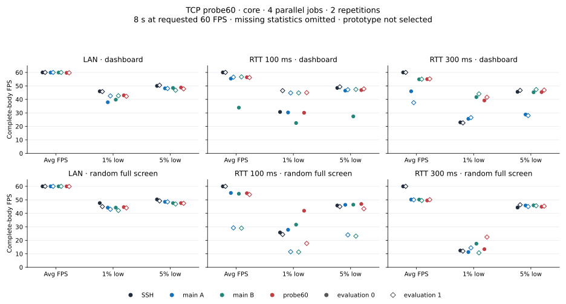
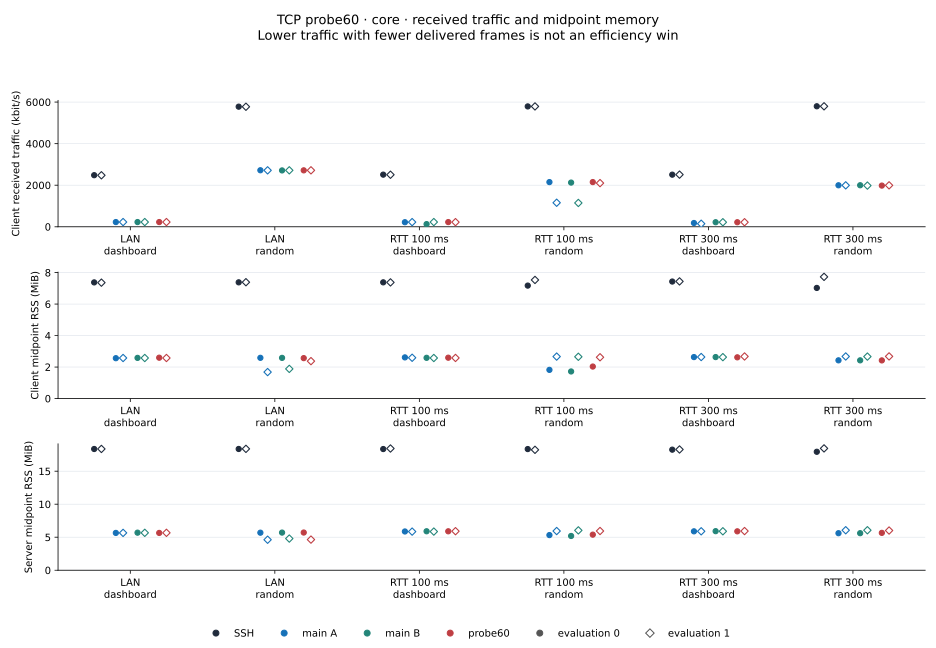
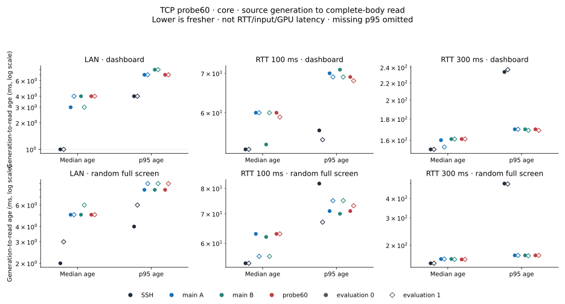
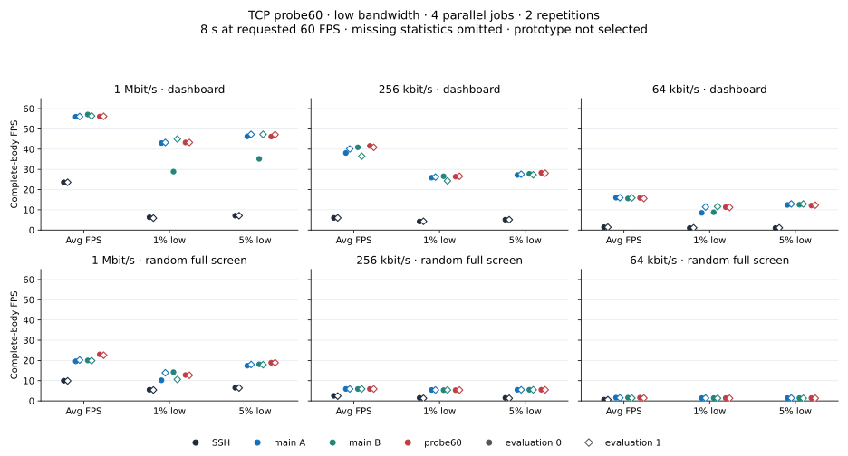
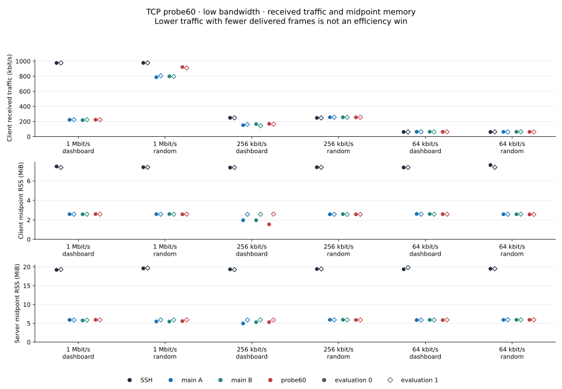
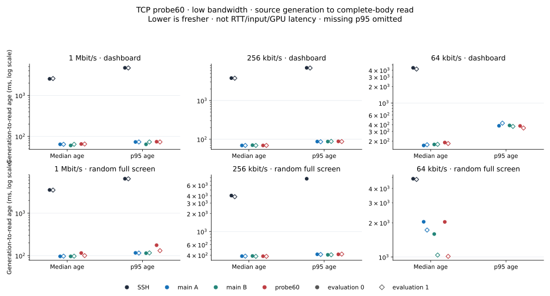

# TCP probe60 investigation · November 1, 2026

The 60% probe threshold recovers some FPS, but the saved repeats retain
1% low deficits and a low-bandwidth age tradeoff. **The candidate remains
unselected and is not applied to product code.** Core and low-bandwidth
screens each retain four simultaneous roles and two evaluations per case;
the source pipelines differ, so their absolute results are not pooled.

## Candidate and functional clue

The [patch](data/probe60-core-20261101/tcp-probe60.patch) changes one production
condition: an existing lossless sender up-probe accepts delivered throughput
at 60% rather than 80% of its selected rate. The existing queue classifier,
floor interval, 1.25 gain, sampling, flight/window and screen policy remain.
Current production lossless opt-in is **server output TCP only**. Client
input keeps its default false/80% behavior; UDP also remains at 80%. Earlier
broader input-TCP prose was corrected without changing source or binaries.

The [paired build](data/probe60-core-20261101/probe60-release-pair.json)
identifies main SHA `9ab79c22…ecb463` / source `6729d398d4f1` and candidate
SHA `40a05263…83166a` / source `7b3c0aa515be`, using the same compiler
container/path/default release profile. Only `src/proto.rs` differs across
the 90 manifest-selected files: that condition and four test fixtures.
[Four targeted tests](data/probe60-core-20261101/tcp-probe60-tests.rs) and the
full library check pass (100 passed, two ignored). The untouched main with
the same fixtures has three passes and the expected 70%-activation failure.
This establishes policy separation, not benefit or safety. Original build,
guard and control-test logs are preserved as deterministic gzip; their
uncompressed hashes are archived.

A separate instrumented functional experiment supplied the motivation:
16 jobs, 24 endpoint traces and 6,671 complete bodies, with performance
eligibility false. One traced transit replica ran at 15.9 body FPS while
its selected capacity later plateaued at 132,603 B/s and repeated classified-no-queue
probe intervals observed approximately 93–95 kB/s. Raw size-rate was absent
throughout that receive window. These observations suggest a probe fixed
point to investigate; they do not prove physical spare capacity, continuous
demand, an exact controller deadline or the cause in uninstrumented main.
The [functional audit](data/probe60-core-20261101/diagnostic22-audit.json) and
[recorded probe/kernel excerpt](data/probe60-core-20261101/diagnostic22-motivation.json)
remain separate from performance acceptance. Old-policy pointwise 60/80%
qualifications are not a replay of the evolving new controller.

The [hypothesis](data/probe60-core-20261101/tcp-probe60-hypothesis.md) also
records the risk: a source/receiver-limited path can false-grow. Under ideal
fixed observed throughput, a post-growth selected rate can reach about
1.25/0.6 = 2.08 times that throughput versus 1.25/0.8 = 1.56 before; this is
not an end-to-end age bound.

## Independent screens

Each screen has **48 jobs / 12 blocks**, parallel four and two evaluations
per network/scene/role. Every block contains SSH, main-A, main-B and probe60.
Main-A/B use the same binary; rsh roles use the same alias, path, port 2222
and configuration. Slots `[SSH,A,B,candidate]` cross to
`[B,candidate,SSH,A]` for evaluation 1. Every repeat remains visible, including
valid zero delivery or missing metrics. No A/A tolerance or automatic pass
is inferred from control variability.

Core uses the unchanged legacy completed-post-write producer/live observer
from study 25. Slow uses the unchanged RAM pre-write/schema2/nonce/pidfd
SIGUSR2 source from study 24 for all roles. Both retain the original five-second
collection deadline, all-four receive fences, strict firewall/qdisc,
before/after file/live-server proof and actual eight-image provenance.
Body character completion and source joins are evaluated offline; live
header FPS does not replace them. There is no startup exclusion or P-core
affinity proof.

Core receive windows span 01:48:23.242–01:53:27.704 and slow windows
01:55:23.023–01:59:12.444 on November 1 KST; investigation folders retain the
October 31 start date. CPU admission is a single interval
with user+system below 30%. Runtime CPU/process load is context, with timing,
sampling and metadata failures still invalidating input. Startup admissions
were 23% core and 27% slow; phase admissions were 17–29% and 23–29%.
Runtime maxima of 52%/51% remain context under that policy. Product CPU/RSS
exclude Python observer/source cost. Immutable preparation/run-stage status
fields precede final analysis; final validity is in each `core-results.json`.

All 48 jobs in each screen are valid. Core retains **21,074 complete bodies**
and slow **7,431**. The compact independent archives retain every complete
frame, body metric, source statistic and original source/capture SHA, plus
source/header audit and CPU/runtime metadata. Retained source records number
23,040 core and 19,781 slow. Slow preserves six pending writes with null ends;
none joins to a received complete body. Original captures and payloads
stay local; portable metric recalculation is supported, independent raw
terminal-character replay requires those original files. Each archive
includes an independent saved-data audit and its explicit limits.

## Core: LAN, RTT 100 and RTT 300 ms

Cells are **average / 1% low / 5% low FPS**. `compress` is the dashboard;
`bandwidth` is incompressible random. No repeat averaging is used.

| Network / scene / evaluation | SSH | Main A | Main B | Probe60 |
|---|---:|---:|---:|---:|
| LAN / dashboard / 0 | 60.0 / 46.0 / 50.0 | 59.9 / 37.9 / 48.2 | 59.9 / 39.8 / 48.5 | 59.7 / 43.0 / 48.8 |
| LAN / dashboard / 1 | 60.0 / 45.8 / 50.5 | 60.0 / 42.6 / 48.1 | 60.0 / 42.7 / 46.8 | 59.7 / 42.3 / 47.8 |
| LAN / random / 0 | 60.0 / 47.6 / 50.3 | 60.0 / 44.2 / 48.5 | 60.0 / 44.2 / 47.6 | 60.0 / 44.6 / 47.6 |
| LAN / random / 1 | 60.0 / 45.0 / 49.2 | 60.0 / 43.0 / 48.5 | 60.0 / 42.1 / 46.9 | 59.9 / 44.0 / 47.4 |
| RTT 100 / dashboard / 0 | 60.0 / 30.7 / 48.5 | 55.4 / 30.3 / 46.5 | 33.9 / 22.5 / 27.4 | 56.4 / 30.1 / 46.9 |
| RTT 100 / dashboard / 1 | 60.0 / 46.5 / 49.3 | 56.5 / 44.8 / 47.2 | 56.7 / 44.8 / 47.4 | 56.2 / 45.0 / 47.8 |
| RTT 100 / random / 0 | 60.0 / 25.8 / 45.8 | 55.1 / 27.8 / 46.3 | 54.5 / 31.6 / 46.4 | 54.9 / 41.9 / 46.9 |
| RTT 100 / random / 1 | 60.0 / 24.3 / 45.0 | 29.2 / 11.5 / 24.0 | 29.0 / 11.3 / 23.1 | 53.9 / 17.7 / 43.4 |
| RTT 300 / dashboard / 0 | 60.0 / 23.0 / 45.6 | 46.0 / 25.6 / 28.8 | 54.9 / 41.7 / 45.3 | 55.0 / 39.2 / 45.4 |
| RTT 300 / dashboard / 1 | 60.0 / 22.6 / 46.7 | 37.6 / 26.5 / 28.0 | 55.0 / 44.1 / 47.3 | 55.2 / 41.6 / 46.9 |
| RTT 300 / random / 0 | 60.0 / 12.4 / 44.3 | 50.2 / 11.3 / 45.8 | 50.2 / 17.5 / 45.9 | 49.5 / 13.4 / 44.9 |
| RTT 300 / random / 1 | 60.0 / 12.0 / 46.3 | 50.0 / 14.4 / 45.0 | 49.5 / 10.7 / 45.6 | 50.1 / 22.4 / 45.3 |

WAN/random evaluation 1 is encouraging: probe60 reaches 53.9 FPS while
main-A/B reach 29.2/29.0. Its 1% low is 17.7, still below SSH's 24.3;
SSH average is 60. In evaluation 0 probe60's 54.9 average lies between
main-A/B's 55.1/54.5. RTT 300/random retains average FPS around 50 versus
SSH 60, even when one low statistic improves. Main-A/B variability elsewhere
and two evaluations preclude assigning every difference to the threshold.

## Slow: 1 Mbit/s, 256 kbit/s and 64 kbit/s

All profiles have nominal RTT 100 ms and no configured loss. The same cell
format and separate evaluations apply; a dash is a missing statistic.

| Network / scene / evaluation | SSH | Main A | Main B | Probe60 |
|---|---:|---:|---:|---:|
| 1 Mbit/s / dashboard / 0 | 23.6 / 6.3 / 7.1 | 56.0 / 43.0 / 46.3 | 57.1 / 28.9 / 35.2 | 56.1 / 43.3 / 46.2 |
| 1 Mbit/s / dashboard / 1 | 23.6 / 5.9 / 7.1 | 56.1 / 43.3 / 47.3 | 56.4 / 45.0 / 47.3 | 56.2 / 43.3 / 47.2 |
| 1 Mbit/s / random / 0 | 10.0 / 5.5 / 6.5 | 19.6 / 10.2 / 17.4 | 20.0 / 14.2 / 18.1 | 23.0 / 12.8 / 18.9 |
| 1 Mbit/s / random / 1 | 9.9 / 5.4 / 6.4 | 20.2 / 13.9 / 18.0 | 19.9 / 10.6 / 17.9 | 22.6 / 12.7 / 18.9 |
| 256 kbit/s / dashboard / 0 | 6.0 / 4.2 / 5.1 | 38.1 / 25.9 / 27.2 | 40.9 / 26.6 / 27.8 | 41.6 / 26.4 / 28.3 |
| 256 kbit/s / dashboard / 1 | 6.0 / 4.3 / 5.1 | 40.1 / 26.2 / 27.6 | 36.5 / 24.3 / 27.3 | 40.9 / 26.6 / 28.1 |
| 256 kbit/s / random / 0 | 2.5 / 1.5 / 1.5 | 5.9 / 5.4 / 5.5 | 5.9 / 5.3 / 5.5 | 5.9 / 5.3 / 5.5 |
| 256 kbit/s / random / 1 | 2.4 / 1.3 / 1.3 | 5.9 / 5.4 / 5.5 | 5.9 / 5.4 / 5.5 | 5.9 / 5.4 / 5.5 |
| 64 kbit/s / dashboard / 0 | 1.4 / 1.0 / 1.0 | 16.0 / 8.5 / 12.4 | 15.6 / 8.8 / 12.5 | 15.9 / 11.3 / 12.1 |
| 64 kbit/s / dashboard / 1 | 1.4 / 1.1 / 1.1 | 16.0 / 11.4 / 12.9 | 15.9 / 11.6 / 12.9 | 15.6 / 11.2 / 12.3 |
| 64 kbit/s / random / 0 | 0.6 / — / — | 1.6 / 1.4 / 1.4 | 1.6 / 1.4 / 1.4 | 1.6 / 1.4 / 1.4 |
| 64 kbit/s / random / 1 | 0.6 / — / — | 1.5 / 1.4 / 1.4 | 1.4 / 1.3 / 1.3 | 1.4 / 1.3 / 1.3 |

At 1 Mbit/s/random, probe60 averages **23.0 / 22.6 FPS** in evaluations 0/1,
versus main-A/B **19.6–20.2**. Body p95 age is **176 / 131 ms**, versus
main controls **114–116 ms**. The corresponding median ages are 115/100 ms
versus main 96–97 ms. Its 1% lows, 12.8/12.7, lie between the two controls
in both evaluations. Higher delivered FPS therefore accompanies older
received frames here; it is not an unqualified improvement.

At 256 kbit/s/random all rsh averages remain 5.9 FPS. At 64 kbit/s/dashboard
evaluation 1, candidate 15.6 FPS and 11.2/12.3 lows are below both main
controls. Candidate p95 age is lower there (347 versus 426/371 ms), another
mixed outcome. The slow64k/random SSH jobs deliver only five frames each,
so 1%/5% lows remain null. Age p95 needs at least 20 observations and is
also omitted where insufficient; absent values are not zero or a win.

## Reading the data

Network is client RX decimal kbit/s; lower traffic with fewer received frames
is not an efficiency gain. RSS is the named product-process midpoint KiB
(charts use MiB), not peak/session-total memory. CPU is percent of one core
for those product processes. Age is generation-to-complete-read, not RTT,
input latency, controller dispatch time or GPU presentation. Age is conditional
on completed frames; it does not measure held-screen age between completions.
Resource checks establish saved batch → summary → CSV consistency and units;
the agent did not retain underlying counter endpoints for independent
counter arithmetic remeasurement. Body metrics are recalculated from frames.
The legacy
source ledger records completed writes and cannot prove absence of unrecorded
pending writes. The RAM source preserves pending attempts with null write
ends; those source records are distinct from received complete bodies.

The [core archive](data/probe60-core-20261101/README.md),
[core independent audit](data/probe60-core-20261101/saved-data-audit.json),
[slow archive](data/probe60-slow-20261101/README.md) and
[slow independent audit](data/probe60-slow-20261101/saved-data-audit.json) include the exact per-run
CSV, complete-frame JSON, source/build/control evidence, portable plotting
and metric verifiers, runtime provenance and manifests. Evaluations are
never pooled. Source instrumentation can change timing, and functional
study 22 is not a controlled performance comparison with these runs.

The saved evidence supports investigating the probe mechanism, but does not
establish all-area SSH parity or regression-free improvement. Probe60 stays
unselected. Moving/fast-to-slow recovery, loss, UDP, input/bulk/session and
broader resource checks are still required before promotion. Earlier
published benchmark tables and product code remain unchanged.
