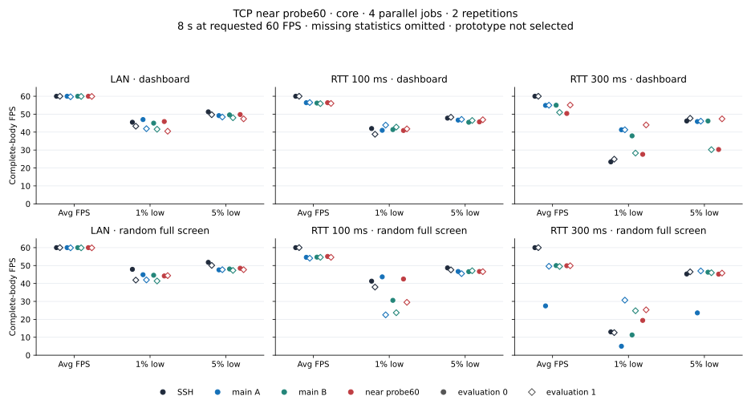
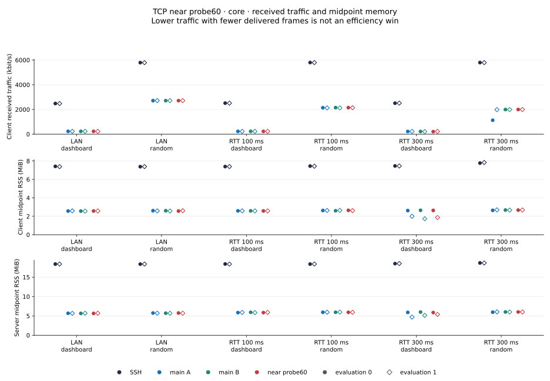
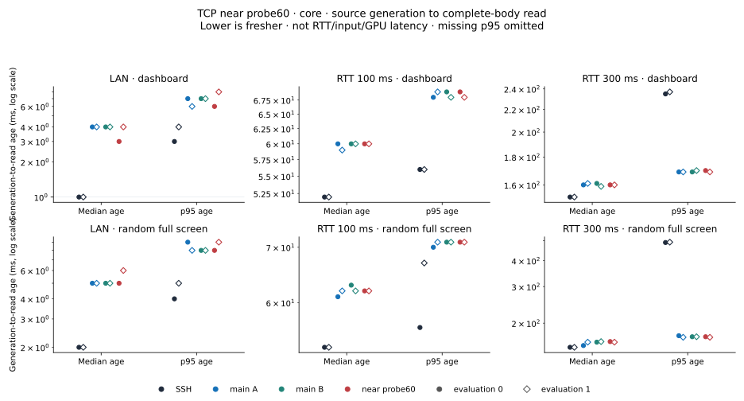
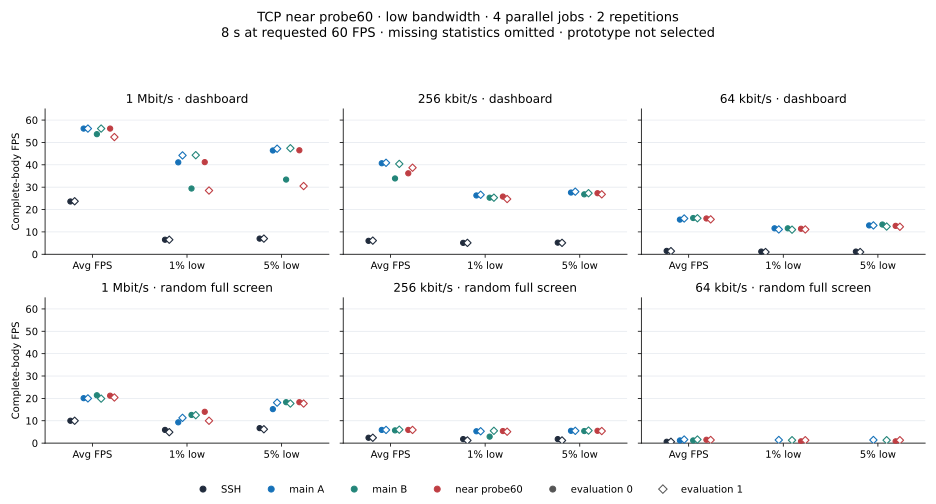
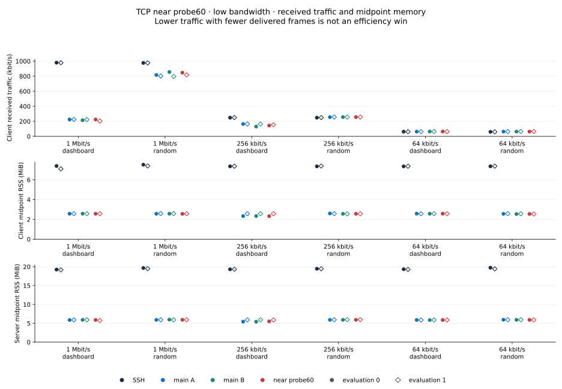
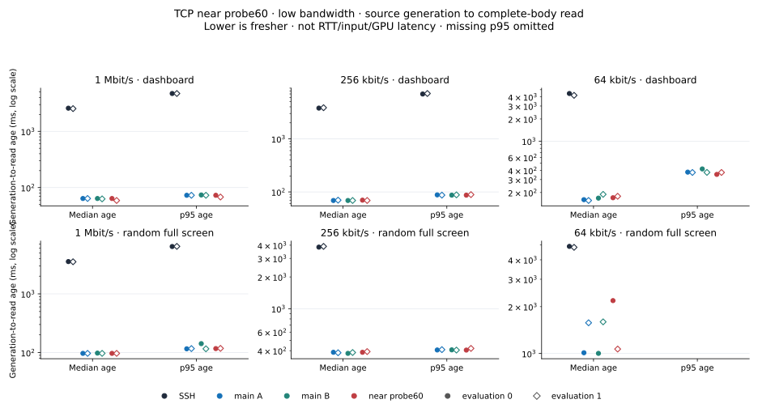

# Near-floor probe60 investigation · November 1, 2026

The restricted probe candidate has mixed FPS outcomes, including retained
dashboard average/low deficits. The primary evaluation uses **1% low,
5% low and average FPS**; CPU/RSS are secondary. Age and fresh recovery remain
separate freshness costs, without invented numeric weights.
**It is currently unselected; product code is unchanged.** This is its current
promotion status, not a final rejection. Individual metric losses can be
acceptable if overall performance improves; no single deficit or invented
weighted score decides that assessment. Core and slow screens
are independent four-worker, two-evaluation experiments. They are not pooled
with each other or with the earlier broad-60% studies.

## Source and scope

The candidate keeps the original 80% up-probe eligibility. Extra 60%
exploration requires the server-output lossless/TCP sender's current fully
acknowledged packets to fit `floor_rtt + wire / selected_rate`. Every packet
popped by that ACK must satisfy this bound. Client input and UDP retain 80%.
There is no new Sender field/API or earlier sampling/queue-classifier change.

This is a **current-ACK timing witness**, not interval-wide demand or physical
spare capacity. It does not test remaining current flight or establish an
empty kernel/network queue. An inaccurate selected rate or inflated floor
can admit extra delay. Existing 80% growth remains possible when the new
witness fails. These uninstrumented performance runs do not record each
actual witness activation, so body improvements do not prove its mechanism.

The [near patch](data/probe60-near-core-20261101/tcp-probe60-near.patch) is
relative to the [broad probe60 patch](data/probe60-near-core-20261101/tcp-probe60.patch);
both are included. The [paired build](data/probe60-near-core-20261101/probe60-near-release-pair.json)
identifies unchanged main SHA `9ab79c22…ecb463` / source `6729d398d4f1` and
near SHA `ad375f1c…f61ad8` / source `b6f26c518f1f`, with the same compiler
container/path/profile and verified embedded identities. Seven targeted
tests and the full library check pass (103 passed, two ignored). The broad
60% control with the same seven fixtures has six passes and the expected
late-packet rejection failure. This verifies the added condition, not benefit
or safety. Both fixture sources and original build/guard/control logs are
archived; deterministic gzip preserves log bytes.

## Method and evidence

Each screen has **48 jobs / 12 blocks**, four simultaneous roles
SSH/main-A/main-B/near and two evaluations per network/scene/role. Main-A/B
are byte-identical. Slots `[SSH,A,B,near]` cross to `[B,near,SSH,A]` for
evaluation 1. Rsh alias/path/port2222/configuration remain equal. Core
inherits study27's legacy completed-write source/live observer; slow inherits
study28's RAM pre-write/schema2/nonce/pidfd SIGUSR2 source. Original five-second
collection, all-four closures, body/header/clock checks, strict firewall/qdisc,
file/live-server proof and eight-image provenance are unchanged.

Core receive windows are **02:22:03.927–02:25:09.996 KST** and slow
**02:28:40.188–02:31:54.222 KST** on November 1. The study folder retains its
October 31 start date. CPU admission is one sampled user+system interval
below30%; runtime load is context while timing/metadata errors reject.
Startup admissions were27%/22%, phase admissions14–24%/11–27%, and runtime
maxima38%/43%. Four workers do not establish P-core affinity or isolation.

All48 jobs per screen pass saved-data checks. Core has **21,617 complete
bodies /23,040 retained source records**; slow has **7,302 /19,780**, including
seven pending writes with null ends and zero pending-body joins. Core's
schema1 records completed writes only: unrecorded pending attempts are unknown.
The independent audits recompute body FPS/lows/age/max gap and read source
headers/clocks/bytes. Resource checks establish saved batch→summary→CSV
consistency and units; underlying counter endpoints were not retained for
independent counter arithmetic remeasurement.

A disclosed host operation read/parsed roughly13 MB of derived audit JSON
during the run/analysis blackout. Its exact start/end, duration and CPU/RSS
effect were not measured; the sidecar's creation timestamp is not the
operation time. The [host-context record](data/probe60-near-core-20261101/host-context-derived-read.json)
is preserved. It neither automatically rejects these observations under the
runtime-context policy nor establishes that the operation had no effect.

## Core: LAN, RTT 100 and RTT 300 ms

Cells are **average /1% low /5% low FPS**. Dashboard is `compress`, random is
incompressible `bandwidth`. Evaluations are kept separate.

| Network /scene /evaluation | SSH | Main A | Main B | Near |
|---|---:|---:|---:|---:|
| LAN / dashboard / 0 | 60.0 / 45.5 / 51.3 | 60.0 / 47.0 / 49.2 | 60.0 / 45.0 / 49.6 | 60.0 / 45.9 / 49.8 |
| LAN / dashboard / 1 | 60.0 / 43.3 / 49.7 | 59.7 / 41.9 / 48.4 | 59.9 / 41.6 / 48.0 | 59.9 / 40.5 / 47.4 |
| LAN / random / 0 | 60.0 / 47.9 / 51.8 | 60.0 / 44.9 / 47.6 | 60.0 / 44.6 / 48.1 | 60.0 / 44.2 / 48.5 |
| LAN / random / 1 | 60.0 / 41.9 / 50.1 | 59.9 / 42.0 / 47.7 | 59.9 / 41.4 / 47.3 | 59.9 / 44.4 / 47.7 |
| RTT100 / dashboard / 0 | 60.0 / 42.0 / 47.8 | 56.4 / 41.0 / 46.7 | 56.2 / 41.4 / 45.5 | 56.4 / 40.9 / 45.7 |
| RTT100 / dashboard / 1 | 60.0 / 38.8 / 48.3 | 56.5 / 43.9 / 47.1 | 55.9 / 42.8 / 46.5 | 56.0 / 41.8 / 46.9 |
| RTT100 / random / 0 | 60.0 / 41.3 / 48.7 | 54.6 / 43.7 / 46.7 | 54.7 / 30.6 / 46.6 | 55.1 / 42.5 / 46.7 |
| RTT100 / random / 1 | 60.0 / 38.0 / 47.6 | 54.1 / 22.5 / 45.5 | 54.6 / 23.7 / 47.1 | 54.6 / 29.5 / 46.6 |
| RTT300 / dashboard / 0 | 60.0 / 23.4 / 46.2 | 54.9 / 41.3 / 45.9 | 55.0 / 37.9 / 46.2 | 50.4 / 27.6 / 30.3 |
| RTT300 / dashboard / 1 | 60.0 / 24.9 / 47.7 | 55.0 / 41.3 / 46.1 | 51.0 / 28.3 / 30.2 | 55.1 / 44.0 / 47.4 |
| RTT300 / random / 0 | 60.0 / 13.0 / 45.3 | 27.5 / 5.0 / 23.6 | 50.0 / 11.3 / 46.3 | 49.9 / 19.4 / 45.2 |
| RTT300 / random / 1 | 60.0 / 12.6 / 46.5 | 49.6 / 30.7 / 47.0 | 49.5 / 24.8 / 46.0 | 49.9 / 25.3 / 45.8 |

The adverse RTT300/dashboard evaluation0 is retained: near **50.4/27.6/30.3**
versus main-A **54.9/41.3/45.9** and main-B **55.0/37.9/46.2**. Evaluation1
instead reaches55.1/44.0/47.4. Neither averaging nor choosing the better repeat
would represent this variability. RTT100/random evaluation1 near54.6 average
matches the stronger main, but its29.5 1% low remains below SSH38.0. RTT300
random averages remain around50 versus SSH60.

## Slow: 1 Mbit/s, 256 kbit/s and 64 kbit/s

Profiles have nominal RTT100ms/no configured loss. Dashes remain missing
statistics, not zero or wins.

| Network /scene /evaluation | SSH | Main A | Main B | Near |
|---|---:|---:|---:|---:|
| 1Mbit/s / dashboard / 0 | 23.6 / 6.5 / 7.0 | 56.2 / 41.1 / 46.4 | 53.7 / 29.4 / 33.4 | 56.2 / 41.2 / 46.5 |
| 1Mbit/s / dashboard / 1 | 23.7 / 6.5 / 7.0 | 56.2 / 44.2 / 47.2 | 56.2 / 44.3 / 47.4 | 52.4 / 28.5 / 30.5 |
| 1Mbit/s / random / 0 | 10.0 / 5.9 / 6.7 | 20.1 / 9.3 / 15.2 | 21.4 / 12.6 / 18.3 | 21.2 / 14.0 / 18.3 |
| 1Mbit/s / random / 1 | 10.0 / 4.9 / 6.2 | 20.0 / 11.3 / 18.1 | 19.9 / 12.5 / 17.7 | 20.4 / 10.0 / 17.7 |
| 256kbit/s / dashboard / 0 | 6.0 / 5.1 / 5.2 | 40.7 / 26.3 / 27.6 | 33.9 / 25.3 / 26.8 | 36.2 / 25.8 / 27.3 |
| 256kbit/s / dashboard / 1 | 6.1 / 5.1 / 5.1 | 40.9 / 26.6 / 28.0 | 40.4 / 25.3 / 27.3 | 38.7 / 24.7 / 26.8 |
| 256kbit/s / random / 0 | 2.4 / 1.8 / 1.8 | 5.9 / 5.3 / 5.5 | 5.7 / 2.9 / 5.4 | 5.9 / 5.4 / 5.5 |
| 256kbit/s / random / 1 | 2.4 / 1.2 / 1.2 | 5.9 / 5.3 / 5.5 | 6.0 / 5.5 / 5.6 | 5.9 / 5.1 / 5.4 |
| 64kbit/s / dashboard / 0 | 1.5 / 1.2 / 1.2 | 15.5 / 11.6 / 12.9 | 16.2 / 11.6 / 13.3 | 16.0 / 11.4 / 12.7 |
| 64kbit/s / dashboard / 1 | 1.4 / 1.0 / 1.0 | 16.0 / 11.1 / 12.9 | 16.1 / 11.0 / 12.4 | 15.6 / 11.1 / 12.3 |
| 64kbit/s / random / 0 | 0.6 / — / — | 1.2 / — / — | 1.2 / — / — | 1.5 / 0.8 / 0.8 |
| 64kbit/s / random / 1 | 0.6 / — / — | 1.6 / 1.4 / 1.4 | 1.6 / 1.3 / 1.3 | 1.4 / 1.3 / 1.3 |

At1M/random, near averages **21.2/20.4 FPS**, with p95 body age **117/118 ms**
versus main **116–142 ms** in these runs. Its1% lows are14.0/10.0: stronger
than both controls in evaluation0, below both in evaluation1. The earlier
[broad60% screen](probe60-20261101.md) recorded candidate23.0/22.6 FPS and
p95 age176/131 ms. This is a descriptive comparison across separate runs;
it does not isolate a causal age fix or authorize promotion.

The1M/dashboard evaluation1 is adverse: near **52.4/28.5/30.5** versus both
main controls56.2 average, about44 1% low and47 5% low. At256k/dashboard
evaluation1, near38.7/24.7/26.8 also trails both controls. Slow64k/random
retains sparse observations: SSH has five bodies in both evaluations and
main-A/B evaluation0 have ten each (nine gaps). These four jobs' eight low
values stay null. Age p95 also remains absent below20 body observations.

## Archive and interpretation

The [core archive](data/probe60-near-core-20261101/README.md) and
[slow archive](data/probe60-near-slow-20261101/README.md) retain all per-run
FPS/lows/age/RX/RSS/CPU, complete-frame observations and96 original raw
source/capture hashes each. [Core](data/probe60-near-core-20261101/saved-data-audit.json)
and [slow](data/probe60-near-slow-20261101/saved-data-audit.json) independent
audit records, original source/build/control evidence, portable metric
verifiers/plots and manifests are included. Raw payloads/captures stay local;
this compact package supports recalculation, not independent raw-body replay.
Earlier build/preparation/pending status fields preserve those original
stages; final data validity is in each `core-results.json`.

RX is whole client non-loopback decimal kbit/s, not bidirectional payload
goodput. RSS is a midpoint product process-name sum in KiB (charts MiB), not
peak/session memory. CPU is percent of one core, excluding source/observer
Python. Age is conditional on completed bodies, not held-screen age, input
latency, RTT, exact controller dispatch or GPU presentation. Age charts use
labeled log axes. Lower traffic with fewer delivered frames is not an
efficiency improvement; missing observations are preserved.

Control variability, host context and separate source pipelines limit causal
interpretation. No automatic A/A tolerance or empty-queue/demand proof
follows. The retained gains and costs inform an overall assessment that can
accept individual regressions; the candidate is currently unselected while
that FPS-first assessment continues. CPU/RSS are supporting evidence; age
and freshly generated recovery remain visible rather than treating stale
frames as equivalent. Moving/loss/UDP/input/bulk/session, recovery and
resource evidence will inform the decision. Existing published benchmark
tables and product code remain unchanged.
