# TCP quarter + cadence margin 결합 검증 · 2026-11-01

결합 60은 295f A/A보다 RTT300 dashboard와 1M random의 avg/일부 low를 높였지만, WAN random의 1% low 비용이 남았다. 별도 slot 교차 진단에서도 후보 1% low29.8/29.5는 odd/even 양쪽에서 낮았다. 전 영역 SSH 동등·이상, 회귀 부재, 두 정책의 가산성 또는 최종 승격을 입증한 결과가 아니다. FPS1%/5% low·avg를 주로 평가하고 CPU/RSS는 보조로 제시하며, 개별 손해에 자동 veto나 임의 가중치를 적용하지 않는다.

네 cohort를 분리했다. Core61·slow62의 96개는 성능 관측 eligible, moving63의 16개는 수동 fidelity를 승인하지 않은 descriptive 자료, parity64의 8개는 사전 고정한 별도 진단이다. 모든 반복과 A/A·SSH, 불리한 셀·NULL·부분본문을 보존하며 cohort 간 FPS를 pool하지 않는다. 전체 120개를 하나의 성능 평균으로 묶지 않는다.

|Cohort|관측/blocks|Body/header|Source records|Pending write/join|Eligibility|수신 창 KST|
|---|---|---|---|---|---|---|
|core|48/12|22195/22215|23040|0/0|True|2026-11-01T08:52:00.301+09:00 – 2026-11-01T08:55:12.692+09:00|
|slow|48/12|8665/8684|19742|6/0|True|2026-11-01T08:57:17.897+09:00 – 2026-11-01T09:00:31.263+09:00|
|moving|16/4|12340/12393|26684|1/0|False|2026-11-01T09:03:18.810+09:00 – 2026-11-01T09:06:05.393+09:00|
|parity|8/2|3642/3646|3840|0/0|True|2026-11-01T09:07:31.216+09:00 – 2026-11-01T09:07:55.164+09:00|

모든 관측은 4병렬×2평가,60Hz/100×30이다. Static은 도구별 기존 first-header anchor의 8초 창, moving은 공통 futureT0의 30초 창이다. Source RAM schema2/pidfd SIGUSR2·all-four closure·원래 5초 수집·pre-exec geometry·strict TCP firewall·artifact/PID guards를 유지했다. CPU admission은 user+system<30%의 첫 interval 한 번이고 runtime CPU는 문맥이다. 물리 P-core pinning 증거는 아니다. [Core archive](data/quarter-margin-core-20261101/README.md), [slow archive](data/quarter-margin-slow-20261101/README.md), [moving archive](data/quarter-margin-moving-20261101/README.md), [별도 parity archive](data/quarter-margin-parity-20261101/README.md).

## 소스와 검증 범위

Candidate는`fa934e198646`/Linux SHA`4b5273bcb4340cfc634214c7495e6df943e6f3dfb161ce2efbbe9c09684c6c2d`, A/A는 기존 COMBINED`295f81d54ea4`/`fb04386fdfe25f25f1bfd0354f11ba7a01c954525a11634ae35caafd46c2eec4`다. main-A/B라는 내부 label은 actual main4f98을 뜻하지 않는다. Baseline은 기존 exact binary를 재사용했고 후보를 따로 빌드했으므로 둘의 새 same-container paired build라고 주장하지 않는다.

Source는 known-slow TCP fresh wait을`min(FRESH_WAIT,gap/4)`로 제한하는 55와, no-slow/low-queue/animating TCP의 raw output period×0.9를 기존 8..20ms로 clamp하는 48을 합쳤다. 새 state/API/options/dependency는 없다. PR8의 source layout은 PR7/48 위의 작은 diff이지만, 이 실험은 295f 대비 두 정책 결합 효과이며 quarter increment versus48 실험이 아니다. 두 분기는 한 호출에서 배타적이어도 startup/추정 feedback가 후속 분기를 바꿀 수 있다. Untraced 자료이므로 활성화와 인과·가산성을 단정하지 않는다. [두 정책/fixture patch](data/quarter-margin-core-20261101/controller.patch), [역변환 proof](data/quarter-margin-core-20261101/60-tcp-quarter-margin-proof.json), [독립 source 리뷰](data/quarter-margin-core-20261101/quartermargin60-source-review.md).

Margin3 fixture는 exact48 그대로, quarter3 중 unknown-rate assertion1개만 의도된 margin 분기의 0.9×gap/clamp로 교정했다. 이를 원문으로 되돌리는 명시적 역변환으로 parent55 full32 exact, quarter 제거로 48 exact, 두 정책/fixture 제거로 295f exact를 확인했다. Linux116 library+4 CLI+25 session+1 concurrency=146pass/2ignored, Mac native116+4+25=145pass/2ignored다. Linux-only concurrency는 Mac에서 0tests였다. Exact48+동일 adaptedquarter control은 2pass/1expected fail이며 기존 margin3도 통과했다. [Paired provenance](data/quarter-margin-core-20261101/paired-build-provenance.json), [Mac 결과](data/quarter-margin-core-20261101/macos60-build-result.json), [Mac guard](data/quarter-margin-core-20261101/macos60-guards.log.gz). Toolchain 관측 로그는 실제 test/guard와 별도로 보존했다.

Compact archive는 complete-frame 시각·N/T/scene·source metadata/수집 proof와 raw hash, 실제 test logs/소스 manifests·patch를 포함한다. Full raw capture/source payload/product source tree 및 GPU 증거는 제외했다. Publisher는 원본 payload를 재파싱하지 않고 독립 감사와 저장 summary를 가져왔다. Portable verifier는 산술·저장 proof/hash 일치를 검사하며, raw body oracle 재생이 아니다. 전체 raw 검사는 원래 머신의 로컬 자료를 요구한다. 독립 감사의 endpoint/PID/source검사와 자원 검증도 구분한다: RX/CPU counter endpoints와 RSS samples가 별도 저장되지 않아 자원은 raw job→summary→CSV 동일성·단위/공식 검토 범위다.

## Core61 ·48개

RTT300 dashboard 후보 44.0/48.7/58.9 및 42.5/47.7/59.0은 두 A/A의 FPS 세 지표보다 높다. WAN random avg58.5/58.3과 5% low47.3/47.9도 높지만 1% low29.7/31.6은 B40.2/41.6보다 낮다. RTT300 random 반복 0의 5% low43.5는 A44.8/B45.4/SSH44.5보다 낮고 반복 1의 1% low11.5는 A14.0/B15.0/SSH12.4보다 낮다. LAN 반복 1의 양 low와 WAN dashboard 반복 1의 5% low 비용도 남겼다.

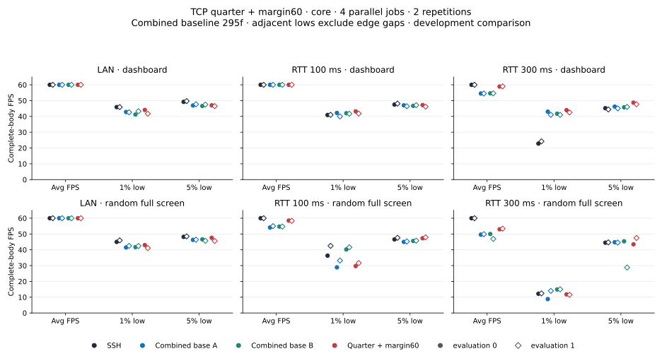

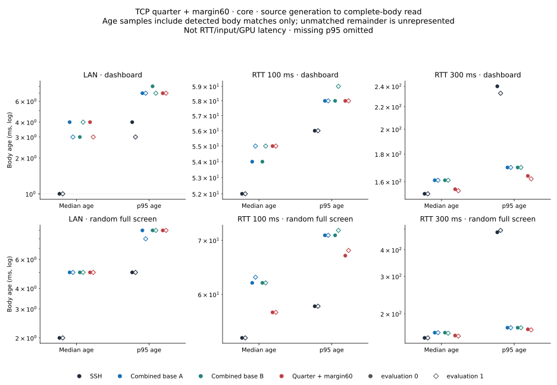

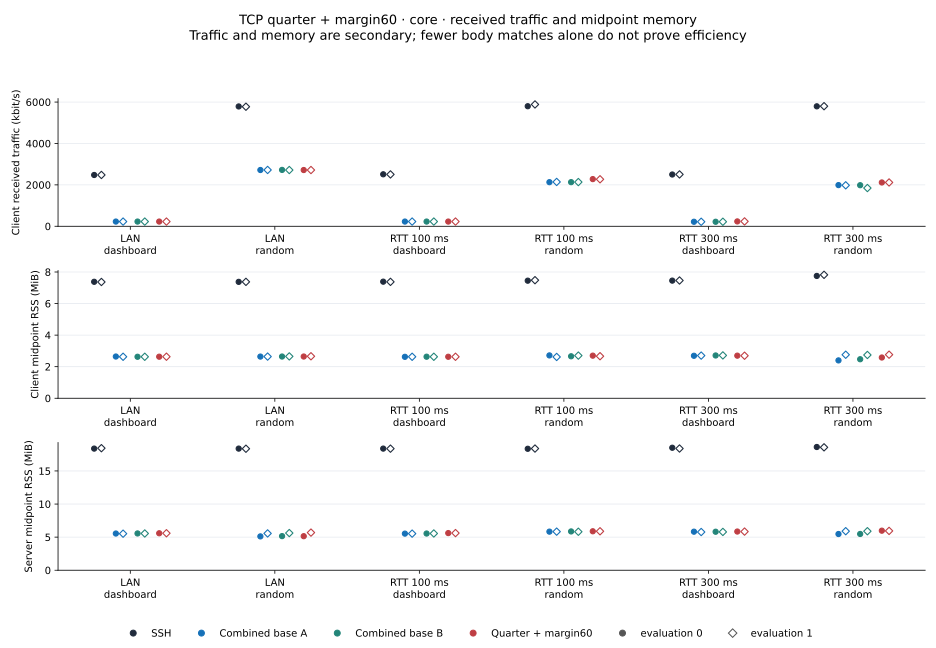

각 셀은 **1% low / 5% low / avg FPS**다.

|Case|SSH|combined-A|combined-B|결합 60|
|---|---|---|---|---|
|00-lan-compress-i0|45.9 / 49.2 / 60.0|42.8 / 46.9 / 60.0|41.2 / 46.6 / 60.0|44.1 / 47.0 / 60.0|
|01-lan-compress-i1|45.9 / 49.7 / 60.0|42.6 / 47.7 / 60.0|43.3 / 47.5 / 60.0|41.7 / 46.5 / 60.0|
|02-lan-bandwidth-i0|45.0 / 48.2 / 60.0|41.5 / 46.3 / 60.0|41.7 / 46.6 / 60.0|43.0 / 47.6 / 60.0|
|03-lan-bandwidth-i1|46.0 / 48.5 / 60.0|42.5 / 46.4 / 60.0|42.4 / 45.7 / 60.0|41.1 / 45.6 / 60.0|
|04-wan-compress-i0|40.9 / 47.5 / 60.0|42.2 / 47.0 / 60.0|42.0 / 46.7 / 60.0|43.2 / 47.2 / 60.0|
|05-wan-compress-i1|41.0 / 48.1 / 60.0|40.0 / 46.4 / 60.0|41.7 / 47.1 / 60.0|41.8 / 46.2 / 60.0|
|06-wan-bandwidth-i0|36.3 / 46.6 / 60.0|28.9 / 45.0 / 54.1|40.2 / 45.6 / 54.7|29.7 / 47.3 / 58.5|
|07-wan-bandwidth-i1|42.5 / 47.6 / 60.0|33.2 / 45.3 / 55.0|41.6 / 45.8 / 54.7|31.6 / 47.9 / 58.3|
|08-highlat-compress-i0|22.8 / 45.2 / 60.0|43.0 / 46.2 / 54.5|41.7 / 45.8 / 54.6|44.0 / 48.7 / 58.9|
|09-highlat-compress-i1|24.2 / 44.4 / 60.0|41.0 / 45.1 / 54.5|41.0 / 46.0 / 54.6|42.5 / 47.7 / 59.0|
|10-highlat-bandwidth-i0|12.2 / 44.5 / 60.0|8.8 / 44.8 / 49.6|14.9 / 45.4 / 50.0|11.8 / 43.5 / 53.0|
|11-highlat-bandwidth-i1|12.4 / 44.7 / 60.0|14.0 / 44.6 / 49.9|15.0 / 28.8 / 46.9|11.5 / 47.5 / 53.4|

전체 network/RSS/CPU 각행은 [core CSV](data/quarter-margin-core-20261101/core-metrics.csv)에 있다. RTT300 random 후보는 body424/header429,427/430이며 online/header를 body FPS로 대체하지 않았다. 모든 source23040/body22195 joins를 별도 감사했다. [독립 감사](data/quarter-margin-core-20261101/saved-data-audit.md).

## Slow62 ·48개

1M dashboard 양 low가 A/A보다 높고 avg60이다.1M random avg24.2/23.6 및 5% low19.6/19.0도 A/A보다 높지만 반복 1의 1% low11.1은 B14.5보다 낮다. Age95는 178/182ms 대 A117/173·B172/170ms로 비용이 있다.64k dashboard avg16.0/15.9와 5% low13.1/13.0은 높지만 1% low와 age438/374ms는 혼합/불리하다.256k dashboard 반복 0의 5% low46.5도 A46.6/B47.3보다 낮다. Sparse SSH의 누락 low3jobs와 age95누락 11jobs는 NULL이며 0으로 그리지 않았다.

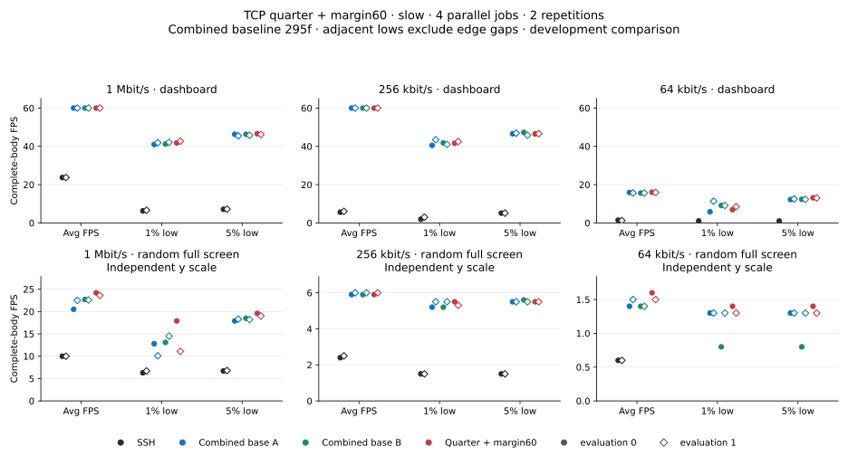

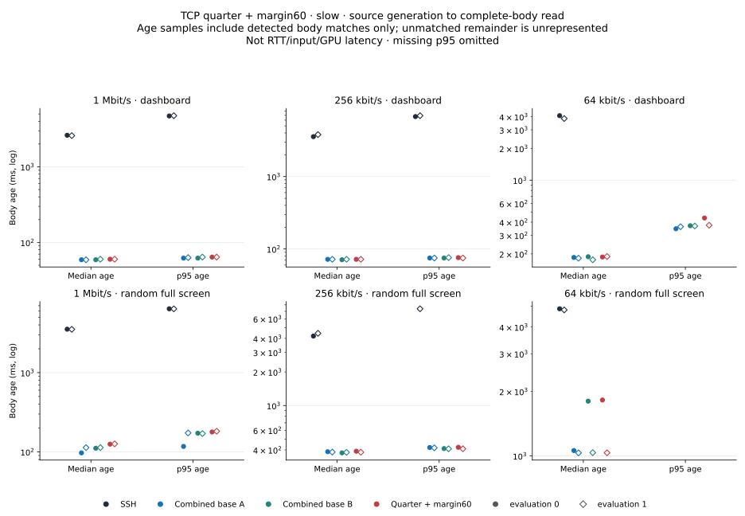

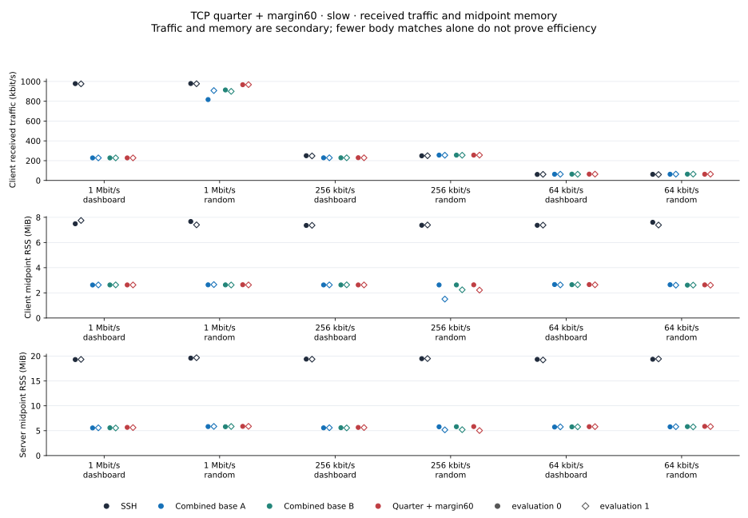

각 셀은 **1% low / 5% low / avg FPS**다.

|Case|SSH|combined-A|combined-B|결합 60|
|---|---|---|---|---|
|00-lowbw-compress-i0|6.3 / 7.1 / 23.7|41.0 / 46.3 / 60.0|41.2 / 46.3 / 60.0|41.8 / 46.6 / 60.0|
|01-lowbw-compress-i1|6.6 / 7.2 / 23.7|41.9 / 45.5 / 60.0|42.1 / 45.8 / 60.0|42.7 / 46.2 / 60.0|
|02-lowbw-bandwidth-i0|6.3 / 6.7 / 10.0|12.8 / 17.9 / 20.5|13.1 / 18.5 / 22.7|17.9 / 19.6 / 24.2|
|03-lowbw-bandwidth-i1|6.7 / 6.8 / 10.0|10.1 / 18.3 / 22.5|14.5 / 18.2 / 22.6|11.1 / 19.0 / 23.6|
|04-verylow-compress-i0|1.9 / 5.1 / 5.6|40.5 / 46.6 / 60.0|41.8 / 47.3 / 60.0|41.6 / 46.5 / 60.0|
|05-verylow-compress-i1|3.0 / 5.1 / 6.0|43.5 / 46.9 / 60.0|41.0 / 45.8 / 60.0|42.5 / 46.6 / 60.0|
|06-verylow-bandwidth-i0|1.5 / 1.5 / 2.4|5.2 / 5.5 / 5.9|5.2 / 5.6 / 5.9|5.5 / 5.5 / 5.9|
|07-verylow-bandwidth-i1|1.5 / 1.5 / 2.5|5.5 / 5.5 / 6.0|5.5 / 5.5 / 6.0|5.3 / 5.5 / 6.0|
|08-slow64k-compress-i0|1.0 / 1.0 / 1.4|5.8 / 12.2 / 15.9|9.1 / 12.3 / 15.6|6.9 / 13.1 / 16.0|
|09-slow64k-compress-i1|NULL / NULL / 1.2|11.3 / 12.5 / 15.6|9.1 / 12.3 / 15.6|8.5 / 13.0 / 15.9|
|10-slow64k-bandwidth-i0|NULL / NULL / 0.6|1.3 / 1.3 / 1.4|0.8 / 0.8 / 1.4|1.4 / 1.4 / 1.6|
|11-slow64k-bandwidth-i1|NULL / NULL / 0.6|1.3 / 1.3 / 1.5|1.3 / 1.3 / 1.4|1.3 / 1.3 / 1.5|

[Slow 전체 CSV](data/quarter-margin-slow-20261101/core-metrics.csv), [독립 감사](data/quarter-margin-slow-20261101/saved-data-audit.md). Pending6개는 write_end=null, 실제 pending body join0이다.

## Moving63 ·16개 descriptive

후보 avg는 네 case 모두 두 A/A보다 높다. Dashboard26.2/31.1 대 A20.5/20.2·B23.0/21.5, random20.9/21.0 대 A18.4/20.2·B20.3/17.7이다. Dashboard 반복 0의 5% low8.7<A10.5, random 반복 0 low2.2/6.7<B3.1/8.6, 반복 1의 5% low6.6<A7.2/B7.1 비용을 유지한다. SSH의 full-window avg/5% low는 네 case 모두 높다. Candidate dashboard age95 129/183ms도 A95/131·B129/154ms와 비교해 비용이 있다.

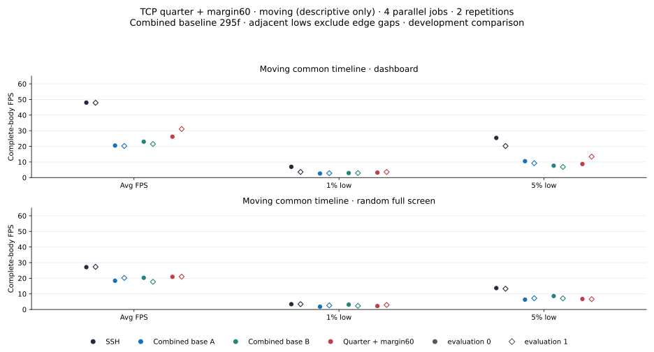

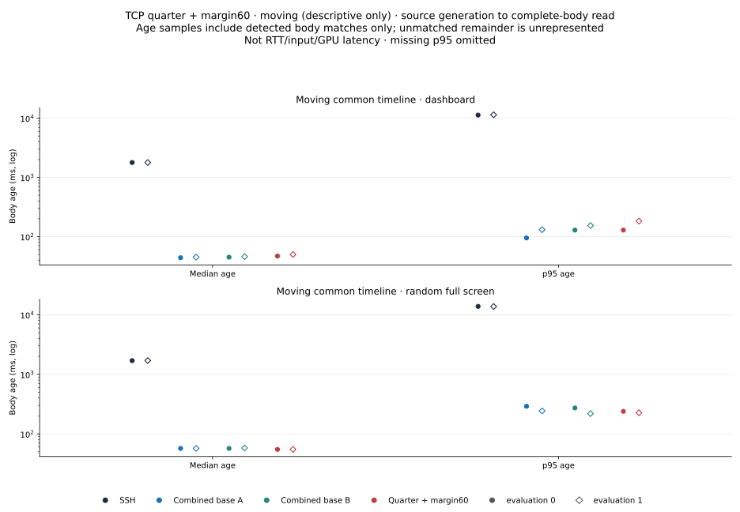

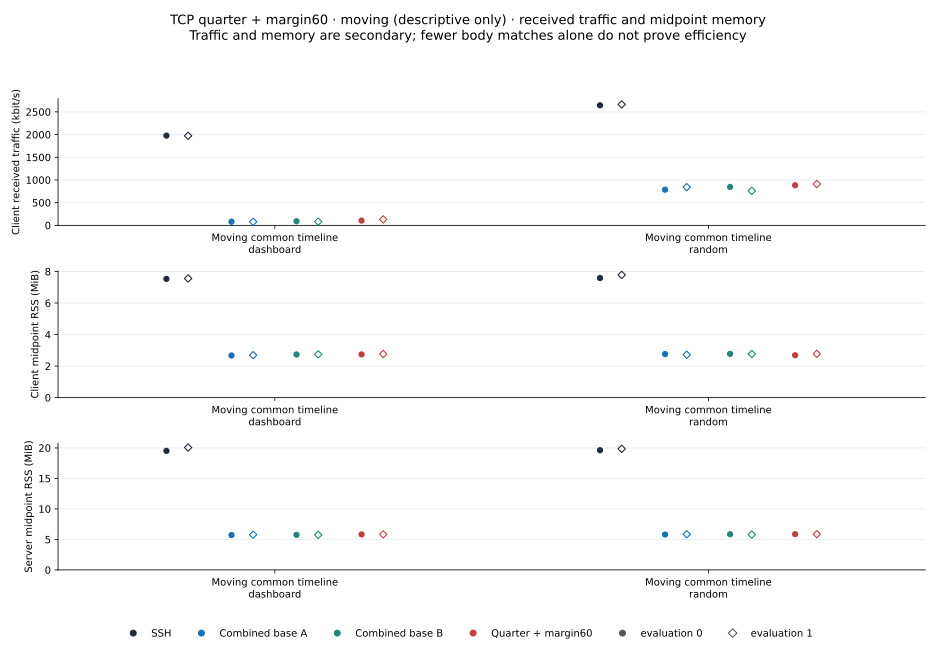

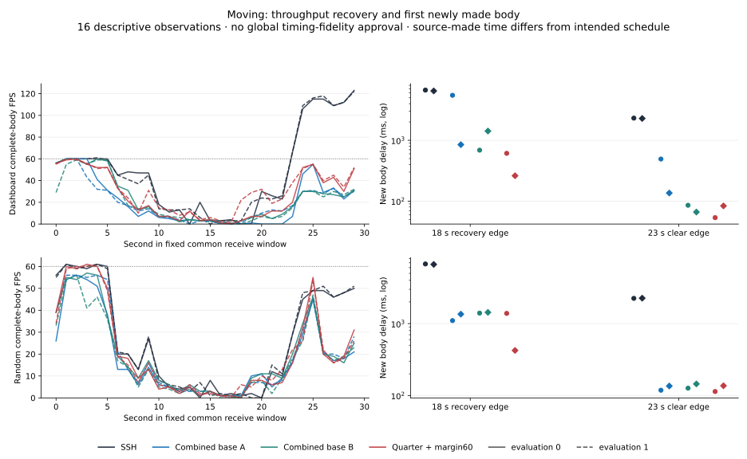

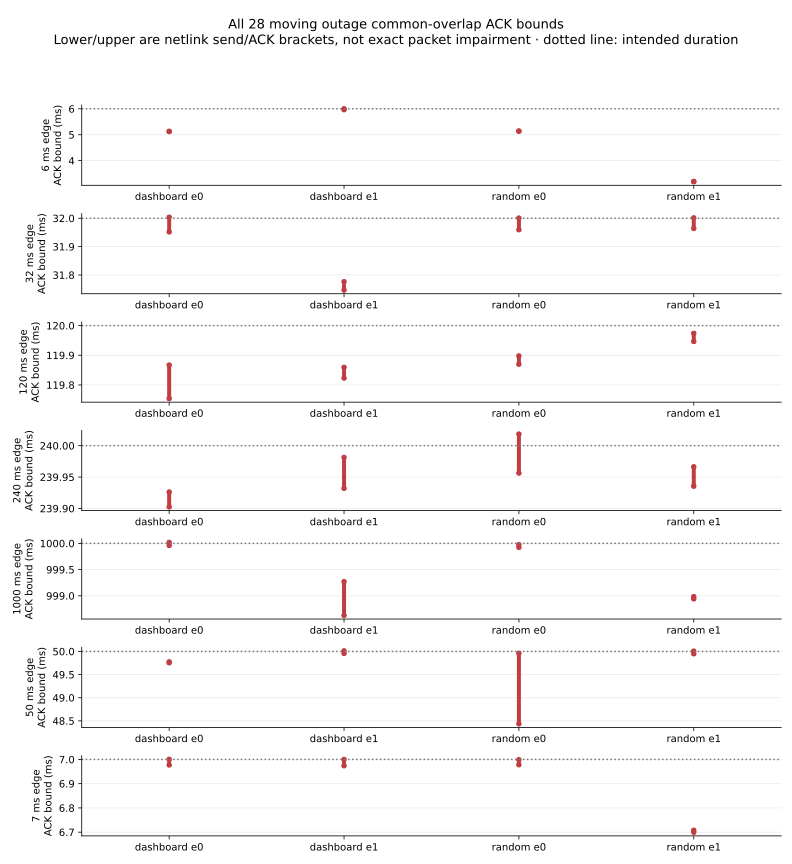

각 셀은 **1% low / 5% low / avg FPS**다.

|Case|SSH|combined-A|combined-B|결합 60|
|---|---|---|---|---|
|00-moving-compress-i0|6.9 / 25.4 / 48.0|2.6 / 10.5 / 20.5|2.9 / 7.6 / 23.0|3.2 / 8.7 / 26.2|
|01-moving-compress-i1|3.6 / 20.2 / 47.9|2.8 / 9.2 / 20.2|2.9 / 6.8 / 21.5|3.6 / 13.4 / 31.1|
|02-moving-bandwidth-i0|3.4 / 13.7 / 27.1|1.8 / 6.3 / 18.4|3.1 / 8.6 / 20.3|2.2 / 6.7 / 20.9|
|03-moving-bandwidth-i1|3.4 / 13.3 / 27.3|2.6 / 7.2 / 20.2|2.3 / 7.1 / 17.7|2.9 / 6.6 / 21.0|

Final23–30초 dashboard 후보 avg41.3/45.0과 low는 A/A보다 높지만 random의 해당구간 1% low3.9/7.1은 A/A보다 낮다. SSH dashboard106.6/107.4FPS는 stale catch-up을 포함하므로 steady fresh60과 같지 않다. Source가 실제 23초 후 만든 dashboard 첫 body delay는 후보 53.5/83.4ms 대 A491.9/135.8·B85.5/66.1ms로 혼합이다. Source-made freshness는 intended generation schedule/GPU/화면체류 지연과 구분한다.

All28 outage ACK bounds/524skews를 보존했다.6ms 공통 overlap은 가장 짧은 case에서 3.188–3.197ms였다. Coverage valid는 global fidelity/정확한 packet 손실 동등성 승인이 아니다. **performance_eligible=False/timing_fidelity_accepted=False/final_selection=None**을 유지한다. [원본 native 기록/derived](data/quarter-margin-moving-20261101/moving-derived.json), [전체 CSV](data/quarter-margin-moving-20261101/core-metrics.csv), [독립 감사](data/quarter-margin-moving-20261101/saved-data-audit.md).

## Parity64 ·별도 사전 고정 8개

기존 61은 A/C가 항상 odd, B/SSH가 even이어서 role과 parity가 분리되지 않았다. 기존 9cohorts의 92 A/A행은 일관된 odd열세를 지지하지 않았지만 설계 교란은 있었다.64는 첫 [SSH,A,B,C], 둘째 [C,B,A,SSH]로 C/SSH0↔3와 A/B1↔2를 교대했다. 실제 source/plan/deployment와 32endpointfile·16live server·16strict network 증거가 이 배치에 맞았다. P-core pinning/안정적 parity 인과를 입증한 것은 아니다.

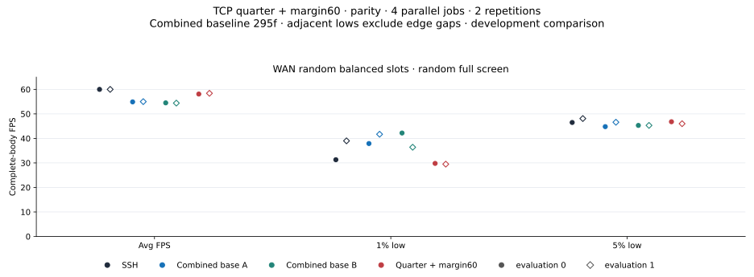

각 셀은 **1% low / 5% low / avg FPS**다.

|Case|SSH|combined-A|combined-B|결합 60|
|---|---|---|---|---|
|00-wan-bandwidth-i0|31.3 / 46.5 / 60.0|37.9 / 44.8 / 54.9|42.2 / 45.3 / 54.5|29.8 / 46.8 / 58.1|
|01-wan-bandwidth-i1|39.0 / 48.1 / 60.0|41.7 / 46.6 / 55.0|36.4 / 45.3 / 54.4|29.5 / 46.0 / 58.4|

C의 1% low는 odd3에서 29.8,even0에서 29.5로 양반복 모든 A/A보다 낮다.61 비용을 odd parity만으로 면책하지 않는다. C avg58.1/58.4>A/A54.4–55.0, age9564/67ms<71ms지만 5% low는 혼합이다. C RX2270/2280kbit/s>A/A2125–2141이며 CPU/RSS 원값은 [별도 CSV](data/quarter-margin-parity-20261101/core-metrics.csv)에 있다. 이 진단은 61과 pool/덮어쓰기/승자선택 재시도를 하지 않았다. [Matched-pair 감사](data/quarter-margin-parity-20261101/saved-data-audit.md).

## 지표와 한계

Avg는 고정 수신 창의 완료 body 수/초다. Low는 인접 complete-body gap의 99th/95th nearest-rank 역수이며 gap10개 미만은 NULL이다. Window 양쪽 boundary gap은 maxgap/empty tail에 따로 포함하고 low에서 빠지는 사실을 숨기지 않는다. Age는 완료 body의 source header ms시각→read 차이이며 p95는 20frames 미만 NULL이다. RTT/input/GPU latency나 불완전 상태 전체의 age가 아니다. Log age축과 slow random의독립 y scale을 표시했고 모든 반복을 별도 marker로 그렸다.

Network는 client non-loopback RX의 decimal kbit/s이며 양방향합이 아니다. RSS는 process-name sums의중간시점 KiB로 plot에서는 MiB(/1024)이며 peak/session total이 아니다. CPU는 transport process/thread의 one-core%이고 source/observer Python은 제외한다. 낮은 traffic/RSS만으로 FPS 손해를 이득이라고 치환하지 않는다.

Old19의 동일 quarter predicate는 다른 parent6729에서 300ms random24.5avg/4.0·12.0low 대 main49.7/14.0·45.2였다. Margin51/53의 1% low 비용과 55/57 dashboard low/age 비용, 현재 61/62/63/64 손해를 모두 유지한다. Source/측정방법 차이가 그 과거 실패를 지우거나 해결했음을 뜻하지 않는다. 새 결과는 평균/low의 유익한 방향을 보이지만 전 영역 SSH parity나 회귀 부재를 결론내리지 않는다. [보존된 old19 proof](data/quarter-margin-core-20261101/55-tcp-fresh-quarter-proof.json).

각 archive에서 `python3 verify-metrics.py`로 complete-frame 산술/CSV/NULL/소스/PID/fence·test log hashes, moving bounds와 별도 64 slot order를 검증할 수 있다. Full raw oracle/GPU 재검증은 제공하지 않는다. Export는 로컬 원자료와 notes를 요구하며 compact arithmetic verifier와 구분된다. 각 `manifest.json`은 curated 파일과 연결 그림의 SHA를 고정한다.
