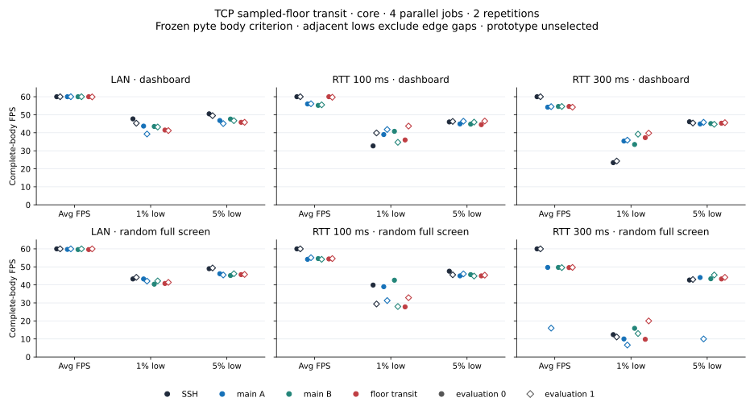
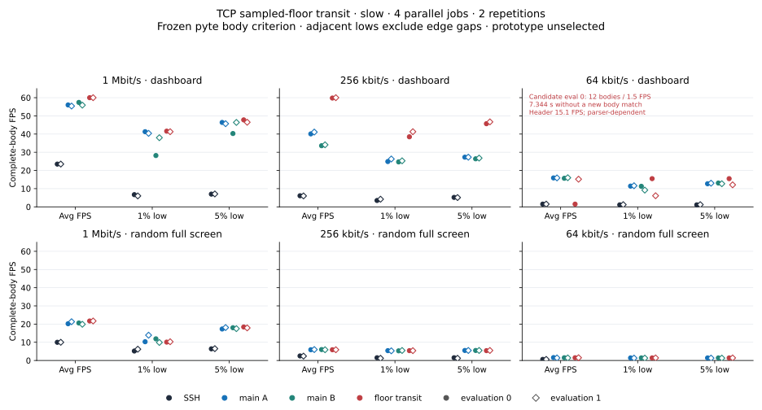
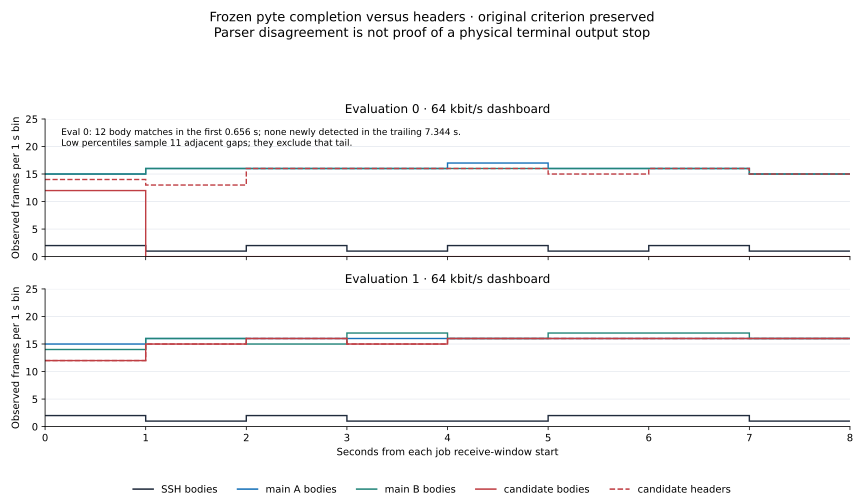
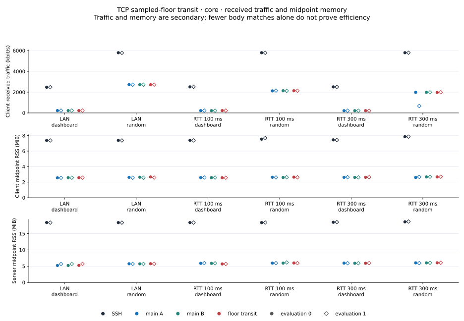
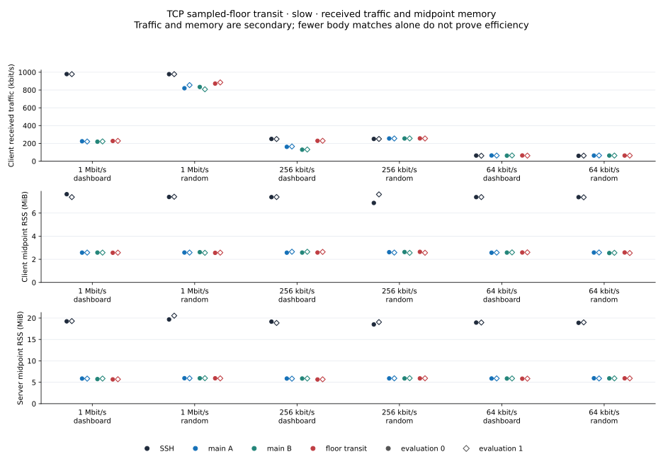
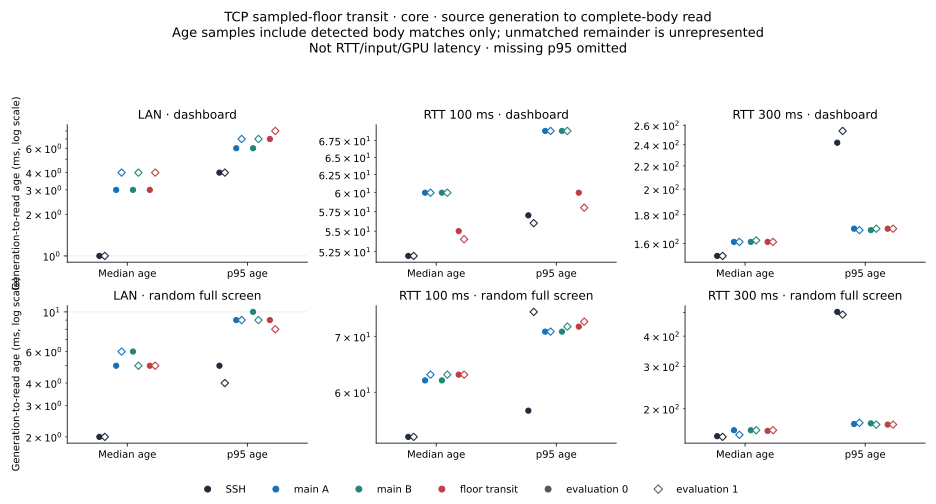
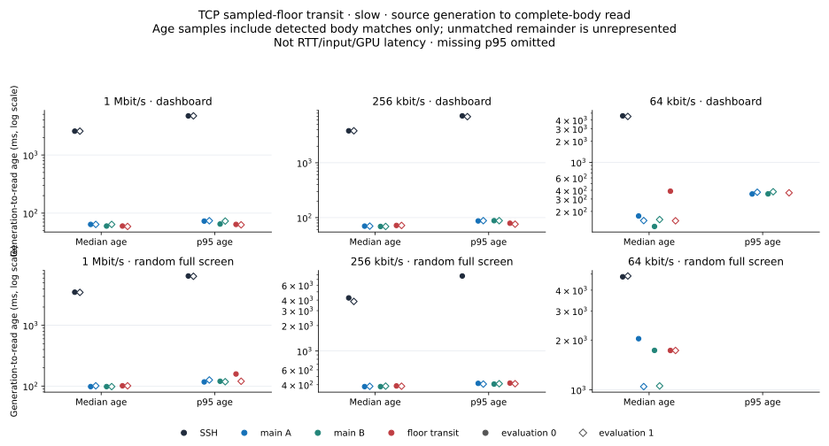

# Sampled-floor transit allowance investigation · November 1, 2026

This candidate restricts the earlier TCP transit allowance to a sampled
RTT floor of at least 20 ms. Its adaptive policy is currently unselected for
product integration. The primary assessment uses **1% low, 5% low and average FPS**;
CPU/RSS are secondary, with freshness, network use and recovery costs kept
visible. Individual losses can be acceptable with overall improvement.
There is no invented numeric weighting or single-metric automatic rejection.

## Source and scope

The earlier transit candidate subtracts a measured bandwidth-delay allowance
from logical output backlog. This version returns no allowance until a
sampled floor is available and at least 20 ms. It retains the original 80%
capacity-probe condition and includes neither broad 60% exploration nor the
near-floor 60% predicate. UDP's modeled allowance and client production are
unchanged. A sampled floor is application feedback, not a measurement of
physical network propagation; a delayed local path can pass this gate.
Returning no allowance reproduces the original backlog calculation for the
same state, without proving that complete future trajectories are identical.

The [paired artifacts](data/transit-floor-core-20261101/transit-floor-release-pair.json)
are main SHA `9ab79c22…ecb463` / source `6729d398d4f1`
and candidate SHA `d45fc85f…f41a7a` / source `239a8181363a`. Seven targeted
tests and the full library check pass (103 passed, two ignored). The earlier
transit control with identical fixtures has four passes and three expected
failures, distinguishing the new floor gate. This verifies conditions in the
fixtures, not performance benefit or universal safety. Source patches,
manifests, paired-build records and original logs accompany the [core archive](data/transit-floor-core-20261101/README.md)
and [slow archive](data/transit-floor-slow-20261101/README.md).
The [floor-gate patch](data/transit-floor-core-20261101/tcp-transit-floor.patch)
is relative to the included [parent transit patch](data/transit-floor-core-20261101/tcp-transit.patch).

## Method and interpretation

Core study 33 and slow study 34 each retain **48 jobs /12 blocks**, four
simultaneous roles SSH/main-A/main-B/candidate and two evaluations per
network/scene/role. Main-A/B are byte-identical. Slots `[SSH,A,B,candidate]`
cross to `[B,candidate,SSH,A]` in evaluation 1. Alias, path, port 2222 and
configuration are equal across rsh roles. Core uses the legacy completed-write
source ledger; slow uses RAM pre-write records and pidfd/`SIGUSR2` collection.
The two pipelines and the two evaluations are not pooled.

CPU admission requires one sampled user+system interval below 30%; runtime
CPU/process load is context. Identity, source, clock, metadata and closure
failures still reject. Four parallel workers do not prove P-core affinity or
isolation. Saved body statistics and resource units are verified separately:
derived resource values can be compared through batch→summary→CSV, but the
underlying counter endpoints were not retained for independent arithmetic
remeasurement.

Core receive windows are 03:02:02.671–03:05:40.014 KST and slow
03:08:52.161–03:18:54.440 KST, on November 1. Startup CPU admissions are
27%/25%, phase admissions 18–26%/13–29%, and runtime maxima 46%/50%.
The study directory retains its October 31 start date.

Core retains 21,601 frozen-oracle complete bodies from 23,040 source records.
Slow retains 7,616 from 19,774, including eight pending writes with null ends
and zero pending-body joins. These are saved observations, not a selection
decision. Schema 1 core pending attempts are unknown rather than assumed zero.
Immutable build/preparation records may say performance was unrun at their
creation stage; later run evidence must be read separately.

## Core: LAN and RTT 100/300

Cells are **average / 1% low / 5% low FPS** under the frozen body criterion.
Dashboard is `compress`; random is incompressible `bandwidth`. Evaluations remain separate.

| Network /scene /evaluation | SSH | Main A | Main B | Floor transit |
|---|---:|---:|---:|---:|
| LAN / dashboard / 0 | 60.0 / 47.7 / 50.5 | 60.0 / 43.7 / 46.8 | 60.0 / 43.5 / 47.6 | 60.0 / 41.5 / 45.8 |
| LAN / dashboard / 1 | 60.0 / 45.3 / 49.5 | 60.0 / 39.3 / 45.1 | 60.0 / 43.2 / 46.7 | 59.9 / 41.2 / 45.8 |
| LAN / random / 0 | 60.0 / 43.3 / 49.0 | 59.7 / 43.3 / 46.2 | 59.6 / 40.4 / 45.2 | 59.6 / 40.8 / 45.7 |
| LAN / random / 1 | 60.0 / 44.2 / 49.4 | 60.0 / 42.1 / 45.5 | 60.0 / 42.2 / 46.2 | 60.0 / 41.4 / 45.8 |
| RTT 100 / dashboard / 0 | 60.0 / 32.7 / 46.0 | 56.0 / 39.0 / 44.9 | 55.2 / 40.8 / 44.8 | 60.0 / 36.0 / 44.5 |
| RTT 100 / dashboard / 1 | 60.0 / 39.9 / 46.3 | 56.1 / 41.8 / 46.4 | 55.5 / 34.7 / 45.9 | 59.7 / 43.7 / 46.5 |
| RTT 100 / random / 0 | 60.0 / 39.9 / 47.6 | 54.2 / 39.0 / 45.0 | 54.6 / 42.6 / 45.7 | 54.4 / 27.8 / 45.0 |
| RTT 100 / random / 1 | 60.0 / 29.4 / 45.6 | 55.1 / 31.3 / 46.1 | 54.2 / 28.0 / 44.9 | 54.6 / 32.9 / 45.4 |
| RTT 300 / dashboard / 0 | 60.0 / 23.4 / 46.1 | 54.2 / 35.4 / 44.9 | 54.6 / 33.5 / 45.1 | 54.6 / 37.3 / 45.3 |
| RTT 300 / dashboard / 1 | 60.0 / 24.3 / 45.4 | 54.5 / 35.9 / 45.8 | 54.6 / 39.2 / 44.7 | 54.2 / 39.8 / 45.6 |
| RTT 300 / random / 0 | 60.0 / 12.4 / 42.7 | 49.7 / 10.0 / 44.1 | 49.7 / 15.9 / 43.4 | 49.6 / 9.8 / 43.3 |
| RTT 300 / random / 1 | 60.0 / 11.1 / 43.0 | 16.0 / 6.6 / 10.0 | 49.6 / 13.0 / 45.5 | 49.7 / 20.0 / 44.2 |

RTT 100 dashboard candidate averages 60.0/59.7 FPS against main 55.2–56.1,
with mixed lows. RTT 100 random evaluation 0 retains a 1% low 27.8 versus
main 39.0/42.6. RTT 300 random remains 49.6/49.7 average versus SSH 60;
its lows are mixed. In evaluation 1, byte-identical main-A falls to 16.0
while main-B is 49.6. That A/A divergence is retained and does not identify
a policy or compiler cause, nor supply an automatic tolerance.

## Slow: 1 Mbit/s, 256 kbit/s and 64 kbit/s

Cells are **average / 1% low / 5% low FPS** under the frozen body criterion.
Dashboard is `compress`; random is incompressible `bandwidth`. Evaluations remain separate.

| Network /scene /evaluation | SSH | Main A | Main B | Floor transit |
|---|---:|---:|---:|---:|
| 1 Mbit/s / dashboard / 0 | 23.5 / 6.7 / 7.0 | 56.0 / 41.3 / 46.4 | 57.4 / 28.2 / 40.3 | 60.0 / 41.6 / 47.8 |
| 1 Mbit/s / dashboard / 1 | 23.5 / 6.0 / 7.1 | 55.4 / 40.4 / 45.7 | 55.9 / 38.0 / 46.4 | 60.0 / 41.3 / 46.5 |
| 1 Mbit/s / random / 0 | 10.0 / 5.2 / 6.4 | 20.2 / 10.3 / 17.3 | 20.6 / 11.9 / 18.0 | 21.7 / 10.1 / 18.4 |
| 1 Mbit/s / random / 1 | 10.0 / 6.2 / 6.5 | 21.3 / 13.9 / 18.1 | 19.9 / 9.9 / 17.5 | 21.7 / 10.3 / 17.9 |
| 256 kbit/s / dashboard / 0 | 6.1 / 3.5 / 5.2 | 40.1 / 24.9 / 27.3 | 33.6 / 24.7 / 26.4 | 59.8 / 38.5 / 45.7 |
| 256 kbit/s / dashboard / 1 | 6.0 / 4.2 / 5.1 | 41.1 / 26.3 / 27.3 | 34.1 / 25.3 / 26.8 | 60.0 / 41.3 / 46.7 |
| 256 kbit/s / random / 0 | 2.5 / 1.5 / 1.5 | 5.9 / 5.4 / 5.5 | 6.0 / 5.3 / 5.5 | 5.9 / 5.4 / 5.4 |
| 256 kbit/s / random / 1 | 2.4 / 1.2 / 1.2 | 6.0 / 5.3 / 5.5 | 5.9 / 5.5 / 5.5 | 5.9 / 5.4 / 5.5 |
| 64 kbit/s / dashboard / 0 | 1.5 / 1.1 / 1.1 | 15.9 / 11.4 / 12.7 | 15.7 / 11.3 / 13.1 | 1.5 / 15.5 / 15.5 † |
| 64 kbit/s / dashboard / 1 | 1.5 / 1.2 / 1.2 | 15.9 / 11.6 / 13.0 | 16.0 / 9.2 / 12.7 | 15.2 / 6.1 / 12.1 |
| 64 kbit/s / random / 0 | 0.6 / — / — | 1.6 / 1.4 / 1.4 | 1.5 / 1.4 / 1.4 | 1.5 / 1.4 / 1.4 |
| 64 kbit/s / random / 1 | 0.6 / — / — | 1.4 / 1.3 / 1.3 | 1.4 / 1.3 / 1.3 | 1.5 / 1.4 / 1.4 |

**†12 body matches and a 7.344-second right-censored no-new-body tail; 121 headers continue.**
The 15.5/15.5 lows sample 11 internal gaps and omit this tail. See the parser
qualification and completion timeline below; these lows alone are not an improvement verdict.

The candidate reaches 60 FPS in both 1 Mbit/s dashboard evaluations and 59.8/60.0
at 256 kbit/s, with higher lows than the simultaneous mains in those dashboard
contexts. 1 Mbit/s random remains mixed: 21.7 FPS in both, but 1% low 10.1/10.3
does not beat every main. These are per-evaluation tradeoffs, without
pooling or declaring overall SSH parity.

## A retained parser-dependent result

Study 34's 64 kbit/s dashboard evaluation 0 candidate slot 3 has **12 complete
bodies /1.5 FPS under the frozen pyte 0.8 oracle**, while matching visible
headers continue at 121 /15.1 FPS. The first 12 complete bodies are n 0–11,
ending at window+0.656425 s; the remaining 7.344284 s has no newly detected
complete body. The edge-inclusive maximum gap is 7344 ms.
This tail is right-censored at the receive-window end: it does not measure
the time to a subsequent completed body.

Its 1%/5% lows of 15.5/15.5 are computed from only 11 adjacent complete-frame
gaps. They exclude that long trailing interval and cannot alone describe
whole-window delivery. Body per-second counts are `[12,0,0,0,0,0,0,0]`.
The saved time-weighted incomplete state 90.0708% uses a different definition
from the 91.7954% interval without a new complete body; these are not pooled
or substituted. Body age p 95 remains missing with 12 samples.

Offline replay reproduces the original result. The first mixed-row state
is followed by later states whose 29 body-row tags agree but retain three
`[0m` characters where the source has spaces. Whole, split and bytewise pyte
controls reproduce the residue when a new ESC follows an unfinished CSI.
Native tmux 3.7c controls instead leave those cells blank and detect the
literal-negative control. This demonstrates an implementation difference,
not a 7.344 s physical output stop, a universal terminal theorem or GPU
presentation. The original criterion remains immutable; no columns are
masked or original metric rewritten. The isolated CAN compatibility follow-up
is separate and must not be mixed into these measurements.

The same evaluation's main-A/B have 127/126 complete bodies, 15.9/15.7 FPS
and 134/143 ms maximum gaps. In evaluation 1 the candidate moves to slot 1
and retains 122 bodies, 15.2 FPS, 6.1/12.1 lows and 207 ms maximum gap. Both
evaluations, their parser qualification and the body/header distinction are
required for any later assessment.

## Resources and body age

All 96 per-evaluation network/CPU/client-and-server RSS values are retained
in the [core CSV](data/transit-floor-core-20261101/core-metrics.csv) and
[slow CSV](data/transit-floor-slow-20261101/core-metrics.csv). Received traffic
is decimal kbit/s; CSV RSS is KiB, plots divide by 1024 for MiB. CPU is each
process's share of one core, and RSS is the midpoint sample. These are saved
derived measurements, not independently reconstructed raw counter endpoints.

At 256 kbit/s dashboard, higher candidate FPS also uses more received traffic:
229 kbit/s versus main 129–165. Candidate client CPU is 1.35%/1.21%, versus
main 0.77–1.04%; server CPU is 1.90%/1.76%, versus main 2.74–3.59%. Candidate
p 95 body age is 79/76 ms versus main 87–88 ms, while median 72 ms is above
main 69–70 ms. These dimensions stay separate rather than becoming a score.

Age is source-generation-to-detected-complete-body-read, **not RTT, input or
GPU latency**. It includes only detected bodies: the 12-body case's unmatched
remainder has no age observation, and its p 95 stays missing. Slow SSH 64k
random has only five bodies per evaluation, so four low values remain null;
there are 12 missing p 95-age values across the slow screen. No point is
invented for these values. Core has no missing lows or p 95 ages.

## Separate CAN interoperability follow-up

The [saved control archive](data/diff-cancel-interop-20261101/README.md)
contains the CAN-only patch and paired Rust build, actual compiled fixture
HEX, frozen-pyte results and native tmux minimal controls. Candidate/control
snapshots are identical; the generated delta and client-filtered delta
differ only by the initial CAN. Rust fixtures check old/new output using the
unchanged Rust Terminal model; the new prefix contract distinguishes the
candidate. Separate external pyte replay checks the compiled HEX. In pyte, all three
feed modes change from three differing characters to zero, with the same
cursor. Native tmux's separate minimal controls demonstrate its different
nested-ESC recovery behavior.
The focused compatibility fix is [PR 4](https://github.com/enif-lee/rsh/pull/4),
separate from the adaptive-research PR 3. Functional integration adds 4 CLI
and 25 session passes to 99 library passes (128 total, two library ignores).
Exact fixture, proof, fresh build metadata and logs are archived.

The compiled-fixture controls provide character/cursor evidence, **not a
replacement for study 34 or a performance improvement measurement**. Those
controls alone do not exercise the full receive/Paced path, inspect GPU presentation or prove every terminal's
recovery. Explicit cancellation can alter packet/compression boundaries by
adding a byte, so a small source edit is not a performance no-regression
proof. Any later CAN or far+CAN measurement belongs to its own dataset.

## Separate focused far+CAN capture

[Study 36's eight-record archive](data/diff-cancel-compatibility-20261101/README.md)
compares SSH, two identical **oldfar** references and far+CAN at 64 kbit/s dashboard,
four parallel jobs and two evaluations. Its internal main-A/B labels mean
oldfar, not actual main. Every role uses a new child SET/GET/assert-before-exec
PTY method. This removes the earlier parent-after-exec source-flow race,
but is not a retained native GET sidecar or proof of later remote geometry.
The new method differs from 34; absolute cross-study values are not pooled.

All eight input records are valid; **performance eligibility is false and
final selection is null**. They retain 774 body matches, 3,319 source records,
one pending null end and zero pending-body joins. Saved body/header counts
agree in all eight jobs, and all six rsh jobs have zero time-weighted
incomplete state. This is saved-oracle evidence, without a second independent
all-eight terminal replay or a GPU claim.

| Evaluation | Role | Avg / 1% low / 5% low FPS | Bodies / headers | Edge maxgap ms |
|---|---|---:|---:|---:|
| 0 | SSH | 1.5 / 1.3 / 1.3 | 12 / 12 | 773 |
| 0 | Oldfar A | 15.7 / 9.0 / 12.6 | 126 / 126 | 167 |
| 0 | Oldfar B | 15.6 / 6.7 / 12.4 | 125 / 125 | 151 |
| 0 | Far+CAN | 15.7 / 11.8 / 12.3 | 126 / 126 | 187 |
| 1 | SSH | 1.5 / 1.1 / 1.1 | 12 / 12 | 946 |
| 1 | Oldfar A | 15.9 / 8.7 / 13.1 | 127 / 127 | 186 |
| 1 | Oldfar B | 15.5 / 9.5 / 12.8 | 124 / 124 | 177 |
| 1 | Far+CAN | 15.2 / 6.0 / 12.2 | 122 / 122 | 203 |

Candidate whole captures contain 120/118 CAN-delta-prefix signatures versus
zero in oldfar references. These support exercising the new byte path, not
an in-window independent-event count. The known 34 nested-CSI pattern is
absent in **all eight**, including healthy oldfar controls. Thus this does
not reproduce the exact failure or establish causal 12→126 recovery.
Evaluation 1 candidate trails both oldfar references on all three FPS metrics;
evaluation 0 has mixed lows. Those costs stay visible without a single-metric
veto, invented weighting or conflating interoperability with global speed.

CPU startup admission is 21%, phases 28/24%, with runtime maxima 38/37% and
external-process maxima 141.7/132.7% retained as context. The compact CSV keeps
all received traffic, CPU, midpoint RSS, age, edge gap and trailing-gap values.
Resource verification has the same saved-derived-counter limitation.

## Reproduction and remaining scope

The compact archives retain 96 raw capture/source hashes per screen, all
48 completed-frame sequences, source-header joins, saved independent audits,
CPU admission/context, schedule, artifact/runtime identities and build records.
They allow saved-statistic recalculation and hash checks, not a fresh oracle
replay without the local full raw captures/source bodies. Immutable original
CSV/patch/log bytes are retained. SVG line whitespace is normalized after
export; the plotting source is included.

Run `python3 verify-metrics.py` inside each data archive for manifest and
metric checks; Matplotlib is required only to rerender `plot.py`. The separate
CAN archive has a standard-library `verify-controls.py` and explicitly local
native-script assumptions. No new benchmark is started by these verifiers.

This is development evidence. Loss, moving recovery, input, UDP, broader
compatibility and fresh public comparison remain separate requirements for
any adaptive-policy promotion. The CAN-only product compatibility fix and
far+CAN follow-ups are separate from the sampled-floor candidate's selection.
